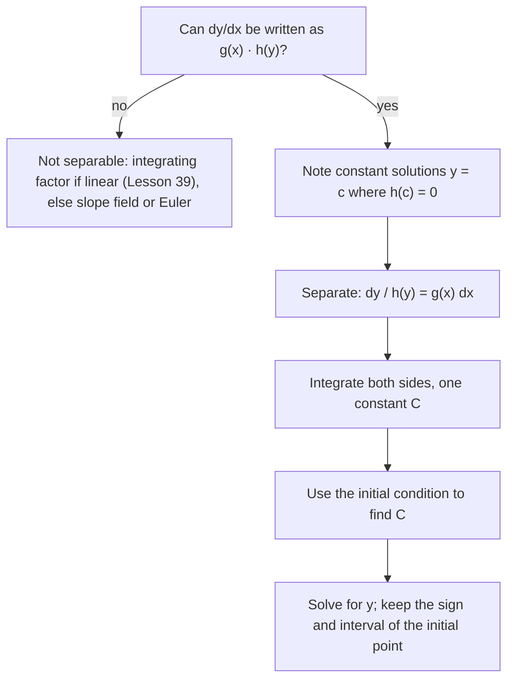

## Solving by separating variables

Lesson 37 approximated solutions. For one large class of equations we can find them exactly. A first-order equation is **separable** if the right side factors into a function of $x$ times a function of $y$:

$$\frac{dy}{dx} = g(x)\,h(y).$$

Then move all the $y$'s to one side and all the $x$'s to the other, and integrate both sides:

$$\int\frac{dy}{h(y)} = \int g(x)\,dx.$$

Why this is legitimate: if $y(x)$ is a solution, then $\frac{1}{h(y)}\frac{dy}{dx} = g(x)$. Integrating both sides with respect to $x$, the left side is $\int\frac{1}{h(y)}\frac{dy}{dx}dx = \int\frac{dy}{h(y)}$ by substitution. The "multiply by $dx$" shorthand is just that substitution.

### Steps

1. Separate: $\frac{dy}{h(y)} = g(x)\,dx$.
2. Integrate both sides; one constant $C$ is enough.
3. Use the initial condition to find $C$ (it's usually easiest right after integrating).
4. Solve for $y$ if possible, and check the domain.

One more thing to watch: dividing by $h(y)$ assumes $h(y) \ne 0$. If $h(c) = 0$, the constant function $y = c$ is also a solution (both sides of the equation are 0), and separating can lose it. The chart puts the whole procedure together.



### Example 1

Solve $\dfrac{dy}{dx} = \dfrac{x}{y}$, $y(0) = -3$.

1. Separate: $y\,dy = x\,dx$.
2. Integrate: $\dfrac{y^2}{2} = \dfrac{x^2}{2} + C$.
3. At $(0, -3)$: $\frac92 = C$. So $y^2 = x^2 + 9$.
4. Solve: $y = \pm\sqrt{x^2 + 9}$. The initial value is negative, so take $y = \mathbf{-\sqrt{x^2 + 9}}$.

### Example 2

Solve $\dfrac{dy}{dx} = 2xy^2$, $y(0) = 1$.

Separate: $y^{-2}dy = 2x\,dx$. Integrate: $-\dfrac1y = x^2 + C$. At $(0, 1)$: $-1 = C$. So $-\dfrac1y = x^2 - 1$, and
$$y = \frac{1}{1 - x^2}, \qquad -1 < x < 1.$$
The solution blows up at $x = \pm1$, so it only lives on the interval containing the initial point. Nothing in the equation $y' = 2xy^2$ warned of this; separable equations can surprise you.

## Exponential growth and decay

The simplest and most important separable equation says a quantity changes at a rate proportional to its size:

$$\frac{dy}{dt} = ky.$$

Separate: $\frac{dy}{y} = k\,dt$. Integrate: $\ln|y| = kt + C$. Exponentiate: $|y| = e^Ce^{kt}$, so $y = Ae^{kt}$. With $y(0) = y_0$:

$$y = y_0e^{kt}.$$

$k > 0$ is **exponential growth** (populations with unlimited resources, continuously compounded money); $k < 0$ is exponential decay (radioactivity, drug elimination).

- **Doubling time:** $e^{kT} = 2 \Rightarrow T = \frac{\ln 2}{k}$.
- **Half-life:** $e^{kT} = \frac12 \Rightarrow T = \frac{\ln 2}{|k|}$.

### Example 3

A culture of bacteria grows at a rate proportional to its size. It has 500 cells at $t = 0$ and 1500 at $t = 4$ hours. When will it reach 10,000?

$P = 500e^{kt}$. From $P(4) = 1500$: $e^{4k} = 3$, so $k = \frac{\ln3}{4} \approx 0.2747$ per hour. Solve $500e^{kt} = 10{,}000$: $e^{kt} = 20$, $t = \frac{\ln20}{k} = \frac{4\ln20}{\ln3} \approx \mathbf{10.91}$ hours.

### Example 4 (Newton's law of cooling)

Newton's law of cooling says $\frac{dT}{dt} = k(T - T_s)$, where $T_s$ is the surrounding temperature. Substituting $u = T - T_s$ gives $\frac{du}{dt} = ku$, so $T = T_s + (T_0 - T_s)e^{kt}$.

Coffee at 90°C sits in a 20°C room; after 10 minutes it's 60°C. Then $60 = 20 + 70e^{10k}$, so $e^{10k} = \frac47$ and $k = \frac{\ln(4/7)}{10} \approx -0.0560$. After 20 minutes: $T = 20 + 70\left(\frac47\right)^2 = 20 + 22.86 \approx 42.9$°C.

## Logistic growth

Real populations can't grow exponentially forever. The **logistic equation** builds in a **carrying capacity** $M$, the largest population the environment can sustain:

$$\frac{dP}{dt} = kP\left(1 - \frac PM\right).$$

When $P$ is small, $1 - \frac PM \approx 1$ and growth is nearly exponential. As $P$ approaches $M$, the factor $1 - \frac PM$ shrinks to 0 and growth stalls. Equilibria are $P = 0$ (unstable) and $P = M$ (stable).

Separating and using partial fractions (Lesson 33) gives the solution

$$P(t) = \frac{M}{1 + Ae^{-kt}}, \qquad A = \frac{M - P_0}{P_0}.$$

```plot
{"x": [0, 12], "y": [0, 1100], "functions": [{"f": "1000/(1 + 9e^(-0.6x))", "label": "P(t)"}, {"f": "1000", "dashed": true, "label": "M = 1000"}, {"f": "500", "dashed": true}], "points": [{"at": [3.662, 500], "label": "fastest growth at P = M/2"}], "xLabel": "t", "yLabel": "P", "caption": "Logistic growth from P₀ = 100 toward M = 1000 (k = 0.6)"}
```

The parts of the S-shaped curve have names worth knowing:


Facts AP exams test without the formula:

- $\lim_{t\to\infty}P(t) = M$ (for $P_0 > 0$).
- Growth is fastest when $P = \frac M2$: $\frac{dP}{dt} = kP - \frac{k}{M}P^2$ is a downward parabola in $P$ with vertex at $\frac M2$. That's the inflection point of the S-shaped curve.
- If $P_0 > M$, the population decreases toward $M$.

### Example 5

A lake is stocked with 100 fish. The population follows $\frac{dP}{dt} = 0.6P\left(1 - \frac{P}{1000}\right)$ ($t$ in years). Find $P(t)$, the population after 5 years, and when it grows fastest.

$M = 1000$, $k = 0.6$, $A = \frac{1000 - 100}{100} = 9$: $P(t) = \dfrac{1000}{1 + 9e^{-0.6t}}$.

$P(5) = \frac{1000}{1 + 9e^{-3}} \approx \frac{1000}{1.448} \approx 690.6$ fish.

Fastest growth at $P = 500$: $1 + 9e^{-0.6t} = 2 \Rightarrow t = \frac{\ln 9}{0.6} \approx 3.66$ years.

## Common mistakes

- *Separating a sum.* $\frac{dy}{dx} = x + y$ is not separable; you can't split $x + y$ into a product. (It is linear, though; the next lesson solves it with an integrating factor.)
- **Forgetting $+C$,** or adding it only after exponentiating (then it multiplies instead of adds; that's fine only if you track it).
- *Dropping the sign choice* when solving $y^2 = \dots$; the initial condition decides.
- **Using $T = T_0e^{kt}$ for cooling.** The exponential applies to the difference $T - T_s$.
- **Logistic: fastest growth at $t$ where $P = M$.** It's at $P = M/2$.

## Key points

- Separable: $\frac{dy}{dx} = g(x)h(y) \Rightarrow \int\frac{dy}{h(y)} = \int g(x)\,dx$.
- $\frac{dy}{dt} = ky \Rightarrow y = y_0e^{kt}$; doubling time or half-life $\frac{\ln2}{|k|}$.
- Cooling: $T = T_s + (T_0 - T_s)e^{kt}$.
- Logistic: $\frac{dP}{dt} = kP(1 - \frac PM)$, $P = \frac{M}{1 + Ae^{-kt}}$; limit $M$, fastest growth at $\frac M2$.
