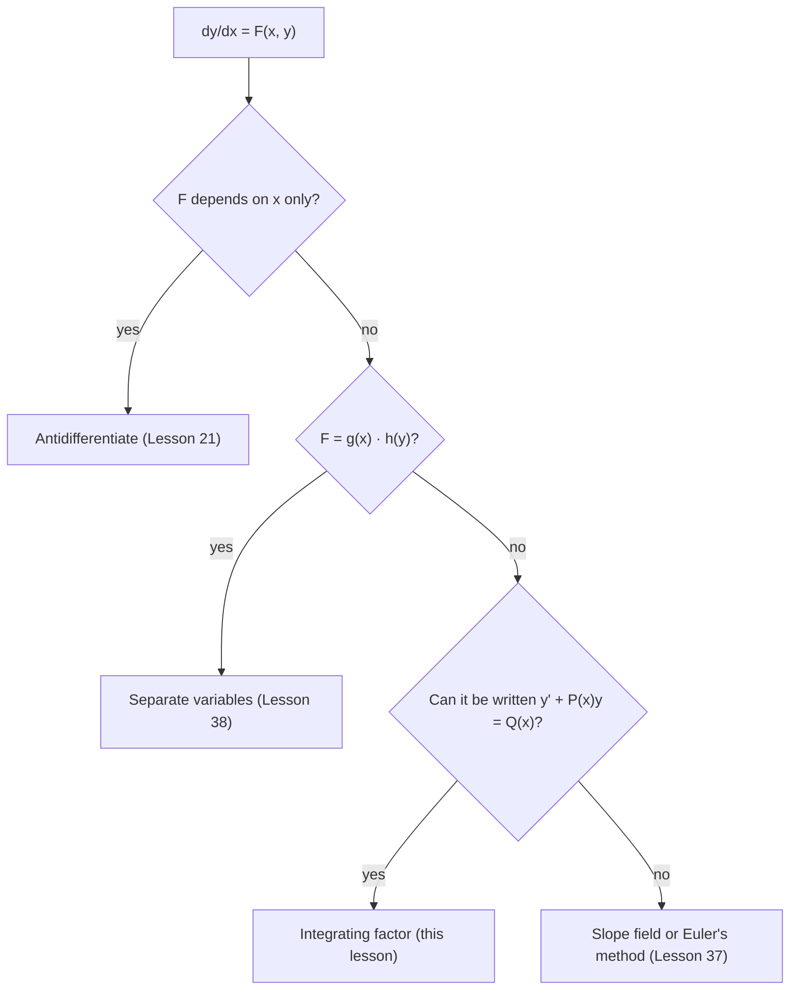

## An equation separation can't touch

Lesson 38 warned that $\frac{dy}{dx} = x + y$ is not separable: no algebra turns $x + y$ into a product $g(x)h(y)$. Yet equations like it are everywhere. Salt flowing into and out of a tank, current building up in a circuit, a drug infused into the bloodstream while the body clears it: each says *rate of change = input − (something) × current amount*. This lesson solves that whole family with one trick, the integrating factor. It is Calculus II material (not on the AP exam).

## Linear equations and standard form

A first-order **linear differential equation** is one that can be written in **standard form**

$$\frac{dy}{dx} + P(x)\,y = Q(x).$$

"Linear" means $y$ and $y'$ appear only to the first power, never multiplied together or inside another function. The coefficients $P$ and $Q$ can be any continuous functions of $x$. So $y' + y = x$ and $xy' + 2y = x^3$ are linear; $y' = y^2$ and $y' + \sin y = 0$ are not.

Before anything else, get the equation into standard form: the coefficient of $y'$ must be 1. For $xy' + 2y = x^3$, divide by $x$: $y' + \frac2xy = x^2$, so $P(x) = \frac2x$ and $Q(x) = x^2$. Watch the sign too: $y' = 3y + 1$ becomes $y' - 3y = 1$, so $P = -3$.

## The integrating factor

The left side $y' + Py$ *almost* looks like the result of the product rule. Multiply the whole equation by a function $\mu(x)$, still to be chosen:

$$\mu y' + \mu P y = \mu Q.$$

The product rule says $(\mu y)' = \mu y' + \mu' y$. The left side above matches this exactly if $\mu' = \mu P$. That is a separable equation for $\mu$, with solution

$$\mu(x) = e^{\int P(x)\,dx}.$$

This $\mu$ is the **integrating factor**. (Any antiderivative of $P$ works; leave out the $+C$, since it would only multiply $\mu$ by a constant.) With it, the equation collapses to

$$\big(\mu y\big)' = \mu Q \quad\Longrightarrow\quad \mu y = \int\mu Q\,dx + C \quad\Longrightarrow\quad y = \frac{1}{\mu}\left(\int\mu Q\,dx + C\right).$$

### Steps

1. Put the equation in standard form and read off $P(x)$ and $Q(x)$.
2. Compute $\mu = e^{\int P\,dx}$.
3. Multiply through; the left side becomes $(\mu y)'$. (Checking this catches most errors.)
4. Integrate both sides, with $+C$ on the right.
5. Divide by $\mu$ (dividing the $C$ too), then use the initial condition.

### Example 1

Solve $\dfrac{dy}{dx} + y = x$, $y(0) = 2$.

$P = 1$, so $\mu = e^{\int1\,dx} = e^x$. Multiply: $e^xy' + e^xy = xe^x$, and the left side is $(e^xy)'$. Integrate, using integration by parts (Lesson 31) on the right:

$$e^xy = \int xe^x\,dx = (x - 1)e^x + C.$$

Divide by $e^x$: $y = x - 1 + Ce^{-x}$. At $x = 0$: $2 = -1 + C$, so $C = 3$ and $y = \mathbf{x - 1 + 3e^{-x}}$.

Check: $y' = 1 - 3e^{-x}$, and $y' + y = 1 - 3e^{-x} + x - 1 + 3e^{-x} = x$. ✓

### Example 2

Solve $xy' + 2y = x^3$ for $x > 0$, with $y(1) = 1$.

Standard form: $y' + \frac2xy = x^2$. Then $\int\frac2x\,dx = 2\ln x$, so $\mu = e^{2\ln x} = x^2$. Multiply: $x^2y' + 2xy = x^4$, which is $(x^2y)' = x^4$. Integrate: $x^2y = \frac{x^5}{5} + C$, so

$$y = \frac{x^3}{5} + \frac{C}{x^2}.$$

At $x = 1$: $1 = \frac15 + C$, so $C = \frac45$ and $y = \mathbf{\dfrac{x^3}{5} + \dfrac{4}{5x^2}}$.

## Constant coefficients: approach to a steady state

Many models have constant $P = k > 0$ and constant $Q = b$: $y' + ky = b$. Then $\mu = e^{kt}$, $(e^{kt}y)' = be^{kt}$, $e^{kt}y = \frac bke^{kt} + C$, and with $y(0) = y_0$:

$$y = \frac bk + \left(y_0 - \frac bk\right)e^{-kt}.$$

The constant $\frac bk$ is the **steady-state solution**: the equilibrium where $y' = 0$. The second term is the **transient**, which decays to 0 whatever $y_0$ is. Newton's law of cooling from Lesson 38 is exactly this shape. The quantity $\frac1k$ is the **time constant**: after one time constant the transient has shrunk to $e^{-1} \approx 37\%$ of its starting size.

## Mixing problems

In a **mixing problem**, a solution flows into a tank and the well-stirred mixture flows out. If $Q(t)$ is the amount of dissolved substance and $V(t)$ the volume,

$$\frac{dQ}{dt} = \underbrace{(\text{concentration in})(\text{flow in})}_{\text{rate in}} - \underbrace{\frac{Q}{V}(\text{flow out})}_{\text{rate out}}.$$

The outflow carries the tank's *current* concentration $\frac QV$, which is what makes the equation linear in $Q$.


### Example 3

A 200-liter tank starts with pure water. Brine with 0.5 kg of salt per liter flows in at 4 L/min, and the mixture drains at 4 L/min. How much salt is in the tank after 30 minutes, and in the long run?

Volume stays 200 L. Rate in $= 0.5(4) = 2$ kg/min; rate out $= \frac{Q}{200}(4) = \frac{Q}{50}$ kg/min. So $Q' + \frac{1}{50}Q = 2$, $Q(0) = 0$. With $k = \frac1{50}$ and $b = 2$, the steady state is $\frac bk = 100$ kg and

$$Q(t) = 100 - 100e^{-t/50}.$$

At $t = 30$: $Q = 100(1 - e^{-0.6}) \approx \mathbf{45.1}$ kg. As $t\to\infty$, $Q \to \mathbf{100}$ kg, which is 200 L at the incoming 0.5 kg/L, as it should be.

### Example 4 (changing volume)

A tank holds 100 L of water with 5 kg of salt. Brine with 0.2 kg/L flows in at 3 L/min; the mixture drains at 2 L/min. Find $Q(t)$.

The volume grows: $V = 100 + t$. So $Q' = 0.6 - \frac{2Q}{100 + t}$, or $Q' + \frac{2}{100 + t}Q = 0.6$. This is not separable, but it is linear. $\mu = e^{2\ln(100 + t)} = (100 + t)^2$, so

$$\big((100 + t)^2Q\big)' = 0.6(100 + t)^2 \;\Rightarrow\; (100 + t)^2Q = 0.2(100 + t)^3 + C.$$

At $t = 0$: $10{,}000(5) = 0.2(10^6) + C$, so $C = -150{,}000$ and $Q(t) = 0.2(100 + t) - \dfrac{150{,}000}{(100 + t)^2}$. After 50 minutes: $Q = 30 - \frac{150{,}000}{22{,}500} \approx \mathbf{23.3}$ kg.

## Circuits

In an **RL circuit** (a resistor $R$ in ohms and an inductor $L$ in henries, driven by a voltage $E$), the current $I(t)$ satisfies

$$L\frac{dI}{dt} + RI = E(t), \qquad\text{standard form: } \frac{dI}{dt} + \frac RLI = \frac{E(t)}{L}.$$

For a constant battery voltage, this is the constant-coefficient case with $k = \frac RL$: the current rises toward the steady state $\frac ER$ (Ohm's law) with time constant $\frac LR$. A resistor and capacitor in series give the same shape for the charge $q$: $R\,q' + \frac1Cq = E$.

### Example 5

A circuit has $R = 12\ \Omega$, $L = 4$ H and a 60-volt battery switched on at $t = 0$, so $I(0) = 0$. Find $I(t)$ and the current after 1 second.

Standard form: $I' + 3I = 15$. Steady state $\frac{15}{3} = 5$ A (which is $\frac{60}{12}$), so $I(t) = \mathbf{5 - 5e^{-3t}}$. At $t = 1$: $5(1 - e^{-3}) \approx \mathbf{4.75}$ A. The time constant is $\frac LR = \frac13$ s.

```plot
{"x": [0, 2], "y": [0, 6], "functions": [{"f": "5 - 5e^(-3x)"}, {"f": "5", "dashed": true}], "labels": [{"at": [1.2, 5.4], "text": "steady state 5 A"}, {"at": [1.2, 4.4], "text": "I(t)"}], "points": [{"at": [0.3333, 3.1606], "label": "one time constant: 63% of the way"}], "xLabel": "t (s)", "yLabel": "I (A)", "caption": "Current in the RL circuit of Example 5 rising toward E/R = 5 A"}
```

## Choosing a method

This module has now given three exact methods and one approximate one. Faced with a first-order equation $\frac{dy}{dx} = F(x, y)$, ask the questions in this order. Some equations, like $y' + ky = b$, are both separable and linear; then either method works.



## Common mistakes

- *Skipping standard form.* For $xy' + 2y = x^3$, $P$ is $\frac2x$, not 2. Divide by the coefficient of $y'$ first.
- *Losing the sign of $P$.* $y' - 3y = 1$ has $P = -3$ and $\mu = e^{-3x}$.
- *Not multiplying $Q$ by $\mu$.* Every term gets multiplied, including the right side.
- *Adding $C$ after dividing by $\mu$.* $y = \frac1\mu\int\mu Q\,dx + C$ is wrong; the constant must be divided by $\mu$ too.
- *Using a constant volume when the flows differ.* If inflow and outflow rates differ, $V$ changes with $t$.

## Key points

- Standard form $y' + P(x)y = Q(x)$; integrating factor $\mu = e^{\int P\,dx}$.
- Multiplying by $\mu$ makes the left side $(\mu y)'$, so $y = \frac1\mu\left(\int\mu Q\,dx + C\right)$.
- $y' + ky = b$: $y = \frac bk + (y_0 - \frac bk)e^{-kt}$, a steady state plus a decaying transient with time constant $\frac1k$.
- Mixing: $Q' = (\text{rate in}) - \frac QV(\text{flow out})$. RL circuit: $LI' + RI = E$, steady current $\frac ER$.
