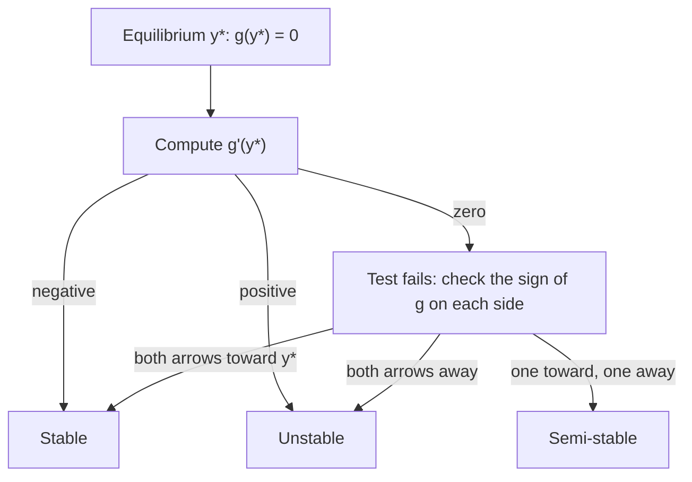

Lesson 37 read the long-run behavior of $\frac{dy}{dx} = y(4 - y)$ straight off its slope field: solutions between 0 and 4 rise toward 4. Lesson 38 found the same thing for the logistic equation by solving it with partial fractions. This honors lesson shows that for an autonomous equation $\frac{dy}{dt} = g(y)$ you rarely need either the picture or the formula. A one-dimensional sketch, the phase line, and one derivative tell you where every solution goes and how fast it gets there. Then we use the idea on a real question (how hard can you fish a lake before the fish disappear?), and finish with the theorem that makes all of this reasoning safe: when a solution exists and when it is the only one.

## The phase line

For $\frac{dy}{dt} = g(y)$ the slope depends only on the height $y$, so every row of the slope field carries the same information. Squash the whole field onto one vertical line, the $y$-axis, and record only the *direction* of motion:

1. Find the equilibria, the roots of $g(y) = 0$, and mark them as dots on a vertical line.
2. In each interval between them, pick a test value. If $g > 0$ there, draw an arrow pointing up (solutions increase); if $g < 0$, draw it pointing down.

That diagram is the **phase line**. An equilibrium with arrows pointing toward it on both sides is **stable**: solutions that start nearby approach it. One with arrows pointing away on both sides is **unstable**: nearby solutions leave. If the arrows point the same way on both sides (one toward, one away), the equilibrium is **semi-stable**: it attracts from one side and repels on the other. (Some books simply count a semi-stable point as unstable, since a tiny push in the wrong direction sends the solution away.)

### Example 1

Draw the phase line for $\dfrac{dy}{dt} = (y - 1)(y - 3)$ and describe the solutions with $y(0) = 0$, $y(0) = 2$ and $y(0) = 4$.

The equilibria are $y = 1$ and $y = 3$. Test one value in each interval: $g(0) = (-1)(-3) = 3 > 0$, $g(2) = (1)(-1) = -1 < 0$, $g(4) = (3)(1) = 3 > 0$. So the arrows point up below 1, down between 1 and 3, and up above 3.


Both arrows point toward $y = 1$, so it is stable; both point away from $y = 3$, so it is unstable. Starting at 0 or at 2, the solution moves toward 1 (rising from 0, falling from 2) and levels off. Starting at 4, the solution rises and keeps rising; in fact it blows up in finite time, just as $y' = 2xy^2$ did in Lesson 38, because $g(y)$ grows like $y^2$.

## Why the arrows tell the whole story

Two facts make the phase line reliable. The first is that a solution of an autonomous equation never turns around. To change direction it would need $y' = 0$ at some moment, which means $g(y) = 0$ there: the solution would be passing through an equilibrium value. The uniqueness theorem at the end of this lesson says that cannot happen unless the solution *is* that equilibrium. So each solution moves monotonically in the direction of its arrow.

The second fact is that a monotonic, bounded function has a limit, and that limit must be an equilibrium (if $y \to L$ and $g(L) \ne 0$, the slope would stay near $g(L)$ and $y$ could not settle). So a solution heads for the next equilibrium in the direction of its arrow, or runs off to $\pm\infty$ if there is none.

## The derivative test for stability

Near an equilibrium $y^*$, replace $g$ by its linearization (Lesson 15): $g(y) \approx g(y^*) + g'(y^*)(y - y^*) = g'(y^*)(y - y^*)$. With $u = y - y^*$, the distance from equilibrium,

$$\frac{du}{dt} \approx g'(y^*)\,u \quad\Longrightarrow\quad u \approx u_0\,e^{g'(y^*)\,t}.$$

That is exponential growth or decay from Lesson 38. So, for $g'$ continuous:

| Sign of $g'(y^*)$ | Behavior near $y^*$ |
|---|---|
| $g'(y^*) < 0$ | stable: the gap shrinks roughly like $e^{-\lvert g'(y^*)\rvert t}$ |
| $g'(y^*) > 0$ | unstable: the gap grows roughly like $e^{g'(y^*)t}$ |
| $g'(y^*) = 0$ | test fails; use the phase line |

In Example 1, $g(y) = y^2 - 4y + 3$ and $g'(y) = 2y - 4$. At $y = 1$, $g' = -2$ (stable, gap shrinking like $e^{-2t}$); at $y = 3$, $g' = 2$ (unstable). The size of $g'(y^*)$ is a rate: a more negative derivative means a faster return. For $y' = (y - 2)^2$, $g'(2) = 0$ and the test says nothing; the phase line shows arrows pointing up on both sides of 2, so $y = 2$ is semi-stable.



### Concavity without solving

Differentiating $y' = g(y)$ with the chain rule gives $y'' = g'(y)\,y' = g'(y)\,g(y)$. So solution curves change concavity where $g'(y) = 0$. For the logistic equation $g(P) = kP\left(1 - \frac PM\right)$, $g'(P) = k\left(1 - \frac{2P}{M}\right)$ is zero at $P = \frac M2$: the inflection point that Lesson 38 found from the formula appears here in one line.

## Harvesting and a tipping point

Return to the lake of Lesson 38, where $\frac{dP}{dt} = 0.6P\left(1 - \frac{P}{1000}\right)$. Now suppose anglers remove fish at a constant $H$ fish per year:

$$\frac{dP}{dt} = 0.6P\left(1 - \frac{P}{1000}\right) - H.$$

The graph of $g(P)$ is the logistic hump shifted down by $H$. Its highest point is at $P = 500$, where the growth term is $0.6(500)(0.5) = 150$.

```plot
{"x": [0, 1100], "y": [-220, 180], "functions": [{"f": "0.6x(1 - x/1000)", "to": 1100}, {"f": "0.6x(1 - x/1000) - 90", "to": 1040}, {"f": "0.6x(1 - x/1000) - 150", "to": 980, "dashed": true}, {"f": "0.6x(1 - x/1000) - 200", "to": 900}], "points": [{"at": [183.77, 0], "label": "183.8"}, {"at": [816.23, 0], "label": "816.2"}, {"at": [500, 0], "label": "500"}], "xLabel": "P (fish)", "yLabel": "dP/dt", "caption": "Growth rate minus harvest for H = 0, 90, 150 (dashed) and 200, top to bottom. The zeros are the equilibria; at H = 150 they merge, and above it there are none."}
```

### Example 2

Find and classify the equilibria for $H = 90$. What happens if the lake starts with 100 fish? With 400? What is the largest harvest the lake can sustain?

Set $0.6P - 0.0006P^2 = 90$, that is $P^2 - 1000P + 150{,}000 = 0$:
$$P = 500 \pm \sqrt{250{,}000 - 150{,}000} = 500 \pm 100\sqrt{10} \approx 183.8 \text{ and } 816.2.$$
Between them the hump is above the axis ($g > 0$, arrows up); outside them it is below ($g < 0$, arrows down). So 816.2 is stable and 183.8 is unstable, a threshold: starting with 400 fish, the population climbs to about 816. Starting with 100 fish, it is below the threshold and declines; the model reaches $P = 0$ in finite time (the lake is fished out), since $g(0) = -90 \ne 0$ means 0 is no longer an equilibrium.

As $H$ grows the hump drops, and the two equilibria slide toward each other. They merge at $P = 500$ when $H = 150$, and for $H > 150$ the curve lies entirely below the axis: every population declines to zero, however large it starts. A sudden change like this in the number or type of equilibria as a parameter crosses a critical value is a **bifurcation**. For $\frac{dP}{dt} = kP\left(1 - \frac PM\right) - H$ the critical harvest is the top of the hump, $H = \frac{kM}{4}$ (here $\frac{0.6 \cdot 1000}{4} = 150$), reached at $P = \frac M2$. It is called the **maximum sustainable yield**.

That answer comes with a warning. Harvesting exactly 150 a year leaves only a semi-stable equilibrium at 500, and any dip below 500 (a bad winter) sends the population to zero. This is a simplified model: real stocks fluctuate, $k$ and $M$ are estimated with error, and fisheries scientists treat maximum sustainable yield as a ceiling to stay well below, not a target.

## When is there exactly one solution?

All of this used the claim that solution curves cannot cross or merge. Here is the theorem behind it, in the form usually taught (it is often credited to Picard and Lindelöf, 1890s).

The **existence and uniqueness theorem** says: if $F(x, y)$ and $\dfrac{\partial F}{\partial y}$ are continuous on an open rectangle containing $(x_0, y_0)$, then the initial value problem $\frac{dy}{dx} = F(x, y)$, $y(x_0) = y_0$ has exactly one solution on some open interval containing $x_0$.

Here $\frac{\partial F}{\partial y}$ means the derivative of $F$ with respect to $y$, treating $x$ as a constant. (Continuity of $F$ alone already guarantees that a solution exists, a result of Peano; uniqueness needs more.) Notice what the theorem does *not* promise: the interval may be short. It is a local statement.

### Example 3

Show that $\dfrac{dy}{dx} = 3y^{2/3}$, $y(0) = 0$ has more than one solution, and explain why that doesn't contradict the theorem.

The constant $y = 0$ works: both sides are 0. So does $y = x^3$: $y' = 3x^2$ and $3(x^3)^{2/3} = 3x^2$. Two different solutions pass through $(0, 0)$. (Gluing $y = 0$ for $x \le c$ to $y = (x - c)^3$ for $x > c$ gives infinitely many more.) The theorem doesn't apply: $F = 3y^{2/3}$ is continuous, but $\frac{\partial F}{\partial y} = 2y^{-1/3}$ is undefined at $y = 0$. Without uniqueness, a solution can sit at an equilibrium for a while and then leave it, and the phase-line reasoning breaks down.

### Example 4

Does $\dfrac{dy}{dx} = x^2 + y^2$, $y(0) = 1$ have a unique solution? Is it defined for all $x$?

$F = x^2 + y^2$ and $\frac{\partial F}{\partial y} = 2y$ are continuous everywhere, so there is exactly one solution near $x = 0$. But it does not last forever. For $x \ge 0$, $y' \ge y^2$, so the solution grows at least as fast as the solution of $y' = y^2$, $y(0) = 1$, which is $\frac{1}{1 - x}$ and blows up at $x = 1$. So this solution blows up at some $x \le 1$ (numerically, near $x \approx 0.970$), even though the formula for $F$ is perfectly smooth.

### What uniqueness buys

- Solution curves of a nice equation never cross or touch. Two solutions through one point would be two solutions of the same initial value problem.
- For $y' = g(y)$ with $g'$ continuous, a nonconstant solution can approach an equilibrium but never reach it in finite time. The logistic population gets ever closer to $M$ without arriving.
- Slope-field sketches are trustworthy: a curve can't jump from one lane of the field to another.

## Common mistakes

- *Reading stability from the sign of $g(y^*)$.* At an equilibrium $g(y^*) = 0$ always; stability comes from the sign of $g$ on each side, or of $g'(y^*)$.
- *Treating $g'(y^*) = 0$ as "stable".* The test fails there; $y' = (y - 2)^2$ is semi-stable, $y' = -(y - 2)^3$ is stable and $y' = (y - 2)^3$ is unstable.
- *Drawing the arrows on the wrong axis.* A phase line lives on the $y$-axis; $t$ does not appear.
- *Assuming a bigger harvest just means a smaller population.* Past $H = \frac{kM}{4}$ there is no equilibrium at all: the change is sudden, not gradual.
- *Reading the theorem backward.* If its hypotheses fail, uniqueness *may* fail, not must; $y' = |y|$ has a non-differentiable right side, yet its solutions are unique.
- *Taking "a solution exists" to mean "for all $x$".* Existence is guaranteed only near $x_0$.

## Key points

- For $y' = g(y)$, the phase line marks equilibria ($g = 0$) and arrows (sign of $g$); solutions move monotonically toward the next equilibrium in the arrow's direction or to $\pm\infty$.
- $g'(y^*) < 0$: stable; $g'(y^*) > 0$: unstable; $g'(y^*) = 0$: test fails. $\lvert g'(y^*)\rvert$ is the exponential rate near equilibrium.
- $y'' = g'(y)\,g(y)$, so inflection points occur where $g'(y) = 0$.
- Logistic harvesting $kP(1 - \frac PM) - H$: two equilibria for $H < \frac{kM}{4}$, none for $H > \frac{kM}{4}$ (a bifurcation); the maximum sustainable yield is $\frac{kM}{4}$.
- If $F$ and $\frac{\partial F}{\partial y}$ are continuous near $(x_0, y_0)$, the IVP has exactly one solution on some interval around $x_0$; solution curves then cannot cross.
