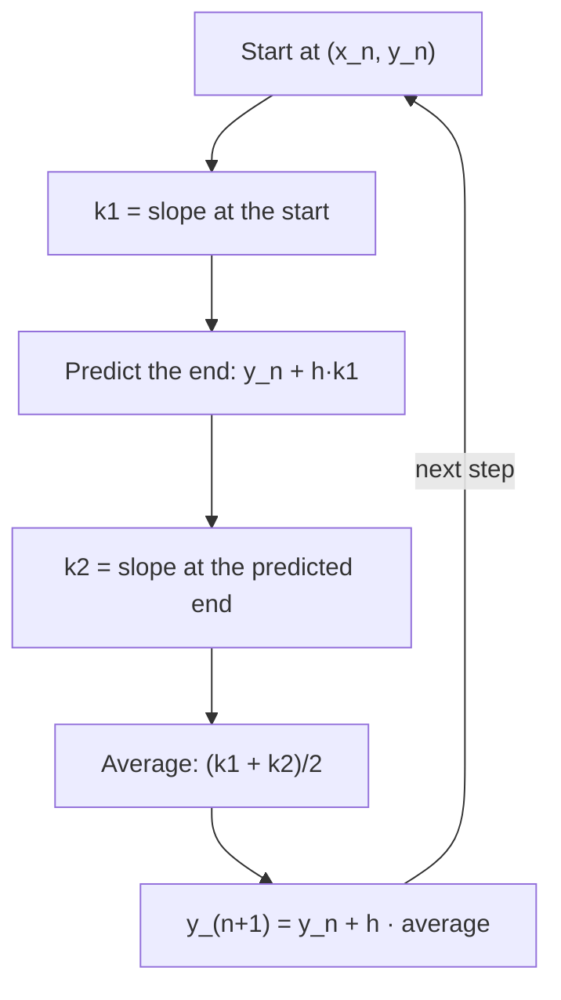

In Lesson 37, Euler's method with four steps of size $h = 0.5$ estimated $y(2) \approx 7.125$ for $\frac{dy}{dx} = x + y$, $y(0) = 1$, while the exact answer is $2e^2 - 3 \approx 11.78$. Lessons 38 and 39 then solved two families of equations exactly, but most differential equations met in science and engineering have no formula solution at all, and computers solve them numerically. This honors lesson asks the questions a numerical analyst asks: how fast does the error shrink as the step gets smaller, how can you estimate the error without knowing the answer, and how can a smarter step do far better for the same work? Along the way you will see that the best methods are the differential-equation versions of the trapezoid and Simpson's rules from Lesson 34.

## How big is Euler's error?

One Euler step follows the tangent line from $(x_n, y_n)$, the linearization of Lesson 15. Over a step of length $h$ a tangent line misses a smooth curve by about $\frac12 y''\,h^2$: the gap grows with the curve's bending and with the square of the step. (This is the first term the tangent line leaves out; Lesson 44 makes it precise with Taylor polynomials.) That error made in a single step is the **local truncation error**, and for Euler's method it is proportional to $h^2$.

To reach a fixed point $x = b$ from $x_0$ you take $N = \frac{b - x_0}{h}$ steps. Roughly $N$ errors of size $Ch^2$ pile up, giving a total, the **global error**, of about $\frac{b - x_0}{h}\cdot Ch^2 = C(b - x_0)\,h$, proportional to $h$. (This is a heuristic: each step starts from a slightly wrong point, and earlier errors can grow or shrink as they travel. Under mild conditions on $F$ the conclusion holds anyway.) A method whose global error is proportional to $h^p$ has **order of accuracy** $p$ (usually just called order $p$); Euler's method has order 1. Halving the step halves the error and doubles the work.

### Example 1

Use Euler's method on $\frac{dy}{dx} = y$, $y(0) = 1$, to approximate $y(1) = e \approx 2.718282$, with $h = 0.1$, $0.05$ and $0.025$.

With slope $y_n$, each step multiplies by $1 + h$, so $y_N = (1 + h)^N$ with $N = \frac1h$.

| $h$ | Euler estimate | Error $e - y_N$ | Error ÷ $h$ |
|---|---|---|---|
| 0.1 | $1.1^{10} \approx 2.593742$ | 0.124539 | 1.25 |
| 0.05 | $1.05^{20} \approx 2.653298$ | 0.064984 | 1.30 |
| 0.025 | $1.025^{40} \approx 2.685064$ | 0.033218 | 1.33 |

Each halving of $h$ roughly halves the error, and error ÷ $h$ settles toward a constant (about $\frac e2 \approx 1.36$). To get the error below 0.0001 you would need about 14,000 steps. (Notice too that $(1 + h)^{1/h} \to e$: the same limit as continuous compounding.)

### Estimating the error without the answer

In real problems the exact value is unknown. But if the error is about $Ch$, then $y_h \approx Y - Ch$ and $y_{h/2} \approx Y - \frac{C}{2}h$, where $Y$ is the true value. Subtracting:

$$Y - y_{h/2} \approx y_{h/2} - y_h, \qquad Y \approx 2y_{h/2} - y_h.$$

So comparing two runs estimates the error of the better one, and the combination $2y_{h/2} - y_h$ cancels the leading error term. Combining runs this way is **Richardson extrapolation**. (If you studied the honors lessons on numerical derivatives or Romberg integration, this is the same idea applied to a new kind of approximation.) In Example 1, $y_{0.05} - y_{0.1} = 0.059555$, a good estimate of the true error 0.064984, and $2(2.653298) - 2.593742 = 2.712853$ is off by only 0.0054, better than either run.

## The improved Euler method

Euler's method uses only the slope at the start of the step. On a concave-up curve that slope is too small for the whole step, so the estimate falls behind. A fairer slope is the average of the slopes at both ends of the step. The end slope is unknown (it needs $y_{n+1}$), so first *predict* the end point with an ordinary Euler step, then *correct* with the averaged slope:

$$k_1 = F(x_n, y_n), \qquad k_2 = F(x_n + h,\; y_n + hk_1), \qquad y_{n+1} = y_n + \frac h2\,(k_1 + k_2).$$

This is the **improved Euler method**, also called Heun's method. Its local error is proportional to $h^3$ and its global error to $h^2$: it has order 2, so halving $h$ cuts the error by about 4.

Why order 2? If $F$ depends only on $x$, the equation is $y' = f(x)$, and $y(b) - y(x_0) = \int_{x_0}^b f(x)\,dx$. Then Euler's method is exactly a left Riemann sum, and the improved Euler method is exactly the **trapezoidal rule**, whose error Lesson 34 showed is proportional to $h^2$.



### Example 2

Use the improved Euler method with $h = 0.5$ on $\frac{dy}{dx} = x + y$, $y(0) = 1$ to estimate $y(2)$.

| $x_n$ | $y_n$ | $k_1 = x_n + y_n$ | predicted $y_n + 0.5k_1$ | $k_2$ | $y_{n+1} = y_n + 0.25(k_1 + k_2)$ |
|---|---|---|---|---|---|
| 0 | 1 | 1 | 1.5 | 2 | 1.75 |
| 0.5 | 1.75 | 2.25 | 2.875 | 3.875 | 3.28125 |
| 1 | 3.28125 | 4.28125 | 5.421875 | 6.921875 | 6.08203 |
| 1.5 | 6.08203 | 7.58203 | 9.87305 | 11.87305 | 10.94580 |

(Each $k_2$ is the slope at $x_n + 0.5$ and the predicted $y$; for example, in the first row $k_2 = 0.5 + 1.5 = 2$.) So $y(2) \approx \mathbf{10.946}$, with error about 0.83, compared with Euler's error of about 4.65 for the same step size. It is still an underestimate, since the solution is concave up, but far closer.

```plot
{"x": [0, 2.2], "y": [0, 13], "functions": [{"f": "2e^x - x - 1", "label": "exact"}], "segments": [{"from": [0, 1], "to": [0.5, 1.5], "dashed": true}, {"from": [0.5, 1.5], "to": [1, 2.5], "dashed": true}, {"from": [1, 2.5], "to": [1.5, 4.25], "dashed": true}, {"from": [1.5, 4.25], "to": [2, 7.125], "dashed": true}, {"from": [0, 1], "to": [0.5, 1.75]}, {"from": [0.5, 1.75], "to": [1, 3.28125]}, {"from": [1, 3.28125], "to": [1.5, 6.08203]}, {"from": [1.5, 6.08203], "to": [2, 10.9458]}], "points": [{"at": [2, 7.125], "label": "Euler 7.125"}, {"at": [2, 10.9458], "label": "improved Euler 10.946"}, {"at": [2, 11.7781], "label": "exact 11.778"}], "caption": "Same step size h = 0.5: Euler (dashed) and improved Euler (solid) against the exact solution"}
```

## The classical Runge–Kutta method

Sampling the slope at more places does better still. The **Runge–Kutta method** of order 4 (RK4, from work by Carl Runge and Wilhelm Kutta around 1900) takes four slopes per step: one at the start, two at the midpoint and one at the end.

$$\begin{aligned}
k_1 &= F(x_n, y_n), & k_2 &= F\!\left(x_n + \tfrac h2,\; y_n + \tfrac h2 k_1\right),\\
k_3 &= F\!\left(x_n + \tfrac h2,\; y_n + \tfrac h2 k_2\right), & k_4 &= F(x_n + h,\; y_n + hk_3),
\end{aligned}$$

$$y_{n+1} = y_n + \frac h6\,(k_1 + 2k_2 + 2k_3 + k_4).$$

The weights $1, 2, 2, 1$ (out of 6) are Simpson's weights $1, 4, 1$ with the middle one split between the two midpoint slopes. When $F$ depends only on $x$, $k_2 = k_3$ and RK4 is exactly Simpson's rule. Its global error is proportional to $h^4$: halving $h$ cuts the error by about 16.

### Example 3

Take one RK4 step with $h = 1$ on $\frac{dy}{dx} = y$, $y(0) = 1$, to estimate $y(1)$.

$k_1 = 1$; $k_2 = 1 + \frac12(1) = 1.5$; $k_3 = 1 + \frac12(1.5) = 1.75$; $k_4 = 1 + 1(1.75) = 2.75$. Then
$$y_1 = 1 + \frac16(1 + 3 + 3.5 + 2.75) = 1 + \frac{10.25}{6} \approx \mathbf{2.708333}.$$
One step lands within 0.01 of $e$; one Euler step of the same size gives 2. In fact, for $y' = y$ one RK4 step multiplies by $1 + h + \frac{h^2}{2} + \frac{h^3}{6} + \frac{h^4}{24}$, the first five terms of the series for $e^h$ that Lesson 44 develops.

## Accuracy for the same work

The fair comparison counts evaluations of $F$, the expensive part when $F$ is complicated. Euler uses 1 per step, improved Euler 2, RK4 4. Here is $y' = y$ on $[0, 1]$ with 40 evaluations each:

| Method | Step size | Steps | Error at $x = 1$ |
|---|---|---|---|
| Euler | 0.025 | 40 | 0.0332 |
| Improved Euler | 0.05 | 20 | 0.00109 |
| RK4 | 0.1 | 10 | 0.0000021 |

For the same work, RK4 is about 16,000 times more accurate than Euler here, and about 500 times more accurate than improved Euler. That is why RK4 and its relatives (often with automatic step-size control, using an error estimate like Richardson's) are the default general-purpose solvers in scientific software.

## When a small step is not small enough: stability

Error can do worse than accumulate: it can explode. Apply Euler's method to the decay equation $y' = -ky$ with $k > 0$. Each step gives $y_{n+1} = y_n - hky_n = (1 - kh)\,y_n$, so $y_n = (1 - kh)^n y_0$. The true solution decays to 0, but the numbers decay only if $|1 - kh| < 1$, that is, $h < \frac2k$. If $\frac1k < h < \frac2k$ they decay while flipping sign each step, and if $h > \frac2k$ they grow in size. This is **numerical instability**: a property of the method and step size, not of the equation.

### Example 4

Use Euler's method on $y' = -10y$, $y(0) = 1$ with $h = 0.25$, $0.15$ and $0.05$.

The multipliers $1 - 10h$ are $-1.5$, $-0.5$ and $0.5$. With $h = 0.25$, four steps give $-1.5$, $2.25$, $-3.375$, $5.0625$, while the true $y(1) = e^{-10} \approx 0.0000454$. With $h = 0.15$ the values $-0.5, 0.25, -0.125, \dots$ shrink but oscillate. Only with $h = 0.05$ do they decay smoothly: $0.5, 0.25, 0.125, \dots$. The limit $h < \frac{2}{10} = 0.2$ has nothing to do with accuracy; it is the price of stability.

Equations whose solutions contain both very fast and very slow decay are called **stiff**: the fast part forces a tiny step long after it has died away. Stiff problems (chemical reactions, circuits) are solved with *implicit* methods such as backward Euler, $y_{n+1} = y_n + hF(x_{n+1}, y_{n+1})$, which for $y' = -ky$ gives $y_{n+1} = \frac{y_n}{1 + kh}$ and decays for every $h > 0$. Those methods are beyond this course.

## Common mistakes

- *Evaluating $k_2$ at the old $x$.* In the improved Euler method, $k_2$ uses $x_n + h$ as well as the predicted $y$; in RK4, $k_2$ and $k_3$ use $x_n + \frac h2$.
- *Stepping from the predicted point.* The corrected step starts again from $y_n$, not from $y_n + hk_1$.
- *Forgetting the weights.* RK4 divides $k_1 + 2k_2 + 2k_3 + k_4$ by 6, and the improved Euler method averages, dividing by 2.
- *Thinking order means accuracy at every step size.* Order describes how the error shrinks as $h \to 0$. A high-order method with an unstable step can still be useless.
- *Expecting halving $h$ to halve every method's error.* That is order 1. Order 2 gives about a quarter, order 4 about a sixteenth.

## Key points

- Euler's method: local error $\propto h^2$, global error $\propto h$ (order 1).
- Comparing runs with $h$ and $\frac h2$ estimates the error; $2y_{h/2} - y_h$ (Richardson extrapolation) cancels an order-1 error term.
- Improved Euler (Heun): $y_{n+1} = y_n + \frac h2\left[F(x_n, y_n) + F(x_n + h, y_n + hk_1)\right]$, order 2; for $y' = f(x)$ it is the trapezoidal rule.
- RK4: four slopes weighted $1, 2, 2, 1$ over 6, order 4; for $y' = f(x)$ it is Simpson's rule.
- Euler on $y' = -ky$ multiplies by $1 - kh$ each step and is stable only for $h < \frac2k$; stiff equations need implicit methods.
