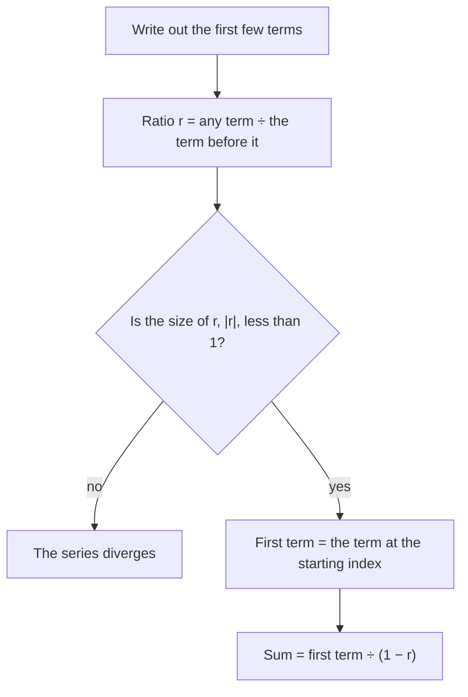

## Adding infinitely many numbers

Can you add infinitely many numbers and get a finite answer? Walk halfway to a wall, then half the remaining distance, then half again: $\frac12 + \frac14 + \frac18 + \cdots$. You never quite arrive, yet the total distance is clearly 1. Making that precise is the job of this module, which is BC and Calculus II material. Series turn out to be a powerful tool: they let us write functions like $e^x$ and $\sin x$ as "infinite polynomials" (Lesson 44), which is how calculators compute them.

We start with sequences, because a series is defined through a sequence of partial sums.

## Sequences

A **sequence** is an infinite ordered list $a_1, a_2, a_3, \dots$, often given by a formula $a_n = f(n)$. For example $a_n = \frac{n}{n + 1}$ gives $\frac12, \frac23, \frac34, \dots$

A sequence **converges** to $L$, written $\lim_{n\to\infty}a_n = L$, if its terms get arbitrarily close to $L$ as $n$ grows. Otherwise it **diverges**.

Limits of sequences work like limits at infinity (Lesson 3): if $a_n = f(n)$ and $\lim_{x\to\infty}f(x) = L$, then $a_n \to L$. So you can use all the earlier tools, including L'Hôpital's rule on $f(x)$.

### Example 1

Find the limits: (a) $a_n = \dfrac{3n^2 - 1}{5n^2 + n}$; (b) $b_n = \dfrac{\ln n}{n}$; (c) $c_n = (-1)^n$; (d) $d_n = \left(1 + \frac2n\right)^n$.

(a) Leading coefficients: $\frac35$. (b) L'Hôpital on $\frac{\ln x}{x}$: $\frac{1/x}{1} \to 0$. (c) Alternates $-1, 1, -1, \dots$: diverges. (d) $e^2$ (Lesson 16).

Two useful facts:
- $r^n \to 0$ if $|r| < 1$; $r^n \to \infty$ if $r > 1$; $r^n$ diverges if $r \le -1$.
- A **monotone** (always increasing or always decreasing) sequence that is **bounded** must converge. (The terms can't keep rising forever without exceeding a ceiling.)

## Series and partial sums

An **infinite series** is a sum $\displaystyle\sum_{n=1}^\infty a_n = a_1 + a_2 + a_3 + \cdots$. Its **partial sums** are
$$S_N = a_1 + a_2 + \dots + a_N.$$
The series **converges** to $S$ if the sequence of partial sums $S_N$ converges to $S$, and then we write $\sum a_n = S$. Otherwise it diverges.

For $\frac12 + \frac14 + \frac18 + \cdots$: $S_1 = \frac12$, $S_2 = \frac34$, $S_3 = \frac78$, and $S_N = 1 - \frac{1}{2^N} \to 1$. So the sum is 1.

You can see the same total in a picture. Cut a square of area 1 in half, then cut the leftover piece in half, and keep going. The pieces have areas $\frac12, \frac14, \frac18, \dots$, and together they fill the whole square: what is left after $N$ cuts is $\frac{1}{2^N}$, which shrinks to 0.


The bar chart shows the same thing as numbers: each partial sum is the area filled so far.

```plot
{"x": [0, 9], "y": [0, 1.2], "bars": [{"x": 1, "height": 0.5, "width": 0.6}, {"x": 2, "height": 0.75, "width": 0.6}, {"x": 3, "height": 0.875, "width": 0.6}, {"x": 4, "height": 0.9375, "width": 0.6}, {"x": 5, "height": 0.96875, "width": 0.6}, {"x": 6, "height": 0.984375, "width": 0.6}, {"x": 7, "height": 0.9921875, "width": 0.6}, {"x": 8, "height": 0.99609375, "width": 0.6}], "functions": [{"f": "1", "dashed": true}], "xLabel": "N", "yLabel": "S_N", "caption": "Partial sums of 1/2 + 1/4 + 1/8 + … climb toward 1"}
```

## Geometric series

A **geometric series** has a constant ratio $r$ between consecutive terms:
$$\sum_{n=0}^\infty ar^n = a + ar + ar^2 + \cdots.$$

*Theorem.* If $|r| < 1$ it converges, and
$$\sum_{n=0}^\infty ar^n = \frac{a}{1 - r} = \frac{\text{first term}}{1 - \text{ratio}}.$$
If $|r| \ge 1$ (and $a \ne 0$), it diverges.

*Why.* $S_N = a + ar + \dots + ar^{N-1}$. Multiply by $r$ and subtract: $S_N - rS_N = a - ar^N$, so $S_N = \frac{a(1 - r^N)}{1 - r}$. If $|r| < 1$, $r^N \to 0$ and $S_N \to \frac{a}{1 - r}$.

The whole procedure fits in a short chart:



### Example 2

Find the sums: (a) $\displaystyle\sum_{n=1}^\infty 5\left(\frac23\right)^{n}$; (b) $4 - 2 + 1 - \frac12 + \cdots$; (c) $\displaystyle\sum_{n=0}^\infty\frac{3^n}{2^n}$.

(a) First term ($n = 1$): $5\cdot\frac23 = \frac{10}{3}$; ratio $\frac23$. Sum $= \dfrac{10/3}{1/3} = \mathbf{10}$.
(b) First term 4, ratio $-\frac12$. Sum $= \dfrac{4}{3/2} = \mathbf{\frac83}$.
(c) Ratio $\frac32 > 1$: **diverges**.

Watch the starting index: "first term" means the term at the starting $n$, not necessarily $a$.

### Example 3 (repeating decimals)

Write $0.\overline{36} = 0.363636\ldots$ as a fraction. It's $\frac{36}{100} + \frac{36}{100^2} + \cdots$, geometric with first term $\frac{36}{100}$ and ratio $\frac{1}{100}$: $\dfrac{36/100}{99/100} = \dfrac{36}{99} = \dfrac{4}{11}$.

## Telescoping series

Sometimes partial sums collapse because terms cancel in pairs.

### Example 4

Find $\displaystyle\sum_{n=1}^\infty\frac{1}{n(n + 1)}$.

Partial fractions: $\frac{1}{n(n + 1)} = \frac1n - \frac{1}{n + 1}$. Then
$$S_N = \left(1 - \tfrac12\right) + \left(\tfrac12 - \tfrac13\right) + \dots + \left(\tfrac1N - \tfrac{1}{N + 1}\right) = 1 - \frac{1}{N + 1} \to 1.$$
The middle terms cancel, like a collapsing telescope. Sum: **1**.

## The divergence test

If $\sum a_n$ converges, then $S_N - S_{N-1} = a_N \to 0$. Turned around, that's the **divergence test** (or $n$th-term test):

**If $\lim_{n\to\infty}a_n \ne 0$ (or doesn't exist), then $\sum a_n$ diverges.**

So $\sum\frac{n}{2n + 1}$ diverges, since the terms approach $\frac12$, not 0. You can't add infinitely many numbers near $\frac12$ and get something finite.

The converse is *false*: terms going to 0 does *not* guarantee convergence. The **harmonic series** $\sum\frac1n = 1 + \frac12 + \frac13 + \cdots$ has terms going to 0, but it diverges. Group the terms:
$$1 + \tfrac12 + \left(\tfrac13 + \tfrac14\right) + \left(\tfrac15 + \dots + \tfrac18\right) + \cdots \ge 1 + \tfrac12 + \tfrac12 + \tfrac12 + \cdots.$$
Each group is at least $\frac12$, and there are infinitely many groups. The next lesson develops tests for deciding cases like this.

## Algebra of series

If $\sum a_n$ and $\sum b_n$ converge, then $\sum(a_n \pm b_n) = \sum a_n \pm \sum b_n$ and $\sum ca_n = c\sum a_n$. Changing or deleting finitely many terms changes the sum but not whether it converges.

## Common mistakes

- *Confusing the sequence with the series.* $a_n \to 0$ is about terms; convergence of $\sum a_n$ is about partial sums.
- *Using the divergence test to prove convergence.* $a_n \to 0$ proves nothing.
- *Wrong first term* in geometric sums when the index starts at 1 or later.
- **Forgetting $|r| < 1$.** $\sum 2^n$ doesn't equal $\frac{1}{1 - 2} = -1$.
- *Assuming telescoping cancels everything.* Write out several terms at both ends of $S_N$.

## Key points

- A series converges if its partial sums $S_N$ converge.
- Geometric: $\sum ar^n = \frac{\text{first term}}{1 - r}$ when $|r| < 1$; diverges when $|r| \ge 1$.
- Telescoping: write $S_N$ and cancel.
- Divergence test: if $a_n \not\to 0$, the series diverges. The harmonic series shows $a_n \to 0$ isn't enough.
