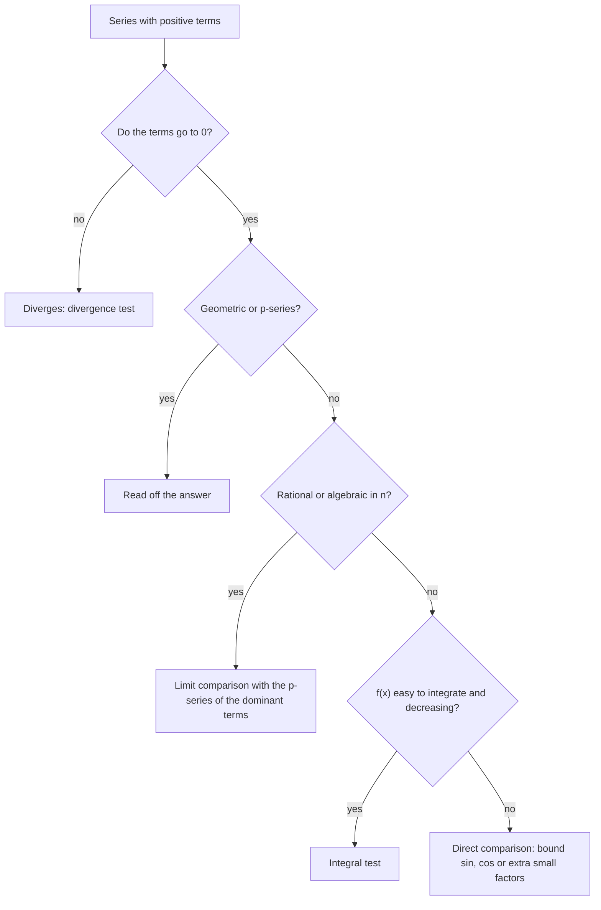

## Deciding convergence without a formula

Geometric and telescoping series have formulas for their sums. Most series don't. For those we ask a simpler question: does it converge at all? This lesson gives three tests for series with **positive terms**: the integral test, the direct comparison test and the limit comparison test, along with the family of p-series they produce. Positive terms make partial sums increase, so the only question is whether they stay bounded.

## The integral test

Compare the series $\sum f(n)$ with the area under $y = f(x)$. If $f$ is decreasing, rectangles of width 1 with heights $f(2), f(3), \dots$ fit *under* the curve, and rectangles with heights $f(1), f(2), \dots$ stick out *above* it:

$$\sum_{n=2}^{N}f(n) \le \int_1^N f(x)\,dx \le \sum_{n=1}^{N-1}f(n).$$

```plot
{"x": [0, 7], "y": [0, 1.2], "bars": [{"x": 1.5, "height": 1, "width": 1}, {"x": 2.5, "height": 0.25, "width": 1}, {"x": 3.5, "height": 0.1111, "width": 1}, {"x": 4.5, "height": 0.0625, "width": 1}, {"x": 5.5, "height": 0.04, "width": 1}], "functions": [{"f": "1/x^2", "from": 0.9}], "caption": "Rectangles with heights f(1), f(2), … lie above y = 1/x² on [1, ∞)"}
```

So the series and the improper integral either both converge or both diverge.

**Integral test.** If $f$ is continuous, positive and decreasing on $[1, \infty)$ and $a_n = f(n)$, then $\sum_{n=1}^\infty a_n$ and $\int_1^\infty f(x)\,dx$ both converge or both diverge.

The integral's value is *not* the series' sum; the test only compares convergence. (The conditions only need to hold eventually, for $x \ge$ some $N$.)

### Example 1

Does $\displaystyle\sum_{n=1}^\infty\frac{n}{e^{n^2}}$ converge?

$f(x) = xe^{-x^2}$ is positive, continuous, and decreasing for $x \ge 1$ ($f' = e^{-x^2}(1 - 2x^2) < 0$). $\int_1^\infty xe^{-x^2}dx = \lim_{t\to\infty}\left[-\tfrac12e^{-x^2}\right]_1^t = \frac{1}{2e}$, which converges. So the series **converges**.

## p-series

Apply the integral test to $f(x) = \frac{1}{x^p}$ and use Lesson 35:

$$\sum_{n=1}^\infty\frac{1}{n^p}\ \text{ converges if } p > 1 \text{ and diverges if } p \le 1.$$

These **p-series** are the benchmarks for the comparison tests. Examples: $\sum\frac{1}{n^2}$ converges (its sum is $\frac{\pi^2}{6}$, a famous result of Euler), $\sum\frac{1}{\sqrt n}$ diverges ($p = \frac12$), and the harmonic series ($p = 1$) diverges.

### Remainder estimate

When you stop at $S_N$, the error is the tail $R_N = \sum_{n=N+1}^\infty a_n$. The same rectangles bound it:
$$\int_{N+1}^\infty f(x)\,dx \le R_N \le \int_N^\infty f(x)\,dx.$$
For $\sum\frac1{n^2}$ with $N = 10$: $\frac{1}{11} \le R_{10} \le \frac{1}{10}$, so $S_{10} = 1.5498$ is within 0.1 of the true sum $1.6449$ (indeed the error is 0.0952).

## The direct comparison test

If the terms of your series are smaller than those of a convergent series, yours converges too; if they're bigger than those of a divergent series, yours diverges.

**Direct comparison test.** Suppose $0 \le a_n \le b_n$ for all $n$ (or all large $n$).
- If $\sum b_n$ converges, then $\sum a_n$ converges.
- If $\sum a_n$ diverges, then $\sum b_n$ diverges.

### Example 2

(a) $\displaystyle\sum\frac{1}{n^2 + 4}$: $\frac{1}{n^2 + 4} < \frac{1}{n^2}$, and $\sum\frac1{n^2}$ converges, so it **converges**.

(b) $\displaystyle\sum\frac{\ln n}{n}$ (from $n = 3$): $\ln n > 1$ for $n \ge 3$, so $\frac{\ln n}{n} > \frac1n$, and the harmonic series diverges. So it **diverges**.

(c) $\displaystyle\sum\frac{\sin^2 n}{3^n}$: $0 \le \frac{\sin^2n}{3^n} \le \frac{1}{3^n}$, a convergent geometric series. **Converges.**

Here is part (a) as a picture: every term of $\sum\frac{1}{n^2 + 4}$ sits below the matching term of $\sum\frac{1}{n^2}$, so its total can't be larger than $\frac{\pi^2}{6}$.

```plot
{"x": [0, 8.5], "y": [0, 1.1], "functions": [{"f": "1/x^2", "from": 0.95, "dashed": true, "label": "1/x²"}], "points": [{"at": [1, 1], "label": "1/n²"}, {"at": [2, 0.25]}, {"at": [3, 0.1111]}, {"at": [4, 0.0625]}, {"at": [5, 0.04]}, {"at": [6, 0.0278]}, {"at": [7, 0.0204]}, {"at": [8, 0.0156]}, {"at": [1, 0.2], "open": true, "label": "1/(n² + 4)"}, {"at": [2, 0.125], "open": true}, {"at": [3, 0.0769], "open": true}, {"at": [4, 0.05], "open": true}, {"at": [5, 0.0345], "open": true}, {"at": [6, 0.025], "open": true}, {"at": [7, 0.0189], "open": true}, {"at": [8, 0.0147], "open": true}], "xLabel": "n", "caption": "Open dots 1/(n² + 4) lie below filled dots 1/n² at every n"}
```

The direction matters. $\frac{1}{n^2 - 4} > \frac{1}{n^2}$, so comparing $\sum\frac{1}{n^2 - 4}$ with $\sum\frac{1}{n^2}$ directly proves nothing. That's what the next test fixes.

## The limit comparison test

When the inequality points the wrong way but the series "behave alike" for large $n$, compare ratios instead.

**Limit comparison test.** Suppose $a_n > 0$, $b_n > 0$ and
$$\lim_{n\to\infty}\frac{a_n}{b_n} = c, \quad 0 < c < \infty.$$
Then $\sum a_n$ and $\sum b_n$ both converge or both diverge.

Choose $b_n$ by keeping only the dominant terms of $a_n$ (highest powers in the numerator and denominator).

### Example 3

Does $\displaystyle\sum_{n=3}^\infty\frac{1}{n^2 - 4}$ converge?

Dominant behavior: $\frac{1}{n^2}$. $\lim\dfrac{1/(n^2 - 4)}{1/n^2} = \lim\dfrac{n^2}{n^2 - 4} = 1$, positive and finite. $\sum\frac1{n^2}$ converges, so this **converges**.

### Example 4

Does $\displaystyle\sum\frac{2n^2 + 3n}{\sqrt{n^5 + 7}}$ converge?

Dominant: $\frac{2n^2}{n^{5/2}} = \frac{2}{n^{1/2}}$, so compare with $b_n = \frac{1}{\sqrt n}$:
$$\frac{a_n}{b_n} = \frac{(2n^2 + 3n)\sqrt n}{\sqrt{n^5 + 7}} \to 2.$$
$\sum\frac{1}{\sqrt n}$ diverges ($p = \frac12$), so this **diverges**.

## Choosing among the tests (so far)

1. Do the terms go to 0? If not, divergence test: done.
2. Geometric or p-series? Read off the answer.
3. Rational/algebraic expression in $n$? Limit comparison with the p-series of its dominant terms.
4. Easy-to-integrate $f(x)$, decreasing? Integral test.
5. Bounded wiggles ($\sin$, $\cos$) or extra small factors? Direct comparison.



The next lesson adds tests for series with negative terms and for factorials and exponentials.

### Example 5

Use the integral test on $\displaystyle\sum_{n=1}^\infty\frac{1}{n^2 + 1}$.

$f(x) = \frac{1}{x^2 + 1}$ is positive, continuous and decreasing for $x \ge 1$, and $\int_1^\infty\frac{dx}{x^2 + 1} = \lim_{t\to\infty}\arctan t - \arctan1 = \frac\pi2 - \frac\pi4 = \frac\pi4$. So the series converges. (Direct comparison with $\frac{1}{n^2}$ works too.)

### Example 6

Decide $\displaystyle\sum_{n=1}^\infty\frac{1}{n\sqrt n + 1}$.

Dominant term: $\frac{1}{n^{3/2}}$. $\lim\dfrac{n^{3/2}}{n^{3/2} + 1} = 1$, so by limit comparison with the convergent p-series ($p = \frac32$), it **converges**. (Direct comparison works here too, since $\frac{1}{n^{3/2} + 1} < \frac{1}{n^{3/2}}$.)

## Common mistakes

- *Using the integral's value as the series' sum.*
- *Checking only that terms decrease.* The integral test also needs $f$ positive and continuous.
- *Comparing in the wrong direction* (smaller than divergent, or bigger than convergent, proves nothing).
- **Limit comparison giving 0 or ∞.** Then the test is inconclusive (with the usual conclusions only in special directions); pick a better $b_n$.
- *p-series boundary.* $p = 1$ diverges.

## Key points

- Integral test: positive, continuous, decreasing $f$; $\sum f(n)$ and $\int_1^\infty f$ converge or diverge together.
- p-series $\sum\frac{1}{n^p}$: converges iff $p > 1$.
- Direct comparison: smaller than convergent ⇒ converges; bigger than divergent ⇒ diverges.
- Limit comparison: $\lim\frac{a_n}{b_n} = c \in (0, \infty)$ ⇒ same behavior. Use the dominant terms for $b_n$.
