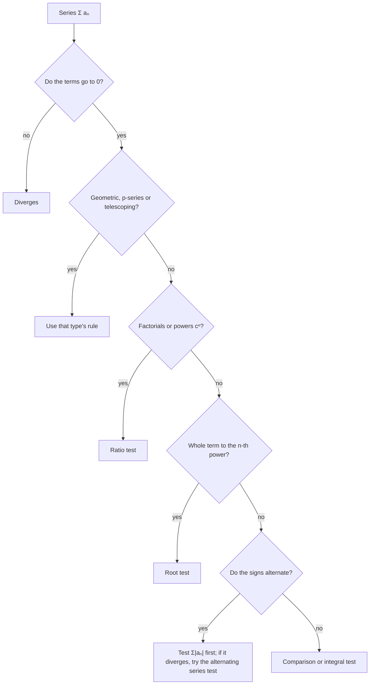

## Series with signs

The tests of Lesson 41 need positive terms. Many important series have terms that switch sign, like $1 - \frac12 + \frac13 - \frac14 + \cdots$, and the power series coming next have both signs and factorials. This lesson completes the toolkit: the alternating series test, absolute versus conditional convergence, and the ratio and root tests.

## Alternating series

An **alternating series** has terms that alternate in sign: $\sum(-1)^{n+1}b_n = b_1 - b_2 + b_3 - \cdots$ with $b_n > 0$.

**Alternating series test** (AST). If
1. $b_{n+1} \le b_n$ for all $n$ (eventually), and
2. $\lim_{n\to\infty}b_n = 0$,

then $\sum(-1)^{n+1}b_n$ converges.

*Why.* The partial sums zigzag: add $b_1$, step back by a smaller $b_2$, forward by an even smaller $b_3$, and so on. The odd partial sums decrease, the even ones increase, every step is shorter than the last, and the steps shrink to 0. The two sides squeeze together on a single limit $S$.

```plot
{"x": [0, 11], "y": [0.3, 1.1], "points": [{"at": [1, 1]}, {"at": [2, 0.5]}, {"at": [3, 0.8333]}, {"at": [4, 0.5833]}, {"at": [5, 0.7833]}, {"at": [6, 0.6167]}, {"at": [7, 0.7595]}, {"at": [8, 0.6345]}, {"at": [9, 0.7456]}, {"at": [10, 0.6456]}], "functions": [{"f": "0.6931", "dashed": true, "label": "ln 2"}], "xLabel": "N", "caption": "Partial sums of 1 − 1/2 + 1/3 − … zigzag in on ln 2 ≈ 0.693"}
```

So the **alternating harmonic series** $1 - \frac12 + \frac13 - \frac14 + \cdots$ converges (to $\ln2$), even though the harmonic series diverges.

### The alternating series error bound

Since the partial sums straddle $S$ and each step is smaller than the last, the error after stopping at $S_N$ is less than the first omitted term:

$$|S - S_N| \le b_{N+1}.$$

Also, the true sum lies between $S_N$ and $S_{N+1}$, and $S - S_N$ has the sign of the first omitted term.

### Example 1

How many terms of $\displaystyle\sum_{n=1}^\infty\frac{(-1)^{n+1}}{n^3}$ guarantee an error below $0.001$?

Need $b_{N+1} = \frac{1}{(N + 1)^3} < 0.001$, so $(N + 1)^3 > 1000$, $N + 1 > 10$. $N = 10$ terms suffice (then the error is at most $\frac{1}{11^3} \approx 0.00075$).

## Absolute and conditional convergence

A series $\sum a_n$ is **absolutely convergent** if $\sum|a_n|$ converges. It is **conditionally convergent** if $\sum a_n$ converges but $\sum|a_n|$ diverges.

*Theorem.* Absolute convergence implies convergence. (If the sizes add up to something finite, adding them with some minus signs can only help.)

| Series | $\sum\lvert a_n\rvert$ | $\sum a_n$ | Type |
|---|---|---|---|
| $\sum\frac{(-1)^n}{n^2}$ | converges ($p = 2$) | converges | absolutely convergent |
| $\sum\frac{(-1)^n}{n}$ | diverges (harmonic) | converges (AST) | conditionally convergent |
| $\sum(-1)^n\frac{n}{n + 1}$ | diverges | diverges ($a_n \not\to 0$) | divergent |

Every series lands in exactly one of three regions. The convergent series are the two inner regions together; the absolutely convergent ones sit inside them.


Absolutely convergent series behave like finite sums: you can rearrange their terms freely. Conditionally convergent series are fragile; rearranging the alternating harmonic series can make it add up to any number you like (Riemann's rearrangement theorem).

## The ratio test

For series involving factorials or exponentials, compare each term with the one before.

**Ratio test.** Let $L = \displaystyle\lim_{n\to\infty}\left|\frac{a_{n+1}}{a_n}\right|$.
- If $L < 1$, $\sum a_n$ converges absolutely.
- If $L > 1$ (including $L = \infty$), $\sum a_n$ diverges.
- If $L = 1$, the test is **inconclusive**.

*Why.* If $L < 1$, eventually each term is less than $r$ times the previous one for some $r < 1$, so the series is dominated by a convergent geometric series. If $L > 1$, the terms grow and can't go to 0.

### Example 2

Test $\displaystyle\sum_{n=1}^\infty\frac{n^2}{3^n}$ and $\displaystyle\sum_{n=1}^\infty\frac{n!}{5^n}$.

- $\left|\dfrac{a_{n+1}}{a_n}\right| = \dfrac{(n + 1)^2}{3^{n+1}}\cdot\dfrac{3^n}{n^2} = \dfrac13\left(\dfrac{n + 1}{n}\right)^2 \to \dfrac13 < 1$: **converges** absolutely.
- $\dfrac{(n + 1)!}{5^{n+1}}\cdot\dfrac{5^n}{n!} = \dfrac{n + 1}{5} \to \infty$: **diverges**.

Simplifying factorials: $\frac{(n + 1)!}{n!} = n + 1$, and $\frac{(2n + 2)!}{(2n)!} = (2n + 2)(2n + 1)$.

### Example 3 (inconclusive)

For any p-series, $\frac{1/(n + 1)^p}{1/n^p} = \left(\frac{n}{n + 1}\right)^p \to 1$. Yet $\sum\frac1{n^2}$ converges and $\sum\frac1n$ diverges. So $L = 1$ really tells you nothing; the ratio test is useless for rational functions of $n$. Use comparison tests for those.

## The root test

**Root test.** Let $L = \displaystyle\lim_{n\to\infty}\sqrt[n]{|a_n|}$. Same conclusions as the ratio test: $L < 1$ converges absolutely, $L > 1$ diverges, $L = 1$ inconclusive.

It's the natural choice when $a_n$ is something to the $n$th power.

### Example 4

Test $\displaystyle\sum\left(\frac{2n + 1}{3n - 1}\right)^n$. $\sqrt[n]{a_n} = \frac{2n + 1}{3n - 1} \to \frac23 < 1$: **converges**.

## A strategy for any series

1. **Divergence test**: if $a_n \not\to 0$, diverges.
2. *Recognize a type*: geometric, p-series, telescoping, alternating.
3. **Factorials or $c^n$**: ratio test. **$n$th powers**: root test.
4. **Rational/algebraic in $n$**: limit comparison with a p-series.
5. *Alternating*: check absolute convergence first; if that fails, try the AST (conditional).
6. *Easy integral*: integral test.

As a flowchart:



### Example 5

Classify $\displaystyle\sum_{n=1}^\infty\frac{(-1)^nn}{n^2 + 1}$.

Absolute values: $\frac{n}{n^2 + 1}$ behaves like $\frac1n$ (limit comparison gives 1), so $\sum|a_n|$ diverges. Alternating series test: $b_n = \frac{n}{n^2 + 1} \to 0$, and it decreases because $f(x) = \frac{x}{x^2 + 1}$ has $f'(x) = \frac{1 - x^2}{(x^2 + 1)^2} \le 0$ for $x \ge 1$. So the series converges, and it is **conditionally convergent**.

## Common mistakes

- *Skipping the decreasing condition* in the AST, or claiming the AST proves divergence. (If $b_n \not\to 0$, it's the divergence test that applies.)
- **Concluding from $L = 1$.** It's inconclusive.
- *Algebra slips with factorials and powers* in ratios. Write $a_{n+1}$ out in full before simplifying.
- *Calling a conditionally convergent series divergent* because $\sum|a_n|$ diverges.
- *Error bound with the wrong term.* It's the first *omitted* term, $b_{N+1}$.

## Key points

- AST: decreasing $b_n \to 0$ ⇒ $\sum(-1)^{n}b_n$ converges; error $\le b_{N+1}$.
- Absolutely convergent ⇒ convergent. Conditional: converges, but not absolutely.
- Ratio test: $L = \lim|a_{n+1}/a_n|$; $< 1$ converges absolutely, $> 1$ diverges, $= 1$ inconclusive.
- Root test: same with $\lim\sqrt[n]{|a_n|}$.
