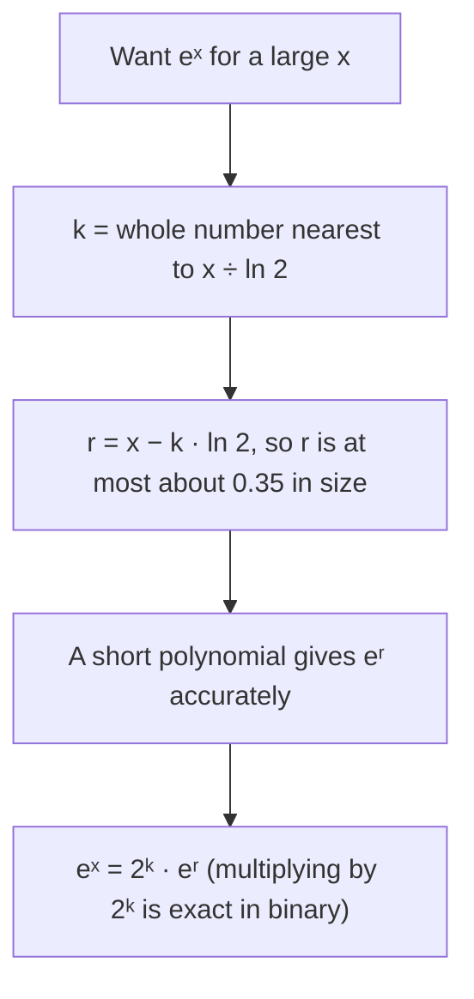

## From "it converges" to "here are the digits"

Lessons 41 to 44 gave you tests that say *whether* a series converges and error bounds that say how far a partial sum can be from the total. This lesson puts those bounds to work on a practical question: how do you actually get the digits of $\pi$, $e$ or $\ln 2$? The answer is rarely "add up the obvious series". Some convergent series are hopelessly slow, and most of the skill lies in rewriting a problem so that a fast series does the work. Along the way you will see how to sharpen the integral-test bounds, how fast the harmonic series grows, and the idea behind how calculators evaluate $e^x$.

## Fast and slow series

Two series from Lessons 43 and 44 show the contrast. At $x = 1$ the arctangent series gives the **Leibniz series**
$$\frac{\pi}{4} = 1 - \frac13 + \frac15 - \frac17 + \cdots.$$
It converges by the alternating series test, but after $N$ terms the error bound for $\pi$ (four times the series) is $\frac{4}{2N + 1}$. For the bound to promise six correct decimals (error below $5\times10^{-7}$), you need about 4 million terms. The partial sums creep toward $\pi$ in a slow zigzag:

```plot
{"x": [0, 13], "y": [2.5, 4.2], "points": [{"at": [1, 4]}, {"at": [2, 2.6667]}, {"at": [3, 3.4667]}, {"at": [4, 2.8952]}, {"at": [5, 3.3397]}, {"at": [6, 2.976]}, {"at": [7, 3.2837]}, {"at": [8, 3.0171]}, {"at": [9, 3.2524]}, {"at": [10, 3.0418]}, {"at": [11, 3.2323]}, {"at": [12, 3.0584]}], "functions": [{"f": "pi", "dashed": true, "label": "π"}], "xLabel": "N", "caption": "Four times the partial sums of 1 − 1/3 + 1/5 − …: after 12 terms the error is still about 0.08"}
```

The series is named after Gottfried Leibniz, who published it in 1682; James Gregory knew the arctangent series in 1671, and the same series appears much earlier in the work of the Kerala school in India, traditionally credited to Madhava (around 1400).

Now compare $e = \sum\frac{1}{n!}$. Factorials grow so fast that the tail is tiny. If you stop after the $\frac{1}{n!}$ term, the rest is
$$\frac{1}{(n + 1)!} + \frac{1}{(n + 2)!} + \cdots = \frac{1}{(n + 1)!}\left(1 + \frac{1}{n + 2} + \frac{1}{(n + 2)(n + 3)} + \cdots\right).$$
Each fraction inside the parentheses is at most a power of $\frac{1}{n + 1}$, so the parentheses are at most the geometric sum $\frac{1}{1 - 1/(n + 1)} = \frac{n + 1}{n}$. That gives a clean bound:
$$0 < e - \sum_{k=0}^{n}\frac{1}{k!} < \frac{1}{(n + 1)!}\cdot\frac{n + 1}{n} = \frac{1}{n!\,n}.$$

### Example 1

How many terms of $\sum\frac{1}{k!}$ give $e$ with error below $10^{-10}$?

We need $n!\,n > 10^{10}$. For $n = 12$: $12!\cdot12 = 479{,}001{,}600 \cdot 12 \approx 5.7\times10^{9}$, too small. For $n = 13$: $13!\cdot13 \approx 8.1\times10^{10}$, enough. So the terms $k = 0, 1, \dots, 13$ (14 terms) give $e \approx 2.71828182845$, with actual error about $1.2\times10^{-11}$. Fourteen terms against millions: that is the difference a factorial makes.

## Squeezing the tail of a positive series

For a series with positive decreasing terms $a_n = f(n)$, Lesson 41 bounded the tail $R_N$ between two integrals. Add $S_N$ to every part and you trap the *sum itself*:
$$S_N + \int_{N+1}^\infty f(x)\,dx \;\le\; S \;\le\; S_N + \int_N^\infty f(x)\,dx.$$
The true sum lies in an interval whose width is $\int_N^{N+1}f(x)\,dx$, which is less than $a_N$ and usually far smaller than either bound on the error alone. Taking the midpoint of the interval as your estimate is a cheap and often very effective improvement.

### Example 2

Estimate $\sum\frac{1}{n^2}$ using $N = 10$.

$S_{10} = 1.549768$ (to 6 decimals). The tail integrals are $\int_{11}^\infty\frac{dx}{x^2} = \frac{1}{11}$ and $\int_{10}^\infty\frac{dx}{x^2} = \frac{1}{10}$, so
$$1.640677 \le S \le 1.649768.$$
The midpoint is $1.645222$. The exact sum is $\frac{\pi^2}{6} = 1.644934$, so the midpoint is off by about $0.0003$, while $S_{10}$ alone was off by $0.095$. Ten terms plus one integral beat a thousand terms added blindly. (In the 1730s, before he found the exact value, Euler computed this sum to many decimal places using more refined ways of estimating the tail.)

### How fast does the harmonic series grow?

The same picture works for a divergent series. With $f(x) = \frac1x$, the rectangles give
$$\ln(N + 1) \le H_N \le 1 + \ln N, \qquad H_N = 1 + \frac12 + \cdots + \frac1N.$$
So $H_N$ grows like $\ln N$: without bound, but extremely slowly. In fact the gap $H_N - \ln N$ decreases toward a limit, the **Euler–Mascheroni constant**
$$\gamma = \lim_{N\to\infty}\left(H_N - \ln N\right) \approx 0.5772.$$
(Nobody knows whether $\gamma$ is rational or irrational; it is a famous open problem.)

```plot
{"x": [0, 13], "y": [-0.2, 3.5], "points": [{"at": [1, 1]}, {"at": [2, 1.5]}, {"at": [3, 1.8333]}, {"at": [4, 2.0833]}, {"at": [5, 2.2833]}, {"at": [6, 2.45]}, {"at": [7, 2.5929]}, {"at": [8, 2.7179]}, {"at": [9, 2.829]}, {"at": [10, 2.929]}, {"at": [11, 3.0199]}, {"at": [12, 3.1032]}], "functions": [{"f": "ln(x)", "from": 0.8, "label": "ln x"}, {"f": "ln(x) + 0.5772", "from": 0.6, "dashed": true, "label": "ln x + γ"}], "xLabel": "N", "caption": "Harmonic partial sums H_N (dots) run parallel to ln N, about 0.58 above it"}
```

### Example 3

About how many terms of the harmonic series are needed for the partial sum to pass 100?

Using $H_N \approx \ln N + \gamma$, solve $\ln N + 0.5772 = 100$: $N \approx e^{99.42} \approx 1.5\times10^{43}$. The bounds above confirm the size: $H_N \le 1 + \ln N$ means $N$ must be at least $e^{99} \approx 10^{43}$. Adding a trillion terms per second, that would take far longer than the age of the universe. The series diverges, but you would never see it happen by adding.

## Faster logarithms

The series $\ln 2 = 1 - \frac12 + \frac13 - \cdots$ is as slow as the Leibniz series. A better idea: subtract two known series. For $|x| < 1$,
$$\ln(1 + x) = x - \frac{x^2}{2} + \frac{x^3}{3} - \cdots, \qquad \ln(1 - x) = -x - \frac{x^2}{2} - \frac{x^3}{3} - \cdots.$$
Subtracting, the even powers cancel and the odd ones double:
$$\ln\frac{1 + x}{1 - x} = 2\left(x + \frac{x^3}{3} + \frac{x^5}{5} + \cdots\right), \qquad |x| < 1.$$
Every positive number $y$ equals $\frac{1 + x}{1 - x}$ for exactly one $x$ in $(-1, 1)$, namely $x = \frac{y - 1}{y + 1}$, so this one series gives every logarithm. The closer $y$ is to 1, the smaller $x$ is and the faster the series converges.

### Example 4

Compute $\ln 2$ to about 4 decimal places.

$x = \frac{2 - 1}{2 + 1} = \frac13$. The terms of $2\left(x + \frac{x^3}{3} + \frac{x^5}{5} + \cdots\right)$ are
$$\tfrac23 = 0.666667,\quad \tfrac{2}{81} = 0.024691,\quad \tfrac{2}{1215} = 0.001646,\quad \tfrac{2}{15309} = 0.000131.$$
Four terms give $0.693135$. The tail starts at $\frac{2x^9}{9}$ and each later term is less than $x^2 = \frac19$ times the one before, so the tail is less than
$$\frac{2(1/3)^9}{9}\cdot\frac{1}{1 - 1/9} \approx 0.0000127.$$
So $\ln 2 \approx 0.69314$ with error under $0.000013$ (the true value is $0.693147$). Four terms here do better than about 40,000 terms of the alternating harmonic series.

## Machin's formula for π

The arctangent series converges fast when $x$ is small, so the trick for $\pi$ is to write $\frac\pi4$ using arctangents of small numbers. **Machin's formula** (John Machin, 1706) does it:
$$\frac{\pi}{4} = 4\arctan\frac15 - \arctan\frac{1}{239}.$$
*Why it's true.* Let $\alpha = \arctan\frac15$. By the double-angle formula for tangent, $\tan2\alpha = \frac{2/5}{1 - 1/25} = \frac{5}{12}$, and then $\tan4\alpha = \frac{10/12}{1 - 25/144} = \frac{120}{119}$. That is just above 1, so $4\alpha$ is just above $\frac\pi4$. The tangent subtraction formula gives
$$\tan\left(4\alpha - \frac\pi4\right) = \frac{\frac{120}{119} - 1}{1 + \frac{120}{119}} = \frac{1}{239}.$$
So $4\alpha - \frac\pi4 = \arctan\frac{1}{239}$, which rearranges to Machin's formula. Machin used it to compute 100 decimal places of $\pi$ by hand, and formulas of this kind remained the main way of computing $\pi$ for more than two centuries.

### Example 5

Estimate $\pi$ from Machin's formula using three terms of the series for $\arctan\frac15$ and one term for $\arctan\frac{1}{239}$.

$\arctan\frac15 \approx \frac15 - \frac{1}{3\cdot125} + \frac{1}{5\cdot3125} = 0.2 - 0.0026667 + 0.000064 = 0.1973973$, and $\arctan\frac{1}{239} \approx \frac{1}{239} = 0.0041841$. Then
$$\pi \approx 4\left(4(0.1973973) - 0.0041841\right) = 3.14162.$$
Error bound: each arctangent series alternates with decreasing terms, so each error is at most its first omitted term. The total error is at most $16\cdot\frac{(1/5)^7}{7} + 4\cdot\frac{(1/239)^3}{3} \approx 0.0000294$. The actual error is $0.0000283$. One more term of the first series brings the error below $10^{-6}$.

## How a machine computes e^x

A Taylor polynomial is accurate only near its center, and the Lagrange bound $\frac{M|x|^{n+1}}{(n + 1)!}$ is useless when $|x|$ is large. The fix is **argument reduction**: shrink the input first, then use a short polynomial. For $e^x$, write $x = k\ln2 + r$ with $k$ a whole number chosen so that $|r| \le \frac{\ln 2}{2} \approx 0.35$. Then
$$e^x = 2^k e^r,$$
and multiplying by $2^k$ is exact in binary arithmetic. The flowchart is a simplified version of what real software libraries do; they use polynomials tuned to spread the error evenly rather than plain Taylor polynomials, and some calculators use other methods altogether, but the reduce-then-approximate idea is common.



### Example 6

Compute $e^{10}$ this way with the degree-5 Taylor polynomial.

$\frac{10}{\ln2} \approx 14.43$, so $k = 14$ and $r = 10 - 14\ln2 \approx 0.295939$. Then $P_5(r) = 1 + r + \frac{r^2}{2} + \cdots + \frac{r^5}{120} \approx 1.3443878$, with Lagrange bound $\frac{e^{0.35}r^6}{720} \approx 1.3\times10^{-6}$. So $e^{10} \approx 16384 \times 1.3443878 \approx 22026.45$; the true value is $22026.47$. Note that multiplying by $2^{14}$ multiplied the absolute error too (to about $0.016$), but the *relative* error stays below $10^{-6}$. Using $P_5$ at $x = 10$ directly would give $1477.7$, which is useless.

## Common mistakes

- *Trusting convergence to mean usefulness.* A convergent series can need millions of terms; check the error bound before computing.
- *Forgetting the conditions on the tail bounds.* The integral sandwich needs positive, decreasing terms; the "first omitted term" bound needs an alternating series with decreasing terms.
- *Using $\frac{1}{(n + 1)!}$ alone as the error for $e$.* The tail is a little bigger than its first term; $\frac{1}{n!\,n}$ is a safe bound.
- *Plugging $y$ into the log series instead of $x$.* For $\ln y$ use $x = \frac{y - 1}{y + 1}$, then $\ln y = 2\left(x + \frac{x^3}{3} + \cdots\right)$; don't forget the factor 2.
- *Confusing absolute and relative error* after scaling, as in Example 6.

## Key points

- The speed of a series matters: the Leibniz series for $\pi$ needs millions of terms for 6 decimals; $\sum\frac{1}{k!}$ gets $e$ to 10 decimals in 14 terms, with $0 < e - \sum_{k\le n}\frac{1}{k!} < \frac{1}{n!\,n}$.
- For positive decreasing terms, $S_N + \int_{N+1}^\infty f \le S \le S_N + \int_N^\infty f$; the midpoint is often a very good estimate.
- $\ln(N + 1) \le H_N \le 1 + \ln N$, and $H_N - \ln N \to \gamma \approx 0.5772$.
- $\ln\frac{1 + x}{1 - x} = 2\left(x + \frac{x^3}{3} + \frac{x^5}{5} + \cdots\right)$ with $x = \frac{y - 1}{y + 1}$ gives fast logarithms.
- Machin's formula $\frac\pi4 = 4\arctan\frac15 - \arctan\frac1{239}$ turns slow arctangent sums into fast ones.
- Argument reduction: shrink the input, then use a short polynomial.
