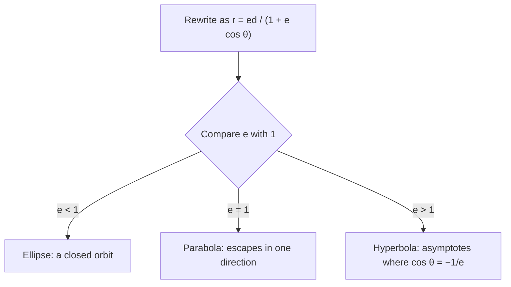

## Why put a conic in polar form?

Lesson 46 described curves by distance and direction from one special point, the pole, and found areas by adding thin wedges $\frac12r^2\,d\theta$ fanning out from it. Ellipses, parabolas and hyperbolas each have a special point of their own, a focus, and when the pole is placed at a focus all three share one short polar equation. That equation is exactly what astronomy needs: a planet, comet or spacecraft coasting under the Sun's gravity follows a conic with the Sun at a focus, and the wedge-area formula turns Kepler's second law into one line of calculus. This lesson builds the equation, reads the shape and size of an orbit from it, and then uses polar area to explain why planets speed up near the Sun and how long an orbit takes.

## One definition for all three conics

Fix a point $F$, the **focus**, a line, the **directrix**, not through $F$, and a positive number $e$, the **eccentricity**. The set of points $P$ whose distance to the focus is $e$ times their distance to the directrix,

$$PF = e\cdot PD,$$

is a **conic section**: an ellipse if $e < 1$, a parabola if $e = 1$, and a hyperbola if $e > 1$. (A circle is the limiting case $e = 0$; it has no directrix in this definition.)


Put the focus at the pole and the directrix at $x = d$ (with $d > 0$). A point $P$ with polar coordinates $(r, \theta)$ has $PF = r$, and its horizontal distance to the line $x = d$ is $PD = d - r\cos\theta$ (for points on the same side of the directrix as the focus; for a hyperbola, the branch beyond the directrix comes out of the same equation with negative values of $r$). The definition becomes $r = e(d - r\cos\theta)$. Collect the $r$ terms: $r + er\cos\theta = ed$, so

$$r = \frac{ed}{1 + e\cos\theta}.$$

Moving the directrix changes only the denominator:

| Directrix | Equation |
|---|---|
| $x = d$ (right of the focus) | $r = \dfrac{ed}{1 + e\cos\theta}$ |
| $x = -d$ (left) | $r = \dfrac{ed}{1 - e\cos\theta}$ |
| $y = d$ (above) | $r = \dfrac{ed}{1 + e\sin\theta}$ |
| $y = -d$ (below) | $r = \dfrac{ed}{1 - e\sin\theta}$ |

To read one, first make the constant in the denominator equal to 1, then read $e$ as the coefficient of the cosine or sine and $ed$ as the numerator.

## Reading the shape from the denominator

The denominator $1 + e\cos\theta$ explains the three shapes.

- If $e < 1$, the denominator is at least $1 - e > 0$, so $r$ stays finite for every $\theta$: a closed curve, the ellipse.
- If $e = 1$, the denominator is 0 only at $\theta = \pi$: the curve runs off to infinity in exactly one direction, the parabola.
- If $e > 1$, the denominator is 0 at the two angles where $\cos\theta = -\frac1e$; those are the directions of the asymptotes. Between them $r$ is negative, which traces the second branch of the hyperbola.

```plot
{"x": [-6, 4], "y": [-5, 5], "equal": true, "curves": [{"x": "2cos(t)/(1 + 0.5cos(t))", "y": "2sin(t)/(1 + 0.5cos(t))", "t": [0, "2pi"]}, {"x": "2cos(t)/(1 + cos(t))", "y": "2sin(t)/(1 + cos(t))", "t": [-2.7, 2.7], "dashed": true}, {"x": "2cos(t)/(1 + 2cos(t))", "y": "2sin(t)/(1 + 2cos(t))", "t": [-1.98, 1.98]}, {"x": "2cos(t)/(1 + 2cos(t))", "y": "2sin(t)/(1 + 2cos(t))", "t": [2.2, 4.08]}], "points": [{"at": [0, 0]}], "labels": [{"at": [-0.6, -0.5], "text": "focus"}, {"at": [-2.6, 2.6], "text": "e = 0.5"}, {"at": [-5.0, 3.9], "text": "e = 1"}, {"at": [2.2, 3.8], "text": "e = 2"}], "caption": "r = 2/(1 + e cos θ) for e = 0.5 (ellipse), 1 (parabola) and 2 (both branches of a hyperbola), all with the focus at the origin"}
```



### Example 1 (an ellipse)

Identify $r = \dfrac{6}{2 + \cos\theta}$ and find its vertices, center and axes.

Divide the top and bottom by 2: $r = \dfrac{3}{1 + \frac12\cos\theta}$. So $e = \frac12$ (an ellipse) and $ed = 3$, giving $d = 6$: the directrix is $x = 6$.

The vertices are on the polar axis. At $\theta = 0$: $r = \frac{3}{3/2} = 2$, the point $(2, 0)$. At $\theta = \pi$: $r = \frac{3}{1/2} = 6$, the point $(-6, 0)$. The major axis runs from $-6$ to $2$, so its length is 8, the **semi-major axis** is $a = 4$, and the center is $(-2, 0)$. The focus (the origin) is $c = 2$ from the center, which matches $c = ae = 4\cdot\frac12$. Then $b = \sqrt{a^2 - c^2} = \sqrt{12} = 2\sqrt3$, and the area is $\pi ab = 8\sqrt3\,\pi \approx 43.53$.

## Measuring an ellipse from its polar equation

Example 1 generalizes. For $r = \dfrac{ed}{1 + e\cos\theta}$ with $0 < e < 1$:

- nearest point to the focus at $\theta = 0$: $r_{\min} = \dfrac{ed}{1 + e}$; farthest at $\theta = \pi$: $r_{\max} = \dfrac{ed}{1 - e}$;
- semi-major axis $a = \frac12(r_{\min} + r_{\max}) = \dfrac{ed}{1 - e^2}$, focus-to-center distance $c = ae$, semi-minor axis $b = a\sqrt{1 - e^2}$;
- the numerator $\ell = ed$ is the value of $r$ at $\theta = \pm\frac\pi2$, called the **semi-latus rectum**, and $\ell = a(1 - e^2)$.

So the equation can be written with the two numbers astronomers quote for an orbit, $a$ and $e$:

$$r = \frac{a(1 - e^2)}{1 + e\cos\theta}, \qquad r_{\min} = a(1 - e), \qquad r_{\max} = a(1 + e), \qquad e = \frac{r_{\max} - r_{\min}}{r_{\max} + r_{\min}}.$$

For an orbit around the Sun, the nearest point is the **perihelion** and the farthest is the **aphelion**.

### Example 2 (a hyperbola)

Describe $r = \dfrac{4}{1 + 2\cos\theta}$.

Here $e = 2$, so it is a hyperbola, with $ed = 4$ and directrix $x = 2$. The denominator vanishes where $\cos\theta = -\frac12$, at $\theta = \pm\frac{2\pi}3$, so the asymptotes point in those directions and have slopes $\pm\sqrt3$. At $\theta = 0$: $r = \frac43$, the vertex $\left(\frac43, 0\right)$ on the branch that wraps around the focus. At $\theta = \pi$: $r = \frac{4}{-1} = -4$, and a negative $r$ at angle $\pi$ is the point $(4, 0)$, the vertex of the other branch. The center is midway, at $\left(\frac83, 0\right)$, and $a = \frac43$; the focus is $c = \frac83$ from the center, and indeed $\frac ca = 2 = e$.

## Kepler's laws

Johannes Kepler, working from Tycho Brahe's careful observations of Mars, published his first two laws in 1609 (*Astronomia Nova*) and the third in 1619 (*Harmonices Mundi*). In modern form, **Kepler's laws** are:

1. Each planet moves on an ellipse with the Sun at one focus.
2. The line from the Sun to the planet sweeps out equal areas in equal times.
3. The square of the orbital period is proportional to the cube of the semi-major axis: $T^2 \propto a^3$.

Newton showed in the *Principia* (1687) that all three follow from his law of gravitation, which also allows parabolic and hyperbolic paths for objects moving fast enough to escape. Real orbits are slightly disturbed by the other planets, so the laws are excellent approximations rather than exact. Here is what polar calculus says about them.

### The second law is a statement about polar area

Measure the area swept since some starting time as $A(t) = \frac12\int_{\theta_0}^{\theta(t)}r^2\,d\varphi$. By the Fundamental Theorem and the chain rule,

$$\frac{dA}{dt} = \frac12r^2\frac{d\theta}{dt}.$$

Equal areas in equal times means $\frac{dA}{dt}$ is constant, so $r^2\frac{d\theta}{dt} = h$ for a constant $h$ (in physics, $h$ is the angular momentum per unit mass). Therefore $\frac{d\theta}{dt} = \frac{h}{r^2}$: the direction to the planet turns fastest when the planet is closest.

```plot
{"x": [-3.8, 2.7], "y": [-2.5, 2.5], "equal": true, "curves": [{"x": "2cos(t)/(1 + 0.4cos(t))", "y": "2sin(t)/(1 + 0.4cos(t))", "t": [0, "2pi"]}], "polygons": [{"points": [[0, 0], [1.241, -0.849], [1.299, -0.71], [1.346, -0.569], [1.382, -0.428], [1.408, -0.285], [1.423, -0.143], [1.429, 0.0], [1.423, 0.143], [1.408, 0.285], [1.382, 0.428], [1.346, 0.569], [1.299, 0.71], [1.241, 0.849]]}, {"points": [[0, 0], [-3.297, 0.379], [-3.317, 0.254], [-3.329, 0.127], [-3.333, 0.0], [-3.329, -0.127], [-3.317, -0.254], [-3.297, -0.379]]}], "points": [{"at": [0, 0]}, {"at": [1.4286, 0]}, {"at": [-3.3333, 0]}], "labels": [{"at": [0.85, 0.08], "text": "Sun"}, {"at": [2.05, -0.4], "text": "perihelion"}, {"at": [-2.6, -0.75], "text": "aphelion"}], "caption": "Orbit with e = 0.4: the two wedges have equal areas, so the planet sweeps the wide angle near perihelion in the same time as the narrow angle near aphelion"}
```

At perihelion and aphelion the velocity is perpendicular to the radius (the distance is at a minimum or maximum, so it isn't changing), and the speed is just $r\frac{d\theta}{dt} = \frac hr$. So

$$\frac{v_{\text{perihelion}}}{v_{\text{aphelion}}} = \frac{r_{\max}}{r_{\min}} = \frac{1 + e}{1 - e}.$$

### Example 3 (Earth)

Earth's distance from the Sun ranges from about 147.1 million km (perihelion, in early January) to about 152.1 million km (aphelion, in early July). Find $e$ and the speed ratio.

$e = \dfrac{152.1 - 147.1}{152.1 + 147.1} = \dfrac{5.0}{299.2} \approx 0.0167$, a nearly circular orbit. The speed ratio is $\dfrac{152.1}{147.1} \approx 1.034$: Earth moves about 3.4% faster in January than in July. (Distance from the Sun is not what causes the seasons; the tilt of Earth's axis does.)

## Area, period and the third law

The whole ellipse has area $\pi ab$. In polar form that is
$$\frac12\int_0^{2\pi}\frac{\ell^2}{(1 + e\cos\theta)^2}\,d\theta = \pi ab,$$
because $\int_0^{2\pi}\frac{d\theta}{(1 + e\cos\theta)^2} = \frac{2\pi}{(1 - e^2)^{3/2}}$ for $0 \le e < 1$. That integral takes a special substitution or a table, but you can check it numerically for any $e$; then $\frac12\ell^2\cdot\frac{2\pi}{(1 - e^2)^{3/2}} = \frac{\pi a^2(1 - e^2)^2}{(1 - e^2)^{3/2}} = \pi a^2\sqrt{1 - e^2} = \pi ab$.

Since area is swept at the constant rate $\frac h2$, one full orbit takes $T = \frac{\pi ab}{h/2} = \frac{2\pi ab}{h}$. Newton's law of gravitation adds one more fact, which we state without derivation: $h^2 = GM\ell$, where $M$ is the Sun's mass and $G$ the gravitational constant. Then, using $b^2 = a^2(1 - e^2) = a\ell$,

$$T^2 = \frac{4\pi^2a^2b^2}{GM\ell} = \frac{4\pi^2}{GM}\,a^3,$$

which is Kepler's third law, with the constant identified. For Earth, $a \approx 1.496\times10^{11}$ m and $GM \approx 1.327\times10^{20}$ m³/s² give $T \approx 3.156\times10^7$ s, about 365.3 days (with more precise values of $a$ and $GM$ the result is the sidereal year, 365.26 days). Measuring $a$ in astronomical units (AU, Earth's semi-major axis) and $T$ in years makes the constant 1 for anything orbiting the Sun: $T = a^{3/2}$.

### Example 4 (Halley's comet)

Halley's comet has $a \approx 17.8$ AU and $e \approx 0.967$. Find its period, perihelion, aphelion and speed ratio.

- Period: $T \approx 17.8^{3/2} \approx 75.1$ years. (Planets' pulls make the actual time between returns vary by a few years; it was last near the Sun in 1986.)
- Perihelion: $a(1 - e) \approx 17.8\times0.033 \approx 0.59$ AU, inside Venus's orbit. Aphelion: $a(1 + e) \approx 35.0$ AU, beyond Neptune.
- Speed ratio: $\frac{1 + e}{1 - e} = \frac{1.967}{0.033} \approx 60$. The comet spends decades crawling far out and only months near the Sun.

### Example 5 (time spent on part of an orbit)

An orbit has $e = 0.5$. What fraction of its period does the body take to go from perihelion ($\theta = 0$) to $\theta = \frac\pi2$?

By the second law, time is proportional to area: the fraction is the swept area over the total area $\pi ab$. Take $\ell = 1$ (the size cancels). Then $a = \frac{\ell}{1 - e^2} = \frac43$, $b = a\sqrt{1 - e^2} = \frac{2}{\sqrt3}$, and $\pi ab \approx 4.8368$. A calculator gives
$$\frac12\int_0^{\pi/2}\frac{d\theta}{(1 + 0.5\cos\theta)^2} \approx 0.4728,$$
so the fraction is $\frac{0.4728}{4.8368} \approx 0.098$. The first quarter turn of angle takes under 10% of the period, and by symmetry the next quarter turn, out to aphelion, takes about $0.5 - 0.098 = 0.402$ of it.

## Common mistakes

- **Reading $e$ before making the constant term 1.** In $r = \frac{6}{2 + \cos\theta}$ the eccentricity is $\frac12$, not 1.
- **Putting the Sun at the center.** The focus is at the pole; the center of the ellipse is $c = ae$ away from it.
- **Assuming constant speed.** By the second law the angle changes at the rate $\frac{h}{r^2}$, fastest at perihelion.
- *Using $\frac{h}{r}$ for the speed everywhere.* It gives the speed only where the velocity is perpendicular to the radius: at perihelion and aphelion.
- *Ignoring negative $r$ for a hyperbola.* Angles where $1 + e\cos\theta < 0$ trace the far branch.
- *Mixing up the directrix.* $1 - e\cos\theta$ means the directrix is $x = -d$; with $\sin\theta$ it is horizontal.

## Key points

- Focus–directrix definition: $PF = e\cdot PD$. With the focus at the pole and directrix $x = d$: $r = \dfrac{ed}{1 + e\cos\theta}$.
- $e < 1$ ellipse, $e = 1$ parabola, $e > 1$ hyperbola (asymptotes where $\cos\theta = -\frac1e$).
- Ellipse: $r = \dfrac{a(1 - e^2)}{1 + e\cos\theta}$, $r_{\min} = a(1 - e)$, $r_{\max} = a(1 + e)$, $b = a\sqrt{1 - e^2}$, area $\pi ab$.
- Kepler's second law: $\frac{dA}{dt} = \frac12r^2\frac{d\theta}{dt}$ is constant, so the planet moves fastest at perihelion; $\frac{v_p}{v_a} = \frac{1 + e}{1 - e}$.
- Kepler's third law: $T^2 = \frac{4\pi^2}{GM}a^3$; in years and AU, $T = a^{3/2}$.
- Time on an arc of the orbit is proportional to the polar area swept.
