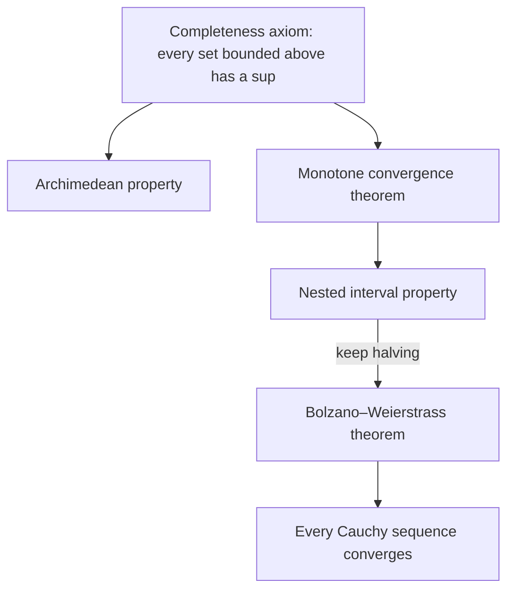

## A gap in the argument

Lesson 40 stated that a bounded monotone sequence converges, with the reason "the terms can't keep rising forever without exceeding a ceiling." That is a picture, not a proof, and here is why it can't be the whole story. The sequence
$$1,\quad 1.4,\quad 1.41,\quad 1.414,\quad 1.4142,\quad \dots$$
(the decimal places of $\sqrt2$, cut off one at a time) is increasing, bounded above by 2, and made entirely of rational numbers. If the rational numbers were the only numbers, it would have no limit at all, because $\sqrt2$ is not rational. The same holes would wreck the Intermediate Value Theorem: on the rationals, $x^2 - 2$ is negative at 1, positive at 2, and zero nowhere.

So the theorems of calculus depend on some property that the real numbers have and the rationals lack. This lesson names that property, completeness, and derives from it the tools that Lessons 92 and 93 use.

## Bounds, suprema and infima

Let $S$ be a set of real numbers. A number $M$ is an **upper bound** for $S$ if $x \le M$ for every $x$ in $S$; a **lower bound** $m$ has $m \le x$ for every $x$ in $S$. A set with an upper bound is *bounded above*.

An upper bound is rarely unique: if 5 is one, so is 6. The best one is the **least upper bound**, or **supremum**, written $\sup S$: an upper bound that is less than or equal to every other upper bound. Likewise the **greatest lower bound**, or **infimum** $\inf S$, is the largest lower bound.

The supremum need not belong to the set. For $S = \left\{1 - \frac1n : n = 1, 2, 3, \dots\right\} = \left\{0, \frac12, \frac23, \frac34, \dots\right\}$, the supremum is 1, but no element equals 1, so $S$ has no maximum. Its infimum, 0, is in $S$, so it is also the minimum. A *maximum* is just a supremum that happens to be in the set.

*The ε-test for a supremum.* A number $s$ is $\sup S$ exactly when

1. $s$ is an upper bound for $S$, and
2. for every $\varepsilon > 0$ some element $x$ of $S$ has $x > s - \varepsilon$.

Condition 2 says that nothing smaller than $s$ is an upper bound, which is what "least" means.

### Example 1

Find the supremum and infimum of $T = \left\{(-1)^n + \frac1n : n = 1, 2, 3, \dots\right\}$, and say whether each is in $T$.

Split by parity. Even $n$ give $1 + \frac1n$: the values $\frac32, \frac54, \frac76, \dots$ decrease toward 1. Odd $n$ give $-1 + \frac1n$: the values $0, -\frac23, -\frac45, \dots$ decrease toward $-1$.

- The largest value is $\frac32$ (at $n = 2$), so $\sup T = \frac32$, and it is a maximum.
- Every element is greater than $-1$, and the odd terms come within any $\varepsilon$ of $-1$, so $\inf T = -1$ by the ε-test (turned upside down). It is not in $T$: there is no minimum.

## The completeness axiom

> **Completeness axiom**. Every nonempty set of real numbers that is bounded above has a least upper bound, and that least upper bound is a real number.

(Applying it to $\{-x : x \in S\}$ gives the matching fact for infima.) This is the property the rationals lack. The set $A = \{q \text{ rational} : q^2 < 2\}$ is bounded above by 2, yet no rational number is its least upper bound. Sketch: a rational $r$ never has $r^2 = 2$. If $r^2 < 2$, a slightly larger rational still has square below 2, so $r$ is not an upper bound. If $r^2 > 2$, a slightly smaller rational still has square above 2, so it is a smaller upper bound and $r$ is not the least. Among the reals, $\sup A = \sqrt2$.

*A labeled simplification.* Here completeness is an axiom: one of the basic rules the real numbers are assumed to obey, along with the algebra and order rules. In the 1870s, Richard Dedekind and Georg Cantor, among others, showed how to *construct* the reals from the rationals; in such a construction, completeness becomes a theorem. Most first analysis courses start, as we do, by taking it as given.

Everything else in this lesson follows from the axiom:

## The Archimedean property

**Archimedean property**: for every real number $x$ there is a natural number $n > x$. Equivalently, for every $\varepsilon > 0$ some $n$ has $\frac1n < \varepsilon$. Lesson 90 used this silently every time it said "choose a whole number $N \ge \frac1\varepsilon$."

*Proof.* Suppose instead that the natural numbers were bounded above. By completeness they have a supremum $s$. Then $s - 1$ is not an upper bound, so some natural number $m$ has $m > s - 1$. But then $m + 1 > s$, and $m + 1$ is a natural number, which contradicts $s$ being an upper bound.

## The monotone convergence theorem

**Monotone convergence theorem**: an increasing sequence that is bounded above converges, and its limit is the supremum of its terms. (Likewise, a decreasing sequence bounded below converges to its infimum.)

*Proof.* The set of terms is nonempty and bounded above, so $L = \sup\{a_n\}$ exists. Given $\varepsilon > 0$, the ε-test gives a term $a_N > L - \varepsilon$. Because the sequence increases, every later term satisfies
$$L - \varepsilon < a_N \le a_n \le L \qquad (n > N),$$
so $|a_n - L| < \varepsilon$. That is the ε–N definition, with $N$ handed to us by the supremum.

### Example 2

Let $a_1 = 1$ and $a_{n+1} = \sqrt{2 + a_n}$. Show the sequence converges and find its limit.

The terms are $1,\ \sqrt3 \approx 1.732,\ 1.932,\ 1.983,\ \dots$

- *Bounded above by 2.* Since $a_1 = 1 < 2$, suppose $a_n < 2$. Then $a_{n+1} = \sqrt{2 + a_n} < \sqrt4 = 2$. By induction every term is below 2.
- *Increasing.* For $0 < x < 2$, $x^2 < x + 2$ (since $x^2 - x - 2 = (x - 2)(x + 1) < 0$), so $x < \sqrt{2 + x}$. Every $a_n$ lies in $(0, 2)$, so $a_n < a_{n+1}$.
- *Limit.* By the theorem, $a_n \to L$ for some $L$. Let $n \to \infty$ in $a_{n+1} = \sqrt{2 + a_n}$: $L = \sqrt{2 + L}$, so $L^2 - L - 2 = 0$ and $L = 2$ (the root $-1$ is impossible because all the terms are positive).

The order matters. Solving "$L = $ formula in $L$" only finds the limit *if there is one*. For $a_{n+1} = 2a_n$ with $a_1 = 1$, the same trick gives $L = 2L$, so $L = 0$, but the sequence $1, 2, 4, 8, \dots$ diverges.

## Nested intervals

**Nested interval property**: if $[a_1, b_1] \supseteq [a_2, b_2] \supseteq [a_3, b_3] \supseteq \cdots$ are closed intervals whose lengths $b_n - a_n$ tend to 0, then exactly one number lies in all of them.

*Why.* The left ends $a_n$ increase and are bounded above by $b_1$, so they converge to some $x$; the right ends decrease and converge too, and since $b_n - a_n \to 0$ they converge to the same $x$. Each $a_n \le x \le b_n$, so $x$ is in every interval, and two different numbers can't both fit in intervals shorter than the gap between them.

This is why every infinite decimal names a real number: $3.1, 3.14, 3.141, \dots$ pin down the nested intervals $[3.1, 3.2] \supseteq [3.14, 3.15] \supseteq \cdots$ Closedness matters: the open intervals $\left(0, \frac1n\right)$ are nested, but no number lies in all of them.

## The Bolzano–Weierstrass theorem

**Bolzano–Weierstrass theorem**: every bounded sequence has a convergent subsequence.

*Proof by halving.* Say every term lies in $[a, b]$. Cut the interval in half. At least one half contains infinitely many terms (the terms can't all fit, infinitely many of them, into two halves that each hold only finitely many); keep that half. Halve it, and again keep a half that holds infinitely many terms. The kept intervals are nested and the $k$-th has length $\frac{b - a}{2^k}$, so they close down on one number $x$. Now choose indices $n_1 < n_2 < \cdots$ with $a_{n_k}$ in the $k$-th interval; this is always possible, because each interval holds infinitely many terms. Then $|a_{n_k} - x| \le \frac{b - a}{2^k} \to 0$.

The sequence $(-1)^n\frac{n}{n + 1}$ from Lesson 90 diverges, but as the theorem promises, it has convergent subsequences (the even terms, which tend to 1). The theorem is named for Bernard Bolzano, who used a version of the halving argument in 1817, and Karl Weierstrass, who made it a standard tool decades later.

## Cauchy sequences

A **Cauchy sequence** is one whose terms eventually stay close *to each other*: for every $\varepsilon > 0$ there is $N$ with $|a_m - a_n| < \varepsilon$ for all $m, n > N$. No limit is mentioned.

Every convergent sequence is Cauchy (two terms each within $\frac\varepsilon2$ of $L$ are within $\varepsilon$ of each other). In the real numbers the converse holds too: a Cauchy sequence is bounded, so Bolzano–Weierstrass gives a convergent subsequence, and the terms of a Cauchy sequence stay close to that subsequence's limit. On the rationals it fails: the decimal truncations of $\sqrt2$ are Cauchy but have no rational limit. The Cauchy criterion lets you prove that a sequence converges without knowing its limit, which is how many series tests are proved.

## Common mistakes

- *Assuming the supremum is in the set.* $\sup\left\{1 - \frac1n\right\} = 1$, which is never reached. When it is reached, it is the maximum.
- *Solving for the limit before proving it exists.* "Let $L = \lim a_n$" is only legal once you know the limit exists, as Example 2's warning shows.
- *Dropping "closed" from nested intervals*, or "bounded" from Bolzano–Weierstrass: the sequence $1, 2, 3, \dots$ has no convergent subsequence.
- *Thinking Bolzano–Weierstrass makes the whole sequence converge.* It promises only a subsequence.
- *Treating completeness as obvious.* It is exactly what fails on the rationals, so any proof that never uses it (or a theorem built on it) can't prove the IVT or monotone convergence.

## Key points

- $\sup S$ is the least upper bound: an upper bound such that, for every $\varepsilon > 0$, some element exceeds $\sup S - \varepsilon$. It is a maximum only if it belongs to $S$.
- Completeness axiom: every nonempty set of reals that is bounded above has a real supremum. The rationals do not have this property.
- Consequences: the Archimedean property, monotone convergence (bounded increasing sequences converge to their sup), nested intervals, Bolzano–Weierstrass (bounded sequences have convergent subsequences), and "Cauchy implies convergent."
- For a recursive sequence, prove that it converges first, then solve for the limit.
