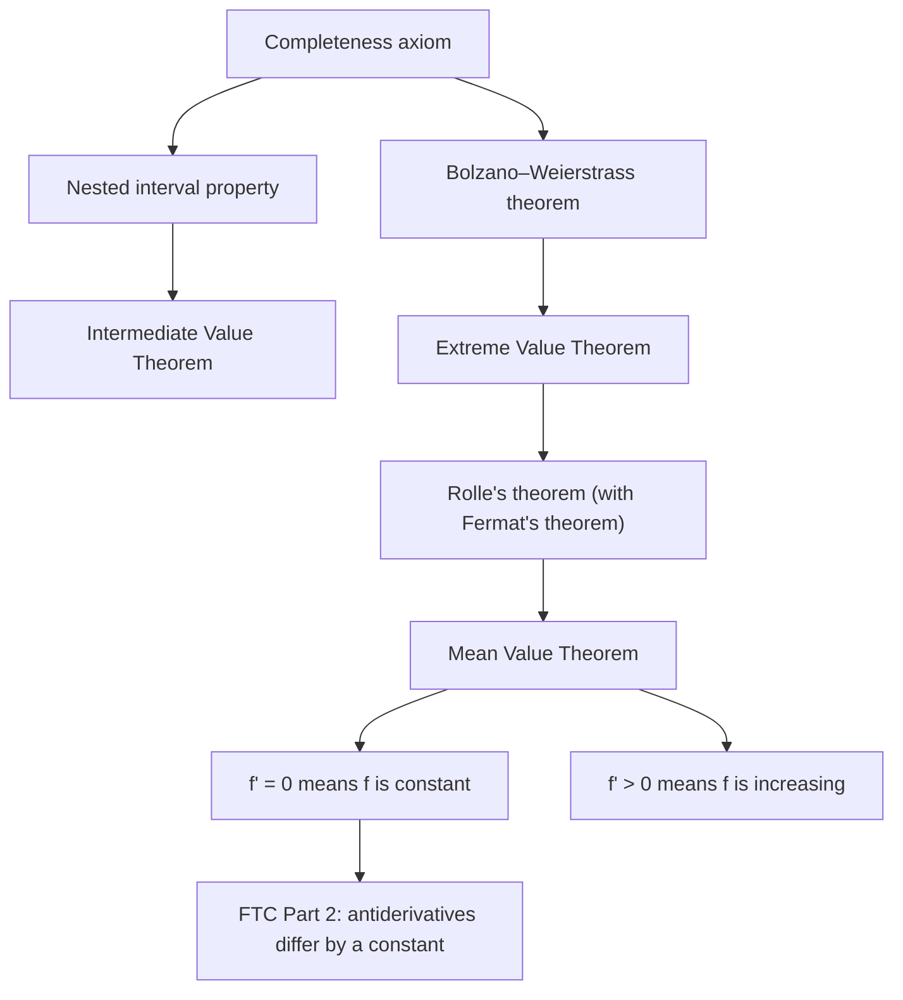

## Two theorems taken on faith

Lesson 5 stated the Intermediate Value Theorem and Lesson 17 stated the Extreme Value Theorem, each with a convincing picture and no proof. Lesson 17 then derived Rolle's theorem *from* the EVT, and the Mean Value Theorem *from* Rolle (apply Rolle's theorem to $f$ minus its secant line, which is the "tilt the picture" step), and almost everything later in the course leans on the MVT. So the whole tower rests on two unproved statements.

Lesson 91 explained why pictures can't be enough: on the rational numbers, $x^2 - 2$ changes sign on $[1, 2]$ without ever being 0. Any real proof must use completeness. This lesson gives those proofs, using the tools from Lessons 90 and 91: nested intervals for the IVT, and the Bolzano–Weierstrass theorem for the EVT.

## Continuity, in the language of sequences

Proofs about sequences need a version of continuity that talks about sequences. The **sequential criterion** for continuity says:

> $f$ is continuous at $c$ exactly when, for every sequence $x_n$ in the domain of $f$ with $x_n \to c$, the outputs satisfy $f(x_n) \to f(c)$.

*Proof of the direction we need (continuous ⇒ sequences behave).* Let $\varepsilon > 0$. Continuity at $c$ (the ε-δ definition with $L = f(c)$) gives a $\delta > 0$ such that $|x - c| < \delta$ implies $|f(x) - f(c)| < \varepsilon$. Since $x_n \to c$, there is an $N$ with $|x_n - c| < \delta$ for all $n > N$. For those $n$, $|f(x_n) - f(c)| < \varepsilon$. So $f(x_n) \to f(c)$.

The other direction is also true (it is proved by contradiction) and gives a handy way to show a function is *not* continuous: find one sequence $x_n \to c$ whose outputs don't tend to $f(c)$.

### Example 1

Let $f(x) = \sin\frac1x$ for $x \ne 0$ and $f(0) = 0$. Show $f$ is not continuous at 0.

Choose inputs where the sine equals 1: $x_n = \dfrac{1}{\frac\pi2 + 2\pi n}$. Then $x_n \to 0$, but $f(x_n) = \sin\left(\frac\pi2 + 2\pi n\right) = 1$ for every $n$, so $f(x_n) \to 1 \ne 0 = f(0)$. By the sequential criterion, $f$ is not continuous at 0.

One more tool, used twice below: *limits keep non-strict inequalities.* If $y_n \le 0$ for every $n$ and $y_n \to y$, then $y \le 0$. (If $y$ were positive, the terms would eventually be within $\frac y2$ of it, hence positive.) Strict inequalities can turn into equalities: $\frac1n > 0$, but its limit is 0.

## Proof of the Intermediate Value Theorem

It is enough to prove one case: *if $f$ is continuous on $[a, b]$ and $f(a) < 0 < f(b)$, then $f(c) = 0$ for some $c$ in $(a, b)$.* For a general height $N$ between $f(a)$ and $f(b)$, apply this case to $f(x) - N$ (or to $N - f(x)$ if $f(a) > f(b)$).

*Proof (bisection).* Start with $[a_1, b_1] = [a, b]$, where $f$ is negative at the left end and positive at the right. Test the midpoint $m$. If $f(m) = 0$, we are done. If $f(m) < 0$, keep $[m, b_1]$; if $f(m) > 0$, keep $[a_1, m]$. Either way the kept interval again has $f < 0$ at its left end and $f > 0$ at its right end. Repeat.

If no midpoint ever hits a root, this produces nested closed intervals $[a_k, b_k]$ of length $\frac{b - a}{2^{k-1}} \to 0$, with $f(a_k) < 0 < f(b_k)$ every time. By the nested interval property (Lesson 91) they close down on a single number $c$, and $a_k \to c$, $b_k \to c$. Now use continuity through the sequential criterion:

- $f(a_k) \to f(c)$, and every $f(a_k) < 0$, so $f(c) \le 0$;
- $f(b_k) \to f(c)$, and every $f(b_k) > 0$, so $f(c) \ge 0$.

Hence $f(c) = 0$. Since $f(a) \ne 0$ and $f(b) \ne 0$, $c$ is neither endpoint. ∎

The one place completeness enters is the nested interval step. Run the same halving on $x^2 - 2$ over $[1, 2]$ using only rationals, and the intervals close in on $\sqrt2$, a point that isn't there.

### Example 2

Run the proof on $f(x) = x^3 + x - 1$ over $[0, 1]$, where $f(0) = -1 < 0 < 1 = f(1)$.

| Step | Interval | Midpoint $m$ | $f(m)$ | Keep |
|---|---|---|---|---|
| 1 | $[0, 1]$ | $0.5$ | $-0.375$ | $[0.5, 1]$ |
| 2 | $[0.5, 1]$ | $0.75$ | $0.171875$ | $[0.5, 0.75]$ |
| 3 | $[0.5, 0.75]$ | $0.625$ | $-0.130859375$ | $[0.625, 0.75]$ |

After three halvings, the root lies in $[0.625, 0.75]$, an interval of length $\frac18$. The intervals keep shrinking toward $c \approx 0.6823$. The proof is also an algorithm: it is the bisection method from Lesson 5.

![The graph of y = x³ + x − 1 rising from (0, −1) to (1, 1) and crossing the x-axis near 0.68. Below the axis, four stacked bars show the nested intervals [0, 1], [0.5, 1], [0.5, 0.75] and [0.625, 0.75], each half as long as the one above it. A dashed vertical line at the root runs through all four bars, and the first midpoint, 0.5, is marked on the top bar.](images/calc-h1-bisection-proof.svg)

## Proof of the Extreme Value Theorem

*Theorem.* If $f$ is continuous on $[a, b]$, then $f$ attains a maximum value and a minimum value there.

*Step 1: $f$ is bounded.* Suppose not. Then for every $n$ there is a point $x_n$ in $[a, b]$ with $|f(x_n)| > n$. The sequence $x_n$ is bounded, so by Bolzano–Weierstrass it has a subsequence $x_{n_k}$ converging to some $c$. Because $a \le x_{n_k} \le b$ and limits keep non-strict inequalities, $a \le c \le b$: the limit stays in the interval. By continuity at $c$, $f(x_{n_k}) \to f(c)$, so the values $f(x_{n_k})$ form a convergent, hence bounded, sequence (Lesson 90). But $|f(x_{n_k})| > n_k \ge k$, which is unbounded. Contradiction.

*Step 2: the supremum is reached.* By Step 1 and completeness, $M = \sup\{f(x) : a \le x \le b\}$ exists. By the ε-test with $\varepsilon = \frac1n$, for each $n$ there is $x_n$ in $[a, b]$ with
$$M - \tfrac1n < f(x_n) \le M.$$
Again take a convergent subsequence $x_{n_k} \to c$ with $c$ in $[a, b]$. By the squeeze theorem $f(x_{n_k}) \to M$, and by continuity $f(x_{n_k}) \to f(c)$. Limits are unique, so $f(c) = M$: the maximum is attained at $c$. For the minimum, apply this to $-f$. ∎

Every hypothesis did a job. *Closed* kept the limit point $c$ inside the interval. *Bounded interval* let us use Bolzano–Weierstrass. *Continuous* turned $x_{n_k} \to c$ into $f(x_{n_k}) \to f(c)$.

```plot
{"x": [-0.1, 1.2], "y": [-0.5, 10], "functions": [{"f": "1/x", "from": 0.1, "to": 1}], "points": [{"at": [1, 1], "label": "(1, 1)"}], "caption": "y = 1/x on (0, 1] is continuous but unbounded: the interval is not closed, and a sequence such as 1/n runs off to 0, outside it"}
```

### Example 3 (watching the proof fail)

Let $f(x) = x^2$ on the open interval $(0, 1)$. Its supremum is $M = 1$, but no $x$ in $(0, 1)$ gives $f(x) = 1$. Where does the proof break?

Step 2 still produces points with $f(x_n) > 1 - \frac1n$, for example $x_n = \sqrt{1 - \frac{1}{2n}}$. Every subsequence of these points converges to $c = 1$, and that point is not in $(0, 1)$. The step "$c$ is in the interval" needed the endpoints, and that step fails. Including the endpoint repairs everything: on $[0, 1]$ the maximum is $f(1) = 1$.

And on the rationals the EVT fails even on a closed interval: $f(x) = \frac{1}{x^2 - 2}$ is defined and continuous at every rational $x$ in $[1, 2]$, but it is unbounded there, because rationals come as close to $\sqrt2$ as you like.

## The whole structure

With these two proofs, every theorem in the chain is proved from the completeness axiom:



Along this route, FTC Part 2 also needs Part 1 (to know that $\int_a^x f(t)\,dt$ is an antiderivative), and Part 1 needs the integral to exist. Lesson 93 supplies that last piece.

## Common mistakes

- *Expecting a strict inequality to survive the limit.* $f(a_k) < 0$ for every $k$ only gives $f(c) \le 0$. The IVT proof needs both one-sided facts to pin $f(c) = 0$.
- *Forgetting to check that $c$ is in the interval.* That is exactly where "closed" is used, and it is what goes wrong in Example 3.
- *Thinking the bisection proof finds every root.* It finds one; $f$ may have others it never looks at.
- *Believing the converse of the IVT.* A function that takes every intermediate value need not be continuous: $\sin\frac1x$ with $f(0) = 0$ (Example 1) takes every value between $-1$ and $1$ on every interval around 0, yet it is discontinuous there.
- *Using Bolzano–Weierstrass on the whole sequence.* It gives a convergent subsequence, which is all these proofs need.

## Key points

- Sequential criterion: $f$ is continuous at $c$ exactly when $x_n \to c$ always gives $f(x_n) \to f(c)$. One bad sequence proves discontinuity.
- IVT proof: bisect, keeping a sign change; nested intervals close on $c$; limits of negative and positive values force $f(c) = 0$.
- EVT proof: Bolzano–Weierstrass plus continuity shows $f$ is bounded, then that the supremum is attained. Closed, bounded and continuous are each essential.
- Both proofs use completeness. Together with Lesson 17's arguments for Rolle and the MVT, all of differential calculus now rests on that one axiom.
