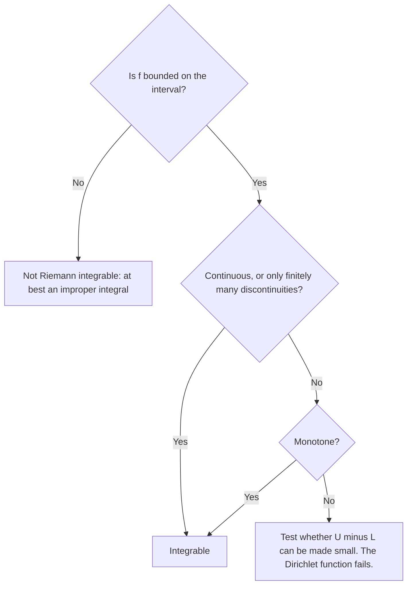

## The promise in Lesson 22

Lesson 22 defined $\int_a^b f(x)\,dx$ as the limit of Riemann sums and made a promise: for continuous $f$ the limit exists and doesn't depend on which sample points you use. That promise was never proved, and it raises real questions. Why should every choice of sample points give the same answer? Is there a function where they don't?

This lesson answers both, using a cleaner way to set up the integral: trap the area between an overestimate and an underestimate, and ask whether the gap can be closed. Bernhard Riemann gave his definition in the 1850s; the version with upper and lower sums used here is usually credited to Gaston Darboux in the 1870s, and most first analysis courses use it. At the end, the same ideas prove FTC Part 1, the last unproved link in the chain from Lesson 92.

## Partitions, upper sums and lower sums

Throughout, $f$ is *bounded* on $[a, b]$. A **partition** $P$ of $[a, b]$ is a finite list of points
$$a = x_0 < x_1 < x_2 < \cdots < x_n = b.$$
The pieces $[x_{i-1}, x_i]$ need not have equal widths; write $\Delta x_i = x_i - x_{i-1}$. On each piece let $M_i$ be the supremum of $f$ and $m_i$ the infimum. Then

$$U(f, P) = \sum_{i=1}^n M_i\,\Delta x_i \qquad\text{and}\qquad L(f, P) = \sum_{i=1}^n m_i\,\Delta x_i$$

are the **upper sum** and **lower sum** for $P$. Every Riemann sum on the same partition lies between them, whatever sample points it uses, because each sample value $f(x_i^*)$ is between $m_i$ and $M_i$. For continuous $f$, the EVT says $M_i$ and $m_i$ are the actual largest and smallest values on each piece.

### Example 1

Compute the upper and lower sums of $f(x) = x^2$ on $[0, 2]$ for $P = \{0, 0.5, 1, 1.5, 2\}$.

On $[0, 2]$ the function increases, so on each piece the infimum is at the left end and the supremum at the right end. Every width is $0.5$.
$$L = 0.5\,(0 + 0.25 + 1 + 2.25) = 1.75, \qquad U = 0.5\,(0.25 + 1 + 2.25 + 4) = 3.75.$$
The true value, $\frac83 \approx 2.667$, lies between them. The gap is $U - L = 2$.

## Refining tightens the bounds

A **refinement** of $P$ is a partition that contains all the points of $P$ and possibly more. Adding a point splits one piece into two. On each half, the supremum is at most the supremum over the whole piece, and the infimum is at least the infimum over the whole piece. So for a refinement $Q$ of $P$,
$$L(f, P) \le L(f, Q) \le U(f, Q) \le U(f, P).$$
Lower sums can only rise and upper sums can only fall. One consequence: *every lower sum is at most every upper sum*, even for two unrelated partitions $P$ and $P'$. Compare both with the partition that uses all their points together:
$$L(f, P) \le L(f, P \cup P') \le U(f, P \cup P') \le U(f, P').$$

## The integral as a meeting point

The **lower integral** is the supremum of all lower sums, and the **upper integral** is the infimum of all upper sums. By the consequence above, the lower integral is never more than the upper integral. When they are equal, $f$ is integrable, and the common value is $\int_a^b f(x)\,dx$.

Here is the test used in practice:

> **Riemann's criterion**: a bounded $f$ is integrable on $[a, b]$ exactly when, for every $\varepsilon > 0$, some partition $P$ has $U(f, P) - L(f, P) < \varepsilon$.

Why: the upper and lower integrals are trapped between $L(f, P)$ and $U(f, P)$ for every $P$, so if that gap can be made smaller than any $\varepsilon$, they must be equal.

*A labeled simplification.* This "Darboux" definition and Lesson 22's limit-of-Riemann-sums definition agree: a bounded function is integrable in one sense exactly when it is in the other, with the same value. That equivalence is a theorem we state without proof. It is what makes the answer independent of the sample points, because all those Riemann sums are squeezed between $L$ and $U$.

## A function that is not integrable

The **Dirichlet function** on $[0, 1]$ is
$$D(x) = \begin{cases} 1 & x \text{ rational} \\ 0 & x \text{ irrational.} \end{cases}$$
Every interval, however short, contains both rational and irrational numbers (a consequence of the Archimedean property from Lesson 91). So on every piece of every partition, $M_i = 1$ and $m_i = 0$, which gives
$$U(D, P) = 1 \quad\text{and}\quad L(D, P) = 0 \quad\text{for every } P.$$
The upper integral is 1, the lower integral is 0, and $D$ is not integrable. In Riemann-sum language: rational sample points always give 1, irrational sample points always give 0, and no amount of refining brings them together. (A more powerful integral, introduced by Henri Lebesgue around 1902, does handle $D$ and gives it the value 0; that is beyond this course.)

## Monotone functions are integrable

*Theorem.* If $f$ is increasing on $[a, b]$, then $f$ is integrable.

*Proof.* Use $n$ equal pieces of width $\Delta x = \frac{b - a}{n}$. Since $f$ increases, $M_i = f(x_i)$ and $m_i = f(x_{i-1})$, so
$$U - L = \sum_{i=1}^n \big[f(x_i) - f(x_{i-1})\big]\Delta x = \big[f(b) - f(a)\big]\frac{b - a}{n},$$
because the sum telescopes. Choosing $n > \frac{[f(b) - f(a)](b - a)}{\varepsilon}$ makes $U - L < \varepsilon$, so Riemann's criterion applies. Decreasing functions work the same way. ∎

The picture explains the telescoping. Each sliver between the upper and lower rectangles has width $\Delta x$; slide them all sideways into one column and they stack up to height $f(b) - f(a)$.

![An increasing curve over [a, b] split into four equal pieces. On each piece a lower rectangle sits under the curve and a taller upper rectangle covers it; the difference between them is a shaded sliver at the top of each upper rectangle. At the right, the four slivers are slid sideways and stacked into one column of width Δx whose height equals f(b) − f(a).](images/calc-h1-darboux.svg)

### Example 2

How many equal pieces guarantee $U - L < 0.01$ for $f(x) = \sqrt x$ on $[0, 4]$?

$f$ increases, $f(4) - f(0) = 2$ and $b - a = 4$, so $U - L = \frac{2\cdot4}{n} = \frac8n$. We need $\frac8n < 0.01$, that is $n > 800$. So $n = 801$ pieces suffice. Notice that the proof didn't need continuity: an increasing function with jumps, even infinitely many, is integrable too.

## Continuous functions are integrable

For a continuous $f$, the plan is to make every piece so short that $f$ varies by less than a set amount on it. That needs one δ that works *everywhere at once*. A function is **uniformly continuous** on a set if for every $\varepsilon > 0$ there is a $\delta > 0$ such that $|f(x) - f(y)| < \varepsilon$ for *all* $x, y$ in the set with $|x - y| < \delta$.

### Example 3

Show $f(x) = x^2$ is uniformly continuous on $[0, 3]$, and contrast it with $\frac1x$ on $(0, 1]$.

For $x, y$ in $[0, 3]$, $|x^2 - y^2| = |x + y|\,|x - y| \le 6|x - y|$. So $\delta = \frac\varepsilon6$ works at every point of the interval. For $\frac1x$ near 0, the graph is so steep that any fixed δ fails: the points $x = \frac1n$ and $y = \frac{1}{n+1}$ are closer than any given δ for large $n$, yet their outputs always differ by 1. No single δ works for $\varepsilon = 1$.

*Theorem (stated with a proof sketch).* A function continuous on a closed bounded interval $[a, b]$ is uniformly continuous there. Sketch: if not, there would be pairs $x_n, y_n$ with $|x_n - y_n| < \frac1n$ but $|f(x_n) - f(y_n)| \ge \varepsilon$. Bolzano–Weierstrass gives a subsequence of the $x_n$ converging to some $c$ in $[a, b]$; the matching $y_n$ converge to $c$ too, and continuity at $c$ then forces $|f(x_n) - f(y_n)| \to 0$ along that subsequence, a contradiction.

With it, the integrability proof is short. Given $\varepsilon > 0$, choose δ for the tolerance $\frac{\varepsilon}{b - a}$ and a partition with every piece shorter than δ. On each piece, the max and min are attained at two points less than δ apart, so $M_i - m_i < \frac{\varepsilon}{b - a}$, and
$$U - L = \sum (M_i - m_i)\Delta x_i < \frac{\varepsilon}{b - a}\sum\Delta x_i = \varepsilon.$$

## Payoff: proving FTC Part 1

Let $f$ be continuous on $[a, b]$ and $G(x) = \int_a^x f(t)\,dt$, which now certainly exists. Take $h > 0$. Then $G(x + h) - G(x) = \int_x^{x+h} f(t)\,dt$. By the EVT, $f$ has a minimum $m_h$ and maximum $M_h$ on $[x, x + h]$, and the one-piece lower and upper sums give
$$m_h\,h \le \int_x^{x+h} f(t)\,dt \le M_h\,h \quad\Longrightarrow\quad m_h \le \frac{G(x + h) - G(x)}{h} \le M_h.$$
Both $m_h$ and $M_h$ are values of $f$ at points within $h$ of $x$, so by continuity both tend to $f(x)$ as $h \to 0^+$. The squeeze theorem gives the right-hand derivative $f(x)$, and $h < 0$ works the same way. So $G'(x) = f(x)$. ∎ Together with Lesson 92's diagram, the main theorems of single-variable calculus now rest on the completeness axiom.

## Common mistakes

- *Calling an unbounded function Riemann integrable.* $\frac{1}{\sqrt x}$ on $(0, 1]$ has no finite supremum on the first piece, so its upper sums don't exist. Its integral is an improper integral (Lesson 35), a limit of ordinary integrals.
- *Using right endpoints for every upper sum.* That works only for increasing functions. In general $M_i$ is the supremum on the piece, which may be in the middle.
- *Testing one family of sample points.* Riemann sums using only rational points converge for the Dirichlet function; integrability needs *every* choice to agree, which is what $U - L \to 0$ guarantees.
- *Confusing continuity with uniform continuity.* $\frac1x$ is continuous at every point of $(0, 1]$ but not uniformly continuous there. On a closed bounded interval the two agree.
- *Thinking refinement always strictly improves the sums.* It never makes them worse, but adding a point where $f$ is constant changes nothing.

## Key points

- Upper and lower sums use the supremum and infimum of $f$ on each piece; every Riemann sum lies between them, and refining moves them toward each other.
- $f$ is integrable when the lower and upper integrals agree; Riemann's criterion: some partition makes $U - L < \varepsilon$, for every $\varepsilon > 0$.
- The Dirichlet function has $U = 1$, $L = 0$ for every partition: not integrable.
- Monotone functions are integrable, with $U - L = [f(b) - f(a)]\frac{b - a}{n}$ for $n$ equal pieces. Continuous functions on $[a, b]$ are integrable because they are uniformly continuous there.
- FTC Part 1 follows from the EVT and the squeeze theorem once the integral is known to exist.
