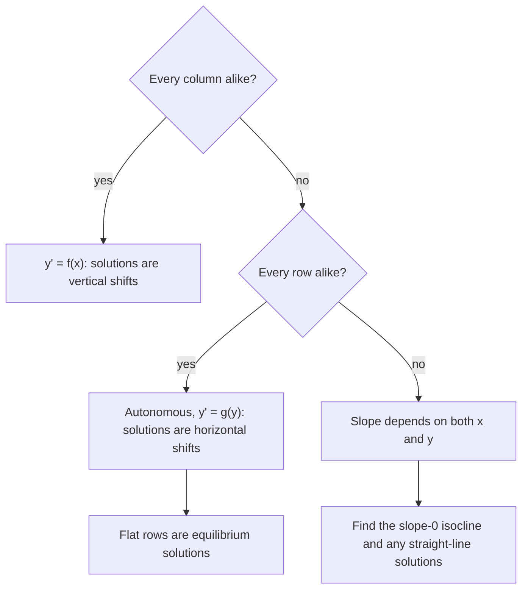

## Seeing solutions without solving

Last lesson we solved equations like $y' = 2x$ by integrating. Most first-order equations
$\dfrac{dy}{dx} = f(x, y)$ can't be solved that easily, and many can't be solved with a
formula at all. Yet the equation itself tells you something very concrete: at every
point $(x, y)$ it gives the slope that a solution curve passing through that point must
have. Draw those slopes and you can *see* the solutions. That picture is a
**slope field** (also called a **direction field**).

## How a slope field is built

Pick a grid of points. At each point $(x, y)$, compute $m = f(x, y)$ and draw a short
segment with slope $m$ centred at the point. That's all.

Why does this work? A solution curve $y(x)$ through a point $(x_0, y_0)$ has tangent
slope $y'(x_0)$, and the equation says $y'(x_0) = f(x_0, y_0)$. So the little segment at
each point is a piece of the tangent line of the solution through that point. A
solution curve must run *along* the segments everywhere it goes, like a leaf floating
on a current.

### Example 1

Sketch a few slopes for $\dfrac{dy}{dx} = x - y$.

| Point | Slope $x - y$ |
|---|---|
| $(0, 0)$ | $0$ |
| $(1, 0)$ | $1$ |
| $(0, 1)$ | $-1$ |
| $(2, 1)$ | $1$ |
| $(1, 2)$ | $-1$ |
| $(2, 2)$ | $0$ |

Along the whole line $y = x$ the slope is 0 (horizontal segments). Above that line
($y > x$) the slopes are negative; below it they are positive.

```plot
{"x": [-3, 3], "y": [-3, 3], "slopeField": {"f": "x - y", "step": 0.5}, "functions": [{"f": "x - 1", "label": "y = x - 1", "dashed": true}, {"f": "x - 1 + 2exp(-x)", "label": "through (0, 1)"}, {"f": "x - 1 - exp(-x)", "label": "through (0, -2)"}], "caption": "Slope field of dy/dx = x − y with two solution curves. Every solution approaches the line y = x − 1."}
```

The figure shows something you could not easily guess from the formula: all the
solutions bend toward the straight line $y = x - 1$. Check that this line really is a
solution: if $y = x - 1$ then $y' = 1$ and $x - y = x - (x - 1) = 1$. It is.

## Isoclines: organizing the sketch

An **isocline** is a curve along which the slope is the same constant $m$, found by
solving $f(x, y) = m$. For $y' = x - y$, the isocline of slope $m$ is the line
$y = x - m$. Drawing a few isoclines and putting segments of the matching slope along
each is a fast way to sketch by hand.

The picture below gathers the parts of a slope field for $y' = x - y$ in one place: the
short slope segments, the isocline of slope 0 (the line $y = x$, where every segment is
flat), the straight-line solution $y = x - 1$, and the solution curve through $(0, 1)$,
which has its lowest point where it crosses the slope-0 isocline.


The isocline for slope 0, where $f(x, y) = 0$, is especially useful: solution curves
have horizontal tangents there, so it's where solutions can reach local maxima or
minima.

## What to read off a slope field

**Patterns in the segments tell you the form of $f$.**

- If segments are the same along every vertical line (each column looks alike),
  the slope depends only on $x$: $y' = f(x)$. Solutions are vertical shifts of each
  other.
- If segments are the same along every horizontal line (each row looks alike),
  the slope depends only on $y$: $y' = g(y)$. Such equations are called **autonomous**,
  and solutions are horizontal shifts of each other.
- A horizontal row of flat segments (slope 0 everywhere along $y = c$) marks an
  equilibrium solution $y = c$.
- Steep segments mean large $|f|$; where $f$ is undefined there is no segment.

This chart puts the checks in the order to try them:



### Example 2

The slope field below has identical segments along each horizontal row and flat rows at
$y = 0$ and $y = 2$. Which equation fits: $y' = x(2 - x)$, $y' = y(2 - y)$, or
$y' = x - y$?

```plot
{"x": [-3, 3], "y": [-1, 3], "slopeField": {"f": "y*(2 - y)", "step": 0.5}, "functions": [{"f": "2/(1 + 3exp(-2x))", "label": "y(0) = 0.5"}], "caption": "A slope field that depends only on y, with flat rows at y = 0 and y = 2."}
```

- Rows look alike, so the slope depends on $y$ alone. That rules out $x(2 - x)$ and $x - y$.
- Check $y' = y(2 - y)$: zero at $y = 0$ and $y = 2$; positive between them (curves
  rise); negative above 2 (curves fall). That matches.

So the equation is $y' = y(2 - y)$. Notice the solution starting at $y = 0.5$: it rises
and levels off at $y = 2$. That S-shape is the logistic curve you'll meet in Lesson 4.

### Example 3

For $\dfrac{dy}{dx} = \dfrac{x}{y}$, what does the field look like, and where is the
slope undefined?

- At points on the $x$-axis ($y = 0$, $x \ne 0$) the slope is undefined: segments would
  be vertical, and no solution $y(x)$ can cross there.
- Along $x = 0$ (the $y$-axis) the slope is 0.
- Along $y = x$ the slope is 1, and along $y = -x$ it is $-1$. So the lines $y = \pm x$
  are themselves solutions (each runs along its own segments), and other solutions are
  hyperbolas $y^2 - x^2 = C$.

## Concavity from the equation

You can find $y''$ from the equation by differentiating with the chain rule, which
tells you whether solutions bend up or down. For $y' = x - y$:

$$y'' = \frac{d}{dx}(x - y) = 1 - y' = 1 - (x - y) = 1 - x + y.$$

So solutions are concave up where $y > x - 1$ and concave down where $y < x - 1$, which
matches the picture: curves above the line bend up toward it, curves below bend down
toward it.

## Common mistakes

- **Swapping the coordinates.** The slope at $(x, y) = (2, 1)$ uses $x = 2$, $y = 1$. Read
  points in order.
- **Thinking every point needs a formula.** A slope field is qualitative; its job is
  shape, not precise numbers.
- **Confusing the two patterns.** Columns alike means $f(x)$; rows alike means $g(y)$.
- **Letting a curve cross the segments.** A solution curve is tangent to the segment at
  every point it passes through.

## Key points

- At each point, a slope field draws a short segment of slope $f(x, y)$; solution curves
  follow the segments.
- Isoclines $f(x, y) = m$ collect points of equal slope; the $m = 0$ isocline holds the
  horizontal tangents.
- Flat rows mark equilibrium solutions; row-alike fields come from autonomous equations
  $y' = g(y)$.
- Differentiate the equation to get $y''$ and concavity.
