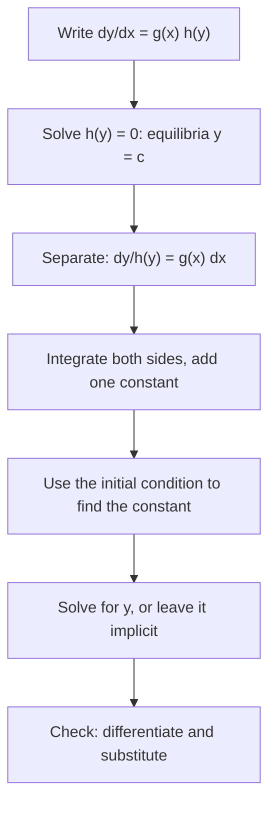

## The first real solving method

Slope fields showed the shape of solutions. Now we find formulas. The first method,
and the one you'll use most often in this module, works when the right side of
$\dfrac{dy}{dx} = f(x, y)$ splits into a factor depending only on $x$ times a factor
depending only on $y$. Such an equation is called **separable**:

$$\frac{dy}{dx} = g(x)\,h(y).$$

Examples: $y' = xy$, $y' = \dfrac{x^2}{y}$, $y' = e^{x - y} = e^x e^{-y}$. Not separable:
$y' = x + y$ (a sum can't be factored that way).

## The method and why it works

1. Divide by $h(y)$ (where $h(y) \ne 0$) and multiply by $dx$:
   $$\frac{1}{h(y)}\,dy = g(x)\,dx.$$
2. Integrate both sides: $\displaystyle\int \frac{dy}{h(y)} = \int g(x)\,dx + C$.
3. Solve for $y$ if you can, then apply any initial condition.

Writing $dy$ and $dx$ as if they were separate quantities looks like a trick, but it is
just the chain rule in reverse. If $H(y)$ is an antiderivative of $1/h(y)$, then for a
solution $y(x)$,

$$\frac{d}{dx}H(y(x)) = \frac{1}{h(y)}\frac{dy}{dx} = g(x).$$

So $H(y(x))$ and $\int g(x)\,dx$ have the same derivative and differ by a constant. One
constant on one side is enough; constants from both sides combine into a single $C$.

## Don't lose the equilibria

Dividing by $h(y)$ is illegal where $h(y) = 0$. If $h(c) = 0$, then $y = c$ is a constant
(equilibrium) solution, and it may not appear in your formula. Always check those values
separately.

The whole method, with the equilibrium check done first so it isn't forgotten, fits in one
chart. (Using the initial condition and solving for $y$ can also be done in the other order;
see below.)



### Example 1

Solve $\dfrac{dy}{dx} = xy$, $y(0) = 3$.

- Separate: $\dfrac{dy}{y} = x\,dx$ (assuming $y \ne 0$).
- Integrate: $\ln|y| = \dfrac{x^2}{2} + C$.
- Exponentiate: $|y| = e^C e^{x^2/2}$, so $y = Ae^{x^2/2}$ where $A = \pm e^C$. Allowing
  $A = 0$ also brings back the equilibrium $y = 0$.
- Initial condition: $3 = Ae^0$, so $A = 3$, and $y = 3e^{x^2/2}$.

This step, replacing $\pm e^C$ by one constant $A$, happens every time you integrate
$\dfrac{dy}{y}$. Remember it.

The figure shows several members of the family $y = Ae^{x^2/2}$. The flat member $A = 0$ is
the equilibrium solution that dividing by $y$ would have lost.

```plot
{"x": [-2.5, 2.5], "y": [-6, 6], "functions": [{"f": "3exp(x^2/2)", "label": "A = 3"}, {"f": "exp(x^2/2)", "label": "A = 1"}, {"f": "0", "label": "A = 0"}, {"f": "-exp(x^2/2)"}, {"f": "-2exp(x^2/2)"}], "points": [{"at": [0, 3], "label": "(0, 3)"}], "caption": "Solutions y = Ae^(x²/2) of dy/dx = xy; the two curves below the axis have A = −1 and A = −2. The equilibrium y = 0 (A = 0) is the one that dividing by y would lose."}
```

### Example 2

Solve $\dfrac{dy}{dx} = \dfrac{6x^2}{y}$, $y(1) = 4$.

- Separate: $y\,dy = 6x^2\,dx$.
- Integrate: $\dfrac{y^2}{2} = 2x^3 + C$.
- Initial condition first (it's easier before solving for $y$): $\dfrac{16}{2} = 2 + C$,
  so $C = 6$.
- Then $y^2 = 4x^3 + 12$. Choose the sign that matches $y(1) = 4 > 0$:
  $$y = \sqrt{4x^3 + 12}.$$
- The solution only exists where $4x^3 + 12 > 0$, that is $x > -\sqrt[3]{3}$. Solutions
  of nonlinear equations often live on limited intervals.

### Example 3

Solve $\dfrac{dy}{dx} = y^2$, $y(0) = 1$.

- Separate: $y^{-2}\,dy = dx$.
- Integrate: $-\dfrac{1}{y} = x + C$.
- Initial condition: $-1 = C$. So $-\dfrac1y = x - 1$, giving $y = \dfrac{1}{1 - x}$.
- This blows up at $x = 1$. The solution of the IVP exists only on $(-\infty, 1)$, the
  interval containing $x_0 = 0$, even though the equation $y' = y^2$ looks perfectly
  harmless everywhere.

```plot
{"x": [-3, 2], "y": [-1, 6], "slopeField": {"f": "y^2", "step": 0.5}, "functions": [{"f": "1/(1 - x)", "to": 0.98, "label": "y = 1/(1 − x)"}], "points": [{"at": [0, 1], "label": "(0, 1)"}], "caption": "The solution of y′ = y², y(0) = 1 shoots to infinity as x → 1."}
```

### Example 4

Solve $\dfrac{dy}{dt} = e^{t - y}$, $y(0) = 0$.

- Rewrite: $e^{t - y} = e^t e^{-y}$, so $e^{y}\,dy = e^t\,dt$.
- Integrate: $e^y = e^t + C$.
- Initial condition: $1 = 1 + C$, so $C = 0$, and $e^y = e^t$, giving $y = t$.
- Check: $y' = 1$ and $e^{t - t} = e^0 = 1$. Correct.

## Implicit solutions

Sometimes you can't solve for $y$. Separating $\dfrac{dy}{dx} = \dfrac{x}{y + \cos y}$
gives $\dfrac{y^2}{2} + \sin y = \dfrac{x^2}{2} + C$. That equation, which defines $y$ as
a function of $x$ without isolating it, is an **implicit solution**. It is a perfectly
good answer; you can still apply an initial condition to find $C$.

## Choosing when to use the initial condition

You may plug in the initial condition right after integrating (as in Example 2) or after
solving for $y$ (as in Example 1). Plugging in early is usually easier, especially before
taking square roots or exponentials. Either way, the answer must satisfy the original
condition, and that check catches most sign errors.

## Checking your answer

Separable problems involve several steps where signs and constants can slip, so finish by
checking. Differentiate your $y$ and confirm $y' = g(x)h(y)$, then confirm the initial value.
For Example 2: $y = (4x^3 + 12)^{1/2}$ gives $y' = \dfrac{12x^2}{2\sqrt{4x^3 + 12}} = \dfrac{6x^2}{y}$, and
$y(1) = \sqrt{16} = 4$. Both check. This takes a minute and catches nearly every error.

## Common mistakes

- **Forgetting the constant** or adding it after exponentiating as $e^{x^2/2} + C$. The
  constant belongs right after integrating; after exponentiating it becomes a factor.
- **Separating a sum.** $y' = x + y$ is not separable; you can't write $dy = x\,dx + y\,dx$
  and integrate $y\,dx$ as if $y$ were constant.
- **Losing equilibrium solutions** when dividing by $h(y)$.
- **Wrong sign of the square root.** Pick the branch that matches the initial value.
- **Ignoring the interval.** The solution of an IVP lives on the largest interval
  containing $x_0$ on which the formula is defined and differentiable.

## Key points

- Separable means $y' = g(x)h(y)$. Separate, integrate both sides, add one constant.
- $\int \frac{dy}{y} = \ln|y|$ leads to $y = Ae^{(\cdots)}$; let $A$ absorb $\pm e^C$.
- Check values with $h(y) = 0$; they are equilibrium solutions.
- Nonlinear equations can have solutions that blow up in finite time; give the interval.
