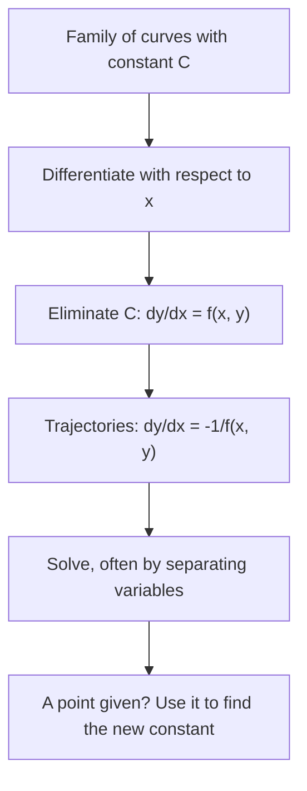

## Running the first lesson backwards

In Lesson 1 we started with a differential equation and found its general solution, a
one-parameter family of curves such as $y = x^2 + C$. In Lesson 2 we saw that the
equation $y' = f(x, y)$ assigns a slope to every point, and in Lesson 3 we learned to
solve separable equations. This honors lesson puts the three ideas together and runs the
first one backwards: starting from a *family of curves*, we find the differential
equation it solves. Once a family is described by its slope rule, a classic geometric
question becomes easy: which curves cross every member of the family at a right angle?

Those perpendicular families are not just a puzzle. Electric field lines cross the
equipotential curves at right angles, heat in a flat plate flows at right angles to the
curves of constant temperature, and water running down a smooth hillside crosses the
contour lines of a map at right angles. In each case one family is known and the other
is wanted.

## From a family of curves to its differential equation

A one-parameter family is an equation in $x$, $y$ and a constant $C$, one curve for each
value of $C$. To find the differential equation that every member satisfies:

1. Differentiate the family's equation with respect to $x$ (implicitly if needed).
2. Eliminate $C$, using the original equation, so that what's left involves only $x$,
   $y$ and $y'$.

The second step is the important one. A slope rule that still contains $C$ only describes
one curve at a time; after eliminating $C$, the rule gives the slope at any point $(x, y)$,
whichever member of the family passes through it.

For the parabolas $y = Cx^2$: differentiating gives $y' = 2Cx$. From the family,
$C = y/x^2$ (for $x \ne 0$), so

$$y' = 2\cdot\frac{y}{x^2}\cdot x = \frac{2y}{x}.$$

Check with one member: $y = 3x^2$ has $y' = 6x$, and $\dfrac{2y}{x} = \dfrac{6x^2}{x} = 6x$.

For the circles $x^2 + y^2 = C$ (centered at the origin), implicit differentiation gives
$2x + 2yy' = 0$, so $y' = -\dfrac{x}{y}$. Here $C$ disappeared on its own, which happens
whenever the constant stands alone on one side.

## Orthogonal trajectories

Two curves are *orthogonal* at a point where they cross if their tangent lines there
are perpendicular. A family of **orthogonal trajectories** of a given family is a second
family whose every member crosses every member of the first family at a right angle.

Two lines with slopes $m_1$ and $m_2$ (neither horizontal nor vertical) are
perpendicular exactly when $m_1m_2 = -1$, that is $m_2 = -1/m_1$. So if the given family
satisfies $y' = f(x, y)$, a trajectory passing through $(x, y)$ must have slope
$-1/f(x, y)$ there:

$$\text{family: } \frac{dy}{dx} = f(x, y) \qquad\Longrightarrow\qquad \text{trajectories: } \frac{dy}{dx} = -\frac{1}{f(x, y)}.$$

This is why eliminating $C$ mattered: the new equation must give the trajectory's slope
at a point using only the point's coordinates. Where $f = 0$ the family has a horizontal
tangent and the trajectory must be vertical there; the formula breaks down, but the
curves we find still cross at right angles.

In slope-field language: draw the field of $y' = f$, turn every little segment through
$90^\circ$, and the curves that follow the turned segments are the orthogonal
trajectories.



### Example 1

Find the orthogonal trajectories of the parabolas $y = Cx^2$.

- The family satisfies $y' = \dfrac{2y}{x}$ (found above).
- Trajectories: $\dfrac{dy}{dx} = -\dfrac{x}{2y}$.
- Separate: $2y\,dy = -x\,dx$. Integrate: $y^2 = -\dfrac{x^2}{2} + c$.
- Multiply by 2 and rename the constant: $x^2 + 2y^2 = K$ with $K > 0$.

The trajectories are ellipses centered at the origin, each $\sqrt2$ times as wide as it is
tall (semi-axes $\sqrt{K}$ and $\sqrt{K/2}$). The trajectory through $(2, 1)$ has
$K = 4 + 2 = 6$.

```plot
{"x": [-4, 4], "y": [-3, 3], "equal": true, "functions": [{"f": "0.25x^2"}, {"f": "x^2"}, {"f": "-0.25x^2"}, {"f": "-x^2"}, {"f": "0", "label": "C = 0"}], "curves": [{"x": "cos(t)", "y": "sin(t)/sqrt(2)", "t": [0, "2pi"], "dashed": true}, {"x": "sqrt(6)cos(t)", "y": "sqrt(3)sin(t)", "t": [0, "2pi"], "dashed": true}, {"x": "sqrt(14)cos(t)", "y": "sqrt(7)sin(t)", "t": [0, "2pi"], "dashed": true}], "points": [{"at": [2, 1], "label": "(2, 1)"}], "caption": "Parabolas y = Cx² (solid) and their orthogonal trajectories, the ellipses x² + 2y² = K (dashed). At every crossing the curves meet at a right angle."}
```

Look at where the curves meet: each ellipse cuts each parabola at a right angle,
including the flat parabola $y = 0$ (the member with $C = 0$), which the ellipses cross
vertically. The $y$-axis also meets every ellipse at a right angle, even though it is not
a member $y = Cx^2$ for any $C$ (you could think of it as the limit $C \to \pm\infty$).

### Example 2

Find the orthogonal trajectories of $y = Ce^{x}$, and the one through $(0, 2)$.

- Differentiate: $y' = Ce^x$. Since $Ce^x = y$, the family satisfies $y' = y$.
- Trajectories: $\dfrac{dy}{dx} = -\dfrac{1}{y}$, so $y\,dy = -dx$.
- Integrate: $\dfrac{y^2}{2} = -x + c$, that is $y^2 = K - 2x$: parabolas opening to the
  left, with their axis along the $x$-axis.
- Through $(0, 2)$: $4 = K$, so $y^2 = 4 - 2x$.

Check at $(0, 2)$: the family member through that point is $y = 2e^x$, slope 2. On
$y^2 = 4 - 2x$, implicit differentiation gives $2yy' = -2$, so $y' = -1/y = -\tfrac12$.
The product of the slopes is $2 \cdot (-\tfrac12) = -1$. Right angle confirmed.

### Example 3

Find the orthogonal trajectories of the hyperbolas $xy = C$.

- Differentiate: $y + xy' = 0$, so $y' = -\dfrac{y}{x}$. ($C$ dropped out by itself.)
- Trajectories: $\dfrac{dy}{dx} = \dfrac{x}{y}$, so $y\,dy = x\,dx$ and $y^2 - x^2 = K$.

These are hyperbolas too, rotated $45^\circ$ from the first family. You met
$y' = x/y$ in Lesson 2, Example 3. In fluid mechanics, the curves $xy = C$ are the
streamlines of the simplest model of an ideal (frictionless, incompressible) fluid
turning a right-angled corner, and $y^2 - x^2 = K$ are its equipotential lines. That's
an idealization: a real fluid sticks to the walls.

### Example 4

Show that the circles centered at the origin and the lines through the origin are
orthogonal families.

- Circles $x^2 + y^2 = C$: $y' = -\dfrac{x}{y}$.
- Trajectories: $y' = \dfrac{y}{x}$, so $\dfrac{dy}{y} = \dfrac{dx}{x}$, $\ln|y| = \ln|x| + c$,
  and $y = Ax$: lines through the origin (with the $y$-axis, $x = 0$, as one more).

Geometrically this is the fact that a radius meets the circle at a right angle. It is
also the picture of a point charge: the electric field lines point straight out from the
charge, and the equipotentials are circles around it.

## Where the second family comes from in science

The same pattern shows up whenever a quantity has a level-curve family and a flow along
the direction of fastest change:

| Known family | Orthogonal family |
|---|---|
| Contour lines of a hill | Paths of steepest descent (where water runs) |
| Equipotential curves | Electric field lines |
| Isotherms in a flat plate (steady heat flow, uniform material) | Heat flow lines |
| Streamlines of an ideal 2D flow | Equipotential (velocity-potential) lines |

The reason, in multivariable calculus, is that the direction of fastest change of a
function (its gradient) is perpendicular to the function's level curves. Here we get the
second family by solving one differential equation.

## A family that is its own trajectory

Some families are **self-orthogonal**: the orthogonal trajectories are members of the
same family. The parabolas $y^2 = 4C(x + C)$, all with focus at the origin, are an
example. Differentiating gives $2yy' = 4C$, so $C = \tfrac12 yy'$, and substituting back
gives the family's equation

$$y^2 = 2xyy' + y^2(y')^2.$$

Replace $y'$ by $-1/y'$ and multiply through by $(y')^2$: you get
$y^2(y')^2 = -2xyy' + y^2$, which rearranges to exactly the same equation. So the
trajectories satisfy the family's own equation: the parabolas opening right ($C > 0$)
cross the parabolas opening left ($C < 0$) at right angles.

## Beyond right angles

The same method finds curves that cross a family at any fixed angle $\alpha$, called
**oblique trajectories**. If the family has slope $m$ at a point, a curve crossing it at
angle $\alpha$ (measured counterclockwise from the family's tangent) has slope
$\dfrac{m + \tan\alpha}{1 - m\tan\alpha}$, from the tangent addition formula. For the
lines through the origin and $\alpha = 45^\circ$, the resulting equation needs the
substitution methods of Module 2, and the answer is a **logarithmic spiral**,
$r = Ae^{\theta}$ in polar coordinates. We won't solve it here.

## Common mistakes

- **Leaving $C$ in the slope.** $y' = 2Cx$ is the slope of one parabola; the trajectories
  need $y' = 2y/x$. Eliminate $C$ before taking the reciprocal.
- **Using $-f$ instead of $-1/f$.** Changing the sign alone gives a mirror image, not a
  perpendicular direction. For the lines $y = Cx$, the mistake gives $y' = -y/x$ and the
  hyperbolas $xy = K$, which cross the lines at right angles only along $y = \pm x$, not in general.
- **Using $1/f$ instead of $-1/f$.** The reciprocal without the sign reflects the
  direction across $y = x$; it is never perpendicular, since $m \cdot \frac1m = 1$, not $-1$.
- **Forgetting the constant of the new family.** The trajectories form a whole family
  with their own constant $K$; a given point picks one of them.
- **Dropping special members.** Dividing during separation can lose a straight-line
  member (like $y = 0$ or $x = 0$); check the axes separately.

## Key points

- To get a family's differential equation, differentiate and eliminate the constant.
- If the family satisfies $y' = f(x, y)$, its orthogonal trajectories satisfy
  $y' = -1/f(x, y)$; solve that equation, often by separation.
- $y = Cx^n$ has trajectories $x^2 + ny^2 = K$; circles about the origin and lines
  through it are orthogonal; $xy = C$ and $y^2 - x^2 = K$ are orthogonal.
- Level curves and the paths of fastest change (contours and steepest descent,
  equipotentials and field lines, isotherms and heat flow) are orthogonal families.
