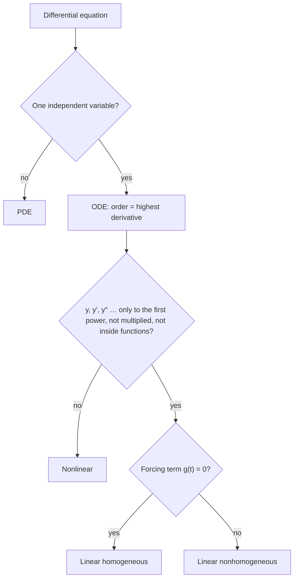

## Why classify?

The bridge module solved a handful of equation types one at a time. The college course
is organized differently: before solving anything, you classify the equation, because
the class tells you which methods can work and what the solutions will look like. A
mechanic doesn't pick up a wrench before knowing whether the bolt is metric. This lesson
gives you the vocabulary every later lesson uses.

## Ordinary versus partial

An **ordinary differential equation** (ODE) involves an unknown function of a single
variable and its ordinary derivatives, such as $y'' + 3y' + 2y = \cos t$. A
**partial differential equation** (PDE) involves an unknown function of two or more
variables and its partial derivatives, such as the heat equation
$u_t = k\,u_{xx}$, where $u(x, t)$ is temperature at position $x$ and time $t$. This
course is about ODEs; the last module shows how ODE techniques solve the simplest PDEs.

## Order

The **order** is the highest derivative present. Order matters because an $n$th-order
equation needs $n$ pieces of starting information: position alone doesn't determine
the motion of a mass on a spring, but position and velocity do.

| Equation | Order |
|---|---|
| $y' = t^2 y$ | 1 |
| $y'' + 4y = \sin t$ | 2 |
| $(y')^3 + y = 0$ | 1 |
| $y^{(4)} - y = 0$ | 4 |

Watch the third row: a cube on $y'$ is a power, not a higher derivative.

Any $n$th-order equation that can be solved for its top derivative can be written in
**normal form**, $y^{(n)} = f(t, y, y', \dots, y^{(n-1)})$. Most theorems are stated
for equations in that form.

## Linear versus nonlinear

This is the most important distinction in the subject. An $n$th-order equation is
**linear** if it can be written as

$$a_n(t)y^{(n)} + a_{n-1}(t)y^{(n-1)} + \cdots + a_1(t)y' + a_0(t)y = g(t).$$

In words: $y$ and its derivatives appear only to the first power, they are not
multiplied together, and they are not inside other functions. The coefficients
$a_k(t)$ and the right side $g(t)$ may be *any* functions of the independent variable;
being "linear" refers to the unknown, not to $t$.

The picture labels the parts of a typical linear equation.


Anything else is **nonlinear**. Typical nonlinear features:

- powers of the unknown: $y^2$, $\sqrt{y}$, $(y')^2$;
- products: $yy'$;
- functions of the unknown: $\sin y$, $e^{y}$, $\ln y$.

### Example 1

Classify each equation by order and linearity.

1. $t^2y'' + ty' + (t^2 - 9)y = 0$: second order, **linear** (the coefficients involve
   $t$, which is allowed).
2. $y'' + \sin y = 0$: second order, **nonlinear** ($\sin y$). This is the exact pendulum
   equation; for small swings, $\sin y \approx y$ gives the linear $y'' + y = 0$.
3. $y' = e^t y + \cos t$: first order, linear.
4. $yy' = t$: first order, nonlinear (product $yy'$).
5. $y''' + (\cos t)y' = e^{2t}$: third order, linear.

### Why linearity matters

Linear equations have a structure nonlinear equations lack. If $y_1$ and $y_2$ solve a
linear equation with $g(t) = 0$, so does $c_1y_1 + c_2y_2$. This
**superposition principle** is why we can build general solutions out of a few basic
pieces in Modules 5 through 8. Linear equations also have solutions that exist on the
whole interval where the coefficients are continuous (next lesson), while nonlinear
equations can blow up unexpectedly, as $y' = y^2$ did in Lesson 3.

## Homogeneous and nonhomogeneous

A linear equation is **homogeneous** if $g(t) = 0$ (every term contains $y$ or a
derivative of $y$) and **nonhomogeneous** otherwise. So $y'' + 4y = 0$ is homogeneous and
$y'' + 4y = \sin t$ is not. The forcing term $g(t)$ represents an outside influence:
a push on a spring, a voltage source, an inflow.

Be careful: in Lesson 10 the word "homogeneous" will appear again with a different
meaning (a first-order equation $y' = F(y/x)$). The context always makes clear which
one is meant.

## Autonomous equations

A first-order equation $y' = f(y)$ whose right side doesn't involve the independent
variable is **autonomous**. Its slope field looks the same along every horizontal line,
as you saw in Lesson 2. Logistic growth $P' = kP(1 - P/K)$ is autonomous; $y' = t - y$ is
not. Module 4 develops a geometric theory just for these.

## Initial and boundary value problems

An **initial value problem** gives all conditions at one point: $y(t_0) = y_0$,
$y'(t_0) = y_1$, and so on (one condition per order). A **boundary value problem** (BVP)
gives conditions at two or more points, such as $y(0) = 0$ and $y(\pi) = 0$. BVPs
behave very differently: they may have no solution or infinitely many. They return in
the last module, where they decide which wave patterns a string can hold.

### Example 2

For $y'' + y = 0$, all solutions have the form $y = c_1\cos t + c_2\sin t$ (Module 5).

- IVP $y(0) = 2$, $y'(0) = 3$: $c_1 = 2$ and $c_2 = 3$. Exactly one solution.
- BVP $y(0) = 0$, $y(\pi) = 0$: $c_1 = 0$, and then $y(\pi) = c_2\sin\pi = 0$ for every
  $c_2$. Infinitely many solutions.
- BVP $y(0) = 0$, $y(\pi) = 1$: $c_1 = 0$ forces $y(\pi) = 0 \ne 1$. No solution.

```plot
{"x": [-0.3, 3.6], "y": [-2.2, 2.4], "xLabel": "t", "functions": [{"f": "2sin(x)", "from": 0, "to": 3.14159}, {"f": "sin(x)", "from": 0, "to": 3.14159}, {"f": "-1.5sin(x)", "from": 0, "to": 3.14159}], "points": [{"at": [0, 0]}, {"at": [3.14159, 0]}, {"at": [3.14159, 1], "open": true, "label": "(π, 1)"}], "labels": [{"at": [1.57, 2.2], "text": "c₂ = 2"}, {"at": [1.57, 1.18], "text": "c₂ = 1"}, {"at": [1.57, -1.25], "text": "c₂ = −1.5"}], "caption": "Solutions y = c₂ sin t of y″ + y = 0 with y(0) = 0. Every one of them also has y(π) = 0, so that BVP has infinitely many solutions; none reaches the open point (π, 1), so that BVP has none."}
```

## Putting it together

The flowchart runs through the main questions in order; the table adds why each one matters.



| Feature | Question to ask | Why it matters |
|---|---|---|
| ODE or PDE | One independent variable? | PDEs need different tools |
| Order | Highest derivative? | Number of conditions and constants |
| Linear? | Is $y$ only to the first power, not multiplied or inside functions? | Superposition, global existence |
| Homogeneous? | Is $g(t) = 0$? | Solution = homogeneous part + particular part |
| Autonomous? | Is $t$ absent from the right side? | Phase-line analysis |
| IVP or BVP | Conditions at one point or several? | Uniqueness |

### Example 3

Classify $\dfrac{d^2\theta}{dt^2} + 0.5\dfrac{d\theta}{dt} + 9\theta = 2\cos 3t$ with
$\theta(0) = 0$, $\theta'(0) = 1$.

- One independent variable $t$: ODE.
- Highest derivative $\theta''$: second order.
- $\theta$, $\theta'$, $\theta''$ all to the first power with constant coefficients: linear.
- Right side $2\cos 3t \ne 0$: nonhomogeneous.
- Both conditions at $t = 0$: an IVP.

This is a damped, driven oscillator (Module 6), and it has exactly one solution.

## Common mistakes

- **Confusing power with order.** $(y')^2$ is first order, nonlinear.
- **Calling an equation nonlinear because of $t$.** $t^3y'' + e^t y = \ln t$ is linear.
- **Mixing the two meanings of "homogeneous."** For linear equations it means $g = 0$.
- **Assuming every BVP has one solution.** Two-point problems can have none or many.

## Key points

- ODE: one independent variable. PDE: several.
- Order = highest derivative; an $n$th-order IVP needs $n$ initial conditions.
- Linear means the unknown and its derivatives appear linearly; coefficients may depend
  on $t$ in any way.
- Homogeneous linear means no forcing term; autonomous means no explicit $t$.
