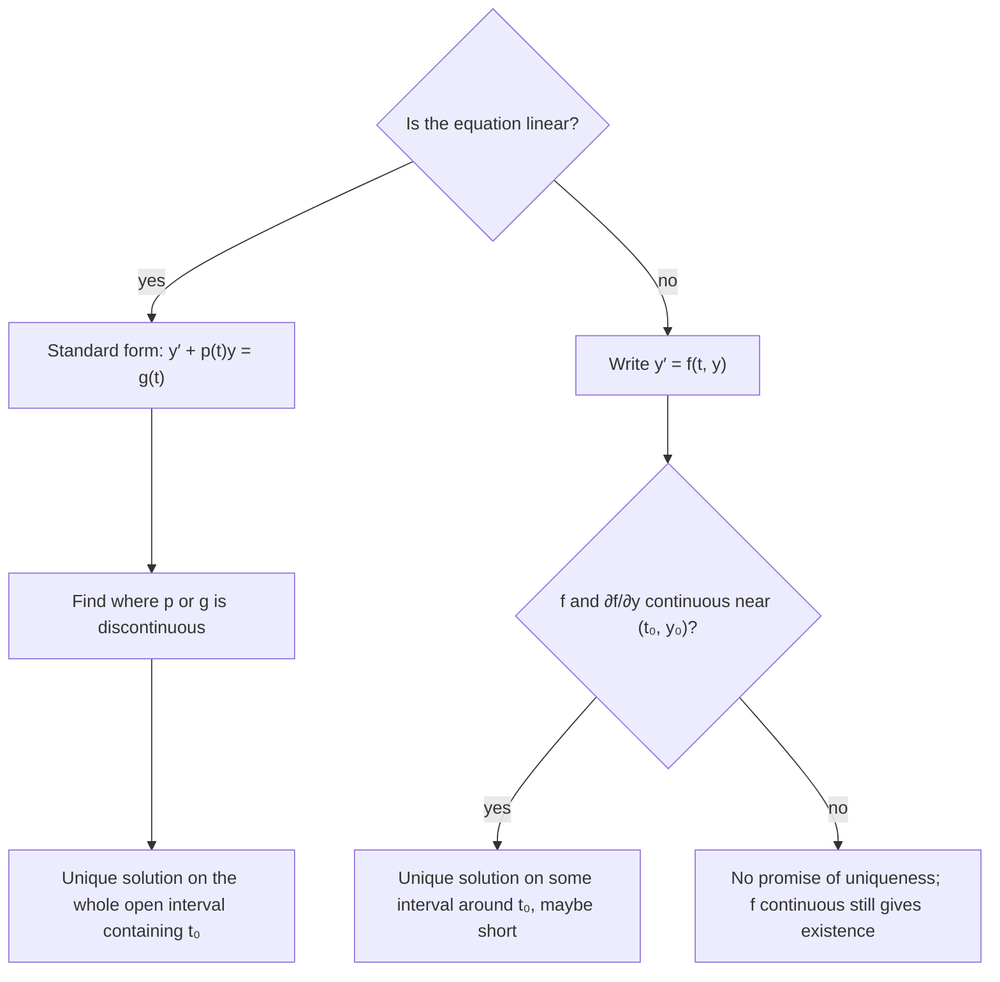

## Can we trust that a solution exists?

Before spending effort solving an initial value problem, it's worth knowing two things:
does a solution exist at all, and is there only one? These are not idle questions. A
model of a physical system is only useful if the starting state determines the future.
If an IVP had two solutions, the model couldn't predict anything. And as you saw with
$y' = y^2$, a solution can exist only on a limited interval. This lesson states the two
standard theorems and shows how to use them without solving anything.

## The theorem for linear first-order equations

Write the linear equation in **standard form** (coefficient of $y'$ equal to 1):

$$y' + p(t)y = g(t), \qquad y(t_0) = y_0.$$

**Theorem (linear).** If $p$ and $g$ are continuous on an open interval $I$ containing
$t_0$, then the IVP has exactly one solution, and that solution exists on all of $I$.

The proof is constructive: the integrating-factor formula in the next lesson produces
the solution, and every step in it (integrating $p$, exponentiating, integrating again)
works wherever $p$ and $g$ are continuous. The practical upshot: for a linear equation
you can find the **interval of validity** in advance, just by locating where $p$ and $g$
break down.

### Example 1

Find the largest interval on which the solution of
$(t - 3)y' + \dfrac{1}{t + 1}\,y = \ln t$, $y(1) = 5$ is guaranteed to exist.

- Divide by $t - 3$ to get standard form:
  $y' + \dfrac{1}{(t + 1)(t - 3)}\,y = \dfrac{\ln t}{t - 3}$.
- $p(t)$ is discontinuous at $t = -1$ and $t = 3$. $g(t)$ needs $t > 0$ (for $\ln t$)
  and $t \ne 3$.
- The trouble points split the line into pieces; the one containing $t_0 = 1$ is
  $(0, 3)$.

So the solution exists and is unique on $0 < t < 3$. If the initial point had been
$t_0 = 5$, the interval would be $(3, \infty)$.

```numberline
{"x": [-2, 5], "points": [{"at": [-1, 0], "open": true, "label": "−1"}, {"at": [0, 0], "open": true, "label": "0"}, {"at": [3, 0], "open": true, "label": "3"}, {"at": [1, 0], "label": "t₀ = 1"}], "segments": [{"from": [0, 0], "to": [3, 0]}], "caption": "Trouble points −1 (p breaks), 0 (ln t needs t > 0) and 3 (p and g break). The piece containing t₀ = 1 is the open interval (0, 3)."}
```

## The theorem for general first-order equations

For a nonlinear equation $y' = f(t, y)$, the condition involves the right side as a
function of two variables.

**Theorem (existence and uniqueness).** If $f$ and $\dfrac{\partial f}{\partial y}$ are
continuous in some rectangle $a < t < b$, $c < y < d$ containing $(t_0, y_0)$, then the
IVP $y' = f(t, y)$, $y(t_0) = y_0$ has exactly one solution on some interval
$t_0 - h < t < t_0 + h$ inside that rectangle.

Two differences from the linear theorem matter:

1. The conclusion is **local**: the theorem promises a solution only on *some* interval
   around $t_0$, possibly very short. It doesn't tell you how long; the solution may
   blow up, as with $y' = y^2$, $y(0) = 1$, which only lasts until $t = 1$.
2. Existence alone needs only $f$ continuous. The extra condition on
   $\partial f/\partial y$ is what guarantees **uniqueness**.

The picture shows what the theorem promises: a rectangle where the hypotheses hold, and a
guaranteed interval that may be much shorter than the rectangle is wide.


### Example 2

Does the theorem guarantee a unique solution of $y' = \sqrt{y}$ through $(0, 0)$? Through
$(0, 4)$?

- $f(t, y) = \sqrt{y}$ is continuous for $y \ge 0$, and
  $\dfrac{\partial f}{\partial y} = \dfrac{1}{2\sqrt{y}}$, which is not continuous at $y = 0$.
- At $(0, 4)$: both $f$ and $f_y$ are continuous near $y = 4$. A unique solution exists.
- At $(0, 0)$: no rectangle around the point works ($f_y$ blows up at $y = 0$, and $f$
  isn't even defined for $y < 0$), and uniqueness really does fail. Both
  $y = 0$ and $y = \dfrac{t^2}{4}$ (for $t \ge 0$) satisfy $y' = \sqrt{y}$ and $y(0) = 0$.
  Check the second: $y' = t/2$ and $\sqrt{t^2/4} = t/2$ for $t \ge 0$.

In fact there are infinitely many solutions: stay at 0 until any time $s \ge 0$, then
follow $\dfrac{(t - s)^2}{4}$. Physically, it's like a ball balanced on a peak that may
roll off at any moment, and the equation can't say when.

```plot
{"x": [-1, 5], "y": [-0.5, 4], "xLabel": "t", "functions": [{"f": "0", "label": "y = 0"}, {"f": "x^2/4", "from": 0, "label": "y = t²/4"}, {"f": "(x - 1.5)^2/4", "from": 1.5, "dashed": true}, {"f": "(x - 3)^2/4", "from": 3, "dashed": true}], "points": [{"at": [0, 0], "label": "(0, 0)"}], "caption": "Several solutions of y′ = √y through the same point (0, 0)."}
```

## What uniqueness means geometrically

If uniqueness holds everywhere in a region, two solution curves can never cross or even
touch there: at a shared point both would solve the same IVP, so they'd be the same
curve. That's why, in a slope field for $y' = y(2 - y)$, a solution starting between the
equilibria $0$ and $2$ stays between them forever. It cannot cross the equilibrium
solutions, because $f(y) = y(2 - y)$ and $f'(y) = 2 - 2y$ are continuous everywhere.

### Example 3

Without solving, show that the solution of $y' = (y - 1)(y + 3)e^{t}$, $y(0) = 0$ satisfies
$-3 < y(t) < 1$ for as long as it exists.

- $y = 1$ and $y = -3$ are equilibrium solutions (they make the right side zero).
- $f(t, y) = (y - 1)(y + 3)e^t$ and $f_y = (2y + 2)e^t$ are continuous everywhere, so
  solution curves can't cross.
- The solution starts at $y = 0$, between $-3$ and $1$, so it is trapped there.

### Example 4

For $y' = \dfrac{t}{y - 2}$, at which initial points $(t_0, y_0)$ does the theorem fail to
apply?

- $f = \dfrac{t}{y - 2}$ is discontinuous where $y = 2$.
- $f_y = -\dfrac{t}{(y - 2)^2}$ is also discontinuous only at $y = 2$.
- So the theorem applies at every point except those on the line $y = 2$.

## The linear theorem is stronger

Compare the two theorems on a linear equation $y' = -p(t)y + g(t)$. Here
$f_y = -p(t)$, so the general theorem asks for $p$ and $g$ continuous, exactly as the
linear theorem does. But only the linear theorem promises the solution lasts across the
*whole* interval where $p$ and $g$ are continuous. Linear equations can't blow up in the
middle of a good interval; nonlinear ones can.

## Which theorem when



## Common mistakes

- **Forgetting to divide by the leading coefficient.** Points where $a_1(t) = 0$ are
  trouble points even if $p$ and $g$ look fine before dividing.
- **Choosing the wrong piece.** The interval must contain $t_0$.
- **Using closed brackets.** The interval is open; it stops short of the trouble point.
- **Reading the theorem backward.** If its hypotheses fail, uniqueness *might* still
  hold; the theorem just doesn't promise it.
- **Expecting the general theorem to give the interval.** For nonlinear equations it only
  guarantees *some* interval around $t_0$.

## Key points

- Linear $y' + p(t)y = g(t)$: a unique solution exists on the largest open interval
  containing $t_0$ where $p$ and $g$ are continuous.
- Nonlinear $y' = f(t, y)$: $f$ continuous gives existence; $f$ and $f_y$ continuous give
  uniqueness, on some interval around $t_0$.
- Where uniqueness holds, solution curves never cross; equilibria act as barriers.
