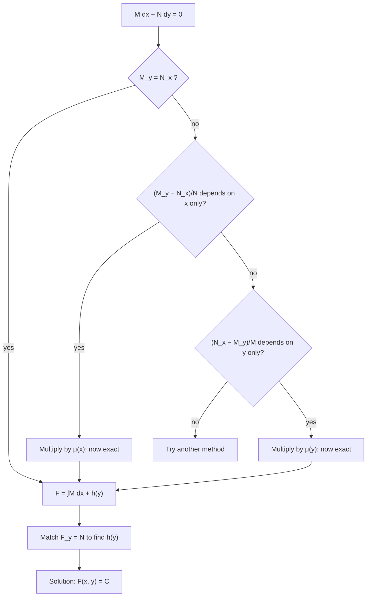

## Solutions as level curves

Some first-order equations are neither separable nor linear, yet have a hidden
structure: their solutions are the level curves $F(x, y) = C$ of some function of two
variables. Recognizing that structure is the method of **exact equations**. It relies on
the partial derivatives and the multivariable chain rule; if those are rusty, the key
fact is that for $F(x, y)$ and a curve $y(x)$,

$$\frac{d}{dx}F(x, y(x)) = F_x + F_y\,\frac{dy}{dx}.$$

## Differential form

Write a first-order equation as

$$M(x, y)\,dx + N(x, y)\,dy = 0,$$

which means $M + N\dfrac{dy}{dx} = 0$. For example $y' = -\dfrac{2xy}{x^2 + 3y^2}$ is
$2xy\,dx + (x^2 + 3y^2)\,dy = 0$.

Now suppose there's a function $F$ with $F_x = M$ and $F_y = N$. Then along a solution,

$$\frac{d}{dx}F(x, y) = F_x + F_y y' = M + Ny' = 0,$$

so $F(x, y)$ is constant: the solutions are the level curves $F(x, y) = C$. An equation
for which such an $F$ exists is called **exact**, and $F$ is a **potential function**.

## The test for exactness

If $F$ exists (with continuous second partials), then $M_y = F_{xy}$ and $N_x = F_{yx}$,
and mixed partials are equal. So

$$\text{exact} \iff \frac{\partial M}{\partial y} = \frac{\partial N}{\partial x}$$

(on a rectangle where $M$, $N$ and these partials are continuous). The forward direction
is the equality of mixed partials; the reverse direction is the construction below,
which always works when the test passes.

## Finding the potential function

1. Check $M_y = N_x$.
2. Integrate $M$ with respect to $x$, treating $y$ as a constant. The "constant" of
   integration can depend on $y$: $F = \int M\,dx + h(y)$.
3. Differentiate that $F$ with respect to $y$ and set it equal to $N$. Solve for $h'(y)$;
   it must come out depending on $y$ only (if exactness holds, it will).
4. Integrate to get $h(y)$ (no constant needed). The solution is $F(x, y) = C$.

You can equally start by integrating $N$ with respect to $y$; choose whichever integral
is easier.

### Example 1

Solve $2xy\,dx + (x^2 + 3y^2)\,dy = 0$, $y(1) = 1$.

- $M = 2xy$, $N = x^2 + 3y^2$. $M_y = 2x$, $N_x = 2x$. Exact.
- $F = \int 2xy\,dx = x^2y + h(y)$.
- $F_y = x^2 + h'(y)$ must equal $x^2 + 3y^2$, so $h'(y) = 3y^2$ and $h = y^3$.
- $F = x^2y + y^3$. Solutions: $x^2y + y^3 = C$.
- At $(1, 1)$: $C = 1 + 1 = 2$. Answer (implicit): $x^2y + y^3 = 2$.

The solutions are the level curves of $F = x^2y + y^3$. Each value of $C$ gives one curve,
and the initial condition picks the one through $(1, 1)$.

```plot
{"x": [-4, 4], "y": [-1.8, 1.8], "curves": [{"x": "sqrt((2 - t^3)/t)", "y": "t", "t": [0.125, 1.2599]}, {"x": "-sqrt((2 - t^3)/t)", "y": "t", "t": [0.125, 1.2599]}, {"x": "sqrt((0.5 - t^3)/t)", "y": "t", "t": [0.032, 0.7937]}, {"x": "-sqrt((0.5 - t^3)/t)", "y": "t", "t": [0.032, 0.7937]}, {"x": "sqrt((-2 - t^3)/t)", "y": "t", "t": [-1.2599, -0.125]}, {"x": "-sqrt((-2 - t^3)/t)", "y": "t", "t": [-1.2599, -0.125]}], "points": [{"at": [1, 1], "label": "(1, 1)"}], "labels": [{"at": [0, 1.45], "text": "C = 2"}, {"at": [0, 0.95], "text": "C = 0.5"}, {"at": [0, -1.45], "text": "C = −2"}], "caption": "Level curves x²y + y³ = C of the potential function. The solution through (1, 1) is the curve with C = 2."}
```

### Example 2

Solve $(3x^2 + y\cos x)\,dx + (\sin x - 4y^3)\,dy = 0$.

- $M_y = \cos x$, $N_x = \cos x$. Exact.
- Integrate $N$ in $y$ this time: $F = y\sin x - y^4 + g(x)$.
- $F_x = y\cos x + g'(x)$ must equal $3x^2 + y\cos x$, so $g' = 3x^2$ and $g = x^3$.
- General solution: $x^3 + y\sin x - y^4 = C$.

### Example 3

Is $(x + y)\,dx + (2x - y)\,dy = 0$ exact?

- $M_y = 1$, $N_x = 2$. Not equal, so no. If you tried the steps anyway, $h'(y)$ would
  come out depending on $x$, the signal that something is wrong.

## Integrating factors for non-exact equations

A non-exact equation can sometimes be made exact by multiplying by a well-chosen
function $\mu$. Requiring $(\mu M)_y = (\mu N)_x$ is a PDE for $\mu$, usually harder than
the original problem. But two special cases are easy:

- If $\dfrac{M_y - N_x}{N}$ depends on $x$ only, then $\mu(x) = e^{\int \frac{M_y - N_x}{N}dx}$.
- If $\dfrac{N_x - M_y}{M}$ depends on $y$ only, then $\mu(y) = e^{\int \frac{N_x - M_y}{M}dy}$.

Where does the first come from? If $\mu = \mu(x)$, the condition $(\mu M)_y = (\mu N)_x$
becomes $\mu M_y = \mu' N + \mu N_x$, so $\dfrac{\mu'}{\mu} = \dfrac{M_y - N_x}{N}$. That
makes sense only if the right side has no $y$ in it, and then $\mu$ follows by
integration. The second case is symmetric.

### Example 4

Solve $(3xy + y^2)\,dx + (x^2 + xy)\,dy = 0$.

- $M_y = 3x + 2y$, $N_x = 2x + y$. Not exact.
- $\dfrac{M_y - N_x}{N} = \dfrac{x + y}{x(x + y)} = \dfrac{1}{x}$, a function of $x$ alone.
- $\mu = e^{\int dx/x} = x$ (for $x > 0$).
- Multiply: $(3x^2y + xy^2)\,dx + (x^3 + x^2y)\,dy = 0$. Check: $M_y = 3x^2 + 2xy = N_x$. ✓
- $F = \int (x^3 + x^2y)\,dy = x^3y + \tfrac12x^2y^2 + g(x)$; $F_x = 3x^2y + xy^2 + g'$,
  so $g' = 0$.
- Solution: $x^3y + \tfrac12 x^2y^2 = C$.

The whole procedure, integrating factors included, fits in one chart:



## How this connects to the linear method

A linear equation $y' + p(x)y = g(x)$ is $(py - g)\,dx + dy = 0$. Then
$\dfrac{M_y - N_x}{N} = \dfrac{p - 0}{1} = p(x)$, so the integrating factor is
$e^{\int p\,dx}$, exactly the one from the previous lesson. The linear method is a
special case of this one.

## Common mistakes

- **Testing the wrong partials.** Compare $\partial M/\partial y$ with $\partial N/\partial x$
  (each differentiated with respect to the *other* variable).
- **Forgetting $h(y)$.** The constant of integration in $\int M\,dx$ can depend on $y$.
- **Double-counting terms.** Terms appearing in both $\int M\,dx$ and $\int N\,dy$ belong
  in $F$ once.
- **Writing $F = 0$.** The solution is $F(x, y) = C$, with $C$ from the initial condition.

## Key points

- $M\,dx + N\,dy = 0$ is exact when $M_y = N_x$; then solutions are $F(x, y) = C$ with
  $F_x = M$, $F_y = N$.
- Build $F$ by integrating $M$ in $x$ (plus $h(y)$) and matching $F_y = N$.
- If $(M_y - N_x)/N$ depends only on $x$, or $(N_x - M_y)/M$ only on $y$, an integrating
  factor makes the equation exact.
