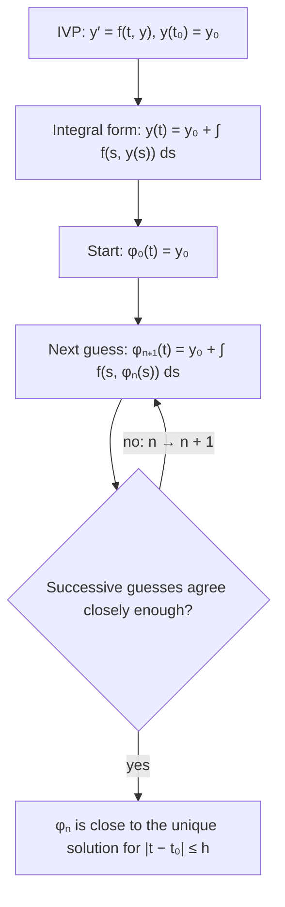

## Building a solution you can't write down

Lesson 7 stated the existence and uniqueness theorem: if $f$ and $\partial f/\partial y$ are
continuous near $(t_0, y_0)$, then $y' = f(t, y)$, $y(t_0) = y_0$ has exactly one solution on
some interval around $t_0$. That lesson used the theorem without proving it. This honors
lesson shows where it comes from. The idea is constructive: start with a crude guess,
improve it with one integral, and repeat. The guesses close in on the solution even when no
formula for it exists. The method is named for the French mathematician Émile Picard, who
developed it around 1890 (Joseph Liouville and others had used similar successive
approximations for linear equations decades earlier), and the theorem it proves is often
called the **Picard–Lindelöf theorem**, after Picard and the Finnish mathematician Ernst
Lindelöf, who sharpened it in 1894.

You need only the Fundamental Theorem of Calculus and some comfort with inequalities.

## From a differential equation to an integral equation

Integrate both sides of $y' = f(t, y)$ from $t_0$ to $t$ and use $y(t_0) = y_0$:

$$y(t) = y_0 + \int_{t_0}^{t} f\big(s, y(s)\big)\,ds.$$

This is an **integral equation**: the unknown function appears inside an integral. It holds
the differential equation *and* the initial condition at once. Going back: if a continuous
function satisfies it, put $t = t_0$ to get $y(t_0) = y_0$, and differentiate (the
Fundamental Theorem of Calculus) to get $y'(t) = f(t, y(t))$. So the two problems have exactly
the same solutions.

Why bother? Integrals smooth things out and are easy to bound, while derivatives can be
wild. An integral equation also suggests an obvious way to improve a guess: put the guess on
the right and see what comes out on the left.

## Picard iteration

**Picard iteration** (also called the method of successive approximations) builds a
sequence of functions, the **Picard iterates**:

$$\varphi_0(t) = y_0, \qquad \varphi_{n+1}(t) = y_0 + \int_{t_0}^{t} f\big(s, \varphi_n(s)\big)\,ds.$$

Each new iterate is the old one fed through the right side of the integral equation. If
the sequence settles down to a limit $\varphi$, then (passing to the limit on both sides)
$\varphi$ satisfies the integral equation, so it solves the IVP.



### Example 1

Find the Picard iterates for $y' = y$, $y(0) = 1$.

- Here $f(t, y) = y$, so $\varphi_{n+1}(t) = 1 + \int_0^t \varphi_n(s)\,ds$.
- $\varphi_0 = 1$.
- $\varphi_1 = 1 + \int_0^t 1\,ds = 1 + t$.
- $\varphi_2 = 1 + \int_0^t (1 + s)\,ds = 1 + t + \dfrac{t^2}{2}$.
- $\varphi_3 = 1 + \int_0^t \left(1 + s + \dfrac{s^2}{2}\right)ds = 1 + t + \dfrac{t^2}{2} + \dfrac{t^3}{6}$.

Each step adds the next term of the Taylor series, and by induction
$\varphi_n = \sum_{k=0}^{n} \dfrac{t^k}{k!}$, which converges to $e^t$ for every $t$. The
iteration has rediscovered the exponential function from nothing but the equation.

```plot
{"x": [-2, 2.6], "y": [-0.5, 7.6], "xLabel": "t", "functions": [{"f": "1", "dashed": true, "to": 2}, {"f": "1 + x", "dashed": true, "to": 2}, {"f": "1 + x + x^2/2", "dashed": true, "to": 2}, {"f": "1 + x + x^2/2 + x^3/6", "dashed": true, "to": 2}, {"f": "exp(x)", "to": 2}], "labels": [{"at": [2.15, 1.25], "text": "φ₀"}, {"at": [2.15, 3.1], "text": "φ₁"}, {"at": [2.15, 5.05], "text": "φ₂"}, {"at": [2.15, 6.3], "text": "φ₃"}, {"at": [1.55, 6.9], "text": "eᵗ"}], "caption": "Picard iterates for y′ = y, y(0) = 1 (dashed) close in on the solution eᵗ (solid). Near t = 0 they agree after very few steps; farther out they need more."}
```

### Example 2

Find the iterates for $y' = 2t(1 + y)$, $y(0) = 0$, and guess the solution.

- $\varphi_0 = 0$.
- $\varphi_1 = \int_0^t 2s(1 + 0)\,ds = t^2$.
- $\varphi_2 = \int_0^t 2s(1 + s^2)\,ds = t^2 + \dfrac{t^4}{2}$.
- $\varphi_3 = \int_0^t 2s\left(1 + s^2 + \dfrac{s^4}{2}\right)ds = t^2 + \dfrac{t^4}{2} + \dfrac{t^6}{6}$.

The pattern is $\sum_{k=1}^{n} \dfrac{t^{2k}}{k!}$, the series of $e^{t^2} - 1$. Check:
$y = e^{t^2} - 1$ gives $y' = 2te^{t^2} = 2t(1 + y)$ and $y(0) = 0$. ✓ (The equation is also
separable and linear, and those methods agree.)

## How far out does it work?

The iterates must stay where $f$ is well behaved. Suppose $f$ and $f_y$ are continuous on the
closed rectangle

$$R: \quad |t - t_0| \le a, \quad |y - y_0| \le b.$$

A continuous function on a closed rectangle is bounded, so there are numbers $M$ and $K$ with
$|f| \le M$ and $|f_y| \le K$ on $R$. By the Mean Value Theorem in $y$,

$$|f(t, y) - f(t, z)| \le K\,|y - z| \quad \text{for all } (t, y), (t, z) \text{ in } R.$$

An inequality of this kind is a **Lipschitz condition**, and $K$ is a Lipschitz constant. It
says $f$ can't change faster than proportionally when $y$ changes. The next honors lesson
looks at it closely.

Since every iterate has slope at most $M$ in size, $|\varphi_n(t) - y_0| \le M|t - t_0|$. To
keep that at most $b$ (so the iterate stays inside $R$), it's enough that
$|t - t_0| \le b/M$. So the iteration is safe on

$$|t - t_0| \le h, \qquad h = \min\left(a, \frac{b}{M}\right).$$

Geometrically, every iterate lives inside the bow-tie formed by the lines of slope $\pm M$
through $(t_0, y_0)$, and $h$ is where that bow-tie hits the top or bottom of $R$.


## Why the iterates converge (a sketch)

Here is the heart of the proof, for $t_0 \le t \le t_0 + h$ (the left side is the same).

1. **First gap.** $|\varphi_1(t) - \varphi_0(t)| = \left|\int_{t_0}^{t} f(s, y_0)\,ds\right| \le M(t - t_0)$.
2. **Each gap controls the next.** Subtract the formulas for $\varphi_{n+1}$ and $\varphi_n$ and use the Lipschitz condition:
   $$|\varphi_{n+1}(t) - \varphi_n(t)| \le \int_{t_0}^{t} K\,|\varphi_n(s) - \varphi_{n-1}(s)|\,ds.$$
3. **Induction.** Feeding step 1 into step 2 again and again gives
   $$|\varphi_{n+1}(t) - \varphi_n(t)| \le \frac{M K^n (t - t_0)^{n+1}}{(n+1)!} \le \frac{M K^n h^{n+1}}{(n+1)!}.$$
4. **Compare with the exponential series.** These bounds are the terms of
   $\frac{M}{K}\left(e^{Kh} - 1\right)$, a convergent series. So
   $\varphi_n = \varphi_0 + \sum (\varphi_{k+1} - \varphi_k)$ converges, and it converges
   uniformly (the same bound works for every $t$ in the interval). Uniform convergence lets
   the limit pass inside the integral, so the limit $\varphi$ satisfies the integral equation.

The factorial in step 3 is what makes it work: no matter how large $K$ and $h$ are,
$(Kh)^n/n!$ eventually shrinks to zero. (Uniqueness also follows from the Lipschitz
condition; the next lesson proves it with Grönwall's inequality.) A full proof checks a few
more details, such as continuity of each iterate, but no new ideas are needed.

Step 4 also tells you how good an iterate is. Adding up the remaining gaps,

$$|\varphi(t) - \varphi_n(t)| \le \frac{M K^n h^{n+1}}{(n+1)!}\,e^{Kh}.$$

### Example 3

For $y' = y^2$, $y(0) = 1$, compute $\varphi_1$ and $\varphi_2$, and find the interval the
theorem guarantees.

- $\varphi_1 = 1 + \int_0^t 1\,ds = 1 + t$.
- $\varphi_2 = 1 + \int_0^t (1 + s)^2\,ds = 1 + t + t^2 + \dfrac{t^3}{3}$.
- The true solution is $y = \dfrac{1}{1 - t} = 1 + t + t^2 + t^3 + \cdots$ for $|t| < 1$;
  $\varphi_2$ matches it through $t^2$.
- On $R$: $|t| \le a$, $|y - 1| \le b$, the largest value of $f = y^2$ is $M = (1 + b)^2$. So
  $h = \min\left(a, \dfrac{b}{(1 + b)^2}\right)$.
- However large you take $a$, $\dfrac{b}{(1 + b)^2}$ is largest at $b = 1$ (its derivative
  $\dfrac{1 - b}{(1 + b)^3}$ is zero there), where it equals $\dfrac14$.

So the theorem guarantees a solution only for $|t| \le \frac14$, while the actual solution
lasts on all of $(-\infty, 1)$. The theorem is honest but cautious: it promises what it can
prove from bounds on $R$ alone, and the true interval is often much longer.

### Example 4

How close is $\varphi_3$ to the solution of $y' = y$, $y(0) = 1$ on $|t| \le \frac12$?

- Take $a = \frac12$ and $b = 1$. On $R$, $|f| = |y| \le 2$, so $M = 2$; $f_y = 1$, so $K = 1$.
- $h = \min\left(\frac12, \frac{1}{2}\right) = \frac12$.
- Bound: $\dfrac{M K^3 h^4}{4!}e^{Kh} = \dfrac{2\,(0.5)^4}{24}\,e^{0.5} \approx 0.0086$.
- Actual error at $t = \frac12$: $e^{0.5} - \left(1 + 0.5 + 0.125 + 0.0208\overline{3}\right) \approx 1.64872 - 1.64583 = 0.0029$.

The bound holds with room to spare, as error bounds usually do.

## Existence without uniqueness

What if $f$ is continuous but not Lipschitz, like $f = \sqrt{y}$ near $y = 0$? The
**Peano existence theorem** (Giuseppe Peano, 1886 and 1890) still guarantees at least one
solution, but its proof uses a compactness argument rather than iteration, and it says
nothing about uniqueness. Picard iteration can even be misleading here: for $y' = \sqrt{y}$,
$y(0) = 0$, every iterate is $\varphi_n = 0$, so the iteration finds the zero solution and
never hints at the others, such as $y = t^2/4$ from Lesson 7.

## Common mistakes

- **Forgetting the $y_0$ in front.** Each iterate is $y_0 + \int \cdots$, not just the integral.
- **Plugging in the wrong function.** Inside the integral, $y$ is replaced by the *previous*
  iterate evaluated at $s$, not by $y_0$ every time.
- **Mixing up the variables.** The integration variable is $s$; the iterate is a function of
  the upper limit $t$.
- **Reading $h$ as the true interval.** $h = \min(a, b/M)$ is a guarantee, usually shorter
  than the real interval of existence.
- **Thinking convergence proves uniqueness by itself.** Iteration from $y_0$ finds one
  solution; uniqueness needs the Lipschitz condition.

## Key points

- The IVP is equivalent to the integral equation $y = y_0 + \int_{t_0}^t f(s, y(s))\,ds$.
- Picard iterates: $\varphi_0 = y_0$, $\varphi_{n+1} = y_0 + \int_{t_0}^t f(s, \varphi_n(s))\,ds$.
- With $|f| \le M$ and $|f_y| \le K$ on $R$, the iterates converge on $|t - t_0| \le h = \min(a, b/M)$.
- Gaps shrink like $M K^n h^{n+1}/(n+1)!$: the factorial wins, giving existence (Picard–Lindelöf).
- Continuity of $f$ alone gives existence (Peano), not uniqueness.
