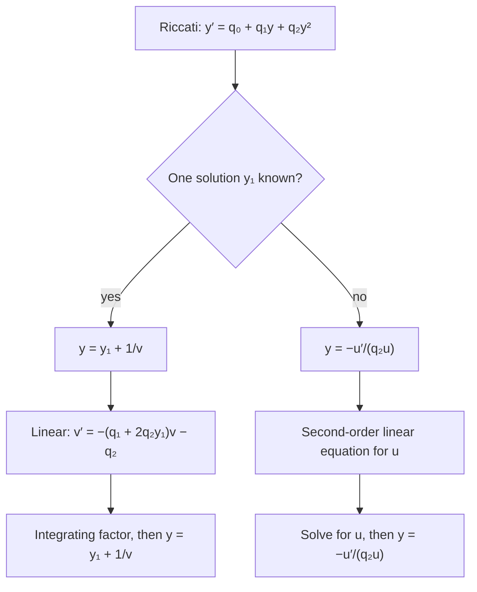

## Two classics beyond Bernoulli

Lesson 10 turned Bernoulli equations into linear ones with a substitution. This honors
lesson takes two older, famous nonlinear equations a step further. The **Riccati equation**,
studied by the Venetian mathematician Jacopo Riccati in the 1720s, is the simplest nonlinear
equation after Bernoulli's, and it has a surprising link to the second-order linear equations
of Module 5. The **Clairaut equation**, studied by Alexis Clairaut in the 1730s, has a family
of straight-line solutions plus one extra curve that belongs to no member of the family, a
vivid picture of how uniqueness can fail.

## The Riccati equation

A Riccati equation has the form

$$y' = q_0(t) + q_1(t)\,y + q_2(t)\,y^2,$$

quadratic in $y$, with $q_2 \ne 0$ (if $q_2 = 0$ it is linear; if $q_0 = 0$ it is Bernoulli
with $n = 2$). In general there is no way to solve it by integrals alone: in 1841 Joseph
Liouville proved that even the innocent-looking $y' = t^2 + y^2$ can't be solved by any finite
combination of elementary functions and their integrals. But a single known solution unlocks
all the others.

### One solution gives them all

Suppose $y_1(t)$ is one solution (found by guessing, often a polynomial, $c/t$ or a constant).
Look for the others in the form

$$y = y_1 + \frac{1}{v}.$$

Then $y' = y_1' - \dfrac{v'}{v^2}$. Substitute into the equation and cancel
$y_1' = q_0 + q_1y_1 + q_2y_1^2$, which holds because $y_1$ is a solution:

$$-\frac{v'}{v^2} = \frac{q_1}{v} + \frac{2q_2y_1}{v} + \frac{q_2}{v^2}.$$

Multiply by $-v^2$:

$$v' = -\big(q_1 + 2q_2y_1\big)\,v - q_2.$$

That is a **linear** first-order equation for $v$, solved by an integrating factor (Lesson 8).
The squared term has disappeared, because the difference of two solutions of a Riccati
equation satisfies a Bernoulli equation, and $1/v$ is Bernoulli's substitution.

### Example 1

Solve $y' = 1 + t^2 - 2ty + y^2$ with $y(0) = \tfrac12$.

- Guess a simple solution. Try $y_1 = t$: $y_1' = 1$ and
  $1 + t^2 - 2t^2 + t^2 = 1$. ✓ (The right side is $1 + (y - t)^2$, which suggests it.)
- Here $q_0 = 1 + t^2$, $q_1 = -2t$, $q_2 = 1$, so
  $v' = -(-2t + 2t)v - 1 = -1$.
- $v = C - t$, so $y = t + \dfrac{1}{C - t}$.
- $y(0) = \dfrac1C = \dfrac12$ gives $C = 2$: $y = t + \dfrac{1}{2 - t}$.

The solution blows up at $t = 2$, even though the coefficients are polynomials, continuous
everywhere. A nonlinear equation can do that (Lesson 7); a linear one can't. The particular
solution $y_1 = t$ is the limiting case $C \to \infty$.

### Example 2

Solve $y' = y^2 - \dfrac{2}{t^2}$ for $t > 0$, with $y(1) = 2$.

- Try $y_1 = \dfrac{c}{t}$: $-\dfrac{c}{t^2} = \dfrac{c^2 - 2}{t^2}$, so $c^2 + c - 2 = 0$ and
  $c = 1$ or $c = -2$. Take $y_1 = \dfrac1t$.
- $q_1 = 0$, $q_2 = 1$: $v' = -\dfrac{2}{t}v - 1$.
- Integrating factor $t^2$: $(t^2v)' = -t^2$, so $t^2v = -\dfrac{t^3}{3} + C$ and
  $v = \dfrac{3C - t^3}{3t^2}$.
- Write $K = 3C$: $y = \dfrac1t + \dfrac{3t^2}{K - t^3}$.
- $y(1) = 1 + \dfrac{3}{K - 1} = 2$ gives $K = 4$. Answer: $y = \dfrac1t + \dfrac{3t^2}{4 - t^3}$,
  which blows up at $t = \sqrt[3]{4} \approx 1.587$.

Check the family against the second guess: $K = 0$ gives $\dfrac1t - \dfrac3t = -\dfrac2t$,
the other solution $c = -2$. ✓

## From Riccati to second-order linear

What if no solution is known? Substitute

$$y = -\frac{u'}{q_2\,u}$$

for a new unknown $u$. A direct (if messy) computation turns the Riccati equation into

$$u'' - \left(q_1 + \frac{q_2'}{q_2}\right)u' + q_0\,q_2\,u = 0,$$

which is *linear* and second order. When $q_2 = 1$ this is simply $u'' - q_1u' + q_0u = 0$.
So every Riccati equation is secretly a second-order linear equation, and the reverse is true
too: dividing a second-order linear equation by $u$ and setting $y = -u'/u$ gives a Riccati
equation. This is one reason Riccati equations keep turning up, from control engineering (the
"matrix Riccati equation" for optimal controllers) to quantum mechanics.



### Example 3

Solve $y' = 1 + y^2$ by the second-order route.

- $q_0 = 1$, $q_1 = 0$, $q_2 = 1$, so $y = -u'/u$ leads to $u'' + u = 0$.
- $u = A\cos t + B\sin t$, which can be written $u = R\cos(t - c)$ for constants $R$ and $c$.
- $y = -\dfrac{u'}{u} = -\dfrac{-R\sin(t - c)}{R\cos(t - c)} = \tan(t - c)$.

Check: $(\tan(t - c))' = \sec^2(t - c) = 1 + \tan^2(t - c)$. ✓ (The equation is also
separable: $\arctan y = t - c$.) Every solution blows up within an interval of length $\pi$,
exactly where $u$ has a zero. Zeros of $u$ become vertical asymptotes of $y$.

## The Clairaut equation

A Clairaut equation has the form

$$y = x\,y' + f(y'),$$

for some function $f$. Write $p = y'$ and differentiate both sides with respect to $x$:

$$p = p + x\,p' + f'(p)\,p' \quad\Longrightarrow\quad p'\big(x + f'(p)\big) = 0.$$

So either factor can be zero.

- **$p' = 0$.** Then $p = C$ is constant, and the equation gives the family of straight lines
  $$y = Cx + f(C).$$
- **$x + f'(p) = 0$.** Then $x = -f'(p)$ and $y = xp + f(p) = f(p) - pf'(p)$. As $p$ varies, this
  traces a curve, given in parametric form with parameter $p$.

The curve in the second case is a **singular solution**: it solves the equation but is not
one of the lines $y = Cx + f(C)$ for any choice of $C$. Geometrically, it is the curve that
every line of the family touches tangentially.

### Example 4

Solve $y = xy' - (y')^2$, and find the solutions through $(3, 2)$.

- Here $f(p) = -p^2$. Lines: $y = Cx - C^2$.
- Singular solution: $x = -f'(p) = 2p$, so $p = \dfrac x2$, and
  $y = xp - p^2 = \dfrac{x^2}{2} - \dfrac{x^2}{4} = \dfrac{x^2}{4}$.
  Check: $y' = \dfrac x2$ and $x\cdot\dfrac x2 - \dfrac{x^2}{4} = \dfrac{x^2}{4}$. ✓
- Each line is tangent to the parabola: the tangent to $y = x^2/4$ at $x = 2C$ has slope $C$
  and passes through $(2C, C^2)$, so it is $y = C^2 + C(x - 2C) = Cx - C^2$.
- Through $(3, 2)$: $2 = 3C - C^2$, so $C^2 - 3C + 2 = 0$ and $C = 1$ or $C = 2$. The solutions
  are the lines $y = x - 1$ and $y = 2x - 4$, tangent to the parabola at $(2, 1)$ and $(4, 4)$.

```plot
{"x": [-3, 6], "y": [-4, 7], "equal": true, "functions": [{"f": "x^2/4", "label": "y = x²/4"}, {"f": "x - 1", "dashed": true}, {"f": "2x - 4", "dashed": true}, {"f": "-x - 1", "dashed": true}, {"f": "0", "dashed": true}], "points": [{"at": [3, 2], "label": "(3, 2)"}, {"at": [2, 1]}, {"at": [4, 4]}, {"at": [-2, 1]}, {"at": [0, 0]}], "caption": "Clairaut equation y = xy′ − (y′)²: the straight-line solutions y = Cx − C² (dashed, shown for C = −1, 0, 1, 2) are all tangent to the singular solution y = x²/4. Two lines pass through (3, 2), a point below the parabola."}
```

### Counting solutions through a point

For Example 4, the lines through $(x_0, y_0)$ come from $C^2 - x_0C + y_0 = 0$, with
discriminant $x_0^2 - 4y_0$:

| Where the point is | Lines through it |
|---|---|
| Below the parabola ($y_0 < x_0^2/4$) | two |
| On the parabola | one (the tangent), plus the parabola itself |
| Above the parabola ($y_0 > x_0^2/4$) | none |

On the parabola, uniqueness fails: both the tangent line and the parabola pass through the
point with the same slope. You can even splice them, following the parabola and then leaving
along a tangent line, to build infinitely many solutions. This matches Lesson 7. Solving
$p^2 - xp + y = 0$ for the slope gives the normal forms $y' = \dfrac{x \pm \sqrt{x^2 - 4y}}{2}$,
whose partial derivative in $y$, $\mp\dfrac{1}{\sqrt{x^2 - 4y}}$, blows up exactly on the
parabola $x^2 = 4y$.

## Common mistakes

- **Forgetting to check the guess.** $y_1$ must satisfy the Riccati equation exactly before
  you substitute $y = y_1 + 1/v$.
- **Dropping the factor 2.** The linear equation is $v' = -(q_1 + 2q_2y_1)v - q_2$; both the
  $2q_2y_1$ and the $-q_2$ are easy to lose.
- **Converting back wrongly.** After finding $v$, the answer is $y = y_1 + 1/v$, not $1/v$.
- **Missing the singular solution.** In a Clairaut equation, setting $p' = 0$ gives only the
  lines; the factor $x + f'(p) = 0$ gives the extra curve.
- **Calling the singular solution a member of the family.** No single value of $C$ produces it.

## Key points

- Riccati: $y' = q_0 + q_1y + q_2y^2$. With one solution $y_1$, $y = y_1 + 1/v$ gives the
  linear $v' = -(q_1 + 2q_2y_1)v - q_2$.
- $y = -u'/(q_2u)$ turns a Riccati equation into a second-order linear equation for $u$;
  zeros of $u$ are blow-ups of $y$.
- Clairaut: $y = xy' + f(y')$ has the lines $y = Cx + f(C)$ and a singular solution
  $x = -f'(p)$, $y = f(p) - pf'(p)$, which all the lines touch.
- Where a singular solution meets the lines, uniqueness fails.
