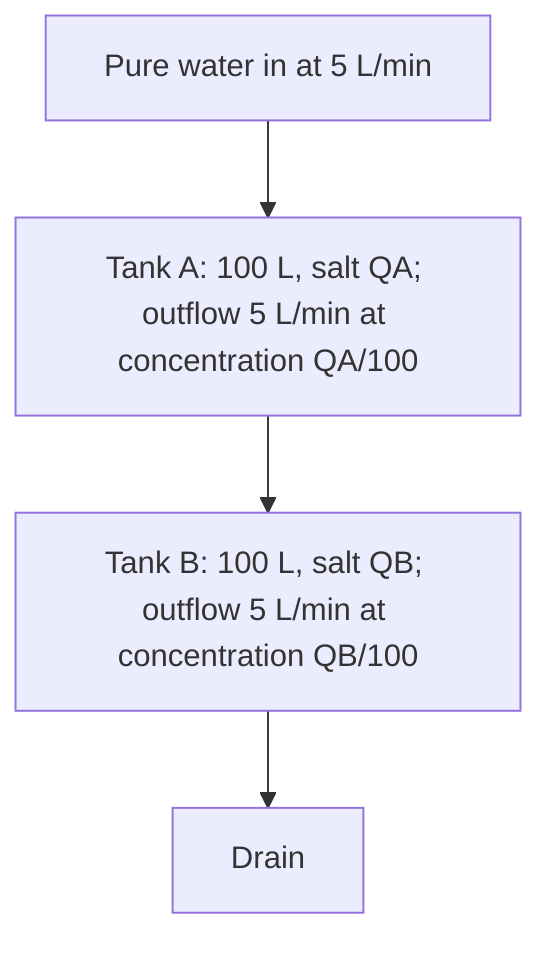

## Tanks, lakes and bloodstreams

A **mixing problem** tracks the amount of a substance (salt, a pollutant, a drug)
dissolved in a well-stirred container while solution flows in and out. The same model
describes a lake receiving polluted river water, a room being ventilated, or medicine
being cleared from blood. It is the cleanest example of the balance principle from the
last lesson.

## Setting up the equation

Let $Q(t)$ be the **amount** of substance (in kg, grams, ...) in the tank at time $t$,
and $V(t)$ the volume of liquid. Then

$$\frac{dQ}{dt} = (\text{rate in}) - (\text{rate out}).$$

Each rate is a flow rate times a concentration:

- **Rate in** = (inflow rate, L/min) × (incoming concentration, kg/L).
- **Rate out** = (outflow rate, L/min) × (concentration in the tank, kg/L) =
  $r_{\text{out}} \cdot \dfrac{Q(t)}{V(t)}$.

The phrase "well-stirred" is what lets us say the outflow has the tank's current
concentration $Q/V$. Check units: every term should be kg/min.

The picture labels each piece of the setup.


## Constant volume

If inflow and outflow rates are equal, $V$ is constant and the equation is

$$\frac{dQ}{dt} = r\,c_{\text{in}} - \frac{r}{V}Q,$$

which is linear with constant coefficients. The solution has the familiar shape:

$$Q(t) = Q_\infty + (Q_0 - Q_\infty)e^{-rt/V}, \qquad Q_\infty = c_{\text{in}}V.$$

The long-run amount $Q_\infty$ is exactly what you'd expect: eventually the tank holds
liquid at the incoming concentration. The rate $r/V$ is how fast the tank "turns over".

### Example 1

A 200 L tank initially holds pure water. Brine with 0.5 kg of salt per liter flows in at
4 L/min, and the well-mixed solution drains at 4 L/min. Find the salt after 30 minutes.

- Rate in: $4 \times 0.5 = 2$ kg/min. Rate out: $4 \cdot \dfrac{Q}{200} = \dfrac{Q}{50}$ kg/min.
- Equation: $Q' = 2 - \dfrac{Q}{50}$, $Q(0) = 0$.
- Integrating factor $e^{t/50}$: $(e^{t/50}Q)' = 2e^{t/50}$, so $e^{t/50}Q = 100e^{t/50} + C$
  and $Q = 100 + Ce^{-t/50}$. $Q(0) = 0$ gives $C = -100$.
- $Q(t) = 100(1 - e^{-t/50})$, and $Q(30) = 100(1 - e^{-0.6}) \approx 45.1$ kg.
- Long run: $Q \to 100$ kg, which is $0.5 \text{ kg/L} \times 200 \text{ L}$.

```plot
{"x": [0, 250], "y": [0, 120], "xLabel": "t (min)", "yLabel": "Q (kg)", "functions": [{"f": "100(1 - exp(-x/50))", "label": "Q(t)"}, {"f": "100", "dashed": true, "label": "100 kg"}], "points": [{"at": [30, 45.12], "label": "t = 30"}], "caption": "Salt in the tank approaches the 100 kg equilibrium."}
```

### Example 2: flushing out a pollutant

A pond holds 10,000 m³ of water containing 50 kg of a pollutant. Clean water flows in at
500 m³/day and mixed water flows out at the same rate. When will the pollutant drop to
5 kg?

- $Q' = 0 - \dfrac{500}{10000}Q = -0.05Q$, so $Q = 50e^{-0.05t}$.
- $50e^{-0.05t} = 5$ gives $t = \dfrac{\ln 10}{0.05} \approx 46.1$ days.

## Changing volume

If inflow and outflow rates differ, the volume changes linearly:
$V(t) = V_0 + (r_{\text{in}} - r_{\text{out}})t$. The equation

$$\frac{dQ}{dt} = r_{\text{in}}c_{\text{in}} - \frac{r_{\text{out}}}{V_0 + (r_{\text{in}} - r_{\text{out}})t}\,Q$$

is still linear, but with a variable coefficient. The integrating factor becomes a
power of $V(t)$.

### Example 3

A tank holds 100 L of water with 10 kg of salt. Brine at 0.2 kg/L enters at 3 L/min; mixed
solution leaves at 2 L/min. Find $Q(t)$ and the salt when the tank (capacity 200 L) is full.

- $V(t) = 100 + t$; full at $t = 100$ min.
- $Q' = 0.6 - \dfrac{2}{100 + t}Q$, so in standard form $Q' + \dfrac{2}{100 + t}Q = 0.6$.
- $\mu = e^{2\ln(100 + t)} = (100 + t)^2$.
- $\big((100 + t)^2Q\big)' = 0.6(100 + t)^2$, so $(100 + t)^2Q = 0.2(100 + t)^3 + C$.
- $Q(0) = 10$: $10^4 \cdot 10 = 0.2 \cdot 10^6 + C$, so $C = 100000 - 200000 = -100000$.
- $Q(t) = 0.2(100 + t) - \dfrac{100000}{(100 + t)^2}$.
- At $t = 100$: $Q = 40 - \dfrac{100000}{40000} = 37.5$ kg.

Sanity check: the concentration at that moment is $37.5/200 = 0.1875$ kg/L, below the
incoming 0.2 kg/L, as it should be since the tank started weaker.

## Two tanks in series

If tank A drains into tank B, the amount in A obeys its own equation, and its outflow
becomes B's inflow. The diagram shows the flows for the example below.



You solve A first and feed the result into B's equation. Example:
both tanks hold 100 L; pure water enters A at 5 L/min; A drains into B at 5 L/min; B drains
at 5 L/min. With $Q_A(0) = 20$ kg and $Q_B(0) = 0$:

- $Q_A' = -\dfrac{Q_A}{20}$, so $Q_A = 20e^{-t/20}$.
- $Q_B' = \dfrac{Q_A}{20} - \dfrac{Q_B}{20} = e^{-t/20} - \dfrac{Q_B}{20}$.
- With $\mu = e^{t/20}$: $(e^{t/20}Q_B)' = 1$, so $Q_B = te^{-t/20}$.

$Q_B$ rises, peaks at $t = 20$ min (with $20e^{-1} \approx 7.36$ kg), then falls. Systems of
tanks like this are a preview of Module 8.

```plot
{"x": [0, 100], "y": [0, 22], "xLabel": "t (min)", "yLabel": "salt (kg)", "functions": [{"f": "20exp(-x/20)"}, {"f": "x*exp(-x/20)"}], "labels": [{"at": [12, 15], "text": "tank A"}, {"at": [55, 7], "text": "tank B"}], "points": [{"at": [20, 7.358], "label": "peak at t = 20"}], "caption": "Salt in tank A decays exponentially; tank B fills from A, peaks at 20 minutes with about 7.36 kg, then empties."}
```

## Checking a mixing model

Three quick checks catch most setup errors. First, at $t = 0$ the formula should give the
stated initial amount. Second, if the volume is constant, the long-run amount should be the
incoming concentration times the volume. Third, the concentration $Q/V$ should always lie
between the starting concentration and the incoming concentration; a tank can't become
saltier than anything that was ever put in it.

## Common mistakes

- **Mixing up amount and concentration.** $Q$ is an amount; the outflow concentration is
  $Q/V$.
- **Using the inflow rate for the outflow** when they differ.
- **Forgetting the volume changes** when rates differ.
- **Units.** Make sure every term is in (amount)/(time).
- **Wrong initial amount.** "Pure water" means $Q(0) = 0$.

## Key points

- $Q' = (\text{flow in})(c_{\text{in}}) - (\text{flow out})\dfrac{Q}{V}$, with
  $V = V_0 + (r_{\text{in}} - r_{\text{out}})t$.
- Constant volume: $Q = c_{\text{in}}V + (Q_0 - c_{\text{in}}V)e^{-rt/V}$.
- Variable volume: still linear, integrating factor a power of $V(t)$.
