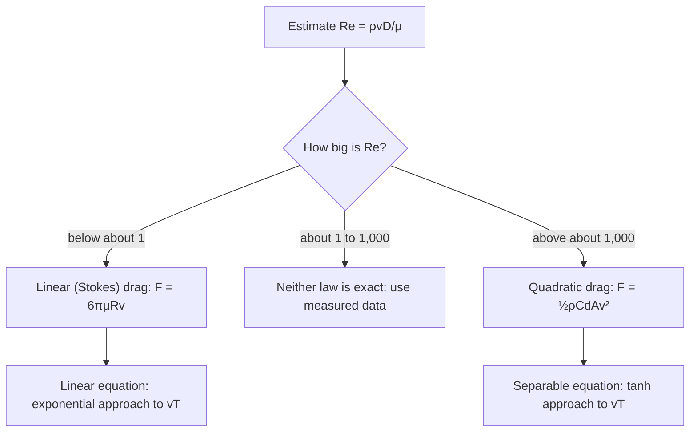

## Beyond the one-line formula

Lesson 13 solved falling with linear drag completely, then gave the answer for drag
proportional to $v^2$ in one line: $v = v_T\tanh(gt/v_T)$, "which you can verify by
differentiating." This lesson derives that formula, finds how far the object falls, and
follows a ball thrown upward through its whole flight, where drag changes direction at the
top. Along the way you will see where the two drag laws come from and how to decide which
one a problem needs. The equations are nonlinear, so the integrating factor of Lesson 8 no
longer works; separation of variables (Lesson 3) and one clever substitution do the job.

## Where the two drag laws come from

Air pushes back on a moving object in two ways. It is sticky (viscous), and it has to be
shoved out of the way (it has inertia). Which effect wins is measured by the
**Reynolds number**

$$\text{Re} = \frac{\rho v D}{\mu},$$

where $\rho$ is the air's density (about 1.2 kg/m³ at sea level), $v$ the speed, $D$ the
object's size (a diameter) and $\mu$ the air's viscosity (about $1.8 \times 10^{-5}$ Pa·s).
Re has no units.

- **Small Re (below about 1): linear drag.** Viscosity dominates and the drag force is
  proportional to speed. For a small sphere of radius $R$, **Stokes' law** gives
  $F = 6\pi\mu R v$. This is the $\gamma v$ of Lesson 13 with $\gamma = 6\pi\mu R$.
- **Large Re (above about 1,000): quadratic drag.** Inertia dominates and the force follows
  the **drag equation**
  $$F = \tfrac12 \rho C_d A v^2,$$
  where $A$ is the cross-sectional area and $C_d$ is a pure number that depends on shape
  (about 0.4 to 0.5 for a sphere over a wide range of speeds). Engineers call $C_d$ the drag
  coefficient; don't confuse it with the $\gamma$ of Lesson 13, which has units of kg/s.
  We lump the constants into one, $k = \tfrac12\rho C_d A$, with units of kg/m.

These cutoffs are rough guides, not sharp boundaries. Between them neither law is exact,
and engineers use measured drag curves. (A smooth sphere also has a sudden drop in $C_d$,
the "drag crisis," near Re ≈ 300,000; rough or irregular bodies like a person don't.)



Two quick estimates. A fog droplet 20 µm across falls at about 1.2 cm/s, so
$\text{Re} \approx \dfrac{1.2(0.012)(2\times10^{-5})}{1.8\times10^{-5}} \approx 0.016$: linear drag.
A skydiver at 50 m/s with $D \approx 0.5$ m has $\text{Re} \approx 1.7 \times 10^6$: firmly
quadratic. Most everyday objects moving through air (balls, people, cars) are in the
quadratic regime, which is why this lesson matters.

## Falling from rest: deriving the tanh formula

Take down as positive. With weight $mg$ and drag $kv^2$ opposing the (downward) motion,

$$m\frac{dv}{dt} = mg - kv^2.$$

The **terminal velocity** is where the right side is zero, $v_T = \sqrt{mg/k}$. Since
$k/m = g/v_T^2$, the equation becomes

$$\frac{dv}{dt} = g\left(1 - \frac{v^2}{v_T^2}\right).$$

It is separable. Write $u = v/v_T$ (the speed as a fraction of terminal velocity), so
$dv = v_T\,du$, and separate:

$$\frac{v_T\,du}{1 - u^2} = g\,dt.$$

Partial fractions give $\dfrac{1}{1 - u^2} = \dfrac12\left(\dfrac{1}{1 - u} + \dfrac{1}{1 + u}\right)$,
so integrating,

$$\frac{v_T}{2}\ln\frac{1 + u}{1 - u} = gt + C.$$

Starting from rest, $u = 0$ at $t = 0$, so $C = 0$. Write $s = gt/v_T$, solve
$\dfrac{1 + u}{1 - u} = e^{2s}$ for $u$, and you get

$$u = \frac{e^{2s} - 1}{e^{2s} + 1} = \frac{e^{s} - e^{-s}}{e^{s} + e^{-s}} = \tanh s.$$

That is the **hyperbolic tangent**, so $v = v_T\tanh(gt/v_T)$. Its inverse is
$\tanh^{-1}u = \tfrac12\ln\dfrac{1 + u}{1 - u}$, which you need whenever a problem gives a speed
and asks for a time.

The formula behaves the way physics says it should. For small $t$, $\tanh s \approx s$, so
$v \approx gt$: at first there is almost no drag and the object is in free fall. For large
$t$, $1 - \tanh s \approx 2e^{-2s}$, so the gap to terminal velocity closes exponentially.

**Distance fallen.** Integrate $v$, using $\dfrac{d}{dt}\ln\cosh(gt/v_T) = \dfrac{g}{v_T}\tanh(gt/v_T)$:

$$x(t) = \frac{v_T^2}{g}\ln\cosh\!\left(\frac{gt}{v_T}\right).$$

For large $t$, $\ln\cosh s \approx s - \ln 2$, so $x \approx v_T t - \dfrac{v_T^2}{g}\ln 2$: the
object eventually falls as if it had moved at $v_T$ all along but started
$\dfrac{v_T}{g}\ln 2$ seconds late.

### Example 1: a skydiver

An 80 kg skydiver falls belly-down with $k = 0.27$ kg/m. Find the terminal velocity, the time
to reach 90% of it, and the distance fallen by then.

- $v_T = \sqrt{\dfrac{80(9.8)}{0.27}} = \sqrt{2903.7} \approx 53.9$ m/s, about 194 km/h. (Real
  belly-down skydivers fall at roughly 50 to 55 m/s, so this $k$ is realistic.)
- 90% means $\tanh s = 0.9$, so $s = \tanh^{-1}0.9 = \tfrac12\ln 19 \approx 1.472$ and
  $t = \dfrac{1.472 \times 53.9}{9.8} \approx 8.1$ s.
- Since $\cosh(\tanh^{-1}u) = 1/\sqrt{1 - u^2}$, $\ln\cosh 1.472 = -\tfrac12\ln 0.19 \approx 0.830$, so
  $x = \dfrac{2903.7}{9.8}(0.830) \approx 246$ m.

Without air, 8.1 s of falling would cover about 321 m and reach 79 m/s. Drag has already
cost nearly a quarter of the distance.

## Speed against distance

Problems often give a height, not a time. Use the chain rule:
$\dfrac{dv}{dt} = \dfrac{dv}{dx}\dfrac{dx}{dt} = v\dfrac{dv}{dx}$. Then

$$v\frac{dv}{dx} = g\left(1 - \frac{v^2}{v_T^2}\right).$$

The substitution $w = v^2$ (so $dw/dx = 2v\,dv/dx$) turns this into a *linear* equation,
$\dfrac{dw}{dx} = 2g\left(1 - \dfrac{w}{v_T^2}\right)$, with solution, starting from rest,

$$v^2 = v_T^2\left(1 - e^{-2gx/v_T^2}\right).$$

Check with Example 1: $e^{-2(9.8)(246)/2903.7} = e^{-1.66} \approx 0.19$, so
$v^2 = 0.81v_T^2$ and $v = 0.9v_T$, as it should be.

## Thrown upward: drag changes direction

Now take *up* as positive and throw a ball upward at speed $v_0$. Gravity always points
down, but drag always opposes the motion, so its direction flips at the top.


- Rising ($v > 0$): $mv' = -mg - kv^2$.
- Falling ($v < 0$): $mv' = -mg + kv^2$.

One formula covers both: $mv' = -mg - kv|v|$. But you can't solve that in one piece with
elementary functions; you solve each leg separately and join them at the top.

**The way up.** Dividing by $m$, $v' = -g\left(1 + \dfrac{v^2}{v_T^2}\right)$. Separating and using
$\displaystyle\int\frac{du}{1 + u^2} = \tan^{-1}u$:

$$v_T\tan^{-1}\frac{v}{v_T} = v_T\tan^{-1}\frac{v_0}{v_T} - gt.$$

The ball stops ($v = 0$) at $t_{\text{top}} = \dfrac{v_T}{g}\tan^{-1}\dfrac{v_0}{v_T}$. For the height,
use $v\,dv/dy$ and $w = v^2$ again: $\dfrac{dw}{dy} = -2g\left(1 + \dfrac{w}{v_T^2}\right)$, which gives

$$H = \frac{v_T^2}{2g}\ln\left(1 + \frac{v_0^2}{v_T^2}\right).$$

For a slow throw, $\ln(1 + \varepsilon) \approx \varepsilon$ gives $H \approx v_0^2/(2g)$, the
no-drag answer.

**The way down.** From rest at height $H$, the falling formula applies (measure distance
down from the top). Landing speed: $v_{\text{ret}}^2 = v_T^2\left(1 - e^{-2gH/v_T^2}\right)$, and
$e^{-2gH/v_T^2} = \dfrac{1}{1 + v_0^2/v_T^2}$, so

$$v_{\text{ret}} = \frac{v_0v_T}{\sqrt{v_0^2 + v_T^2}}.$$

This is smaller than both $v_0$ and $v_T$: air takes energy on both legs.

### Example 2: up and back down

A ball with terminal velocity 40 m/s is thrown straight up at 30 m/s. Find the time to the
top, the maximum height, the landing speed and the time to fall back.

- $t_{\text{top}} = \dfrac{40}{9.8}\tan^{-1}(0.75) \approx 4.082(0.6435) \approx 2.63$ s (no drag: $30/9.8 \approx 3.06$ s).
- $H = \dfrac{1600}{19.6}\ln(1 + 0.5625) \approx 81.63(0.4463) \approx 36.4$ m (no drag: 45.9 m).
- $v_{\text{ret}} = \dfrac{30 \times 40}{\sqrt{900 + 1600}} = \dfrac{1200}{50} = 24$ m/s.
- Falling from rest to $0.6v_T$: $t = \dfrac{v_T}{g}\tanh^{-1}0.6 = 4.082 \times \tfrac12\ln 4 \approx 2.83$ s.

The fall (2.83 s) takes *longer* than the rise (2.63 s). On the way up, drag adds to gravity;
on the way down, it subtracts. The whole flight takes about 5.46 s instead of 6.12 s.

## Linear and quadratic drag side by side

Give both models the package from Lesson 13, with the same terminal velocity, 24.5 m/s. Both
then have the same time scale, $v_T/g = 2.5$ s, yet the quadratic one gets close to $v_T$
sooner: at $t = 5$ s it is at 23.6 m/s against 21.2 m/s. The reason is that at any speed
below $v_T$, $kv^2 = mg(v/v_T)^2$ is smaller than $\gamma v = mg(v/v_T)$, so quadratic drag
holds the object back less until it is nearly at terminal speed.

```plot
{"x": [0, 12], "y": [0, 30], "xLabel": "t (s)", "yLabel": "v (m/s)", "functions": [{"f": "24.5tanh(0.4x)"}, {"f": "24.5(1 - exp(-0.4x))"}, {"f": "24.5", "dashed": true}, {"f": "9.8x", "dashed": true, "to": 2.5, "label": "no drag"}], "caption": "Same terminal velocity, 24.5 m/s (dashed line): the quadratic-drag curve (upper) approaches it faster than the linear-drag curve (lower)."}
```

## Common mistakes

- **Using one equation for the whole flight.** With quadratic drag, $mv' = -mg - kv^2$ is only
  right while the object rises. Drag is $-kv|v|$, so split the motion at the top.
- **Expecting a symmetric flight.** With drag, the fall is slower and lands at a lower speed
  than the launch.
- **Reaching for an integrating factor.** $mv' = mg - kv^2$ is nonlinear; separate variables
  (or use $w = v^2$ for speed against distance).
- **Wrong terminal velocity.** It is $\sqrt{mg/k}$ for quadratic drag, not $mg/k$; check units:
  $k$ is in kg/m, so $mg/k$ is in m²/s².
- **Confusing $\tanh^{-1}$ with $1/\tanh$.** The inverse function undoes $\tanh$; the reciprocal
  is $\coth$.

## Key points

- Low Reynolds number: linear (Stokes) drag. High Reynolds number: quadratic drag,
  $F = \tfrac12\rho C_dAv^2 = kv^2$. The cutoffs are rough.
- From rest: $v = v_T\tanh(gt/v_T)$ and $x = \dfrac{v_T^2}{g}\ln\cosh(gt/v_T)$, with
  $v_T = \sqrt{mg/k}$.
- Speed against distance: $v^2 = v_T^2(1 - e^{-2gx/v_T^2})$, from the substitution $w = v^2$.
- Thrown up: $t_{\text{top}} = \dfrac{v_T}{g}\tan^{-1}\dfrac{v_0}{v_T}$,
  $H = \dfrac{v_T^2}{2g}\ln\left(1 + \dfrac{v_0^2}{v_T^2}\right)$,
  $v_{\text{ret}} = \dfrac{v_0v_T}{\sqrt{v_0^2 + v_T^2}}$.
- Drag reverses at the top, so up and down are different equations.
