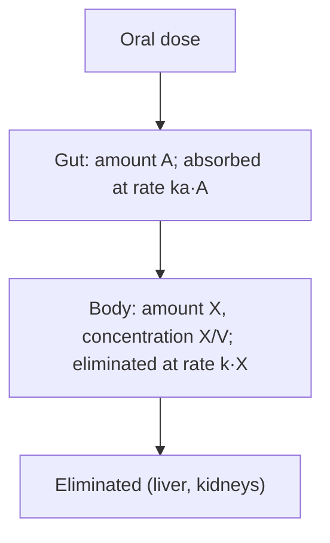

## From tanks to bloodstreams

Lesson 12 mentioned that the mixing model also describes medicine being cleared from the
blood. This lesson takes that seriously. **Pharmacokinetics** is the study of how the body
absorbs, distributes and eliminates a drug, and its simplest models are exactly the tanks of
Lesson 12: a dose flows in, the body mixes it, and the liver and kidneys remove it. The
questions are practical ones. How fast must an IV drip run to hold a target level? Why does
a daily pill take days to reach full effect? Why do doctors sometimes give a bigger first
dose? Every answer comes from first-order linear equations you already know how to solve.

This is a teaching model, not dosing advice. Real dosing uses measured, drug-specific values
and clinical judgment.

## The one-compartment model

The **one-compartment model** treats the body as a single well-stirred tank. Let $X(t)$ be
the amount of drug in the body (mg) and $C(t)$ its concentration in the blood (mg/L). They are
linked by the **volume of distribution** $V$:

$$C = \frac{X}{V}.$$

$V$ is an *apparent* volume: it is whatever volume makes $C = X/V$ true. A drug that soaks into
fat or muscle leaves little in the blood, so its $V$ can be far larger than the body's actual
volume.

Most drugs at normal doses are removed at a rate proportional to the amount present
(first-order elimination):

$$\frac{dX}{dt} = -kX,$$

where $k$ (per hour) is the **elimination rate constant**. Two related numbers are used
clinically. The half-life is $t_{1/2} = \ln 2/k$, as in Lesson 4. The **clearance**,
$\text{CL} = kV$ (L/h), is the volume of blood completely cleared of drug per hour, so the
elimination rate is $kX = \text{CL}\cdot C$.

These are simplifications. Many drugs need two or more compartments (blood plus slowly
equilibrating tissues), and a few, such as alcohol, are eliminated at a nearly constant rate
because the enzymes that remove them saturate. The one-compartment, first-order model is
the starting point that the others build on.

## A single injection

An IV **bolus** puts the whole dose $D$ into the blood at once, so $X(0) = D$ and

$$C(t) = \frac{D}{V}e^{-kt}.$$

On a semilog plot ($\ln C$ against $t$) this is a straight line with slope $-k$ and
intercept $\ln(D/V)$. That is how $k$ and $V$ are measured: give a known dose, take blood
samples, fit the line.

### Example 1: finding the parameters

A patient receives a 500 mg IV bolus. Blood levels are 8 mg/L at 2 hours and 4 mg/L at
6 hours. Find $k$, $V$ and the clearance.

- The level halved in 4 hours, so $t_{1/2} = 4$ h and $k = \ln 2/4 \approx 0.173$ per hour.
- Run the decay backward 2 hours from the first sample: $C(0) = 8e^{2k} = 8 \cdot 2^{1/2} \approx 11.3$ mg/L.
- $V = D/C(0) = 500/11.31 \approx 44.2$ L, and $\text{CL} = kV \approx 0.173 \times 44.2 \approx 7.66$ L/h.

## A constant infusion

An IV **infusion** delivers drug at a steady rate $R_0$ (mg/h). Now

$$\frac{dX}{dt} = R_0 - kX,$$

which is exactly the constant-volume mixing tank of Lesson 12: rate in minus rate out.
Starting from zero, with $C = X/V$,

$$C(t) = \frac{R_0}{\text{CL}}\left(1 - e^{-kt}\right).$$

The level rises to the **steady state** $C_{ss} = R_0/\text{CL}$, where elimination
balances the drip. After $n$ half-lives it has covered a fraction $1 - 2^{-n}$ of the way:
50%, 75%, 87.5%, 93.8%, 96.9% after 1 to 5 half-lives. That is the source of the rule of
thumb that a drug reaches steady state in about four to five half-lives.

Notice what controls what. The steady level depends on the rate and the clearance; the
*time* to get there depends only on the half-life. Running the drip faster raises the
plateau but doesn't get you there any sooner.

### Example 2: infusion with a loading dose

A drug has $t_{1/2} = 8$ h and $V = 40$ L. The target level is 10 mg/L.

- $k = \ln 2/8 \approx 0.0866$ per hour and $\text{CL} = kV \approx 3.47$ L/h.
- Infusion rate: $R_0 = C_{ss}\cdot\text{CL} \approx 10 \times 3.47 \approx 34.7$ mg/h.
- Time to 90% of target: $1 - e^{-kt} = 0.9$ gives $t = \ln 10/k \approx 26.6$ h, more than a day.

To reach the target at once, give a **loading dose**: a bolus $D_L = C_{ss}V = 400$ mg at
the start, together with the infusion. The equation is linear, so the two responses add
(the superposition principle): the bolus contributes $10e^{-kt}$, the infusion
$10(1 - e^{-kt})$, and the total is exactly 10 mg/L from the first minute. The infusion that
then keeps the level there is the **maintenance dose**.

## Repeated doses

Most drugs are taken as a dose $D$ every $\tau$ hours, the **dosing interval**. Treat each
dose as a bolus. Between doses the level decays by the factor $r = e^{-k\tau}$, the fraction
left after one interval. Just after dose $n$, the level is the new dose plus what remains of
the earlier ones:

$$C_n = \frac{D}{V}\left(1 + r + r^2 + \cdots + r^{n-1}\right) = \frac{D}{V}\cdot\frac{1 - r^n}{1 - r}.$$

That is a geometric series. As $n$ grows, $r^n \to 0$, and the peaks approach the
steady-state peak

$$C_{\text{peak}} = \frac{D/V}{1 - r}, \qquad C_{\text{trough}} = rC_{\text{peak}}.$$

The number $\dfrac{1}{1 - r}$ is the **accumulation factor**: how many times higher the
steady-state peak is than the first one. At steady state each dose adds exactly $D/V$, and
each interval removes exactly $D/V$.

### Example 3: a dose every half-life

A patient takes 300 mg every 6 hours. The drug has $V = 30$ L and $t_{1/2} = 6$ h.

- Each dose adds $D/V = 10$ mg/L, and $r = e^{-k\tau} = 2^{-6/6} = \tfrac12$.
- Peaks: 10, then $10 + 5 = 15$, then 17.5, 18.75, 19.375, … mg/L.
- Accumulation factor $1/(1 - \tfrac12) = 2$: the peaks approach 20 mg/L and the troughs 10 mg/L.

```plot
{"x": [0, 36], "y": [0, 25], "xLabel": "t (hours)", "yLabel": "C (mg/L)", "functions": [{"f": "10exp(-0.115525x)", "from": 0, "to": 6}, {"f": "15exp(-0.115525(x-6))", "from": 6, "to": 12}, {"f": "17.5exp(-0.115525(x-12))", "from": 12, "to": 18}, {"f": "18.75exp(-0.115525(x-18))", "from": 18, "to": 24}, {"f": "19.375exp(-0.115525(x-24))", "from": 24, "to": 30}, {"f": "19.6875exp(-0.115525(x-30))", "from": 30, "to": 36}, {"f": "20", "dashed": true, "label": "steady peak 20"}, {"f": "10", "dashed": true, "label": "steady trough 10"}], "segments": [{"from": [6, 5], "to": [6, 15]}, {"from": [12, 7.5], "to": [12, 17.5]}, {"from": [18, 8.75], "to": [18, 18.75]}, {"from": [24, 9.375], "to": [24, 19.375]}, {"from": [30, 9.6875], "to": [30, 19.6875]}], "caption": "300 mg every 6 hours with a 6-hour half-life: each dose jumps the level up 10 mg/L, and the peaks and troughs climb toward 20 and 10 mg/L."}
```

A loading dose works here too: a first dose of $D/(1 - r) = 600$ mg starts the patient at the
steady-state peak. The average level at steady state is $\dfrac{D}{\text{CL}\cdot\tau}$, here
$\dfrac{300}{3.47 \times 6} \approx 14.4$ mg/L. It is a little below the midpoint of 20 and 10,
because the decay curve sags. Smaller doses given more often keep the same average with a
smaller swing between peak and trough.

## Taking a drug by mouth

A pill first dissolves in the gut and is absorbed from there into the blood: two
compartments in series, like the two tanks in Lesson 12.



Only a fraction $F$ of the dose, the **bioavailability**, ever reaches the circulation. With
absorption rate constant $k_a$:

$$A' = -k_aA,\quad A(0) = FD; \qquad X' = k_aA - kX,\quad X(0) = 0.$$

Solve the gut first: $A = FDe^{-k_at}$. Then $X' + kX = k_aFDe^{-k_at}$ is linear; with
integrating factor $e^{kt}$ and $k_a \ne k$,

$$X(t) = \frac{FDk_a}{k_a - k}\left(e^{-kt} - e^{-k_at}\right).$$

The level rises, peaks and falls. Setting $X' = 0$ gives the peak time

$$t_{\max} = \frac{\ln(k_a/k)}{k_a - k}.$$

If $k_a = k$, the formula breaks down and the solution is $X = FDk\,te^{-kt}$, the same
$te^{-t/20}$ shape as tank B in Lesson 12.

### Example 4: a tablet

A 500 mg tablet has $F = 0.8$, $k_a = 1.0$ per hour, $k = 0.2$ per hour, and $V = 50$ L. When
does the blood level peak, and how high?

- $t_{\max} = \dfrac{\ln 5}{0.8} \approx 2.01$ h.
- $C_{\max} = \dfrac{FD}{V}\cdot\dfrac{k_a}{k_a - k}\left(e^{-kt_{\max}} - e^{-k_at_{\max}}\right) = 8(1.25)(0.6687 - 0.1337) \approx 5.35$ mg/L.

Compare an IV bolus of the same 400 mg that actually reaches the blood: it would start at
8 mg/L. Slow absorption flattens and delays the peak.

## Common mistakes

- **Amount versus concentration.** Equations balance amounts ($X$, mg); blood tests measure
  concentrations ($C = X/V$, mg/L). Convert with $V$.
- **Thinking a faster drip reaches steady state sooner.** The time scale is set by the
  half-life alone; only a loading dose shortcuts it.
- **Summing the series wrong.** After $n$ doses the sum has $n$ terms, $1 + r + \cdots + r^{n-1}$,
  not $r^n$ terms or $n + 1$.
- **Forgetting bioavailability** for oral doses: only $FD$ reaches the blood.
- **Treating $V$ as a real volume.** It is an apparent volume and can exceed body volume.

## Key points

- One compartment: $X' = (\text{rate in}) - kX$, $C = X/V$, $\text{CL} = kV$, $t_{1/2} = \ln 2/k$.
- Bolus: $C = (D/V)e^{-kt}$. Infusion: $C = (R_0/\text{CL})(1 - e^{-kt})$, steady state in about
  4 to 5 half-lives; loading dose $C_{ss}V$.
- Repeated doses: $r = e^{-k\tau}$, steady peak $(D/V)/(1 - r)$, trough $r$ times the peak.
- Oral dosing is two tanks in series: $t_{\max} = \ln(k_a/k)/(k_a - k)$.
