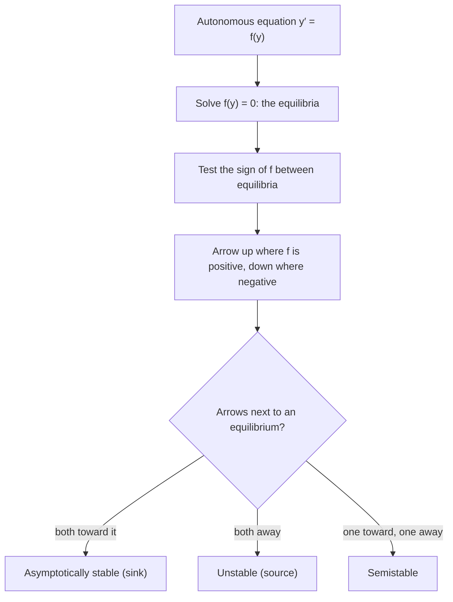

## Understanding without solving

The models so far all had formula solutions. Often, though, what you really want to know
is qualitative: will the population die out or level off? Will the temperature settle?
For **autonomous** equations, $y' = f(y)$, you can answer such questions from the graph
of $f$ alone, without solving. This lesson builds that tool, the phase line, and the
language of stability that runs through the rest of the course.

## Equilibria

An **equilibrium** (also called a critical point or equilibrium solution) is a value
$y^*$ with $f(y^*) = 0$. Then the constant function $y(t) = y^*$ is a solution: the system
sits there forever.

Between equilibria, $f(y)$ has a fixed sign (if $f$ is continuous). Where $f > 0$,
solutions increase; where $f < 0$, they decrease. And since $f$ and $f'$ are continuous
in typical models, uniqueness says solutions can't cross an equilibrium. So a solution
starting between two equilibria moves monotonically toward one of them.

## The phase line

A **phase line** is a vertical copy of the $y$-axis showing the equilibria as dots, with
arrows between them pointing up where $f > 0$ and down where $f < 0$. It's a compressed
slope field: since the slopes don't depend on $t$, one column says everything.

To draw it:

1. Solve $f(y) = 0$ for the equilibria.
2. Test the sign of $f$ in each interval between them.
3. Draw arrows: up for positive, down for negative.

The whole procedure, through the classification described in the next section, fits in one
chart:



## Stability

An equilibrium is classified by what nearby solutions do.

- **Asymptotically stable** (a **sink**): arrows on both sides point toward it. Nearby
  solutions approach it as $t \to \infty$.
- **Unstable** (a **source**): arrows on both sides point away. Nearby solutions leave.
- **Semistable**: arrows point toward it on one side and away
  on the other.

Here are all three on one phase line, for $y' = (y + 2)(y - 1)^2(y - 3)$. A filled dot marks a
sink, an open dot a source and a half-filled dot a semistable equilibrium, a common drawing
convention.


### The derivative test

If $f'(y^*) < 0$, then $f$ goes from positive to negative across $y^*$: arrows point in
from both sides, so $y^*$ is asymptotically stable. If $f'(y^*) > 0$, it's unstable. If
$f'(y^*) = 0$, the test is inconclusive; look at signs directly.

Why does this work? Near $y^*$, $f(y) \approx f'(y^*)(y - y^*)$, so $u = y - y^*$
satisfies approximately $u' = f'(y^*)u$, whose solutions $u = u_0e^{f'(y^*)t}$ decay when
$f'(y^*) < 0$ and grow when $f'(y^*) > 0$. This **linearization** idea comes back in
Module 8 for systems.

### Example 1

Analyze $y' = y(4 - y)$.

- Equilibria: $y = 0$, $y = 4$.
- Signs: for $y < 0$, $f < 0$ (down); for $0 < y < 4$, $f > 0$ (up); for $y > 4$, $f < 0$ (down).
- $y = 0$: arrows point away (down below, up above): unstable.
  $y = 4$: arrows point toward it: asymptotically stable.
- Derivative test agrees: $f'(y) = 4 - 2y$; $f'(0) = 4 > 0$, $f'(4) = -4 < 0$.

This is the logistic equation. Any positive starting population tends to 4.

```plot
{"x": [-1.5, 5.5], "y": [-6, 5], "xLabel": "y", "yLabel": "f(y)", "functions": [{"f": "x*(4 - x)", "label": "f(y) = y(4 − y)"}], "points": [{"at": [0, 0], "open": true, "label": "0: unstable"}, {"at": [4, 0], "label": "4: stable"}], "caption": "The sign of f(y) gives the phase-line arrows: down for y < 0, up for 0 < y < 4, down for y > 4."}
```

```plot
{"x": [0, 6], "y": [-1.5, 6], "xLabel": "t", "slopeField": {"f": "y*(4 - y)", "step": 0.5}, "functions": [{"f": "4/(1 + 7exp(-4x))", "label": "y(0) = 0.5"}, {"f": "4/(1 - 0.5exp(-4x))", "from": 0.2, "label": "y(0) = 8"}, {"f": "4", "dashed": true}, {"f": "0", "dashed": true}], "caption": "Solutions of y′ = y(4 − y): y = 4 attracts, y = 0 repels."}
```

### Example 2

Analyze $y' = (y - 1)^2(y + 2)$.

- Equilibria: $y = 1$ and $y = -2$.
- Signs: $y < -2$: $(+)(-) < 0$, down. $-2 < y < 1$: $(+)(+) > 0$, up. $y > 1$: $(+)(+) > 0$, up.
- $y = -2$: down below, up above: unstable.
- $y = 1$: up below (toward it), up above (away): **semistable**. Note $f'(1) = 0$,
  so the derivative test says nothing; the squared factor is the giveaway, since it
  doesn't change sign.

### Example 3

A solution of $y' = y^3 - 9y$ starts at $y(0) = 2$. What is $\lim_{t\to\infty} y(t)$?

- $f(y) = y(y - 3)(y + 3)$; equilibria $-3, 0, 3$.
- On $(0, 3)$: try $y = 1$: $1 - 9 < 0$, so solutions decrease.
- Starting at 2, the solution decreases toward the next equilibrium below, $y = 0$.
  The limit is 0. (Check: $f'(0) = -9 < 0$, so 0 is stable.)

## Reading the shape of solutions

The phase line tells you more than limits. Since $y'' = f'(y)\,y' = f'(y)f(y)$,
solutions have inflection points where $f'(y) = 0$, that is, at the peaks and troughs of
the graph of $f$. For the logistic $y' = y(4 - y)$, $f'(y) = 0$ at $y = 2$: the S-curve
bends there, exactly halfway to the carrying capacity, as Lesson 4 found.

## Population thresholds

Some species need a minimum population to survive (mates must find each other). A model
with an **extinction threshold** $T$ and carrying capacity $K$ is

$$P' = -rP\left(1 - \frac{P}{T}\right)\left(1 - \frac{P}{K}\right), \qquad 0 < T < K.$$

Check the signs. For $0 < P < T$: $\left(1 - \frac PT\right) > 0$, $\left(1 - \frac PK\right) > 0$, so $P' < 0$ and the
population dies out. Between $T$ and $K$: $P' > 0$, so it grows to $K$. Above $K$: $P' < 0$.
So $0$ and $K$ are stable, and $T$ is unstable: a tipping point.

## Common mistakes

- **Using $t$.** Phase lines only work for autonomous equations; $y' = t - y$ needs a full
  slope field.
- **Reading the wrong graph.** The arrows come from the sign of $f(y)$, not from the sign
  of $y$.
- **Trusting $f'(y^*) = 0$.** That case needs a direct sign check.
- **Thinking solutions reach equilibria.** They approach as $t \to \infty$ but (with
  uniqueness) never arrive in finite time.

## Key points

- Equilibria of $y' = f(y)$ solve $f(y) = 0$; arrows up where $f > 0$, down where $f < 0$.
- Stable: arrows point in. Unstable: arrows point out. Semistable: mixed.
- Derivative test: $f'(y^*) < 0$ stable, $f'(y^*) > 0$ unstable, $= 0$ inconclusive.
- A solution moves monotonically toward the next equilibrium in the arrow's direction
  (or to $\pm\infty$).
