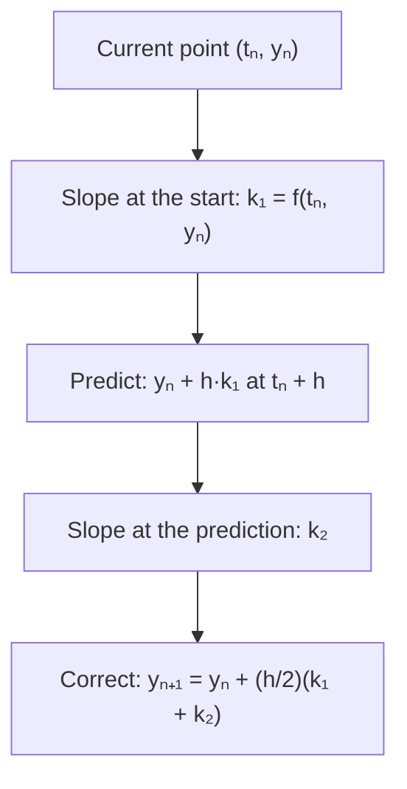

## Why we need better methods

Euler's method (Lesson 5) is simple and honest, but slow to converge: to get one more
correct digit you need about ten times as many steps. For a model run over years of
simulated time, or a spacecraft trajectory, that's too expensive. This lesson explains
*why* Euler's error behaves as it does and builds the first improvement, the improved
Euler method (also called **Heun's method**).

## Two kinds of error

Ignoring round-off, there are two errors to keep apart.

- **Local truncation error**: the error made in a *single* step, assuming you started
  that step exactly on the true solution.
- **Global error**: the total error at the end, $y(t_N) - y_N$, after errors from all
  steps have accumulated and propagated.

### Euler's local error

Taylor's theorem says the true solution satisfies

$$y(t + h) = y(t) + h\,y'(t) + \frac{h^2}{2}y''(\xi)$$

for some $\xi$ between $t$ and $t + h$. Euler's step keeps the first two terms and
throws away the third, so the local error is about $\dfrac{h^2}{2}y''$: proportional to
$h^2$.

### From local to global

To cross a fixed interval of length $L$ takes $N = L/h$ steps. If each step adds error of
order $h^2$, the total is roughly $N \cdot h^2 = Lh$, proportional to $h$. That's why
halving $h$ halved the error in Lesson 5. A method whose global error is proportional to
$h^p$ is said to have **order** $p$. Euler's method has order 1.

### Example 1

For $y' = y$, $y(0) = 1$, compare Euler estimates of $y(1) = e \approx 2.718282$.

| $h$ | Euler estimate $(1 + h)^{1/h}$ | Error | Error ÷ $h$ |
|---|---|---|---|
| 0.1 | 2.593742 | 0.124539 | 1.245 |
| 0.05 | 2.653298 | 0.064984 | 1.300 |
| 0.025 | 2.685064 | 0.033218 | 1.329 |

Error ÷ $h$ settles near a constant (it tends to $e/2 \approx 1.36$): the error is
proportional to $h$, as predicted.

## The improved Euler method

Euler's method uses the slope at the *start* of the step for the whole step. If the
slope changes over the step, that's biased. A better idea is to average the slopes at
the start and the end. We don't know the end yet, but we can estimate it with an Euler
step. That gives a **predictor-corrector** scheme:

$$\begin{aligned}
k_1 &= f(t_n, y_n) &&\text{slope at the start}\\
k_2 &= f(t_n + h,\ y_n + hk_1) &&\text{slope at the Euler-predicted end}\\
y_{n+1} &= y_n + \frac{h}{2}(k_1 + k_2) &&\text{step with the average slope}
\end{aligned}$$

It's the trapezoid rule applied to $y(t + h) = y(t) + \int_t^{t+h} f\,ds$, just as
Euler's method is the left-endpoint rule. Its local error is proportional to $h^3$ and
its global error to $h^2$: it is a **second-order method**. Halving $h$ cuts the error by
about a factor of 4.

The picture shows one step for $y' = y$ from $(t_n, y_n) = (0, 1)$ with a deliberately large
$h = 1$. Euler's step follows the starting slope $k_1 = 1$ and lands at 2, well below the
curve. The slope there is $k_2 = 2$. The average slope $1.5$ carries the step to $2.5$, much
closer to the true $e \approx 2.718$.

As a procedure, each step is four moves:

### Example 2

Use improved Euler with $h = 0.5$ for $y' = t + y$, $y(0) = 1$, to estimate $y(1)$.
(Exact: $y = 2e^t - t - 1$, so $y(1) \approx 3.436564$.)

Step 1 (from $t = 0$, $y = 1$):

- $k_1 = 0 + 1 = 1$.
- Predicted end: $y = 1 + 0.5(1) = 1.5$ at $t = 0.5$; $k_2 = 0.5 + 1.5 = 2$.
- $y_1 = 1 + 0.25(1 + 2) = 1.75$.

Step 2 (from $t = 0.5$, $y = 1.75$):

- $k_1 = 0.5 + 1.75 = 2.25$.
- Predicted end: $1.75 + 0.5(2.25) = 2.875$ at $t = 1$; $k_2 = 1 + 2.875 = 3.875$.
- $y_2 = 1.75 + 0.25(2.25 + 3.875) = 1.75 + 1.53125 = 3.28125$.

The error is $3.436564 - 3.28125 \approx 0.155$, compared with 0.937 for Euler with the same
step size. Each step costs two evaluations of $f$ instead of one, but the accuracy gain is
far larger.

### Example 3

One step of improved Euler for $y' = -2ty$, $y(0) = 1$, with $h = 0.1$.

- $k_1 = -2(0)(1) = 0$.
- Predicted: $y = 1 + 0.1(0) = 1$ at $t = 0.1$; $k_2 = -2(0.1)(1) = -0.2$.
- $y_1 = 1 + 0.05(0 - 0.2) = 0.99$.
- Exact: $e^{-0.01} \approx 0.990050$. Error about $5 \times 10^{-5}$. Euler would have
  given $y_1 = 1$, error $0.01$.

## Estimating error without the exact answer

In practice you don't know the true solution. A standard trick: compute with step $h$
and with step $h/2$. For a method of order $p$, the error with $h/2$ is about $1/2^p$ of
the error with $h$, so the difference between the two answers reveals roughly how big
the error is. Software uses this idea to choose step sizes automatically (adaptive
methods), taking small steps where the solution changes quickly and large ones where it's
smooth.

## Round-off error

Computers carry finitely many digits, so each arithmetic step adds a tiny
**round-off error**. With extremely small $h$ there are so many steps that round-off
can start to dominate. In practice, a higher-order method with a moderate step beats a
low-order method with a microscopic one.

## Common mistakes

- **Using $t_n$ in $k_2$.** The second slope is evaluated at $t_n + h$, the end of the step.
- **Using $h$ instead of $h/2$** in the final update; the average slope is $(k_1 + k_2)/2$.
- **Confusing local and global order.** Euler: local $h^2$, global $h$. Improved Euler:
  local $h^3$, global $h^2$.

## Key points

- Local error is per step; global error accumulates over $L/h$ steps, so it is one power
  of $h$ lower.
- Euler's method is first order: error $\propto h$.
- Improved Euler (Heun): $k_1 = f(t_n, y_n)$, $k_2 = f(t_n + h, y_n + hk_1)$,
  $y_{n+1} = y_n + \tfrac h2(k_1 + k_2)$; second order, error $\propto h^2$.
