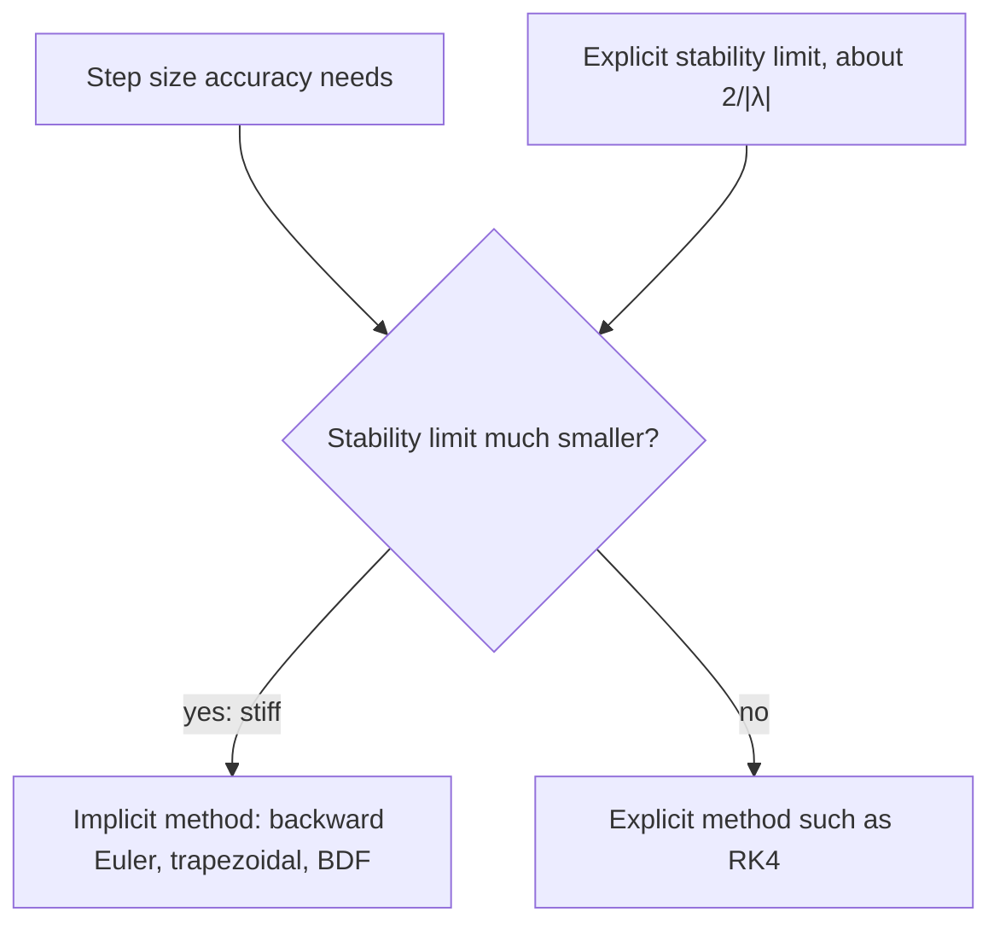

Lesson 17 ended with a warning: on an equation like $y' = -1000(y - \cos t)$, Euler's method
and even RK4 need absurdly small steps, although the solution itself is smooth. This lesson
explains why, using one simple equation to measure the stability of any method, and builds
the cure: **implicit methods**, which pay more per step but can take far larger steps.

## The test equation

To see whether a method keeps errors under control, apply it to the **test equation**

$$y' = \lambda y, \qquad \lambda < 0,$$

whose solutions $y_0e^{\lambda t}$ decay to 0. A sensible method should produce numbers that
decay too. One Euler step gives $y_{n+1} = y_n + h\lambda y_n = (1 + h\lambda)y_n$. Write
$z = h\lambda$. Every one-step method we have met turns into the same pattern,
$y_{n+1} = R(z)\,y_n$, where $R$ is the method's **stability function**:

| Method | $R(z)$ |
|---|---|
| Euler | $1 + z$ |
| Improved Euler (Heun) | $1 + z + \dfrac{z^2}{2}$ |
| RK4 | $1 + z + \dfrac{z^2}{2} + \dfrac{z^3}{6} + \dfrac{z^4}{24}$ |

(Lesson 17 found the RK4 line: the first five terms of $e^z$.) After $n$ steps,
$y_n = R(z)^n y_0$, so the numbers decay exactly when $\lvert R(z)\rvert < 1$. The set of $z$ with
$\lvert R(z)\rvert \le 1$ is the method's **region of absolute stability**.

Why should one linear equation tell us about all equations? Near any solution, a small error
$e$ evolves approximately like $e' = \dfrac{\partial f}{\partial y}\,e$ (the linearization idea
of Lesson 14), so $\lambda = \partial f/\partial y$ plays the role of the decay rate. If
$h\,\partial f/\partial y$ lies outside the stability region, errors get amplified every step.
This is a guide, not a theorem, for nonlinear problems. For systems, $\lambda$ runs over the
eigenvalues of the Jacobian matrix (Module 8), which can be complex; that is why the regions are
drawn in the complex plane.

## Step-size limits for explicit methods

For real $\lambda < 0$, Euler's method needs $-1 \le 1 + h\lambda \le 1$, that is

$$h \le \frac{2}{\lvert\lambda\rvert}.$$

For improved Euler, $1 + z + z^2/2 = \tfrac12\big((1 + z)^2 + 1\big)$ is never below $\tfrac12$,
and it is at most 1 exactly when $-2 \le z \le 0$: the same limit $h \le 2/\lvert\lambda\rvert$. For RK4
the real interval is about $-2.785 \le z \le 0$, so $h \le 2.785/\lvert\lambda\rvert$. In every
**explicit method** of this kind (one where $y_{n+1}$ is computed directly from known values),
$R$ is a polynomial, and a polynomial grows without bound, so the stability region is always
bounded: a large enough $\lvert z\rvert$ is unstable.

### Example 1

For $y' = -50y$, find the largest stable step for Euler's method and for RK4, and the
smallest number of Euler steps needed on $0 \le t \le 10$.

- Euler: $h \le 2/50 = 0.04$.
- RK4: $h \le 2.785/50 \approx 0.0557$.
- Euler on $[0, 10]$: at least $10/0.04 = 250$ steps, even though $e^{-50t}$ is
  below $10^{-20}$ after $t = 1$ and there is nothing left to follow.

## What makes an equation stiff

Take $y' = -1000(y - \cos t)$, $y(0) = 0$. Solving it as a linear equation (Lesson 8) gives

$$y = \frac{10^6\cos t + 1000\sin t}{10^6 + 1} - \frac{10^6}{10^6 + 1}e^{-1000t}.$$

The exponential term dies within a few thousandths of a second; after that $y$ is
practically $\cos t$, a slow, smooth curve. Accuracy alone would allow a step like $h = 0.05$.
But $\partial f/\partial y = -1000$, so Euler's method is stable only for $h \le 0.002$:
5,000 steps to reach $t = 10$. With $h = 0.1$, $z = -100$ and $R(z) = -99$, so any error is
multiplied by $-99$ every step. Starting from $y_0 = 0$, Euler gives
$y_1 = 100$, $y_2 \approx -9800$, $y_3 \approx 970{,}000$.

An equation like this is a **stiff equation**: stability, not accuracy, is what limits the step
size of explicit methods. Stiffness usually comes from a fast-decaying component sitting
alongside the slow behavior you actually care about, as in chemical reactions with very fast
and very slow steps, or circuits with very different time constants. There is no single
agreed precise definition; the working definition above is the useful one. (The word comes
from 1950s work on chemical reaction rates.)

## Implicit methods

Euler's method is the left-endpoint rule: it uses the slope at the start of the step. Using the
slope at the *end* gives the **backward Euler method**:

$$y_{n+1} = y_n + h\,f(t_{n+1},\ y_{n+1}).$$

The unknown $y_{n+1}$ appears on both sides, so each step means solving an equation. That makes
it an **implicit method**. On the test equation:

$$y_{n+1} = y_n + h\lambda y_{n+1} \quad\Longrightarrow\quad y_{n+1} = \frac{1}{1 - z}\,y_n, \qquad R(z) = \frac{1}{1 - z}.$$

If $\operatorname{Re} z < 0$, then $\lvert 1 - z\rvert > 1$ and $\lvert R(z)\rvert < 1$: backward Euler damps every
decaying mode, for every step size. A method whose stability region contains the whole left
half-plane is called **A-stable**. Backward Euler is only first order, like Euler, so its
accuracy is no better; what it gains is stability.

Averaging the two endpoint slopes gives the **trapezoidal method**,

$$y_{n+1} = y_n + \frac h2\Big(f(t_n, y_n) + f(t_{n+1}, y_{n+1})\Big), \qquad R(z) = \frac{1 + z/2}{1 - z/2}.$$

It is A-stable and second order.


The shaded parts are where $\lvert R(z)\rvert \le 1$. The explicit methods have small, bounded
regions; the two implicit methods contain the entire left half-plane.

### Example 2

Apply backward Euler with $h = 0.1$ to $y' = -1000(y - \cos t)$, $y(0) = 0$.

The equation is linear in $y_{n+1}$, so solve for it:
$$y_{n+1} = y_n - 100\big(y_{n+1} - \cos t_{n+1}\big) \;\Longrightarrow\; y_{n+1} = \frac{y_n + 100\cos t_{n+1}}{101}.$$

- $y_1 = \dfrac{0 + 100\cos 0.1}{101} \approx 0.9852$ (exact $0.9951$)
- $y_2 = \dfrac{0.9852 + 100\cos 0.2}{101} \approx 0.9801$ (exact $0.9803$)
- $y_3 \approx 0.9556$ (exact $0.9556$)

The first step can't follow the transient, which lasts far less than one step, but after that
the numbers sit on the smooth solution, using a step 50 times larger than Euler's stability
limit.

```plot
{"x": [0, 1], "y": [0, 1.1], "xLabel": "t", "yLabel": "y", "functions": [{"f": "(1000000cos(x) + 1000sin(x))/1000001 - (1000000/1000001)exp(-1000x)"}], "labels": [{"at": [0.3, 0.72], "text": "exact solution"}], "points": [{"at": [0, 0]}, {"at": [0.1, 0.9852]}, {"at": [0.2, 0.9801]}, {"at": [0.3, 0.9556]}, {"at": [0.4, 0.9214]}, {"at": [0.5, 0.878]}, {"at": [0.6, 0.8259]}, {"at": [0.7, 0.7654]}, {"at": [0.8, 0.6974]}, {"at": [0.9, 0.6224]}, {"at": [1, 0.5411]}], "caption": "Backward Euler with h = 0.1 (dots) on y′ = −1000(y − cos t). The exact solution jumps almost instantly from 0 to near cos t; the dots follow it from the first step on. Euler with the same step would be near 970,000 by t = 0.3."}
```

### Example 3

Try the trapezoidal method on the same problem with $h = 0.1$. Here $z = -100$, so
$R(-100) = \dfrac{1 - 50}{1 + 50} = -\dfrac{49}{51} \approx -0.96$. The method is stable, but the
initial transient is damped by only 4% per step and flips sign each time. Computing:
$y_1 \approx 1.956$, $y_2 \approx 0.057$, $y_3 \approx 1.843$, while the true values are near
$0.99$, $0.98$, $0.96$. The error swings by about $\pm 0.9$ for many steps. Backward Euler's
$R(-100) = \tfrac1{101}$ wipes the transient out at once.

The difference is the limit as $z \to -\infty$: backward Euler's $R(z) \to 0$, but the
trapezoidal $R(z) \to -1$. A method that is A-stable and also has $R(z) \to 0$ as $\lvert z\rvert \to \infty$ is called
**L-stable**. Many widely used stiff solvers are built on backward-Euler-like formulas, such as
the **backward differentiation formulas** (BDF), which use several earlier points to reach higher
order.

## The price: solving an equation each step

When $f$ is linear in $y$, as above, the implicit equation is solved with algebra. When it is
nonlinear, each step needs a root-finder, usually Newton's method.

### Example 4

Take one backward Euler step with $h = 0.25$ for $y' = -2y^2$, $y(0) = 1$.

- The step equation is $Y = 1 + 0.25(-2Y^2) = 1 - 0.5Y^2$, so $0.5Y^2 + Y - 1 = 0$.
- Quadratic formula: $Y = -1 \pm \sqrt{3}$. Take the root near $y_0 = 1$:
  $Y = \sqrt3 - 1 \approx 0.7321$.
- Newton's method finds it without the formula: with $g(Y) = 0.5Y^2 + Y - 1$ and
  $g'(Y) = Y + 1$, start at $Y_0 = y_0 = 1$: $Y_1 = 1 - \tfrac{0.5}{2} = 0.75$, then
  $Y_2 = 0.75 - \tfrac{0.03125}{1.75} \approx 0.73214$, already within $10^{-4}$.
- The exact value is $y(0.25) = \tfrac{1}{1 + 2(0.25)} = \tfrac23 \approx 0.6667$; explicit Euler
  gives $1 - 0.5 = 0.5$.

So an implicit step costs more: a few evaluations of $f$ and of $\partial f/\partial y$, and a
linear solve for systems. On a stiff problem that is a bargain, because the steps can be
hundreds of times longer. On a non-stiff problem it is wasted effort, and an explicit method
such as RK4 is the better choice. Software libraries offer both kinds: SciPy's `solve_ivp`, for
example, has the explicit `RK45` as its default and the implicit `Radau` and `BDF` for stiff
problems.



## Common mistakes

- **Thinking implicit means more accurate.** Backward Euler has the same first order as Euler.
  Implicit methods win on stability, not accuracy per step.
- **Thinking stiff means fast-changing.** The solution you want is usually smooth. Stiffness is a
  fast component that has already died out but still limits explicit methods.
- **Taking the wrong root.** An implicit step can have several solutions; the right one is near
  $y_n$ (start Newton's method there).
- **Assuming A-stable is enough.** The trapezoidal method is A-stable but lets stiff transients
  ring for many steps.

## Key points

- On $y' = \lambda y$, a one-step method gives $y_{n+1} = R(z)y_n$ with $z = h\lambda$; it is stable
  where $\lvert R(z)\rvert \le 1$.
- Explicit methods have bounded regions: Euler and improved Euler need $h \le 2/\lvert\lambda\rvert$,
  RK4 about $2.785/\lvert\lambda\rvert$.
- A problem is stiff when stability, not accuracy, limits an explicit method's step.
- Backward Euler $R = 1/(1 - z)$ and trapezoidal $R = (1 + z/2)/(1 - z/2)$ are A-stable; backward
  Euler is also L-stable.
- Implicit steps require solving an equation (Newton's method when $f$ is nonlinear).
