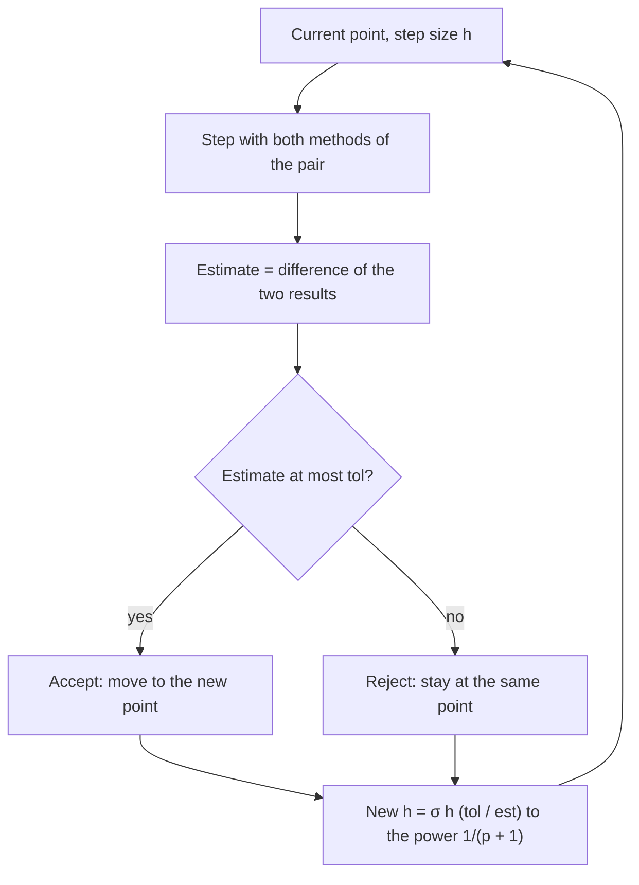

Lesson 16 mentioned a trick: compute with step $h$ and with step $h/2$, and the difference
between the answers shows roughly how large the error is. This lesson makes that precise, then
turns it into the way real solvers work. They estimate the error of every step as they go and
choose the next step size so the error stays near a target the user sets. Small steps where
the solution changes quickly, large steps where it is calm, and no need to know in advance
which is which.

## Richardson's error estimate

For a method of order $p$, the result at a fixed time $T$ behaves for small $h$ like

$$A(h) \approx y(T) + Ch^p,$$

where $C$ depends on the problem but hardly on $h$. Halving the step gives
$A(h/2) \approx y(T) + Ch^p/2^p$. Subtracting the two eliminates $y(T)$:

$$A(h) - A(h/2) \approx Ch^p\left(1 - \frac{1}{2^p}\right) = \frac{Ch^p}{2^p}(2^p - 1).$$

Since $Ch^p/2^p$ is the error of $A(h/2)$, we get an estimate of that error from the two
computed numbers alone:

$$y(T) - A(h/2) \approx \frac{A(h/2) - A(h)}{2^p - 1}.$$

Adding this estimate to $A(h/2)$ gives an improved value. That step is called
**Richardson extrapolation**, after the English scientist Lewis Fry Richardson, who used it in the early
twentieth century.

$$A_{\text{better}} = A(h/2) + \frac{A(h/2) - A(h)}{2^p - 1}.$$

### Example 1

For $y' = y$, $y(0) = 1$, the true value is $y(1) = e \approx 2.718282$.

**Euler** ($p = 1$): $A(0.1) = 2.593742$ and $A(0.05) = 2.653298$ (Lesson 16).

- Estimated error of $A(0.05)$: $\dfrac{2.653298 - 2.593742}{2^1 - 1} = 0.059556$. The actual error
  is $0.064984$, so the estimate is right to within about 10%.
- Extrapolated: $2.653298 + 0.059556 = 2.712854$, error $0.0054$, about twelve times smaller
  than the error of $A(0.05)$.

**Improved Euler** ($p = 2$): $A(0.1) = 2.714081$ and $A(0.05) = 2.717191$.

- Estimated error of $A(0.05)$: $\dfrac{2.717191 - 2.714081}{2^2 - 1} = 0.001037$. Actual:
  $0.001091$.
- Extrapolated: $2.717191 + 0.001037 = 2.718228$, error about $5 \times 10^{-5}$.

The estimate is only as good as the assumption $A(h) \approx y(T) + Ch^p$, which needs $h$ small
enough. If the two answers disagree wildly, the estimate means little and the step should be
cut further.

## Embedded pairs: an error estimate for free

Step doubling triples the work. A cheaper idea is to run two methods of different orders that
share their slope evaluations. The simplest **embedded pair** is Heun–Euler. One improved Euler
step already computes $k_1 = f(t_n, y_n)$ and $k_2 = f(t_n + h,\ y_n + hk_1)$, so both

$$y_E = y_n + hk_1 \quad\text{(Euler, order 1)} \qquad\text{and}\qquad z = y_n + \frac h2(k_1 + k_2) \quad\text{(Heun, order 2)}$$

come at no extra cost. Because $z$ is much more accurate than $y_E$, the difference

$$\text{est} = \lvert z - y_E\rvert = \frac h2\,\lvert k_2 - k_1\rvert$$

is a good estimate of the local error of the Euler step. Professional codes use the same idea
with higher orders. The Runge–Kutta–Fehlberg method (RKF45) pairs orders 4 and 5. The
**Dormand–Prince method**, a 5(4) pair, is the engine of MATLAB's `ode45` and of SciPy's default
`RK45`. It has seven stages, but the last slope of one step is the first slope of the next, so
it costs about six evaluations of $f$ per step.

## Choosing the next step size

The error estimate belongs to the lower-order method, of order $p$, whose local error is about
$Ch^{p+1}$ (one power more than its global order; Lesson 16). Suppose a step of size $h$
produced the estimate est, and we want the local error to be at most a **tolerance** tol. The
step size that would have made $Ch_{\text{new}}^{p+1} = \text{tol}$ satisfies
$\left(h_{\text{new}}/h\right)^{p+1} = \text{tol}/\text{est}$, so

$$h_{\text{new}} = \sigma\, h\left(\frac{\text{tol}}{\text{est}}\right)^{1/(p+1)}.$$

The **safety factor** $\sigma$, typically 0.8 or 0.9, aims a little below the tolerance so
that fewer steps fail. Codes also cap how fast $h$ may grow or shrink in one go. The full loop
is **adaptive step-size control**:



After an accepted step, codes usually continue from the higher-order value $z$ rather than the
lower-order one whose error was estimated. This is called **local extrapolation**: the error
estimate is then a little pessimistic, which errs on the safe side.

### Example 2

Solve $y' = t - y$, $y(0) = 1$ with the Heun–Euler pair ($p = 1$), tolerance $0.001$, safety
factor $0.9$, and a first try of $h = 0.2$.

First try, $h = 0.2$:

- $k_1 = 0 - 1 = -1$, so $y_E = 1 + 0.2(-1) = 0.8$.
- $k_2 = f(0.2,\ 0.8) = 0.2 - 0.8 = -0.6$, so $z = 1 + 0.1(-1 - 0.6) = 0.84$.
- est $= \lvert 0.84 - 0.8\rvert = 0.04 > 0.001$: **reject**.
- $h_{\text{new}} = 0.9(0.2)\left(\dfrac{0.001}{0.04}\right)^{1/2} = 0.18 \times 0.158 \approx 0.0285$.

Second try, $h = 0.0285$ (more precisely $0.02846$), from the same point:

- $y_E = 1 - 0.02846 = 0.97154$; $k_2 = 0.02846 - 0.97154 = -0.94308$.
- est $= \tfrac{0.02846}{2}\lvert -0.94308 - (-1)\rvert \approx 0.00081 \le 0.001$: **accept**, and
  continue from $z \approx 0.97235$ at $t \approx 0.0285$.
- The next step is $0.9(0.02846)(0.001/0.00081)^{1/2} \approx 0.0285$ again; as the solution
  levels off, the steps slowly lengthen.

The exact solution $y = t - 1 + 2e^{-t}$ gives $y(0.2) \approx 0.8375$, so the rejected Euler value
$0.8$ really was off by about $0.04$, just as estimated.

### Example 3

The logistic equation $y' = 10y(1 - y)$, $y(0) = 0.01$ rises steeply around $t = 0.46$ and is
nearly flat before and after. Running the same Heun–Euler controller from $t = 0$ to $2$ with
tolerance $0.005$ takes 31 accepted steps (plus 8 rejected tries). The steps shrink to about
$0.03$ on the steep part and grow to about $0.23$ near the end.

```plot
{"x": [0, 2], "y": [0, 1.1], "xLabel": "t", "yLabel": "y", "functions": [{"f": "1/(1 + 99exp(-10x))", "label": "exact"}], "points": [{"at": [0, 0.01]}, {"at": [0.1, 0.025]}, {"at": [0.16, 0.043]}, {"at": [0.207, 0.067]}, {"at": [0.246, 0.095]}, {"at": [0.281, 0.13]}, {"at": [0.316, 0.173]}, {"at": [0.348, 0.224]}, {"at": [0.378, 0.281]}, {"at": [0.409, 0.346]}, {"at": [0.442, 0.423]}, {"at": [0.481, 0.519]}, {"at": [0.519, 0.612]}, {"at": [0.55, 0.683]}, {"at": [0.58, 0.742]}, {"at": [0.609, 0.794]}, {"at": [0.637, 0.836]}, {"at": [0.665, 0.87]}, {"at": [0.694, 0.899]}, {"at": [0.724, 0.923]}, {"at": [0.757, 0.943]}, {"at": [0.794, 0.96]}, {"at": [0.834, 0.972]}, {"at": [0.882, 0.982]}, {"at": [0.938, 0.989]}, {"at": [1.007, 0.994]}, {"at": [1.095, 0.997]}, {"at": [1.214, 0.998]}, {"at": [1.379, 0.999]}, {"at": [1.609, 0.999]}, {"at": [1.844, 0.998]}, {"at": [2, 0.999]}], "caption": "Adaptive Heun–Euler steps (dots) on y′ = 10y(1 − y) with tolerance 0.005: crowded where the curve is steep, spread out where it is flat."}
```

Two honest remarks. First, the largest error along the way is about $0.034$, several times the
tolerance; see the next section. Second, on a mild problem like this one a well-chosen fixed
step does about as well. Adaptivity pays off when the quiet and busy stretches are very
different in length, or when you don't know in advance where the busy parts are.

## What the tolerance does and doesn't control

- **It limits local error, not global error.** Each step's error is kept near tol, but errors
  from all steps accumulate (Lesson 16), and an unstable solution can amplify them. A standard
  check is to solve again with a tolerance ten times smaller; the digits that don't change can be
  trusted. This is Richardson's idea applied to the whole run.
- **It is usually mixed.** Software accepts a step when the error is below
  $\text{atol} + \text{rtol}\cdot\lvert y\rvert$: an absolute part for values near zero and a relative
  part for large values. SciPy's `solve_ivp`, for example, defaults to $\text{rtol} = 10^{-3}$ and
  $\text{atol} = 10^{-6}$.
- **It cannot cure stiffness.** On a stiff problem an explicit adaptive solver shrinks $h$ down
  to the stability limit and keeps it there, taking huge numbers of tiny steps (often with many
  rejections) while the solution looks smooth. That pattern is a sign to switch to an implicit
  method (the previous honors lesson).

## Common mistakes

- **Wrong exponent.** The step formula uses $1/(p + 1)$, where $p$ is the order of the method
  whose error is estimated, because local error is one power higher than the global order.
- **Wrong denominator.** Richardson's estimate divides by $2^p - 1$, not $2^p$.
- **Advancing after a failed step.** A rejected step is retried from the *same* point with a
  smaller $h$.
- **Reading the tolerance as a guarantee.** The final answer can be off by more than tol.

## Key points

- Richardson: for order $p$, $y(T) - A(h/2) \approx \dfrac{A(h/2) - A(h)}{2^p - 1}$; adding it gives
  a better value.
- Embedded pairs (Heun–Euler, RKF45, Dormand–Prince) get an error estimate from shared slopes.
- Heun–Euler estimate: $\tfrac h2\lvert k_2 - k_1\rvert$.
- New step: $h_{\text{new}} = \sigma h\,(\text{tol}/\text{est})^{1/(p+1)}$; reject and retry if
  est $>$ tol.
- Tolerances control local error; check global accuracy by tightening the tolerance.
