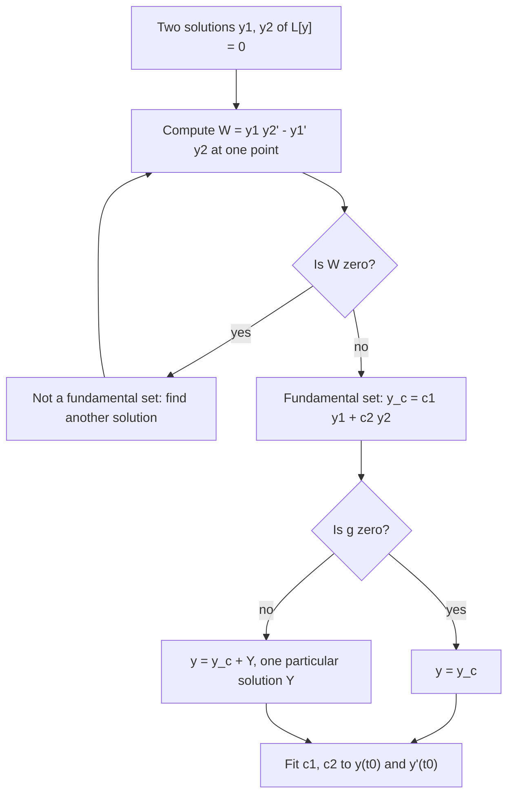

## Why second order?

Newton's second law, $F = ma$, sets an *acceleration*, a second derivative. So the
motion of anything driven by forces, from a car suspension to a guitar string to the
current in a radio's tuning circuit, is governed by second-order equations. This module
develops the theory and methods for the **second-order linear equation**

$$y'' + p(t)y' + q(t)y = g(t).$$

This lesson is about structure: what the set of solutions looks like and how to know when
you've found all of them. The next three lessons find solutions explicitly when the
coefficients are constants.

## Existence and uniqueness

**Theorem.** If $p$, $q$ and $g$ are continuous on an open interval $I$ containing $t_0$,
then the IVP

$$y'' + py' + qy = g, \qquad y(t_0) = y_0, \quad y'(t_0) = y_0'$$

has exactly one solution, and it exists on all of $I$.

Two initial conditions, position and velocity, are needed: that's the second-order
version of Lesson 7's theorem. As before, linearity guarantees the solution lasts across
the whole interval.

## The homogeneous equation and superposition

Write $L[y] = y'' + py' + qy$. Then $L$ is a **linear operator**: for constants $c_1, c_2$,

$$L[c_1y_1 + c_2y_2] = c_1L[y_1] + c_2L[y_2],$$

because differentiation respects sums and constant multiples. So if $y_1$ and $y_2$ solve
the homogeneous equation $L[y] = 0$, then so does every **linear combination**
$c_1y_1 + c_2y_2$. This is the **principle of superposition**.

## When do two solutions give all solutions?

Given two solutions $y_1$, $y_2$ of $L[y] = 0$, can we fit *any* initial conditions with
$c_1y_1 + c_2y_2$? We need $c_1, c_2$ with

$$c_1y_1(t_0) + c_2y_2(t_0) = y_0, \qquad c_1y_1'(t_0) + c_2y_2'(t_0) = y_0'.$$

This $2 \times 2$ linear system has a unique solution for every right side exactly when
its determinant is nonzero. That determinant is the **Wronskian**:

$$W(y_1, y_2)(t) = \begin{vmatrix} y_1 & y_2 \\ y_1' & y_2' \end{vmatrix} = y_1y_2' - y_1'y_2.$$

**Theorem.** If $y_1$, $y_2$ solve $L[y] = 0$ on $I$ and $W(y_1, y_2)(t_0) \ne 0$ for some
$t_0$ in $I$, then every solution on $I$ has the form $y = c_1y_1 + c_2y_2$.

Such a pair is a **fundamental set of solutions**, and $c_1y_1 + c_2y_2$ is the
**general solution**. The proof: take any solution $\phi$; choose $c_1, c_2$ to match
$\phi(t_0)$ and $\phi'(t_0)$ (possible because $W \ne 0$); then $\phi$ and
$c_1y_1 + c_2y_2$ solve the same IVP, so by uniqueness they're equal.

### Abel's theorem

For solutions of $L[y] = 0$, the Wronskian satisfies $W' = -p(t)W$ (a short computation),
so

$$W(t) = Ce^{-\int p(t)\,dt}.$$

An exponential is never zero, so $W$ is either zero everywhere on $I$ or never zero.
That's why it's enough to check one point.

## Linear independence

Two functions are **linearly dependent** if one is a constant multiple of the other, and
**linearly independent** otherwise. For solutions of $L[y] = 0$, being a fundamental set
is the same as being linearly independent. If $y_2 = ky_1$, then
$W = y_1(ky_1') - y_1'(ky_1) = 0$.

### Example 1

Show that $y_1 = e^{2t}$ and $y_2 = e^{-3t}$ form a fundamental set for
$y'' + y' - 6y = 0$, and solve the IVP $y(0) = 1$, $y'(0) = 7$.

- Check they're solutions: for $e^{2t}$, $4 + 2 - 6 = 0$; for $e^{-3t}$, $9 - 3 - 6 = 0$. ✓
- Wronskian: $W = e^{2t}(-3e^{-3t}) - (2e^{2t})e^{-3t} = -5e^{-t} \ne 0$. Fundamental set.
- General solution $y = c_1e^{2t} + c_2e^{-3t}$, with $y' = 2c_1e^{2t} - 3c_2e^{-3t}$.
- Conditions: $c_1 + c_2 = 1$, $2c_1 - 3c_2 = 7$. Adding 3 times the first: $5c_1 = 10$, so
  $c_1 = 2$, $c_2 = -1$.
- Answer: $y = 2e^{2t} - e^{-3t}$.

Abel's theorem check: $p = 1$, so $W = Ce^{-t}$, matching $-5e^{-t}$.

The figure shows superposition at work: the solution is the sum of the two pieces
$2e^{2t}$ and $-e^{-3t}$, and it passes through $(0, 1)$ as required.

```plot
{"x": [-1, 1], "y": [-20, 15], "xLabel": "t", "functions": [{"f": "2exp(2x)", "dashed": true}, {"f": "-exp(-3x)", "dashed": true}, {"f": "2exp(2x) - exp(-3x)", "label": "y = 2e^(2t) − e^(−3t)"}], "points": [{"at": [0, 1], "label": "(0, 1)"}], "caption": "The IVP solution (solid) is the sum of 2e^(2t) (dashed, rising) and −e^(−3t) (dashed, below the axis)."}
```

### Example 2

Are $y_1 = \cos 3t$ and $y_2 = \sin 3t$ a fundamental set for $y'' + 9y = 0$?

- Both solve it ($y'' = -9y$ for each).
- $W = \cos 3t \cdot 3\cos 3t - (-3\sin 3t)\sin 3t = 3(\cos^2 3t + \sin^2 3t) = 3$. Never zero.
- Yes. General solution $y = c_1\cos 3t + c_2\sin 3t$.

### Example 3

$y_1 = t$ and $y_2 = t^2$ have $W = t \cdot 2t - 1 \cdot t^2 = t^2$, which is zero at
$t = 0$ but not elsewhere. Abel's theorem says that's impossible for two solutions of an
equation $y'' + py' + qy = 0$ with $p, q$ continuous on an interval containing 0. Indeed
they solve $t^2y'' - 2ty' + 2y = 0$, whose standard form has $p = -2/t$, discontinuous at
0. On $(0, \infty)$ they form a fundamental set.

## The nonhomogeneous equation

If $Y_1$ and $Y_2$ both solve $L[y] = g$, then $L[Y_1 - Y_2] = g - g = 0$: their difference
solves the homogeneous equation. So every solution of $L[y] = g$ has the form

$$y = \underbrace{c_1y_1 + c_2y_2}_{y_c,\ \text{complementary solution}} + \underbrace{Y(t)}_{\text{particular solution}}.$$

The homogeneous part is called the **complementary solution** $y_c$; $Y$ is any one
**particular solution**. You met this structure for first-order equations in Lesson 8.
Module 6 finds particular solutions; Lessons 19–21 find $y_c$.

The flowchart puts the whole procedure of this lesson in one place.



## Common mistakes

- **Applying superposition to nonhomogeneous equations.** The sum of two solutions of
  $L[y] = g$ solves $L[y] = 2g$, not $L[y] = g$.
- **Wronskian sign or order.** $W = y_1y_2' - y_1'y_2$; swapping $y_1$ and $y_2$ flips the
  sign, which doesn't affect whether it's zero.
- **Checking $W$ only where it's convenient** for functions that aren't solutions. Abel's
  "all or nothing" applies only to solutions of one equation with continuous coefficients.
- **Applying initial conditions before adding $Y$.** Fit $c_1, c_2$ to the *full* solution
  $y_c + Y$.

## Key points

- $y'' + py' + qy = g$ with continuous coefficients has a unique solution for each
  $y(t_0)$, $y'(t_0)$, valid on the whole interval.
- Superposition: combinations of homogeneous solutions are solutions.
- Two solutions with nonzero Wronskian $y_1y_2' - y_1'y_2$ form a fundamental set;
  $y = c_1y_1 + c_2y_2$ is then the general solution.
- Nonhomogeneous: $y = y_c + Y$.
