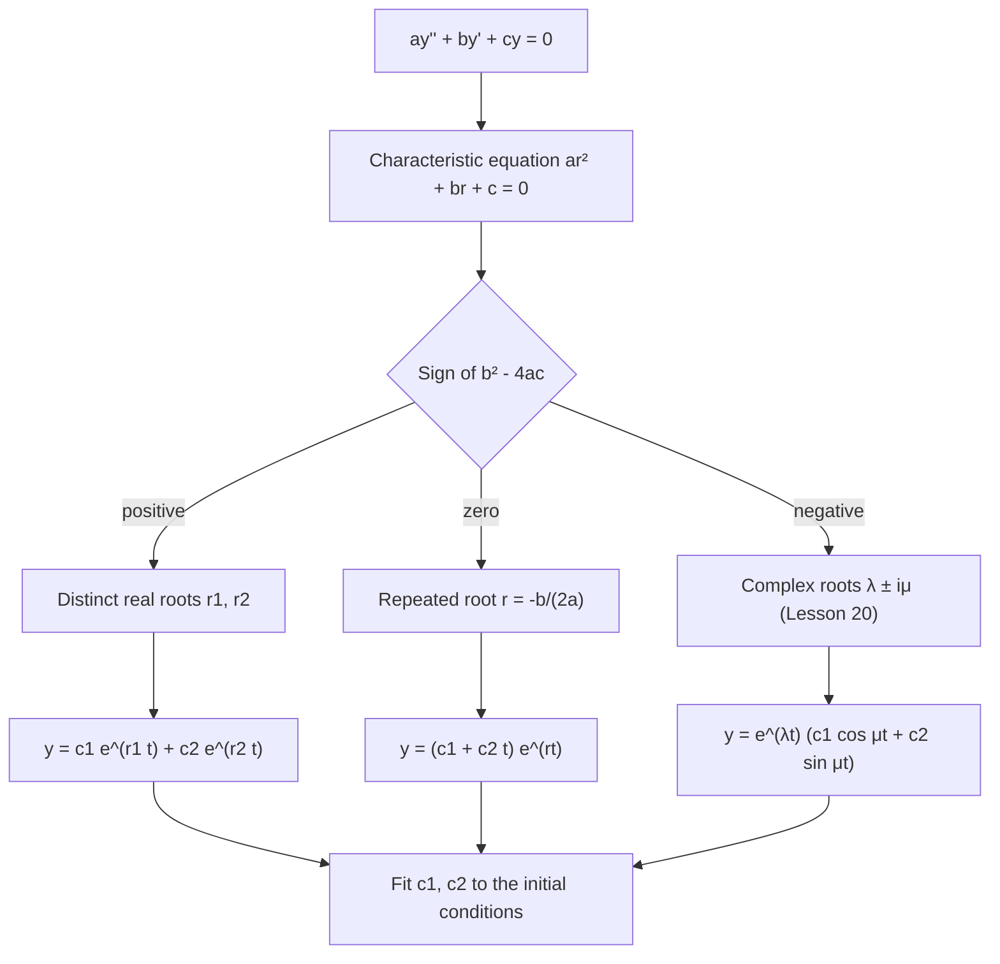

## Guessing exponentials

For the homogeneous equation with constant coefficients,

$$ay'' + by' + cy = 0, \qquad a \ne 0,$$

there is a complete recipe. The key observation: derivatives of $e^{rt}$ are multiples of
$e^{rt}$. So try $y = e^{rt}$. Substituting $y' = re^{rt}$ and $y'' = r^2e^{rt}$:

$$(ar^2 + br + c)e^{rt} = 0.$$

Since $e^{rt}$ is never zero, $y = e^{rt}$ is a solution exactly when $r$ solves the
**characteristic equation**

$$ar^2 + br + c = 0.$$

The differential equation has become an algebra problem. Its roots, from the quadratic
formula $r = \dfrac{-b \pm \sqrt{b^2 - 4ac}}{2a}$, come in three cases decided by the
discriminant $b^2 - 4ac$:

| Discriminant | Roots | General solution |
|---|---|---|
| $> 0$ | real, distinct $r_1 \ne r_2$ | $c_1e^{r_1t} + c_2e^{r_2t}$ |
| $= 0$ | real, repeated $r$ | $c_1e^{rt} + c_2te^{rt}$ |
| $< 0$ | complex $\lambda \pm i\mu$ | $e^{\lambda t}(c_1\cos\mu t + c_2\sin\mu t)$ |

This lesson does the first two; Lesson 20 handles complex roots.

The three cases are easiest to remember as pictures of where the roots sit in the complex
plane. A fourth picture, a purely imaginary pair, is the special complex case with
$\lambda = 0$ (pure oscillation, Lesson 20).


The decision is always made the same way:



## Distinct real roots

If $r_1 \ne r_2$ are real, $e^{r_1t}$ and $e^{r_2t}$ are both solutions, and their Wronskian
is

$$W = e^{r_1t}r_2e^{r_2t} - r_1e^{r_1t}e^{r_2t} = (r_2 - r_1)e^{(r_1 + r_2)t} \ne 0.$$

So they form a fundamental set, and the general solution is
$y = c_1e^{r_1t} + c_2e^{r_2t}$.

### Example 1

Solve $y'' - y' - 6y = 0$, $y(0) = 3$, $y'(0) = -1$.

- Characteristic equation: $r^2 - r - 6 = (r - 3)(r + 2) = 0$, so $r = 3, -2$.
- $y = c_1e^{3t} + c_2e^{-2t}$, $y' = 3c_1e^{3t} - 2c_2e^{-2t}$.
- $c_1 + c_2 = 3$ and $3c_1 - 2c_2 = -1$. From the first, $c_2 = 3 - c_1$; then
  $3c_1 - 6 + 2c_1 = -1$, so $c_1 = 1$, $c_2 = 2$.
- Answer: $y = e^{3t} + 2e^{-2t}$.

As $t \to \infty$ the $e^{3t}$ term dominates and $y \to \infty$. Long-run behaviour is
controlled by the largest root.

### Example 2

Solve $2y'' + 5y' + 2y = 0$, $y(0) = 0$, $y'(0) = 3$.

- $2r^2 + 5r + 2 = (2r + 1)(r + 2) = 0$, so $r = -\tfrac12, -2$.
- $y = c_1e^{-t/2} + c_2e^{-2t}$; $c_1 + c_2 = 0$ and $-\tfrac12c_1 - 2c_2 = 3$.
- With $c_2 = -c_1$: $-\tfrac12c_1 + 2c_1 = 3$, so $c_1 = 2$, $c_2 = -2$.
- Answer: $y = 2e^{-t/2} - 2e^{-2t}$. Both roots are negative, so $y \to 0$: it rises from
  0, peaks, and decays, never oscillating.

```plot
{"x": [0, 8], "y": [-0.5, 1.5], "xLabel": "t", "functions": [{"f": "2exp(-x/2) - 2exp(-2x)", "label": "y = 2e^(−t/2) − 2e^(−2t)"}], "caption": "With two negative real roots the solution rises and decays without oscillating."}
```

## Repeated roots

If $b^2 = 4ac$ there's only one root, $r = -\dfrac{b}{2a}$, giving one solution
$y_1 = e^{rt}$. We need a second. The method of reduction of order (Lesson 21) produces it
systematically; here's the result and a check. Try $y_2 = te^{rt}$:

$$y_2' = (1 + rt)e^{rt}, \qquad y_2'' = (2r + r^2t)e^{rt}.$$

Then $ay_2'' + by_2' + cy_2 = e^{rt}\big[(ar^2 + br + c)t + (2ar + b)\big]$. Both brackets
vanish: the first because $r$ is a root, the second because $r = -b/(2a)$. So $te^{rt}$ is
a solution. Its Wronskian with $e^{rt}$ is $e^{2rt} \ne 0$, so

$$y = c_1e^{rt} + c_2te^{rt} = (c_1 + c_2t)e^{rt}.$$

### Example 3

Solve $y'' + 6y' + 9y = 0$, $y(0) = 2$, $y'(0) = -1$.

- $r^2 + 6r + 9 = (r + 3)^2$, so $r = -3$ (double).
- $y = (c_1 + c_2t)e^{-3t}$; $y' = \big(c_2 - 3c_1 - 3c_2t\big)e^{-3t}$.
- $y(0) = c_1 = 2$; $y'(0) = c_2 - 3c_1 = -1$, so $c_2 = 5$.
- Answer: $y = (2 + 5t)e^{-3t}$.

The extra factor $t$ slows the decay but cannot stop it: $e^{-3t}$ eventually wins. Since
$2 + 5t > 0$ for $t \ge 0$, this solution never crosses zero for $t \ge 0$.

```plot
{"x": [0, 3], "y": [-0.2, 2.2], "xLabel": "t", "functions": [{"f": "(2 + 5x)exp(-3x)", "label": "y = (2 + 5t)e^(−3t)"}, {"f": "2exp(-3x)", "dashed": true}], "caption": "The repeated-root solution (solid) decays more slowly than 2e^(−3t) (dashed) because of the factor 2 + 5t."}
```

### Example 4

Solve $4y'' - 4y' + y = 0$, $y(0) = 1$, $y'(0) = 0$.

- $4r^2 - 4r + 1 = (2r - 1)^2$, so $r = \tfrac12$ (double).
- $y = (c_1 + c_2t)e^{t/2}$, $y(0) = c_1 = 1$, $y'(0) = c_2 + \tfrac12c_1 = 0$, so
  $c_2 = -\tfrac12$.
- Answer: $y = \left(1 - \tfrac t2\right)e^{t/2}$.

## Working backward

You can also build an equation from its solutions. If the general solution is
$c_1e^{2t} + c_2e^{-5t}$, the roots are $2$ and $-5$, so the characteristic polynomial is
$(r - 2)(r + 5) = r^2 + 3r - 10$, and the equation is $y'' + 3y' - 10y = 0$.

## Long-term behaviour

- All roots negative: every solution decays to 0.
- Some root positive: most solutions grow without bound (unless the initial conditions
  happen to kill that term).
- A root equal to 0: $e^{0t} = 1$ is a solution, a constant.

## Common mistakes

- **Sign errors in the roots.** $(r - 3)(r + 2) = 0$ gives $r = 3$ and $r = -2$.
- **Forgetting the $t$** for a repeated root; $c_1e^{rt} + c_2e^{rt}$ is just one solution.
- **Differentiating $te^{rt}$ wrongly.** Use the product rule: $(1 + rt)e^{rt}$.
- **Forgetting $a$** when the leading coefficient isn't 1: $2r^2 + 5r + 2$ has roots $-\tfrac12$
  and $-2$, not $-1$ and $-4$.

## Key points

- $ay'' + by' + cy = 0$: try $e^{rt}$ to get $ar^2 + br + c = 0$.
- Distinct real roots: $y = c_1e^{r_1t} + c_2e^{r_2t}$.
- Repeated root: $y = (c_1 + c_2t)e^{rt}$.
- Fit $c_1, c_2$ by solving a $2 \times 2$ linear system from $y(0)$ and $y'(0)$.
