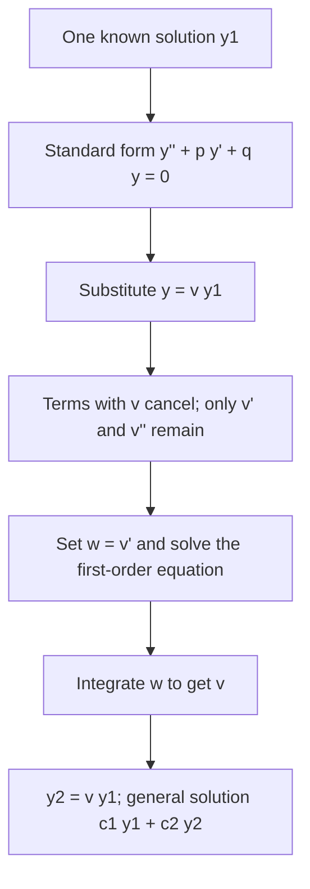
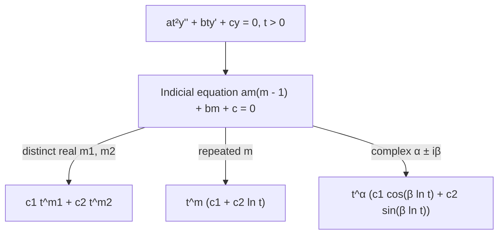

## One solution is half the battle

For constant-coefficient equations we can always find two solutions. For equations with
variable coefficients, like $t^2y'' - 3ty' + 4y = 0$, there's no general recipe, but if you
can find (or guess, or are given) *one* nonzero solution $y_1$, a second one always
follows. The method is called **reduction of order** because it turns the second-order
problem into a first-order one. It also explains where the $te^{rt}$ in Lesson 19 came from.

## The method

Given one solution $y_1$ of $y'' + p(t)y' + q(t)y = 0$, look for a second of the form

$$y = v(t)\,y_1(t).$$

(If $v$ were constant we'd just get a multiple of $y_1$; letting it vary is the idea.)
Differentiate:

$$y' = v'y_1 + vy_1', \qquad y'' = v''y_1 + 2v'y_1' + vy_1''.$$

Substitute and group the terms with $v$:

$$v''y_1 + v'(2y_1' + py_1) + v\underbrace{(y_1'' + py_1' + qy_1)}_{=\,0} = 0.$$

The $v$ terms cancel because $y_1$ is a solution. What remains involves only $v'$ and
$v''$. Set $w = v'$:

$$y_1w' + (2y_1' + py_1)w = 0,$$

a first-order (separable and linear) equation for $w$. Solve it, integrate to get $v$, and
$y_2 = vy_1$. Any nonconstant $v$ works; constants of integration can be dropped since they
just add multiples of $y_1$.

There's a closed form too, which follows from solving the $w$ equation:

$$y_2 = y_1\int \frac{e^{-\int p\,dt}}{y_1^2}\,dt.$$

It's often easier to use the formula, but doing the substitution builds understanding and
avoids errors with $p$.

The steps in order:



### Example 1: where $te^{rt}$ comes from

For $y'' - 6y' + 9y = 0$, one solution is $y_1 = e^{3t}$. Find another.

- $y = ve^{3t}$: $y' = (v' + 3v)e^{3t}$, $y'' = (v'' + 6v' + 9v)e^{3t}$.
- Substitute: $e^{3t}\big[(v'' + 6v' + 9v) - 6(v' + 3v) + 9v\big] = e^{3t}v'' = 0$.
- So $v'' = 0$, $v = c_1 + c_2t$, and the new solution is $te^{3t}$.

### Example 2

Given that $y_1 = t^2$ solves $t^2y'' - 3ty' + 4y = 0$ for $t > 0$, find the general solution.

- Standard form: $y'' - \dfrac3t y' + \dfrac{4}{t^2}y = 0$, so $p = -\dfrac3t$.
- Formula: $e^{-\int p\,dt} = e^{3\ln t} = t^3$, and $\dfrac{t^3}{(t^2)^2} = \dfrac1t$.
- $\int \dfrac{dt}{t} = \ln t$, so $y_2 = t^2\ln t$.
- General solution: $y = c_1t^2 + c_2t^2\ln t$.

Check $y_2$: $y_2' = 2t\ln t + t$, $y_2'' = 2\ln t + 3$. Then
$t^2(2\ln t + 3) - 3t(2t\ln t + t) + 4t^2\ln t = (2 - 6 + 4)t^2\ln t + (3 - 3)t^2 = 0$. ✓

The two solutions are plotted below. Neither is a constant multiple of the other: their ratio
$\ln t$ changes, so they form a fundamental set on $(0, \infty)$.

```plot
{"x": [0, 3], "y": [-1, 10], "xLabel": "t", "functions": [{"f": "x^2", "from": 0.01}, {"f": "x^2 ln(x)", "from": 0.01, "dashed": true}], "labels": [{"at": [0.7, 5], "text": "y₁ = t²"}, {"at": [2.4, 0.6], "text": "y₂ = t² ln t"}], "caption": "The given solution t² (solid) and the second solution t² ln t (dashed) found by reduction of order; y₂ is negative for 0 < t < 1."}
```

### Example 3

Given $y_1 = t$ solves $(1 - t^2)y'' - 2ty' + 2y = 0$ on $(-1, 1)$ (a Legendre equation),
set up the integral for $y_2$.

- $p = -\dfrac{2t}{1 - t^2}$, so $-\int p\,dt = \int \dfrac{2t}{1 - t^2}dt = -\ln(1 - t^2)$ and
  $e^{-\int p} = \dfrac{1}{1 - t^2}$.
- $y_2 = t\displaystyle\int \frac{dt}{t^2(1 - t^2)}$. Partial fractions:
  $\dfrac{1}{t^2(1 - t^2)} = \dfrac{1}{t^2} + \dfrac{1}{1 - t^2}$.
- So $y_2 = t\left(-\dfrac1t + \dfrac12\ln\dfrac{1 + t}{1 - t}\right) = \dfrac t2\ln\dfrac{1 + t}{1 - t} - 1$.

Equations like this one come back in series solutions (Module 9), where most solutions
aren't elementary functions at all.

## Cauchy–Euler equations

A family of variable-coefficient equations you can always solve is the
**Cauchy–Euler equation** (or equidimensional equation),

$$at^2y'' + bty' + cy = 0, \qquad t > 0.$$

Each term has the power of $t$ matching the order of the derivative, which suggests trying
$y = t^m$. Substituting $y' = mt^{m-1}$, $y'' = m(m - 1)t^{m-2}$ gives the
**indicial equation**

$$am(m - 1) + bm + c = 0.$$

- Distinct real roots $m_1, m_2$: $y = c_1t^{m_1} + c_2t^{m_2}$.
- Repeated root $m$: $y = c_1t^m + c_2t^m\ln t$ (that's Example 2, via reduction of order).
- Complex roots $\alpha \pm i\beta$: $y = t^{\alpha}\big(c_1\cos(\beta\ln t) + c_2\sin(\beta\ln t)\big)$.

The substitution $t = e^x$ turns a Cauchy–Euler equation into a constant-coefficient one,
which is why the three cases mirror Lessons 19 and 20, with $t^m$ in place of $e^{rt}$ and
$\ln t$ in place of $t$.

The three cases at a glance:



### Example 4

Solve $t^2y'' + ty' - 9y = 0$, $y(1) = 2$, $y'(1) = 0$.

- Indicial: $m(m - 1) + m - 9 = m^2 - 9 = 0$, $m = \pm 3$.
- $y = c_1t^3 + c_2t^{-3}$; $y' = 3c_1t^2 - 3c_2t^{-4}$.
- $c_1 + c_2 = 2$, $3c_1 - 3c_2 = 0$: $c_1 = c_2 = 1$.
- Answer: $y = t^3 + t^{-3}$.

## Common mistakes

- **Not using standard form.** The formula needs $p$ from $y'' + py' + qy = 0$; divide by
  the leading coefficient first.
- **Expecting the $v$ term to survive.** If it doesn't cancel, $y_1$ isn't actually a solution
  (or there's an algebra slip).
- **Indicial equation slip.** It's $am(m - 1) + bm + c$, not $am^2 + bm + c$.
- **Forgetting $t > 0$.** Cauchy–Euler solutions with $\ln t$ or $t^m$ are for $t > 0$.

## Key points

- Given $y_1$, set $y = vy_1$; the equation reduces to first order in $w = v'$.
- Formula: $y_2 = y_1\displaystyle\int \frac{e^{-\int p\,dt}}{y_1^2}\,dt$.
- Cauchy–Euler $at^2y'' + bty' + cy = 0$: try $t^m$; indicial equation $am(m-1) + bm + c = 0$.
