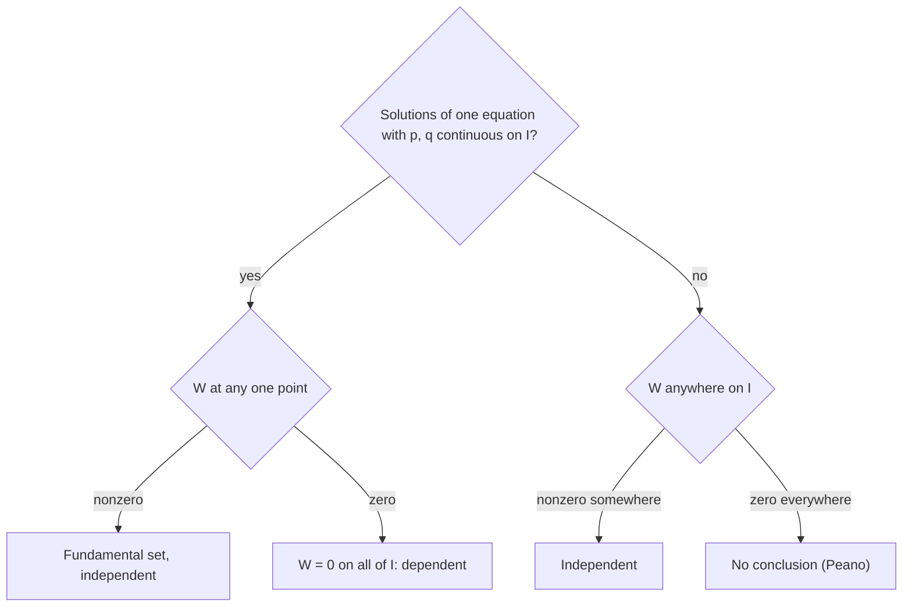

## Looking under the hood

Lesson 18 made three claims and asked you to trust them: the Wronskian of two solutions
satisfies $W' = -p(t)W$ ("a short computation"), two solutions with a nonzero Wronskian give
*every* solution, and for solutions, a zero Wronskian means linear dependence. Lesson 21 then
produced a formula for a second solution out of thin air. This honors lesson proves all of
these and shows how they fit together. Along the way you will see that the set of solutions
is a two-dimensional vector space, learn to rebuild an equation from two of its solutions,
and meet a famous example showing that the Wronskian test can fail for functions that are
not solutions.

Throughout, $p$ and $q$ are continuous on an open interval $I$, and

$$L[y] = y'' + p(t)y' + q(t)y = 0.$$

## Proving Abel's theorem

Let $y_1$, $y_2$ solve $L[y] = 0$ and $W = y_1y_2' - y_1'y_2$. Differentiate with the product
rule:

$$W' = y_1'y_2' + y_1y_2'' - y_1''y_2 - y_1'y_2' = y_1y_2'' - y_1''y_2.$$

The $y_1'y_2'$ terms cancel. Now use the equation in the form $y'' = -py' - qy$ for each
solution:

$$W' = y_1(-py_2' - qy_2) - (-py_1' - qy_1)y_2 = -p(y_1y_2' - y_1'y_2) + (-qy_1y_2 + qy_1y_2).$$

The $q$ terms cancel exactly, leaving

$$W' = -p(t)\,W.$$

This is a first-order linear (and separable) equation for $W$, so

$$W(t) = W(t_0)\exp\!\left(-\int_{t_0}^{t} p(s)\,ds\right).$$

Two things stand out. First, $q$ has disappeared: the Wronskian depends only on the
coefficient of $y'$. Second, the exponential is never zero, so $W$ is either zero everywhere
on $I$ (when $W(t_0) = 0$) or never zero. The result is named for the Norwegian mathematician
Niels Henrik Abel (1802–1829); the same identity for equations of any order, and for systems, is usually credited to Joseph Liouville (Liouville's formula).

### Example 1

Two solutions of $ty'' - 2y' + t^3y = 0$ on $t > 0$ have $W(1) = 5$. Find $W(2)$ without
solving the equation.

- Standard form: divide by $t$, so $p = -\dfrac2t$ (the $t^3$ term only affects $q$, which doesn't
  matter).
- $-\displaystyle\int_1^t p\,ds = \int_1^t \frac2s\,ds = 2\ln t$, so $W(t) = 5e^{2\ln t} = 5t^2$.
- $W(2) = 20$.

## The solution space has dimension two

Superposition says any linear combination of solutions is a solution, so the solutions of
$L[y] = 0$ form a vector space, the **solution space**. Its dimension is exactly 2. Here is
why. Fix $t_0$ in $I$ and send each solution $y$ to its pair of initial values:

$$y \longmapsto \big(y(t_0),\ y'(t_0)\big).$$

This map is linear. The existence theorem says every pair $(a, b)$ is reached by some
solution, so the map is *onto* $\mathbb{R}^2$. The uniqueness theorem says two solutions with the
same pair are equal, so the map is *one-to-one*. A one-to-one linear map onto $\mathbb{R}^2$
means the solution space is a copy of $\mathbb{R}^2$: dimension 2.

Consequences:
- Any two independent solutions form a basis, which is what "fundamental set" means.
- Any three solutions are linearly dependent: some combination
  $c_1y_1 + c_2y_2 + c_3y_3$ with not all $c_i = 0$ is identically zero.

The most convenient basis at $t_0$ is the **principal fundamental set**: the solutions $u_1$,
$u_2$ with

$$u_1(t_0) = 1,\ u_1'(t_0) = 0, \qquad u_2(t_0) = 0,\ u_2'(t_0) = 1.$$

Their Wronskian at $t_0$ is $1 \cdot 1 - 0 \cdot 0 = 1$, and the solution with $y(t_0) = a$,
$y'(t_0) = b$ is simply $y = au_1 + bu_2$: no system to solve.

### Example 2

Find the principal fundamental set of $y'' - y = 0$ at $t_0 = 0$, and use it to solve
$y(0) = 3$, $y'(0) = -2$.

- The general solution is $c_1e^t + c_2e^{-t}$.
- $u_1$: $c_1 + c_2 = 1$, $c_1 - c_2 = 0$, so $u_1 = \tfrac12(e^t + e^{-t}) = \cosh t$.
- $u_2$: $c_1 + c_2 = 0$, $c_1 - c_2 = 1$, so $u_2 = \tfrac12(e^t - e^{-t}) = \sinh t$.
- Answer: $y = 3\cosh t - 2\sinh t$.

The three solutions $e^t$, $e^{-t}$ and $\cosh t$ must be dependent, and they are:
$e^t + e^{-t} - 2\cosh t = 0$.

## A second solution straight from Abel

For any two differentiable functions with $y_1 \ne 0$, the quotient rule gives

$$\left(\frac{y_2}{y_1}\right)' = \frac{y_1y_2' - y_1'y_2}{y_1^2} = \frac{W}{y_1^2}.$$

If $y_1$ is a known solution, Abel's theorem tells us $W$ for *any* second solution, up to a
constant: $W = Ce^{-\int p\,dt}$. Take $C = 1$ and integrate:

$$y_2 = y_1\int \frac{e^{-\int p\,dt}}{y_1^2}\,dt.$$

That is exactly the reduction-of-order formula from Lesson 21, now derived in two lines.

### Example 3

Check that $y_1 = e^t$ solves $(t - 1)y'' - ty' + y = 0$, and find a second solution on
$t > 1$.

- Check: $(t - 1)e^t - te^t + e^t = 0$. ✓
- Standard form: $p = -\dfrac{t}{t - 1} = -1 - \dfrac{1}{t - 1}$, so
  $-\displaystyle\int p\,dt = t + \ln(t - 1)$ and $W = (t - 1)e^t$.
- $\left(\dfrac{y_2}{e^t}\right)' = \dfrac{(t - 1)e^t}{e^{2t}} = (t - 1)e^{-t}$. Integrating by parts,
  $\displaystyle\int (t - 1)e^{-t}\,dt = -te^{-t}$.
- So $y_2 = e^t(-te^{-t}) = -t$. Any multiple works; take $y_2 = t$.
- Check: $(t - 1)(0) - t(1) + t = 0$. ✓ General solution: $y = c_1e^t + c_2t$.

The point $t = 1$, where the leading coefficient vanishes, is where $p$ blows up. Indeed
$W(e^t, t) = (1 - t)e^t$ is zero exactly there, as Abel's theorem allows only at a
discontinuity of $p$.

## Rebuilding the equation from two solutions

Abel's theorem also runs backwards. If $y_1$, $y_2$ are known solutions with $W \ne 0$, then
$y$ is a solution exactly when the three functions $y$, $y_1$, $y_2$ are dependent, which
happens when

$$\begin{vmatrix} y & y_1 & y_2 \\ y' & y_1' & y_2' \\ y'' & y_1'' & y_2'' \end{vmatrix} = 0.$$

Expanding down the first column, the coefficient of $y''$ is $W$ and the coefficient of $y'$
is $-(y_1y_2'' - y_1''y_2) = -W'$. Dividing by $W$:

$$p = -\frac{W'}{W}, \qquad q = \frac{y_1'y_2'' - y_1''y_2'}{W}.$$

The formula for $p$ is just Abel's $W' = -pW$ rearranged.

### Example 4

Which equation $y'' + py' + qy = 0$ has fundamental set $y_1 = t$, $y_2 = t^2$ on $t > 0$?

- $W = t \cdot 2t - 1 \cdot t^2 = t^2$ and $W' = 2t$, so $p = -\dfrac{2t}{t^2} = -\dfrac2t$.
- $q = \dfrac{(1)(2) - (0)(2t)}{t^2} = \dfrac{2}{t^2}$.
- The equation is $y'' - \dfrac2ty' + \dfrac{2}{t^2}y = 0$, or $t^2y'' - 2ty' + 2y = 0$: the equation
  from Lesson 18's Example 3. Its $p$ is undefined at $t = 0$, which is exactly where
  $W = t^2$ vanishes.

## When the Wronskian test fails

One direction works for *any* differentiable functions: if $f = kg$, then
$W(f, g) = kgg' - kg'g = 0$. So a Wronskian that is nonzero at even one point proves $f$ and
$g$ are linearly independent.

The converse is false in general. Take $f = t^2$ and $g = t\lvert t\rvert$ on $(-1, 1)$. Both are
differentiable, with $f' = 2t$ and $g' = 2\lvert t\rvert$, and

$$W = t^2 \cdot 2\lvert t\rvert - 2t \cdot t\lvert t\rvert = 0 \quad\text{for every } t.$$

Yet they are independent: $g = f$ for $t > 0$ but $g = -f$ for $t < 0$, so no single constant
$k$ gives $g = kf$ on the whole interval.

```plot
{"x": [-1.2, 1.2], "y": [-1.5, 1.5], "xLabel": "t", "functions": [{"f": "x^2", "label": "f = t²"}, {"f": "x*abs(x)", "dashed": true, "label": "g = t|t|"}], "caption": "f = t² (solid) and g = t|t| (dashed) agree for t > 0 and are opposite for t < 0: their Wronskian is 0 everywhere, but neither is a constant multiple of the other."}
```

Giuseppe Peano pointed out this kind of example in an 1889 note, correcting the claim, common
in the books and papers of the time, that $W \equiv 0$ always means dependence. (His pair was
$t^2 + t\lvert t\rvert$ and $t^2 - t\lvert t\rvert$, combinations of these same two functions.)

For *solutions* the converse does hold, and the proof shows exactly what the example lacks.
Suppose $y_1$, $y_2$ solve $L[y] = 0$ and $W(t_0) = 0$. Then the system
$c_1y_1(t_0) + c_2y_2(t_0) = 0$, $c_1y_1'(t_0) + c_2y_2'(t_0) = 0$ has zero determinant, so it has a
solution with $c_1$, $c_2$ not both zero. The function $\phi = c_1y_1 + c_2y_2$ solves the
equation with $\phi(t_0) = \phi'(t_0) = 0$, and so does the zero function. By uniqueness,
$\phi \equiv 0$: the solutions are dependent. The functions $t^2$ and $t\lvert t\rvert$ escape
this argument because they do not solve any single equation $y'' + py' + qy = 0$ with $p$,
$q$ continuous on $(-1, 1)$ (both have value 0 and slope 0 at $t = 0$, and uniqueness would
force a solution with those initial values to be identically zero).



## Common mistakes

- **Reading $p$ before dividing.** Abel's formula uses $p$ from $y'' + py' + qy = 0$. For
  $ty'' - 2y' + \cdots$, $p = -2/t$, not $-2$.
- **Dropping the minus sign.** $W = Ce^{-\int p\,dt}$; with $p = -2/t$ that is $Ct^2$, not $Ct^{-2}$.
- **Thinking $q$ matters for $W$.** It cancels in the proof; two equations with the same $p$
  have Wronskians of the same form.
- **Using "$W \equiv 0$ means dependent" for arbitrary functions.** It is only guaranteed for
  solutions of one equation with continuous coefficients.
- **Confusing the principal set with any fundamental set.** $\cos 3t$ and $\sin 3t$ form a
  fundamental set of $y'' + 9y = 0$, but the principal set at 0 is $\cos 3t$ and
  $\tfrac13\sin 3t$, because $u_2'(0)$ must be 1.

## Key points

- Abel: $W' = -pW$, so $W(t) = W(t_0)\exp\left(-\int_{t_0}^t p\,ds\right)$; $q$ plays no role.
- The solutions of $y'' + py' + qy = 0$ form a vector space of dimension 2; any three are
  dependent.
- The principal fundamental set at $t_0$ has initial values $(1, 0)$ and $(0, 1)$, so
  $y = y(t_0)u_1 + y'(t_0)u_2$.
- $(y_2/y_1)' = W/y_1^2$ turns Abel's formula into the reduction-of-order formula.
- From two solutions: $p = -W'/W$, $q = (y_1'y_2'' - y_1''y_2')/W$.
- $W \ne 0$ somewhere always proves independence; $W \equiv 0$ proves dependence only for
  solutions (Peano's counterexample shows why).
