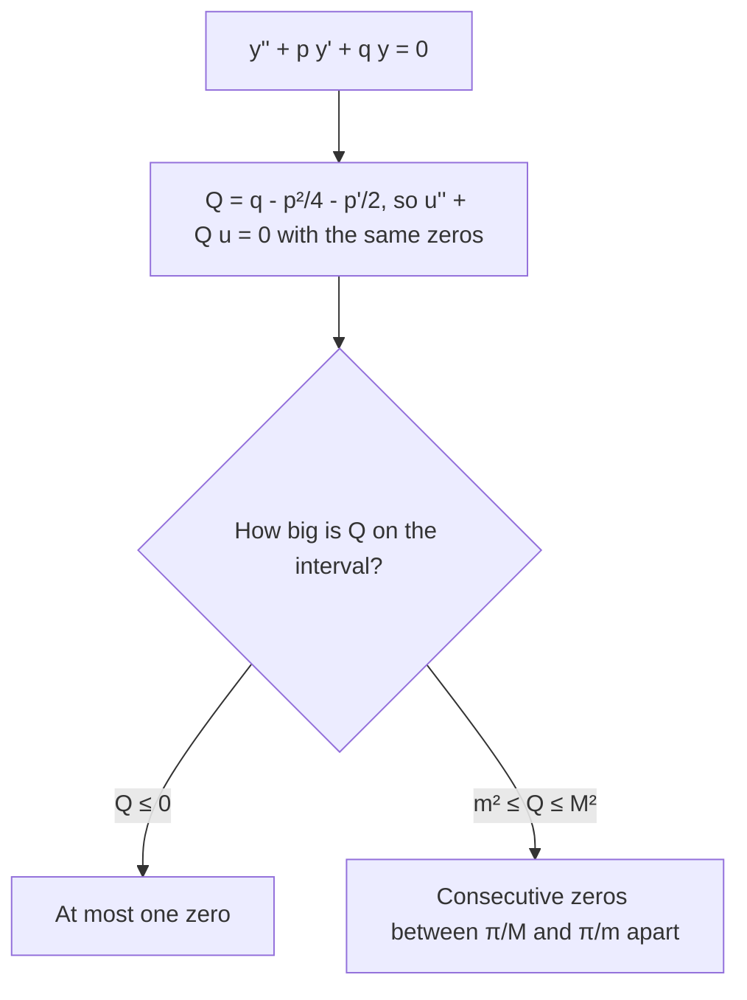

## Oscillation without a formula

Lesson 20 settled oscillation for constant coefficients: solutions of $ay'' + by' + cy = 0$
oscillate exactly when the characteristic roots are complex, $\lambda \pm i\mu$, and then
consecutive zeros are exactly $\pi/\mu$ apart. But most variable-coefficient equations have
no formula for their solutions. Airy's equation $y'' + ty = 0$ (Module 9 solves it by power
series) is a typical example. Can we still say whether its solutions oscillate, and how far
apart their zeros are?

Yes. In 1836 Charles-François Sturm published a memoir on second-order linear equations in
Liouville's new *Journal de Mathématiques Pures et Appliquées* showing how to answer such
questions by *comparing* equations, without solving them. This lesson proves his two main
theorems with nothing more than the Wronskian, and uses them to bound the spacing of
zeros. Throughout, "solution" means a nonzero solution, and $p$, $q$ are continuous on the
interval in question.

## Step 1: remove the first-derivative term

Sturm's comparisons are cleanest for equations with no $y'$ term. Any equation
$y'' + p(t)y' + q(t)y = 0$ can be put in that form. Substitute

$$y = u(t)\,e^{-\frac12\int p\,dt}.$$

Write $v = e^{-\frac12\int p\,dt}$, so $v' = -\tfrac12pv$ and $v'' = \left(\tfrac14p^2 - \tfrac12p'\right)v$.
With $y = uv$, $y' = u'v + uv'$ and $y'' = u''v + 2u'v' + uv''$. Substituting and dividing by
$v$, the $u'$ terms are $u'(2v'/v + p) = u'(-p + p) = 0$, and what is left is

$$u'' + Q(t)\,u = 0, \qquad Q = q - \frac{p^2}{4} - \frac{p'}{2}.$$

Because $v$ is an exponential, it is never zero, so **$y$ and $u$ have exactly the same
zeros**. Every question about zeros of $y$ is a question about zeros of $u$.

Check with constant coefficients: for $y'' + 4y' + 13y = 0$, $p = 4$, $q = 13$, so
$Q = 13 - 4 = 9$ and $u'' + 9u = 0$. So $u = \cos 3t$ (for example) and $y = e^{-2t}\cos 3t$,
matching the roots $-2 \pm 3i$.

### Example 1: Bessel's equation

Bessel's equation of order $\nu$, $t^2y'' + ty' + (t^2 - \nu^2)y = 0$, describes vibrating
drumheads and heat flow in cylinders. For $t > 0$, $p = \dfrac1t$ and $q = 1 - \dfrac{\nu^2}{t^2}$.

- $p^2/4 = \dfrac{1}{4t^2}$ and $p'/2 = -\dfrac{1}{2t^2}$.
- $Q = 1 - \dfrac{\nu^2}{t^2} - \dfrac{1}{4t^2} + \dfrac{1}{2t^2} = 1 + \dfrac{\frac14 - \nu^2}{t^2}$.
- The multiplier is $e^{-\frac12\int dt/t} = t^{-1/2}$, so $y = u/\sqrt t$.

For $\nu = \tfrac12$, $Q = 1$ exactly. Then $u = c_1\cos t + c_2\sin t$ and every solution is
$y = (c_1\cos t + c_2\sin t)/\sqrt t$: its zeros are exactly $\pi$ apart. For any other $\nu$,
$Q \to 1$ as $t \to \infty$, which suggests (and Sturm's theorems confirm) that the zeros of
every Bessel function become nearly $\pi$ apart for large $t$.

## The separation theorem

**Sturm separation theorem.** If $y_1$ and $y_2$ are linearly independent solutions of
$y'' + py' + qy = 0$, then between any two consecutive zeros of $y_1$ there is exactly one
zero of $y_2$.

*Proof.* Since the solutions are independent, their Wronskian $W = y_1y_2' - y_1'y_2$ is never
zero (Lesson 18), so it keeps one sign. Let $a < b$ be consecutive zeros of $y_1$. At those
points $W = -y_1'y_2$. Neither $y_1'(a)$ nor $y_1'(b)$ is zero (a solution with $y = y' = 0$ at a
point is identically zero), and they have opposite signs: $y_1$ keeps one sign between $a$
and $b$, so it leaves zero going one way and returns going the other. Since $W(a)$ and $W(b)$
have the same sign, $y_2(a)$ and $y_2(b)$ must have opposite signs, so $y_2$ has a zero in
$(a, b)$ by the intermediate value theorem. If it had two there, the same argument with the
roles swapped would put a zero of $y_1$ between them, contradicting that $a$, $b$ are
consecutive. $\blacksquare$

So the zeros of independent solutions **interlace**: they alternate. Two consequences:
independent solutions never share a zero (it would make $W = 0$), and on any interval the
numbers of zeros of two solutions differ by at most one. In particular, if one solution has
infinitely many zeros on $[t_0, \infty)$, every solution does. Such an equation (and its
solutions) is called **oscillatory**.

The Cauchy–Euler equation $t^2y'' + ty' + 4y = 0$ shows this: its solutions $\cos(2\ln t)$
and $\sin(2\ln t)$ (Lesson 21, roots $\pm 2i$) have zeros at $t = e^{\pi/4 + k\pi/2}$ and
$t = e^{k\pi/2}$, which alternate.

```plot
{"x": [0, 12], "y": [-1.4, 1.4], "xLabel": "t", "functions": [{"f": "cos(2ln(x))", "from": 0.12}, {"f": "sin(2ln(x))", "from": 0.12, "dashed": true}], "points": [{"at": [0.456, 0]}, {"at": [2.193, 0]}, {"at": [10.551, 0]}, {"at": [0.208, 0], "open": true}, {"at": [1, 0], "open": true}, {"at": [4.81, 0], "open": true}], "caption": "cos(2 ln t) (solid, zeros as filled dots) and sin(2 ln t) (dashed, zeros as open dots): the zeros alternate, even though the spacing grows."}
```

## The comparison theorem

The separation theorem compares two solutions of one equation. Sturm's second theorem
compares two *different* equations: a larger coefficient $Q$ forces faster oscillation.

**Sturm comparison theorem.** Let $u'' + Q_1(t)u = 0$ and $v'' + Q_2(t)v = 0$, with
$Q_2(t) \ge Q_1(t)$ on $[a, b]$ and $Q_2 > Q_1$ somewhere in $(a, b)$. If $a$ and $b$ are
consecutive zeros of a solution $u$, then every solution $v$ has a zero strictly between
$a$ and $b$.

*Proof.* Suppose not: then $v$ has one sign on $(a, b)$; replacing $u$ or $v$ by its negative
if needed, $u > 0$ and $v > 0$ on $(a, b)$, so $u'(a) > 0$, $u'(b) < 0$, $v(a) \ge 0$ and
$v(b) \ge 0$. Differentiate a Wronskian-like expression:

$$(u'v - uv')' = u''v - uv'' = -Q_1uv + Q_2uv = (Q_2 - Q_1)uv.$$

(The $u'v'$ terms cancel.) Integrate from $a$ to $b$, using $u(a) = u(b) = 0$:

$$u'(b)v(b) - u'(a)v(a) = \int_a^b (Q_2 - Q_1)uv\,dt.$$

The left side is $\le 0$. The right side is $> 0$, since the integrand is never negative and
is positive near a point where $Q_2 > Q_1$. Contradiction. $\blacksquare$

## Spacing between zeros

Compare with $\sin$ functions, which solve $v'' + k^2v = 0$ and have zeros exactly $\pi/k$
apart. Suppose that on an interval

$$m^2 \le Q(t) \le M^2 \qquad (m, M > 0).$$

- **Zeros are at least $\pi/M$ apart.** Let $a$ be a zero of $u$ and compare $u$ (as the
  equation with $Q_1 = Q$) with $v = \sin\big(M(t - a)\big)$ ($Q_2 = M^2$). If the next zero $b$ of
  $u$ came before $a + \pi/M$, then $v$ would need a zero in $(a, b)$, but $v$'s first zero after
  $a$ is $a + \pi/M$. So $b \ge a + \pi/M$.
- **Zeros are at most $\pi/m$ apart.** Now let $v = \sin\big(m(t - a)\big)$ play the role of the
  slower equation ($Q_1 = m^2 \le Q_2 = Q$). Its zeros $a$ and $a + \pi/m$ are consecutive, so $u$ has a
  zero in $(a, a + \pi/m)$, or exactly at $a + \pi/m$ if $Q = m^2$ throughout. So the next
  zero comes within $\pi/m$.

In short, consecutive zeros are between $\pi/M$ and $\pi/m$ apart. And if $Q(t) \le 0$ on an
interval, compare with $v = 1$ (which solves $v'' + 0 \cdot v = 0$ and never vanishes): a
solution has **at most one zero** there. (If $Q \equiv 0$, $u$ is linear, which also has at
most one zero.) That is why $y'' - y = 0$, with $Q = -1$, never oscillates.



### Example 2: Airy's equation

How far apart are consecutive zeros of solutions of $y'' + ty = 0$ that lie in $[4, 9]$?

- There is no $y'$ term, so $Q = t$, and on $[4, 9]$, $4 \le Q \le 9$: $m = 2$, $M = 3$.
- Consecutive zeros in $[4, 9]$ are between $\pi/3 \approx 1.047$ and $\pi/2 \approx 1.571$ apart.
- Numerically, the solution $\operatorname{Ai}(-t)$ has zeros near 4.088, 5.521, 6.787 and 7.944, with
  gaps 1.433, 1.266 and 1.157: inside the bounds, and shrinking.

Since $Q = t \to \infty$, every solution has infinitely many zeros on $t > 0$, crowding
together: near $t = T$ they are roughly $\pi/\sqrt{T}$ apart. For $t < 0$, $Q < 0$, so each
solution has at most one zero on $(-\infty, 0]$.

### Example 3: counting zeros

Show that every solution of $u'' + (4 + \cos t)u = 0$ has between 55 and 72 zeros in
$[0, 100]$.

- $3 \le Q \le 5$, so $m = \sqrt3$, $M = \sqrt5$: gaps lie between $\pi/\sqrt5 \approx 1.405$ and
  $\pi/\sqrt3 \approx 1.814$.
- *At least:* the first zero is within $\pi/\sqrt3$ of $t = 0$ (compare with $\sin(\sqrt3\,t)$), and
  each later one within $\pi/\sqrt3$ of the previous. So the $k$th zero is at most
  $k\pi/\sqrt3$, and all $k$ with $k\pi/\sqrt3 \le 100$ fit: $k \le 100\sqrt3/\pi \approx 55.1$, so at
  least 55 zeros.
- *At most:* $N$ zeros span at least $(N - 1)\pi/\sqrt5$, which must be $\le 100$:
  $N \le 1 + 100\sqrt5/\pi \approx 72.2$, so at most 72.

A numerical solution of this equation finds 63 or 64 zeros on $[0, 100]$, depending on the
initial conditions, comfortably inside the guarantee. The theorems give bounds, not exact
counts.

## Common mistakes

- **Comparing equations that still have a $y'$ term.** The comparison theorem is about
  $u'' + Qu = 0$. Compute $Q = q - p^2/4 - p'/2$ first; using $q$ alone can be badly wrong
  ($y'' + 4y' + 3y = 0$ has $q = 3 > 0$ but $Q = -1$, and it doesn't oscillate).
- **Reversing the bounds.** A *bigger* $Q$ means *closer* zeros: the upper bound $M^2$ on $Q$
  gives the *lower* bound $\pi/M$ on the gap.
- **Forgetting the square root.** Zeros of $\sin kt$ are $\pi/k$ apart, so $Q \le 9$ gives gaps
  of at least $\pi/3$, not $\pi/9$.
- **Expecting equal spacing.** Except for constant $Q$, gaps change along the interval; the
  theorems only bound them.
- **Applying separation to dependent solutions.** $y$ and $2y$ have the same zeros; the
  theorem needs independent solutions.

## Key points

- $y = u\,e^{-\frac12\int p\,dt}$ turns $y'' + py' + qy = 0$ into $u'' + Qu = 0$ with
  $Q = q - p^2/4 - p'/2$; $y$ and $u$ have the same zeros.
- Separation: zeros of independent solutions interlace; all solutions oscillate or none do.
- Comparison: if $Q_2 \ge Q_1$ (not identically equal), $v$ has a zero between any two
  consecutive zeros of $u$.
- If $m^2 \le Q \le M^2$, consecutive zeros are between $\pi/M$ and $\pi/m$ apart; if $Q \le 0$, at
  most one zero.
- Sturm (1836) got these from the Wronskian alone, without solving anything.
