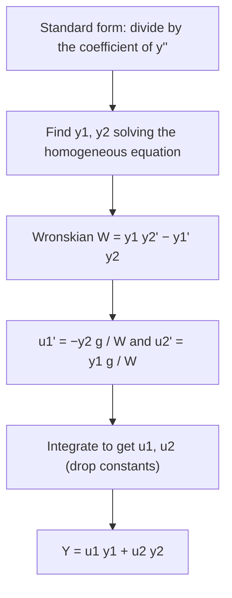
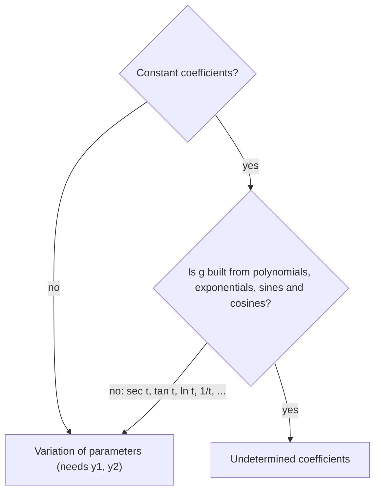

## A method that always works

Undetermined coefficients is fast but limited: constant coefficients, and only forcing
terms whose derivatives close up into a finite family. **Variation of parameters** has
neither limit. Given a fundamental set $y_1, y_2$ for the homogeneous equation, it produces
a particular solution for *any* continuous forcing $g(t)$, at the cost of computing two
integrals. It's the same idea as reduction of order: replace constants by functions.

## The idea

The complementary solution is $c_1y_1 + c_2y_2$. Look for a particular solution with the
constants allowed to vary:

$$Y = u_1(t)y_1(t) + u_2(t)y_2(t).$$

Two unknown functions but only one equation to satisfy, so we're free to impose one extra
condition. We choose it to keep derivatives simple:

$$u_1'y_1 + u_2'y_2 = 0.$$

Then $Y' = u_1y_1' + u_2y_2'$ (the $u'$ terms vanish by our choice), and
$Y'' = u_1y_1'' + u_2y_2'' + u_1'y_1' + u_2'y_2'$. Substituting into
$y'' + py' + qy = g$, the terms with $u_1$ and $u_2$ collect into
$u_1L[y_1] + u_2L[y_2] = 0$, leaving

$$u_1'y_1' + u_2'y_2' = g.$$

## The formulas

So $u_1'$ and $u_2'$ solve the linear system

$$\begin{aligned} u_1'y_1 + u_2'y_2 &= 0 \\ u_1'y_1' + u_2'y_2' &= g(t) \end{aligned}$$

whose determinant is the Wronskian $W = y_1y_2' - y_1'y_2 \ne 0$. By Cramer's rule,

$$u_1' = -\frac{y_2\,g}{W}, \qquad u_2' = \frac{y_1\,g}{W},$$

and

$$Y(t) = -y_1\int \frac{y_2\,g}{W}\,dt + y_2\int \frac{y_1\,g}{W}\,dt.$$

**Important:** $g$ here is the right side when the equation is in standard form, with
coefficient 1 on $y''$. For $ay'' + by' + cy = f(t)$, use $g = f/a$.

Constants of integration can be dropped: they just add multiples of $y_1$ and $y_2$, which
are already in $y_c$.

The steps, in order:

### Example 1

Find a particular solution of $y'' + y = \sec t$ on $-\pi/2 < t < \pi/2$.

Undetermined coefficients can't handle $\sec t$. Use variation of parameters.

- $y_1 = \cos t$, $y_2 = \sin t$, $W = \cos^2 t + \sin^2 t = 1$.
- $u_1' = -\sin t\sec t = -\tan t$, so $u_1 = \ln|\cos t| = \ln(\cos t)$ on this interval.
- $u_2' = \cos t\sec t = 1$, so $u_2 = t$.
- $Y = \cos t\,\ln(\cos t) + t\sin t$.

General solution: $y = c_1\cos t + c_2\sin t + \cos t\ln(\cos t) + t\sin t$.

### Example 2

Find a particular solution of $y'' - 2y' + y = \dfrac{e^t}{t}$, $t > 0$.

- Double root 1: $y_1 = e^t$, $y_2 = te^t$, $W = e^{2t}$ (Lesson 19).
- $u_1' = -\dfrac{te^t \cdot e^t/t}{e^{2t}} = -1$, so $u_1 = -t$.
- $u_2' = \dfrac{e^t \cdot e^t/t}{e^{2t}} = \dfrac1t$, so $u_2 = \ln t$.
- $Y = -te^t + te^t\ln t$. The $-te^t$ part is a multiple of $y_2$, so we may drop it:
  $Y = te^t\ln t$.

### Example 3: checking against undetermined coefficients

Use variation of parameters on $y'' - y = e^{2t}$ (where we know $Y = \tfrac13e^{2t}$).

- $y_1 = e^t$, $y_2 = e^{-t}$, $W = e^t(-e^{-t}) - e^te^{-t} = -2$.
- $u_1' = -\dfrac{e^{-t}e^{2t}}{-2} = \dfrac{e^t}{2}$, so $u_1 = \dfrac{e^t}{2}$.
- $u_2' = \dfrac{e^te^{2t}}{-2} = -\dfrac{e^{3t}}{2}$, so $u_2 = -\dfrac{e^{3t}}{6}$.
- $Y = \dfrac{e^t}{2}e^t - \dfrac{e^{3t}}{6}e^{-t} = \dfrac{e^{2t}}{2} - \dfrac{e^{2t}}{6} = \dfrac{e^{2t}}{3}$. ✓

Same answer, more work: use undetermined coefficients when it applies.

### Example 4: variable coefficients

Given $y_1 = t$, $y_2 = t^{-1}$ solve $t^2y'' + ty' - y = 0$, find a particular solution of
$t^2y'' + ty' - y = t^2$ for $t > 0$.

- Standard form: divide by $t^2$, so $g = 1$.
- $W = t(-t^{-2}) - 1 \cdot t^{-1} = -\dfrac2t$.
- $u_1' = -\dfrac{t^{-1}\cdot 1}{-2/t} = \dfrac12$, so $u_1 = \dfrac t2$.
- $u_2' = \dfrac{t \cdot 1}{-2/t} = -\dfrac{t^2}{2}$, so $u_2 = -\dfrac{t^3}{6}$.
- $Y = \dfrac t2 \cdot t - \dfrac{t^3}{6}\cdot\dfrac1t = \dfrac{t^2}{2} - \dfrac{t^2}{6} = \dfrac{t^2}{3}$.

Check: $t^2\left(\tfrac23\right) + t\left(\tfrac{2t}{3}\right) - \tfrac{t^2}{3} = t^2$. ✓ Forgetting
to divide by $t^2$ would have produced a wrong answer.

## A definite-integral form

Writing the integrals from $t_0$ to $t$ gives the particular solution with $Y(t_0) = 0$ and
$Y'(t_0) = 0$:

$$Y(t) = \int_{t_0}^{t}\frac{y_1(s)y_2(t) - y_1(t)y_2(s)}{W(s)}\,g(s)\,ds.$$

For $y'' + \omega^2y = g$ this becomes $Y = \dfrac{1}{\omega}\displaystyle\int_0^t \sin\big(\omega(t - s)\big)g(s)\,ds$,
a convolution integral you'll meet again with Laplace transforms.

## Which method?

| Situation | Method |
|---|---|
| Constant coefficients, $g$ = polynomial / exponential / sine / cosine (or products, sums) | Undetermined coefficients |
| $g$ like $\sec t$, $\tan t$, $\ln t$, $1/t$, $e^t/t$ | Variation of parameters |
| Variable coefficients (with $y_1, y_2$ known) | Variation of parameters |

The same choice as a decision chart:

## Common mistakes

- **Not dividing by the leading coefficient** before identifying $g$.
- **Sign of $u_1'$.** It's $-y_2g/W$; the minus sign is easy to drop.
- **Wronskian order.** $W = y_1y_2' - y_1'y_2$ with $y_1, y_2$ in the same order as in the
  formulas.
- **Keeping unnecessary terms.** Terms that duplicate $y_c$ can be absorbed into $c_1, c_2$.

## Key points

- Seek $Y = u_1y_1 + u_2y_2$ with $u_1'y_1 + u_2'y_2 = 0$ and $u_1'y_1' + u_2'y_2' = g$.
- $u_1' = -y_2g/W$, $u_2' = y_1g/W$, where $g$ is the standard-form right side.
- Works for any continuous $g$ and for variable coefficients, given $y_1$ and $y_2$.
