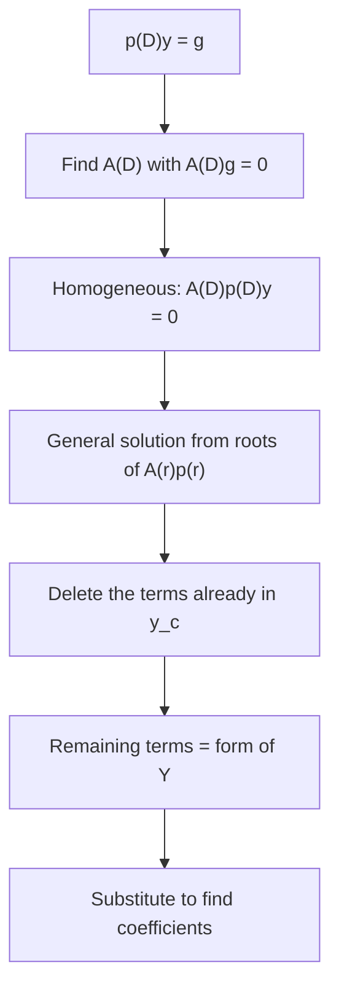

## Why the table works

Lesson 22 handed you a table of guesses for undetermined coefficients and a rule to
multiply by $t$ when a guess overlaps $y_c$. Lesson 27 refined the rule: multiply by $t^s$,
where $s$ is the multiplicity of the overlapping root. Both rules work, but as stated they
are recipes to memorize. This honors lesson derives them. The tool is the operator notation
from Lesson 26, where $D$ means $d/dt$ and the equation $ay'' + by' + cy = g$ is written
$p(D)y = g$. The idea: find a second operator that *kills* the forcing term $g$, apply it to
both sides, and you are left with a homogeneous equation, which Lesson 27 already taught you
to solve. The form of the particular solution then simply falls out, modification rule
included.

## Operators that multiply like polynomials

A **differential operator** is a rule that turns a function into a combination of its
derivatives, such as $D^2 - 3D - 4$, which sends $y$ to $y'' - 3y' - 4y$. Applying one
constant-coefficient operator after another works exactly like multiplying polynomials:

$$(D - a)\big[(D - b)y\big] = (D - a)(y' - by) = y'' - by' - ay' + aby = \big(D^2 - (a + b)D + ab\big)y.$$

So $(D - a)(D - b) = D^2 - (a + b)D + ab$, and since that is symmetric in $a$ and $b$, the
order doesn't matter: constant-coefficient operators *commute*. That is why we may factor
$p(D)$ the same way we factor the characteristic polynomial $p(r)$.

This is special to constant coefficients. With a variable coefficient, order matters:
$D(ty) = y + ty'$ but $t(Dy) = ty'$. Everything below assumes constant coefficients.

## Annihilators

An operator $A(D)$ **annihilates** a function $f$ if $A(D)f = 0$; we call $A(D)$ an
**annihilator** of $f$. You already know many: by the root rule of Lesson 27, the solutions
of $A(D)y = 0$ are built from the roots of $A(r)$, so $A(D)$ annihilates exactly those
functions. Reading Lesson 27's table backwards:

| Function $f$ | Smallest annihilator | Roots of $A(r)$ |
|---|---|---|
| polynomial of degree $n$ | $D^{n+1}$ | $0$, multiplicity $n + 1$ |
| $e^{\alpha t}$ | $D - \alpha$ | $\alpha$ |
| $t^ne^{\alpha t}$ | $(D - \alpha)^{n+1}$ | $\alpha$, multiplicity $n + 1$ |
| $\cos\beta t$ or $\sin\beta t$ | $D^2 + \beta^2$ | $\pm i\beta$ |
| $e^{\alpha t}\cos\beta t$ or $e^{\alpha t}\sin\beta t$ | $(D - \alpha)^2 + \beta^2$ | $\alpha \pm i\beta$ |
| $t^ne^{\alpha t}\cos\beta t$ or $t^ne^{\alpha t}\sin\beta t$ | $\big[(D - \alpha)^2 + \beta^2\big]^{n+1}$ | $\alpha \pm i\beta$, multiplicity $n + 1$ |

For a sum, multiply annihilators: if $A_1$ kills $f_1$ and $A_2$ kills $f_2$, then $A_1A_2$
kills $f_1 + f_2$, because the operators commute. (If the two share a factor, you need it only
once, to the higher of its two powers: $D - 1$ kills $e^t$ and $(D - 1)^2$ kills $te^t$, so
$(D - 1)^2$ kills $e^t + te^t$.) A quick check of one row: $(D - 2)^2$ applied to $te^{2t}$ gives
$(D - 2)\big[e^{2t} + 2te^{2t} - 2te^{2t}\big] = (D - 2)e^{2t} = 0$.

Notice which functions appear: exactly the polynomials, exponentials, sines and cosines and
their products, the same list as Lesson 22's table. That is no accident.

## The method

To find the form of a particular solution of $p(D)y = g$:

1. Find an annihilator $A(D)$ of $g$.
2. Apply it to both sides: $A(D)p(D)y = A(D)g = 0$. Every solution of the original equation,
   including the particular solution $Y$, solves this homogeneous equation.
3. Solve the homogeneous equation with characteristic polynomial $A(r)p(r)$ (Lesson 27).
4. Delete the terms that already make up $y_c$ (they solve $p(D)y = 0$ and contribute nothing
   to $g$). What remains, with unknown coefficients, is the form of $Y$.
5. Substitute into the original equation to find the coefficients.

Here is the payoff. If a root of $A(r)$ is also a root of $p(r)$, the multiplicities add in
the product $A(r)p(r)$, and the extra powers of $t$ appear automatically. The modification
rule is not a separate rule at all; it is just the repeated-root rule applied to $A(r)p(r)$.

### Example 1: the modification rule, derived

Find the form of $Y$ for $y'' - 3y' - 4y = 5e^{4t}$ (Lesson 22, Example 4).

- $p(r) = r^2 - 3r - 4 = (r - 4)(r + 1)$, so $y_c = c_1e^{4t} + c_2e^{-t}$.
- $5e^{4t}$ is killed by $D - 4$.
- $A(r)p(r) = (r - 4)^2(r + 1)$: the root 4 now has multiplicity 2. The general solution
  of $(D - 4)^2(D + 1)y = 0$ is $c_1e^{4t} + c_2e^{-t} + c_3te^{4t}$.
- Delete the $y_c$ terms: $Y = Ate^{4t}$. That is exactly the modified guess, and
  substituting gives $A = 1$ as before.

Nobody had to remember to multiply by $t$; the double root did it.

### Example 2: a guess that's easy to get wrong

Find a particular solution of $y'' + y = t\sin t$.

- $p(r) = r^2 + 1$, roots $\pm i$, so $y_c = c_1\cos t + c_2\sin t$.
- $t\sin t = te^{0t}\sin t$ with $\alpha = 0$, $\beta = 1$, $n = 1$: its annihilator is
  $(D^2 + 1)^2$.
- $A(r)p(r) = (r^2 + 1)^3$: roots $\pm i$, each of multiplicity 3. The general solution is
  $(c_1 + c_2t + c_3t^2)\cos t + (c_4 + c_5t + c_6t^2)\sin t$.
- Delete $\cos t$ and $\sin t$:
  $$Y = (At + Bt^2)\cos t + (Ct + Et^2)\sin t.$$
- Substituting and matching the four kinds of terms ($\cos t$, $t\cos t$, $\sin t$, $t\sin t$)
  gives $A = 0$, $B = -\tfrac14$, $C = \tfrac14$, $E = 0$:
  $$Y = -\tfrac14t^2\cos t + \tfrac14t\sin t.$$

The table approach would start from $(A_1t + A_0)\cos t + (B_1t + B_0)\sin t$ and multiply
the *whole* guess by $t$. A common slip is multiplying only the leading terms, or only the
cosine; the annihilator makes the correct form unmistakable.

## The exponential shift rule

Finding coefficients is often faster with one more operator fact. Since
$D\big(e^{\alpha t}v\big) = e^{\alpha t}(v' + \alpha v) = e^{\alpha t}(D + \alpha)v$, repeating
it gives the **exponential shift rule**:

$$p(D)\big[e^{\alpha t}v\big] = e^{\alpha t}\,p(D + \alpha)\,v.$$

Pulling $e^{\alpha t}$ to the left shifts every $D$ by $\alpha$. It shines when $\alpha$ is a
root of $p$, because then $D + \alpha$ turns the factor $(D - \alpha)$ into a plain $D$.

### Example 3: a sum, solved with the shift rule

Solve $y'' - 2y' + y = te^t + 4$.

- $p(r) = (r - 1)^2$, a double root: $y_c = (c_1 + c_2t)e^t$.
- Annihilators: $(D - 1)^2$ kills $te^t$ and $D$ kills 4, so $A(D) = D(D - 1)^2$.
- $A(r)p(r) = r(r - 1)^4$. Its solutions are $1$ and $e^t, te^t, t^2e^t, t^3e^t$. Delete
  $y_c$: $Y = (At^2 + Bt^3)e^t + C$.
- The constant: $p(D)C = C$, so $C = 4$.
- For the exponential part, write $Y_1 = e^tv$. The shift rule gives
  $(D - 1)^2\big[e^tv\big] = e^tD^2v$, so we need $v'' = t$. The simplest choice is
  $v = \tfrac16t^3$ (the extra $c_1 + c_2t$ from integrating would only reproduce $y_c$). So
  $A = 0$ and $B = \tfrac16$.
- $y = (c_1 + c_2t)e^t + \tfrac16t^3e^t + 4$.

Two integrations replaced a page of product-rule algebra. The shift rule also explains why
the $t$ terms always cancel when the modification is right (Lesson 22): after the shift,
the factor $D^s$ only ever sees a polynomial.

### Example 4: reading off a form

Find the form of $Y$ for $y^{(4)} - y = \cos t + te^{-t}$.

- $p(r) = r^4 - 1 = (r - 1)(r + 1)(r^2 + 1)$, so $y_c = c_1e^t + c_2e^{-t} + c_3\cos t + c_4\sin t$.
- Annihilators: $D^2 + 1$ for $\cos t$, $(D + 1)^2$ for $te^{-t}$.
- $A(r)p(r) = (r - 1)(r + 1)^3(r^2 + 1)^2$. Beyond $y_c$, its solutions add $te^{-t}$,
  $t^2e^{-t}$, $t\cos t$ and $t\sin t$.
- $Y = (At + Bt^2)e^{-t} + t(C\cos t + E\sin t)$.

(Solving gives $A = -\tfrac38$, $B = -\tfrac18$, $C = 0$, $E = -\tfrac14$.) Both pieces of $g$
overlap $y_c$ here, each by a simple root, so each piece gets one factor of $t$, and the
polynomial factor of $te^{-t}$ still keeps all its lower powers.

## What the method can't do

The method needs an annihilator, and only a function that solves some constant-coefficient
homogeneous equation has one. Those are precisely the finite sums of terms
$t^ne^{\alpha t}\cos\beta t$ and $t^ne^{\alpha t}\sin\beta t$. Functions such as $\tan t$,
$\ln t$ and $1/t$ have none: their derivatives keep producing new kinds of functions
($1/t, 1/t^2, 1/t^3, \dots$ are independent), so no finite combination of derivatives can
vanish. For those, and for variable coefficients where operators don't commute, use
variation of parameters (Lesson 23).

## Common mistakes

- **Annihilating $\sin\beta t$ with $D - i\beta$ alone.** That complex factor kills
  $e^{i\beta t}$, not the real $\sin\beta t$; a real sine or cosine needs both factors,
  $D^2 + \beta^2$.
- **Wrong power on the annihilator.** $t^ne^{\alpha t}$ needs $(D - \alpha)^{n+1}$, one more
  than the power of $t$.
- **Keeping the $y_c$ terms in $Y$.** They contribute nothing to $g$; leaving them in leaves
  their coefficients undetermined (any value works), which only adds confusing work.
- **Using the method with variable coefficients.** The factoring and commuting steps fail.
- **Shifting the wrong way.** It is $p(D + \alpha)$, not $p(D - \alpha)$, when $e^{\alpha t}$
  is pulled out in front.

## Key points

- Constant-coefficient operators multiply and factor like polynomials, and they commute.
- $A(D)$ annihilates $f$ when $A(D)f = 0$; the annihilator's roots are the exponents that
  build $f$, with multiplicity one more than the power of $t$.
- Applying $A(D)$ to $p(D)y = g$ gives a homogeneous equation; its solutions minus $y_c$
  are the form of $Y$. Overlapping roots add multiplicities, which is the modification rule.
- Exponential shift: $p(D)\big[e^{\alpha t}v\big] = e^{\alpha t}p(D + \alpha)v$.
- Only sums of $t^ne^{\alpha t}\cos\beta t$ and $t^ne^{\alpha t}\sin\beta t$ have annihilators.
