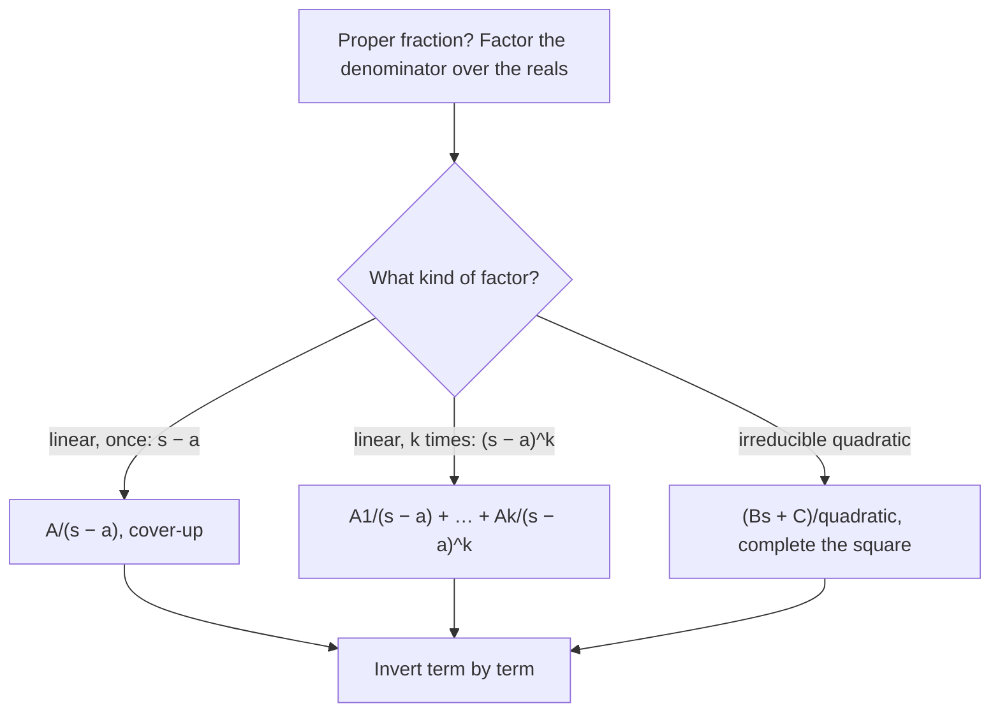

## Going back

Solving an IVP with Laplace transforms ends with a formula for $Y(s)$, and we need the
function $y(t)$ it came from. That's the **inverse Laplace transform**, written
$\mathcal{L}^{-1}\{F(s)\} = f(t)$. In practice, nobody evaluates an inverse integral by hand;
we rearrange $F(s)$ into pieces that appear in the table and read them off. The main tool
is **partial fractions**, plus completing the square.

Inverse transforms are unique in the sense that matters: two continuous functions with the
same transform are equal. And $\mathcal{L}^{-1}$ is linear, so we can invert term by term.

## Reading the table backward

### Example 1

- $\mathcal{L}^{-1}\left\{\dfrac{5}{s - 3}\right\} = 5e^{3t}$.
- $\mathcal{L}^{-1}\left\{\dfrac{4}{s^3}\right\} = 4\cdot\dfrac{t^2}{2!} = 2t^2$ (adjust the constant to match $\dfrac{n!}{s^{n+1}}$).
- $\mathcal{L}^{-1}\left\{\dfrac{3}{s^2 + 16}\right\} = \dfrac34\mathcal{L}^{-1}\left\{\dfrac{4}{s^2 + 16}\right\} = \dfrac34\sin 4t$.
- $\mathcal{L}^{-1}\left\{\dfrac{2s - 6}{s^2 + 9}\right\} = 2\cos 3t - 2\sin 3t$ (split into $\dfrac{2s}{s^2 + 9} - \dfrac{6}{s^2 + 9}$).

## Partial fractions: distinct linear factors

A proper rational function (degree of numerator less than degree of denominator) whose
denominator factors into distinct linear factors splits as

$$\frac{P(s)}{(s - a_1)(s - a_2)\cdots(s - a_n)} = \frac{A_1}{s - a_1} + \cdots + \frac{A_n}{s - a_n}.$$

The fastest way to get each $A_k$ is the **cover-up method**: multiply by $(s - a_k)$, then
set $s = a_k$. All other terms vanish.

### Example 2

Find $\mathcal{L}^{-1}\left\{\dfrac{s + 7}{(s - 1)(s + 3)}\right\}$.

- $\dfrac{s + 7}{(s - 1)(s + 3)} = \dfrac{A}{s - 1} + \dfrac{B}{s + 3}$.
- $A$: cover up $(s - 1)$, set $s = 1$: $A = \dfrac{1 + 7}{1 + 3} = 2$.
- $B$: cover up $(s + 3)$, set $s = -3$: $B = \dfrac{-3 + 7}{-3 - 1} = -1$.
- Inverse: $2e^t - e^{-3t}$.

## Repeated linear factors

A factor $(s - a)^k$ needs $k$ terms: $\dfrac{A_1}{s - a} + \dfrac{A_2}{(s - a)^2} + \cdots + \dfrac{A_k}{(s - a)^k}$.
They invert to $e^{at}$, $te^{at}$, $\dfrac{t^2}{2}e^{at}$, … by the shifting rule.

### Example 3

Find $\mathcal{L}^{-1}\left\{\dfrac{3s + 1}{(s + 1)^2}\right\}$.

- Write $3s + 1 = 3(s + 1) - 2$. Then $\dfrac{3s + 1}{(s + 1)^2} = \dfrac{3}{s + 1} - \dfrac{2}{(s + 1)^2}$.
- Inverse: $3e^{-t} - 2te^{-t}$.

Rewriting the numerator in powers of $(s - a)$ is often faster than solving for unknowns.

## Irreducible quadratics: complete the square

A quadratic factor with no real roots, like $s^2 + 4s + 13$, gets a term
$\dfrac{Bs + C}{s^2 + 4s + 13}$. To invert, complete the square,
$s^2 + 4s + 13 = (s + 2)^2 + 9$, and write the numerator in terms of $s + 2$:

### Example 4

Find $\mathcal{L}^{-1}\left\{\dfrac{2s + 1}{s^2 + 4s + 13}\right\}$.

- Denominator: $(s + 2)^2 + 3^2$.
- Numerator: $2s + 1 = 2(s + 2) - 3$.
- Split: $\dfrac{2(s + 2)}{(s + 2)^2 + 9} - \dfrac{3}{(s + 2)^2 + 9}$.
- Inverse (first shift with $a = -2$): $2e^{-2t}\cos 3t - e^{-2t}\sin 3t$.

### Example 5: mixed factors

Find $\mathcal{L}^{-1}\left\{\dfrac{10}{s(s^2 + 2s + 5)}\right\}$.

- $\dfrac{10}{s(s^2 + 2s + 5)} = \dfrac As + \dfrac{Bs + C}{s^2 + 2s + 5}$.
- Cover-up for $A$ ($s = 0$): $A = \dfrac{10}{5} = 2$.
- Then $10 = 2(s^2 + 2s + 5) + (Bs + C)s$. Comparing $s^2$: $0 = 2 + B$, so $B = -2$.
  Comparing $s$: $0 = 4 + C$, so $C = -4$.
- $\dfrac{-2s - 4}{(s + 1)^2 + 4} = \dfrac{-2(s + 1) - 2}{(s + 1)^2 + 4}$.
- Inverse: $2 - 2e^{-t}\cos 2t - e^{-t}\sin 2t$.

The term to write down for each factor of the denominator follows a short decision chart.

## A strategy checklist

1. If the numerator's degree is not less than the denominator's, something's off (for
   ordinary functions $F(s) \to 0$).
2. Factor the denominator completely over the reals.
3. Set up partial fractions: one term per linear factor (more if repeated), $Bs + C$ over
   each irreducible quadratic.
4. Find constants by cover-up, then by comparing coefficients or plugging convenient $s$.
5. Complete squares and match table forms; adjust constants.
6. Check: at $t = 0$, $f(0)$ should equal $\lim_{s\to\infty} sF(s)$ (the initial value
   theorem). In Example 5: $sF(s) \to 0$, and $2 - 2 - 0 = 0$. ✓

### Example 6: checking a decomposition

After finding constants, check by recombining or by plugging in a convenient value of $s$.
For Example 2, at $s = 0$ the original is $\dfrac{7}{(-1)(3)} = -\dfrac73$ and the decomposition
gives $\dfrac{2}{-1} - \dfrac{1}{3} = -\dfrac73$. ✓ One numerical check like this catches most
arithmetic slips before they propagate into the final answer.

### Example 7: improper-looking terms

$\mathcal{L}^{-1}\left\{\dfrac{s^2 + 2}{s^3 + s}\right\}$: factor $s^3 + s = s(s^2 + 1)$. Cover-up at $s = 0$
gives $\dfrac{2}{1} = 2$. Then $s^2 + 2 = 2(s^2 + 1) + (Bs + C)s$; comparing $s^2$ terms,
$1 = 2 + B$, so $B = -1$, and $C = 0$. The inverse is $2 - \cos t$.

## Common mistakes

- **Constant mismatch.** $\dfrac{1}{s^2 + 9}$ inverts to $\tfrac13\sin 3t$, not $\sin 3t$.
- **Shifting only part.** With $(s + 2)^2 + 9$ in the denominator, the numerator must be
  written in terms of $s + 2$ before using the cosine entry.
- **Sign of the shift.** $(s + 2)$ means $a = -2$: the factor is $e^{-2t}$.
- **Too few terms** for repeated factors.

## Key points

- $\mathcal{L}^{-1}$ is linear; invert term by term from the table.
- Partial fractions: cover-up for distinct linear factors; extra terms for repeated
  factors; $Bs + C$ over irreducible quadratics.
- Complete the square to get $(s - a)^2 + b^2$, then use $e^{at}\cos bt$ and $e^{at}\sin bt$.
