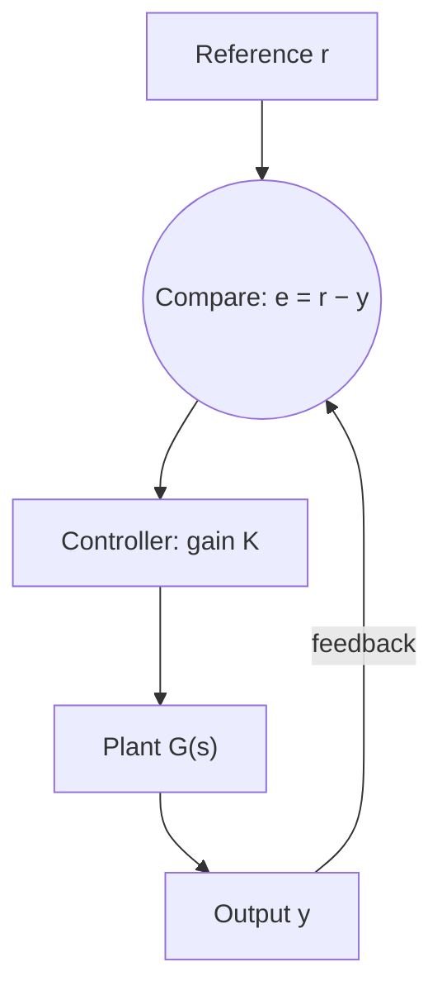

## Reading behavior from $H(s)$

Lesson 32 defined the transfer function $H(s)$ of a linear system: with zero initial
conditions, the output transform is $Y(s) = H(s)G(s)$, and the impulse response is
$h = \mathcal{L}^{-1}\{H\}$. Lesson 30 noticed that the roots of the characteristic polynomial
become the poles of $Y(s)$. This lesson turns those two remarks into the working tool of
control engineering. Without solving anything, the location of a few numbers in the complex
plane tells you whether a system settles down, oscillates or blows up, where its output
ends up, and how feedback changes all of that.

## Transfer functions and poles

For a constant-coefficient equation in which the input $g$ may also appear with derivatives,

$$a_ny^{(n)} + \cdots + a_1y' + a_0y = b_mg^{(m)} + \cdots + b_1g' + b_0g,$$

transforming with zero initial conditions gives $P(s)Y = Q(s)G$, so $H(s) = Q(s)/P(s)$, where
$P(s) = a_ns^n + \cdots + a_0$ is the characteristic polynomial and $Q(s) = b_ms^m + \cdots + b_0$.
After cancelling any common factors, the roots of $P$ are the **poles** of $H$ (where it
blows up) and the roots of $Q$ are its zeros. We plot poles as crosses in the **s-plane**,
the complex plane with $\operatorname{Re}s$ across and $\operatorname{Im}s$ up.

### Example 1

For $y'' + 3y' + 2y = g' + 3g$: $H(s) = \dfrac{s + 3}{s^2 + 3s + 2} = \dfrac{s + 3}{(s + 1)(s + 2)}$.
Poles $-1$ and $-2$, one zero at $-3$. Partial fractions (cover-up) give
$H = \dfrac{2}{s + 1} - \dfrac{1}{s + 2}$, so $h(t) = 2e^{-t} - e^{-2t}$: one decaying exponential per pole.

## Where the poles are tells you what happens

Partial fractions split $H$ into one piece per pole, and each piece inverts to one kind of
term. So the poles alone fix the *shapes* in the impulse response; the zeros and the input
only change how much of each shape appears.

| Pole of $H$ | Term in $h(t)$ | Behavior |
|---|---|---|
| real, $s = -a < 0$ | $e^{-at}$ | decays |
| real, $s = a > 0$ | $e^{at}$ | grows |
| $s = 0$ | constant | stays put |
| pair $\lambda \pm i\mu$, $\lambda < 0$ | $e^{\lambda t}\cos\mu t$, $e^{\lambda t}\sin\mu t$ | decaying oscillation |
| pair $\pm i\mu$ | $\cos\mu t$, $\sin\mu t$ | steady oscillation |
| pair $\lambda \pm i\mu$, $\lambda > 0$ | $e^{\lambda t}\cos\mu t$, $e^{\lambda t}\sin\mu t$ | growing oscillation |
| repeated pole $p$ ($k$ times) | $t^{k-1}e^{pt}$ and lower powers | as above, times powers of $t$ |

The real part of a pole is a growth rate (negative means decay) and the imaginary part is an
angular frequency. Distance to the left of the imaginary axis measures how fast a mode dies
out; poles near the axis ring for a long time.

## BIBO stability

A system is **BIBO stable** (bounded-input, bounded-output) if every bounded input produces
a bounded output from zero initial conditions. For a transfer function that is a ratio of
polynomials with $\deg Q \le \deg P$, the test is short:

> The system is BIBO stable exactly when every pole of $H$ has negative real part, that is,
> all poles lie in the open left half of the s-plane.

Why: since $y = h * g$, $|y(t)| \le \max|g|\cdot\int_0^\infty|h(\tau)|\,d\tau$, so an integrable impulse
response guarantees bounded outputs, and poles in the left half-plane give exactly the
integrable $h$. (When $\deg Q = \deg P$ the impulse response also contains a multiple of
$\delta(t)$, which is harmless.) Conversely, a pole with $\operatorname{Re}s \ge 0$ gives a term that
doesn't decay, and some bounded input can pump it up without limit.

### Example 2: a pole on the axis is not enough

The undamped spring $y'' + 4y = g$ has $H = \dfrac{1}{s^2 + 4}$, poles $\pm 2i$. Its impulse response
$\tfrac12\sin 2t$ stays bounded, but it isn't integrable. Feed it the bounded input $g = \sin 2t$:

$$Y = \frac{1}{s^2 + 4}\cdot\frac{2}{s^2 + 4} = \frac{2}{(s^2 + 4)^2}, \qquad y = \frac{\sin 2t - 2t\cos 2t}{8}$$

(from the reference-sheet entry for $1/(s^2 + b^2)^2$). The $t\cos 2t$ term grows without bound:
resonance. So poles on the imaginary axis mean *not* BIBO stable, even though most inputs
(any sinusoid at another frequency, say) give bounded outputs.

One caution about the word "after cancelling". If $P$ and $Q$ share a root in the right
half-plane, the cancelled factor hides a growing solution of the homogeneous equation that
the transfer function never shows. BIBO stability is a statement about inputs and outputs
from rest; engineers also check this "internal" stability, which needs every root of $P$ in
the left half-plane.

## Testing stability without finding roots

For a quadratic $s^2 + bs + c$, both roots have negative real part exactly when $b > 0$ and
$c > 0$ (Lesson 24 in disguise: positive damping and positive stiffness). For higher degree,
having all coefficients positive is necessary but no longer sufficient. In 1868 James Clerk
Maxwell, studying governors that regulate steam engines, asked for a test that avoids
solving for the roots; Edward Routh (1877) and Adolf Hurwitz (1895) found general ones, now
called the Routh–Hurwitz criterion (the honors lesson on larger systems in Module 8 develops
it). For a cubic it reads:

> $a_3s^3 + a_2s^2 + a_1s + a_0$ with $a_3 > 0$ has all roots in the open left half-plane
> exactly when $a_2, a_1, a_0 > 0$ and $a_2a_1 > a_3a_0$.

### Example 3

- $s^3 + 2s^2 + 3s + 4$: coefficients positive, and $2\cdot3 = 6 > 1\cdot4$. Stable (the roots are
  about $-1.65$ and $-0.17 \pm 1.55i$).
- $s^3 + s^2 + s + 2$: coefficients positive, but $1\cdot1 = 1 < 2$. Unstable: a complex pair has
  real part about $+0.18$.

## Where does the output end up?

The **final value theorem** says: if every pole of $sF(s)$ lies in the open left half-plane,
then

$$\lim_{t\to\infty}f(t) = \lim_{s\to0}sF(s).$$

The hypothesis is essential. For $f = \sin t$, $sF = \dfrac{s}{s^2 + 1} \to 0$, but $\sin t$ has no
limit (poles $\pm i$). For $f = e^t$, $sF = \dfrac{s}{s - 1} \to 0$, yet $e^t \to \infty$ (pole at 1). Its
partner, the **initial value theorem** $f(0^+) = \lim_{s\to\infty}sF(s)$ (Lesson 29), has no condition
on the poles; it needs only that $F$ be the transform of an ordinary function (no delta
terms).

The **step response** is the output for the input $u_0(t) = 1$, starting from rest:
$Y = H(s)/s$. If the system is stable, the final value theorem gives
$\lim y = H(0)$, the **DC gain**: the factor by which the system scales a constant input
in the long run.

### Example 4

$H(s) = \dfrac{10}{s^2 + 2s + 5}$ has poles $-1 \pm 2i$, so it is stable, and the step response ends
at $H(0) = 10/5 = 2$. Checking by inverting $Y = \dfrac{10}{s(s^2 + 2s + 5)}$ with partial fractions:
$y = 2 - e^{-t}(2\cos 2t + \sin 2t)$, which oscillates (angular frequency 2, from the imaginary part)
while its deviation from 2 decays like $e^{-t}$ (from the real part), just as the pole
location predicts. Lesson 26's complex gain is the same function on the imaginary axis:
for a stable system the steady response to $\cos\omega t$ has amplitude $|H(i\omega)|$, and
$\omega = 0$ gives back the DC gain.

## Feedback moves the poles

In a feedback loop, a controller measures the output $y$, compares it with the desired value
$r$, and drives the system (the "plant", transfer function $G$) with an input proportional
to the error $e = r - y$. With gain $K$ this is **proportional control**.

In transforms, $Y = G\,K\,(R - Y)$, so $Y = \dfrac{KG}{1 + KG}R$. The
**closed-loop transfer function** $\dfrac{KG}{1 + KG}$ has new poles, the roots of $1 + KG(s) = 0$, which move as you turn
the gain.

### Example 5: the gain that makes it oscillate

Let $G(s) = \dfrac{1}{(s + 1)(s + 2)(s + 3)}$ (three first-order lags in a row, like three tanks
or three RC stages in series, each with its own time constant). The closed loop is
$\dfrac{K}{(s + 1)(s + 2)(s + 3) + K}$ with characteristic polynomial

$$s^3 + 6s^2 + 11s + (6 + K).$$

- Routh–Hurwitz: need $6 + K > 0$ and $6\cdot11 > 1\cdot(6 + K)$, so the loop is stable exactly for
  $-6 < K < 60$.
- At $K = 60$ the polynomial is $s^3 + 6s^2 + 11s + 66 = (s + 6)(s^2 + 11)$: poles $\pm i\sqrt{11}$ on
  the axis. The loop oscillates at angular frequency $\sqrt{11} \approx 3.32$ (period
  $2\pi/\sqrt{11} \approx 1.89$). For $K > 60$ the pair crosses into the right half-plane and the
  oscillation grows.
- Step response for a stable $K > 0$: by the final value theorem $y \to \dfrac{K}{6 + K}$ (the
  closed-loop DC gain), so the error settles at $\dfrac{6}{6 + K}$. Raising $K$ shrinks it
  ($K = 18$ leaves 25%), but stability caps $K$ below 60, so this controller can't get the error
  below $\dfrac{6}{66} = \dfrac{1}{11} \approx 9\%$.

That trade-off, accuracy against stability, is the central tension of control design. This
example is deliberately simple: real designs add integral action (which removes the
steady error) and check margins of safety, not just the stability boundary.

## Common mistakes

- **Treating poles on the imaginary axis as stable.** They give undamped terms; a bounded
  input at the right frequency produces an unbounded output.
- **Using the final value theorem when it doesn't apply.** Check the poles of $sF(s)$ first;
  otherwise the "limit" it gives can be nonsense.
- **Positive coefficients are not proof.** For degree 3 and up, also check $a_2a_1 > a_3a_0$
  (or find the roots).
- **Forgetting the $1/s$ of the step** when computing a step response: $Y = H(s)/s$.
- **Closed loop sign.** With negative feedback the denominator is $1 + KG$, not $1 - KG$.

## Key points

- $H(s) = Q(s)/P(s)$; poles are the roots of $P$ (after cancelling), and each gives one shape
  in $h(t)$: real part = growth rate, imaginary part = frequency.
- BIBO stable $\iff$ every pole has $\operatorname{Re}s < 0$; poles on the imaginary axis are not stable.
- Quadratic $s^2 + bs + c$: stable iff $b, c > 0$. Cubic: all coefficients positive and
  $a_2a_1 > a_3a_0$.
- Final value theorem $\lim_{t\to\infty}f = \lim_{s\to0}sF$, only when the poles of $sF$ are in the left
  half-plane. Stable step response ends at the DC gain $H(0)$.
- Feedback: closed loop $KG/(1 + KG)$; its poles move with $K$ and can cross into instability.
