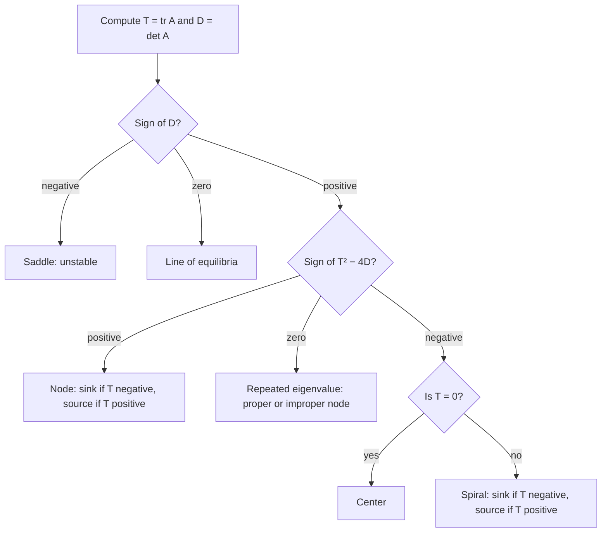

## Rotation in the phase plane

When the characteristic equation $\lambda^2 - (\operatorname{tr}A)\lambda + \det A = 0$ has a
negative discriminant, the eigenvalues are complex: $\lambda = \alpha \pm i\beta$. Just as complex
characteristic roots gave oscillations in Lesson 20, complex eigenvalues make trajectories
rotate around the origin. This lesson handles that case and the borderline case of a
repeated eigenvalue, then collects all cases into one classification chart.

## Complex eigenvalues

Find a complex eigenvector $\mathbf{v} = \mathbf{a} + i\mathbf{b}$ for $\lambda = \alpha + i\beta$. The complex
solution $e^{\lambda t}\mathbf{v}$ expands by Euler's formula:

$$e^{\alpha t}(\cos\beta t + i\sin\beta t)(\mathbf{a} + i\mathbf{b}) = e^{\alpha t}\big(\mathbf{a}\cos\beta t - \mathbf{b}\sin\beta t\big) + ie^{\alpha t}\big(\mathbf{a}\sin\beta t + \mathbf{b}\cos\beta t\big).$$

Since $A$ is real, the real and imaginary parts are each real solutions, and they are
independent. So

$$\mathbf{x} = c_1e^{\alpha t}\big(\mathbf{a}\cos\beta t - \mathbf{b}\sin\beta t\big) + c_2e^{\alpha t}\big(\mathbf{a}\sin\beta t + \mathbf{b}\cos\beta t\big).$$

The conjugate eigenvalue gives nothing new.

### Example 1

Solve $\mathbf{x}' = \begin{bmatrix} -1 & -4 \\ 1 & -1 \end{bmatrix}\mathbf{x}$.

- Trace $-2$, det $1 + 4 = 5$: $\lambda^2 + 2\lambda + 5 = 0$, $\lambda = -1 \pm 2i$.
- For $\lambda = -1 + 2i$: $A - \lambda I = \begin{bmatrix} -2i & -4 \\ 1 & -2i \end{bmatrix}$. Second row:
  $v_1 - 2iv_2 = 0$, so take $v_2 = 1$, $v_1 = 2i$: $\mathbf{v} = \begin{bmatrix} 2i \\ 1 \end{bmatrix} = \begin{bmatrix} 0 \\ 1 \end{bmatrix} + i\begin{bmatrix} 2 \\ 0 \end{bmatrix}$.
- So $\mathbf{a} = (0, 1)$, $\mathbf{b} = (2, 0)$, $\alpha = -1$, $\beta = 2$:

$$\mathbf{x} = c_1e^{-t}\begin{bmatrix} -2\sin 2t \\ \cos 2t \end{bmatrix} + c_2e^{-t}\begin{bmatrix} 2\cos 2t \\ \sin 2t \end{bmatrix}.$$

The factor $e^{-t}$ shrinks the trajectories as they rotate: they spiral into the origin.

```plot
{"x": [-3, 3], "y": [-2, 2], "xLabel": "x₁", "yLabel": "x₂", "equal": true, "vectorField": {"u": "-x - 4y", "v": "x - y", "step": 0.4}, "curves": [{"x": "-4exp(-t)*sin(2t)", "y": "2exp(-t)*cos(2t)", "t": [-0.2, 8]}, {"x": "2.6exp(-t)*cos(2t)", "y": "1.3exp(-t)*sin(2t)", "t": [-0.1, 8]}], "caption": "Spiral sink for Example 1 (α = −1 < 0): trajectories rotate counterclockwise while shrinking."}
```

### Direction and shape

- $\alpha < 0$: **spiral sink**, asymptotically stable.
- $\alpha > 0$: **spiral source**, unstable.
- $\alpha = 0$ (purely imaginary eigenvalues): closed elliptical orbits around the origin, a
  **center**. It's stable (solutions stay close) but not asymptotically stable (they don't
  approach). The undamped spring is a center.

Rotation direction: compute the velocity $A\mathbf{x}$ at a convenient point such as $(1, 0)$.
In Example 1, $A(1, 0) = (-1, 1)$, which points up: counterclockwise.

### Example 2

The spring $u'' + 4u = 0$ as a system ($x_1 = u$, $x_2 = u'$): $A = \begin{bmatrix} 0 & 1 \\ -4 & 0 \end{bmatrix}$,
eigenvalues $\pm 2i$. A center; trajectories are ellipses $4x_1^2 + x_2^2 = C$ (energy is conserved).
At $(1, 0)$ the velocity is $(0, -4)$: clockwise.

## Repeated eigenvalues

If $(\operatorname{tr}A)^2 = 4\det A$, there's one eigenvalue $\lambda$ (repeated). Two cases:

- **Two independent eigenvectors.** That only happens when $A = \lambda I$. Then every vector is
  an eigenvector, $\mathbf{x} = e^{\lambda t}\mathbf{x}_0$, and trajectories are rays: a **proper node**
  (or star).
- **One eigenvector $\mathbf{v}$** (the usual case). One solution is $e^{\lambda t}\mathbf{v}$. By analogy
  with $te^{rt}$, try a second of the form $\mathbf{x} = te^{\lambda t}\mathbf{v} + e^{\lambda t}\mathbf{w}$. Substituting
  shows this works when

  $$(A - \lambda I)\mathbf{w} = \mathbf{v}.$$

  Such a $\mathbf{w}$ is a **generalized eigenvector**. The general solution is

  $$\mathbf{x} = c_1e^{\lambda t}\mathbf{v} + c_2e^{\lambda t}(t\mathbf{v} + \mathbf{w}).$$

  The origin is an **improper node** (or degenerate node): stable if $\lambda < 0$, unstable if
  $\lambda > 0$. All trajectories become tangent to the single eigenvector line.

### Example 3

Solve $\mathbf{x}' = \begin{bmatrix} 1 & -1 \\ 1 & 3 \end{bmatrix}\mathbf{x}$.

- Trace 4, det $3 + 1 = 4$: $(\lambda - 2)^2 = 0$, $\lambda = 2$.
- $A - 2I = \begin{bmatrix} -1 & -1 \\ 1 & 1 \end{bmatrix}$: $\mathbf{v} = (1, -1)$.
- Solve $(A - 2I)\mathbf{w} = \mathbf{v}$: $-w_1 - w_2 = 1$. Take $w_1 = 0$, $w_2 = -1$: $\mathbf{w} = (0, -1)$.
- $\mathbf{x} = c_1e^{2t}\begin{bmatrix} 1 \\ -1 \end{bmatrix} + c_2e^{2t}\left(t\begin{bmatrix} 1 \\ -1 \end{bmatrix} + \begin{bmatrix} 0 \\ -1 \end{bmatrix}\right)$.
  Unstable improper node.

The pictures below collect the new portrait types from this lesson. (The improper node shown
is a stable one; an unstable one looks the same with the arrows reversed.)


## The trace–determinant chart

With $T = \operatorname{tr}A$ and $D = \det A$, the eigenvalues are $\dfrac{T \pm \sqrt{T^2 - 4D}}{2}$, so $T$
and $D$ alone decide the type of the origin:

| Region | Type |
|---|---|
| $D < 0$ | saddle (unstable) |
| $D > 0$, $T^2 > 4D$ | node: sink if $T < 0$, source if $T > 0$ |
| $D > 0$, $T^2 < 4D$ | spiral: sink if $T < 0$, source if $T > 0$; center if $T = 0$ |
| $D > 0$, $T^2 = 4D$ | repeated eigenvalue: proper or improper node |
| $D = 0$ | a line of equilibria (degenerate) |

```plot
{"x": [-5, 5], "y": [-3, 8], "xLabel": "T = tr A", "yLabel": "D = det A", "functions": [{"f": "x^2/4", "label": "T² = 4D"}], "labels": [{"at": [0, -1.5], "text": "saddles"}, {"at": [-3.4, 1], "text": "nodal sinks"}, {"at": [3.4, 1], "text": "nodal sources"}, {"at": [-1.6, 5], "text": "spiral sinks"}, {"at": [1.6, 5], "text": "spiral sources"}, {"at": [0.3, 7.3], "text": "centers (T = 0)"}], "segments": [{"from": [0, 0], "to": [0, 8], "dashed": true}], "caption": "Trace–determinant plane: the parabola T² = 4D separates nodes from spirals; the region T < 0, D > 0 (upper left) is asymptotically stable."}
```

Asymptotic stability holds exactly when $T < 0$ and $D > 0$: both eigenvalues have negative
real parts.

To classify from $T$ and $D$ step by step, follow the chart:



### Example 4

Classify: (a) $T = -3$, $D = 2$; (b) $T = 2$, $D = 5$; (c) $T = 0$, $D = 9$; (d) $T = 1$, $D = -4$.

- (a) $T^2 = 9 > 8$: nodal sink. (b) $4 < 20$: spiral source. (c) center. (d) saddle.

## Common mistakes

- **Using only the conjugate pair's real part** and forgetting $\mathbf{b}$. Both $\mathbf{a}$ and $\mathbf{b}$ appear.
- **Calling a center asymptotically stable.** Trajectories orbit; they don't approach.
- **Sign of $\mathbf{w}$'s equation.** It's $(A - \lambda I)\mathbf{w} = \mathbf{v}$, not $= \mathbf{0}$.
- **Rotation direction by guesswork.** Check the velocity at $(1, 0)$.

## Key points

- Complex $\alpha \pm i\beta$: real and imaginary parts of $e^{\lambda t}(\mathbf{a} + i\mathbf{b})$; spiral sink
  ($\alpha < 0$), spiral source ($\alpha > 0$) or center ($\alpha = 0$).
- Repeated $\lambda$ with one eigenvector: $\mathbf{x} = c_1e^{\lambda t}\mathbf{v} + c_2e^{\lambda t}(t\mathbf{v} + \mathbf{w})$,
  $(A - \lambda I)\mathbf{w} = \mathbf{v}$.
- Trace–determinant: $D < 0$ saddle; $T^2 - 4D$ separates nodes from spirals; stable iff
  $T < 0 < D$.
