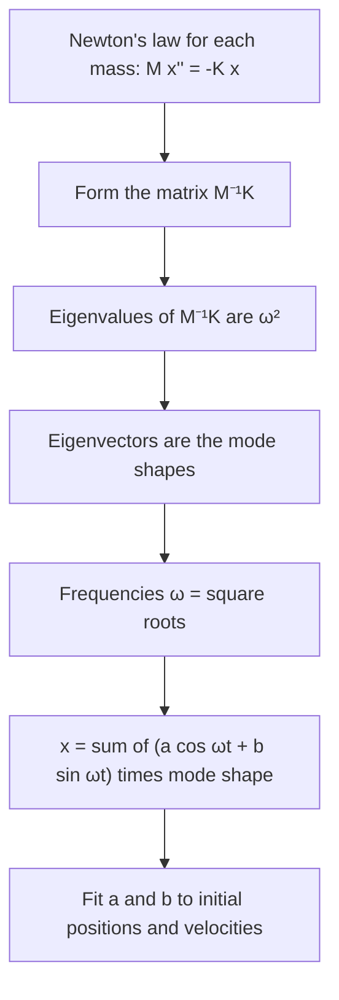

## Two springs that talk to each other

In Lesson 24 a single mass on a spring oscillated at its natural frequency
$\omega_0 = \sqrt{k/m}$. In Lesson 33 we saw that such an equation can be rewritten as a
first-order system, and in Lessons 34 and 35 that eigenvalues and eigenvectors describe
everything a linear system does. This honors lesson brings the two threads together for
**coupled oscillators**: several masses joined by springs, so that each one pushes and pulls
on the others. Molecules vibrating, the floors of a building swaying in an earthquake, and
two pendulums hanging from the same beam all work this way.

The surprise is that the messy-looking motion of a coupled system is always a sum of a few
very simple motions, the normal modes, in which every mass oscillates at the *same*
frequency. Finding them is an eigenvalue problem.

## Setting up the equations

Put two masses $m_1$ and $m_2$ on a frictionless track between two walls, joined by three
springs as in the picture: $k_1$ from the left wall to $m_1$, the coupling spring $k_2$
between the masses, and $k_3$ from $m_2$ to the right wall. Let $x_1$ and $x_2$ be the
displacements from equilibrium, positive to the right.


Each spring pulls with Hooke's law, force $= k \times$ stretch. Spring $k_2$ is stretched by
$x_2 - x_1$, so it pulls $m_1$ to the right with force $k_2(x_2 - x_1)$ and pulls $m_2$ to the
left with the same force. Newton's second law for each mass gives

$$m_1x_1'' = -k_1x_1 + k_2(x_2 - x_1), \qquad m_2x_2'' = -k_2(x_2 - x_1) - k_3x_2.$$

In matrix form, with $\mathbf{x} = (x_1, x_2)$,

$$M\mathbf{x}'' = -K\mathbf{x}, \qquad M = \begin{bmatrix} m_1 & 0 \\ 0 & m_2 \end{bmatrix}, \quad K = \begin{bmatrix} k_1 + k_2 & -k_2 \\ -k_2 & k_2 + k_3 \end{bmatrix}.$$

$M$ is the mass matrix and $K$ is the **stiffness matrix**. Notice that $K$ is symmetric: the
coupling spring pulls on each mass equally (Newton's third law). We could convert this to
four first-order equations as in Lesson 33, but the second-order form leads to a smaller
eigenvalue problem.

## The eigenvalue problem for frequencies

Look for a solution in which both masses move in step at one frequency $\omega$:

$$\mathbf{x}(t) = \cos(\omega t)\,\mathbf{v}.$$

Then $\mathbf{x}'' = -\omega^2\cos(\omega t)\,\mathbf{v}$, and $M\mathbf{x}'' = -K\mathbf{x}$ becomes
$\omega^2M\mathbf{v} = K\mathbf{v}$. Multiplying by $M^{-1}$:

$$\big(M^{-1}K\big)\mathbf{v} = \omega^2\mathbf{v}.$$

So the *squares* of the frequencies are the eigenvalues of $M^{-1}K$, and each eigenvector
$\mathbf{v}$ is a **mode shape**: it says how far, and in which direction, each mass moves
relative to the others in that mode. A solution $\cos(\omega t)\mathbf{v}$ or
$\sin(\omega t)\mathbf{v}$ is called a normal mode, the same idea as the standing waves of a
string in Lesson 40, but with finitely many masses.

Why are the eigenvalues positive, so that $\omega$ is real? For two masses,

$$M^{-1}K = \begin{bmatrix} \frac{k_1 + k_2}{m_1} & -\frac{k_2}{m_1} \\[2pt] -\frac{k_2}{m_2} & \frac{k_2 + k_3}{m_2} \end{bmatrix}.$$

Its discriminant $T^2 - 4D$ works out to $\left(\frac{k_1 + k_2}{m_1} - \frac{k_2 + k_3}{m_2}\right)^2 + \frac{4k_2^2}{m_1m_2} \ge 0$,
so the eigenvalues are real. Its trace is positive and its determinant is
$\dfrac{k_1k_2 + k_1k_3 + k_2k_3}{m_1m_2} > 0$, so both eigenvalues are positive. (For any
number of masses in a chain attached to at least one wall the same holds, because the spring energy $\tfrac12\mathbf{x}^{T}K\mathbf{x}$ is
positive for every nonzero displacement; we state that general fact without proof.)

Since each frequency comes with a cosine and a sine, the general solution for two masses is

$$\mathbf{x}(t) = \big(a_1\cos\omega_1t + b_1\sin\omega_1t\big)\mathbf{v}_1 + \big(a_2\cos\omega_2t + b_2\sin\omega_2t\big)\mathbf{v}_2,$$

with four constants for the four initial conditions (two positions, two velocities).
In first-order form the four eigenvalues are $\pm i\omega_1$ and $\pm i\omega_2$, all purely
imaginary, just like the center of Lesson 35: without friction, nothing decays.



### Example 1: identical masses and springs

Take $m_1 = m_2 = 1$ kg and $k_1 = k_2 = k_3 = 4$ N/m. Then
$M^{-1}K = \begin{bmatrix} 8 & -4 \\ -4 & 8 \end{bmatrix}$.

- Trace 16, determinant $64 - 16 = 48$: $\lambda^2 - 16\lambda + 48 = (\lambda - 4)(\lambda - 12) = 0$.
- $\omega^2 = 4$: $(M^{-1}K - 4I)\mathbf{v} = \mathbf{0}$ has first row $4v_1 - 4v_2 = 0$, so $\mathbf{v}_1 = (1, 1)$.
  Frequency $\omega_1 = 2$ rad/s.
- $\omega^2 = 12$: first row $-4v_1 - 4v_2 = 0$, so $\mathbf{v}_2 = (1, -1)$. Frequency
  $\omega_2 = \sqrt{12} = 2\sqrt3 \approx 3.46$ rad/s.

The physics explains both numbers. In the **in-phase mode** $(1, 1)$ the masses move together,
the coupling spring never stretches, and each mass feels only its own wall spring:
$\omega = \sqrt{4/1} = 2$, the single-spring frequency. In the **out-of-phase mode** $(1, -1)$
the masses move in opposite directions, the coupling spring stretches by twice each
displacement, and each mass feels an extra restoring force, so the frequency is higher:
$\omega^2 = (4 + 2 \cdot 4)/1 = 12$.

### Example 2: release one mass

Same system. Pull $m_1$ one unit to the right, hold $m_2$ at equilibrium, and release both
from rest: $\mathbf{x}(0) = (1, 0)$, $\mathbf{x}'(0) = (0, 0)$.

- Zero initial velocity kills the sine terms ($b_1 = b_2 = 0$).
- At $t = 0$: $a_1(1, 1) + a_2(1, -1) = (1, 0)$, so $a_1 + a_2 = 1$ and $a_1 - a_2 = 0$:
  $a_1 = a_2 = \tfrac12$.
- $x_1 = \tfrac12\big(\cos 2t + \cos 2\sqrt3\,t\big)$ and $x_2 = \tfrac12\big(\cos 2t - \cos 2\sqrt3\,t\big)$.

Each mass moves as a mixture of the two frequencies. Because $2\sqrt3/2 = \sqrt3$ is
irrational, the motion never exactly repeats: a sum of two periodic motions is periodic only
when the ratio of their frequencies is rational.

## Decoupling with modal coordinates

For Example 1 the equations are $x_1'' = -8x_1 + 4x_2$ and $x_2'' = 4x_1 - 8x_2$. Add them and
subtract them:

$$(x_1 + x_2)'' = -4(x_1 + x_2), \qquad (x_1 - x_2)'' = -12(x_1 - x_2).$$

The new unknowns $q_1 = x_1 + x_2$ and $q_2 = x_1 - x_2$ each satisfy a single spring equation
$q'' + \omega^2q = 0$ that has nothing to do with the other. Such variables are called
**modal coordinates**. In general, writing $\mathbf{x} = V\mathbf{q}$, where the columns of $V$ are
the mode shapes, turns $\mathbf{x}'' = -M^{-1}K\mathbf{x}$ into $\mathbf{q}'' = -\Lambda\mathbf{q}$ with
$\Lambda$ diagonal. This is the idea behind the modal analysis engineers use for bridges,
aircraft wings and buildings: a structure with thousands of parts is understood one mode
at a time.

### Example 3: a two-story building

A simple model of a two-story building treats each floor as a rigid mass $m$ and the
columns of each story as a spring of stiffness $k$ (a simplified "shear building" with no
damping). The ground floor's columns connect floor 1 to the ground; the second story's
columns connect floor 2 to floor 1, and nothing is above floor 2. Then

$$mx_1'' = -kx_1 + k(x_2 - x_1), \qquad mx_2'' = -k(x_2 - x_1),$$

so $M^{-1}K = \dfrac{k}{m}\begin{bmatrix} 2 & -1 \\ -1 & 1 \end{bmatrix}$. Take $k/m = 100\ \text{s}^{-2}$.

- The matrix $\begin{bmatrix} 2 & -1 \\ -1 & 1 \end{bmatrix}$ has trace 3 and determinant 1, so its
  eigenvalues are $\mu = \frac{3 \pm \sqrt5}{2}$, about $0.382$ and $2.618$.
- Frequencies: $\omega = 10\sqrt{\mu}$, about $6.18$ and $16.18$ rad/s (about $0.98$ and
  $2.58$ cycles per second).
- Mode shapes from the first row $(2 - \mu)v_1 - v_2 = 0$: $\mathbf{v} = (1, 2 - \mu)$, which gives
  $(1, 1.618)$ for the slow mode and $(1, -0.618)$ for the fast one.

In the slow mode both floors sway the same way, the top one about 1.6 times as far. In the
fast mode they move in opposite directions. Ground shaking near either frequency would
cause resonance (Lesson 25), which is why engineers compute these modes before building.

## Weak coupling: energy that moves back and forth

Make the coupling spring much weaker than the others: $k_1 = k_3 = k$ and $k_2 = \kappa$ with
$\kappa$ small, equal masses $m$. The modes are still $(1, 1)$ and $(1, -1)$, now with

$$\omega_1 = \sqrt{k/m}, \qquad \omega_2 = \sqrt{(k + 2\kappa)/m},$$

two frequencies that are close together. Releasing $m_1$ from $x_1 = 1$ as in Example 2 gives
$x_1 = \tfrac12(\cos\omega_1t + \cos\omega_2t)$, and the sum-to-product identities turn this into

$$x_1 = \cos\!\Big(\frac{\omega_2 - \omega_1}{2}t\Big)\cos\!\Big(\frac{\omega_1 + \omega_2}{2}t\Big), \qquad x_2 = \sin\!\Big(\frac{\omega_2 - \omega_1}{2}t\Big)\sin\!\Big(\frac{\omega_1 + \omega_2}{2}t\Big).$$

These are beats (Lesson 25). Each mass oscillates quickly inside a slowly changing envelope,
and the envelopes are out of step: when mass 1's envelope reaches zero, mass 2's is at its
largest. All the motion passes from one mass to the other, and back, over and over. The first
complete hand-off happens when $\frac{\omega_2 - \omega_1}{2}t = \frac{\pi}{2}$, at

$$t = \frac{\pi}{\omega_2 - \omega_1}.$$

### Example 4

With $m = 1$ kg, $k = 1$ N/m and $\kappa = 0.05$ N/m: $\omega_1 = 1$ and $\omega_2 = \sqrt{1.1} \approx 1.0488$
rad/s. Mass 1 is almost still (its envelope is zero), with nearly all the motion in mass 2, at
$t = \pi/0.0488 \approx 64.4$ s, and the motion is back in mass 1 at about $128.7$ s.

```plot
{"x": [0, 135], "y": [-1.2, 1.2], "xLabel": "t (s)", "yLabel": "x₁", "functions": [{"f": "0.5*(cos(x) + cos(1.0488088*x))"}, {"f": "cos(0.0244044*x)", "dashed": true}, {"f": "-cos(0.0244044*x)", "dashed": true}], "caption": "Mass 1 in Example 4: fast oscillation inside a slow envelope (dashed) that reaches zero near t = 64 s."}
```

```plot
{"x": [0, 135], "y": [-1.2, 1.2], "xLabel": "t (s)", "yLabel": "x₂", "functions": [{"f": "0.5*(cos(x) - cos(1.0488088*x))"}, {"f": "sin(0.0244044*x)", "dashed": true}, {"f": "-sin(0.0244044*x)", "dashed": true}], "caption": "Mass 2 in Example 4: it starts at rest and holds all the motion near t = 64 s."}
```

The same slow exchange shows up in two pendulums hanging from a slightly flexible beam and
in the Wilberforce pendulum, a weight on a spring whose bouncing and twisting motions trade
energy back and forth.

## Common mistakes

- **Using $\omega$ for the eigenvalue.** The eigenvalues of $M^{-1}K$ are $\omega^2$; take square
  roots to get the frequencies.
- **Forgetting the masses.** With unequal masses the eigenvalues belong to $M^{-1}K$, not to
  $K$: divide each row of $K$ by its mass.
- **Sign of the coupling term.** The stretch of the middle spring is $x_2 - x_1$, so the
  off-diagonal entries of $K$ are $-k_2$; diagonal entries add every spring touching that mass.
- **Assuming the motion is periodic.** A mixture of two modes repeats only if
  $\omega_2/\omega_1$ is rational.
- **Radians versus cycles.** $\omega$ is in rad/s; divide by $2\pi$ for cycles per second (Hz).

## Key points

- Masses and springs give $M\mathbf{x}'' = -K\mathbf{x}$ with a symmetric stiffness matrix $K$.
- Trying $\cos(\omega t)\mathbf{v}$ gives $M^{-1}K\mathbf{v} = \omega^2\mathbf{v}$: eigenvalues are squared
  frequencies, eigenvectors are mode shapes.
- The general motion is a sum of normal modes, with two constants per mode.
- Modal coordinates turn the coupled system into separate single-spring equations.
- Weak coupling gives two close frequencies, beats, and a complete transfer of motion every
  $\pi/(\omega_2 - \omega_1)$.
