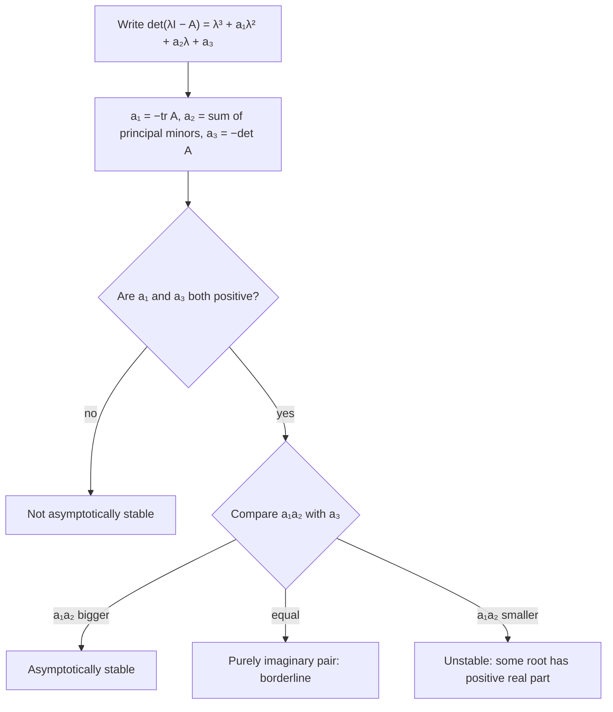

## Beyond two dimensions

Lessons 33 to 35 worked with $2 \times 2$ systems, where the trace and determinant decide
everything and a phase portrait fits on a page. Real models are often bigger: a drug moving
from the gut to the blood to the tissues, three tanks in a row, a third-order equation, the
loops of a feedback controller. This honors lesson shows that the eigenvalue method carries
over to $n \times n$ systems unchanged, and then answers the question engineers care about most:
*is the equilibrium stable?* For large systems that question has a famous shortcut, the
Routh–Hurwitz test, which decides stability from the coefficients of the characteristic
polynomial without finding a single root.

## The eigenvalue method for $n$ unknowns

For $\mathbf{x}' = A\mathbf{x}$ with a constant $n \times n$ matrix $A$, the argument of Lesson 33 works
word for word: $e^{\lambda t}\mathbf{v}$ is a solution exactly when $A\mathbf{v} = \lambda\mathbf{v}$. The
eigenvalues are the roots of the degree-$n$ characteristic polynomial $\det(\lambda I - A)$. If
$A$ has $n$ independent eigenvectors (always true when the eigenvalues are distinct), then

$$\mathbf{x}(t) = c_1e^{\lambda_1t}\mathbf{v}_1 + c_2e^{\lambda_2t}\mathbf{v}_2 + \cdots + c_ne^{\lambda_nt}\mathbf{v}_n.$$

Complex pairs are handled as in Lesson 35 (real and imaginary parts), and missing
eigenvectors bring in terms like $te^{\lambda t}$.

For a $3 \times 3$ matrix the characteristic polynomial can be written from three numbers:

$$\det(\lambda I - A) = \lambda^3 - (\operatorname{tr}A)\lambda^2 + E_2\lambda - \det A,$$

where $E_2$ is the sum of the three $2 \times 2$ **principal minors** (the determinants left after
deleting row $i$ and column $i$, for $i = 1, 2, 3$). Comparing with
$(\lambda - \lambda_1)(\lambda - \lambda_2)(\lambda - \lambda_3)$ shows two facts that hold for every $n$:
the eigenvalues add up to the trace and multiply to the determinant.

## Stability in any dimension

Each term $c_ie^{\lambda_it}\mathbf{v}_i$ decays exactly when $\operatorname{Re}\lambda_i < 0$, and an
extra factor $t$ or $t^2$ can't stop $e^{\lambda t}$ from decaying when the real part is
negative. So:

**The origin of $\mathbf{x}' = A\mathbf{x}$ is asymptotically stable exactly when every eigenvalue of
$A$ has a negative real part.** If any eigenvalue has a positive real part, it is unstable.

For $n = 2$ this is the rule "$T < 0$ and $D > 0$" from Lesson 35. In the long run, the
eigenvalue with the largest real part, the **dominant eigenvalue**, controls how fast
solutions die out (or blow up): every other term fades relative to it.

### Example 1: three tanks in a chain

Pure water flows at 10 L/min into tank 1 (50 L), from tank 1 into tank 2 (100 L), from tank 2
into tank 3 (200 L), and out of tank 3. Tank 1 starts with 100 g of salt; the others start
with none.


Each tank loses salt at (flow ÷ volume) × amount, and gains what the tank before it loses:

$$Q_1' = -0.2Q_1, \qquad Q_2' = 0.2Q_1 - 0.1Q_2, \qquad Q_3' = 0.1Q_2 - 0.05Q_3.$$

This is a compartment model: amounts of something moving between well-mixed boxes.

- The matrix is lower triangular, so its eigenvalues are the diagonal entries $-0.2$, $-0.1$,
  $-0.05$. All negative: the salt washes out.
- A triangular system can also be solved one equation at a time. $Q_1 = 100e^{-0.2t}$.
  Then $Q_2' + 0.1Q_2 = 20e^{-0.2t}$, and undetermined coefficients with $Q_2(0) = 0$ give
  $Q_2 = 200\big(e^{-0.1t} - e^{-0.2t}\big)$.
- Likewise $Q_3 = \tfrac{800}{3}e^{-0.05t} - 400e^{-0.1t} + \tfrac{400}{3}e^{-0.2t}$, which you can
  check satisfies $Q_3' = 0.1Q_2 - 0.05Q_3$ and $Q_3(0) = 0$.
- Tank 2 peaks when $Q_2' = 0$: $0.1e^{-0.1t} = 0.2e^{-0.2t}$, so $e^{0.1t} = 2$ and
  $t = 10\ln2 \approx 6.9$ min, with $Q_2 = 50$ g.

```plot
{"x": [0, 90], "y": [0, 105], "xLabel": "t (min)", "yLabel": "salt (g)", "functions": [{"f": "100*exp(-0.2*x)"}, {"f": "200*(exp(-0.1*x) - exp(-0.2*x))", "dashed": true}, {"f": "800/3*exp(-0.05*x) - 400*exp(-0.1*x) + 400/3*exp(-0.2*x)"}], "labels": [{"at": [5, 78], "text": "Q₁"}, {"at": [15, 52], "text": "Q₂ (dashed)"}, {"at": [46, 34], "text": "Q₃"}], "caption": "Salt in the three tanks of Example 1. Each tank peaks later than the one before it; the slow eigenvalue −0.05 of the big tank sets the tail."}
```

After an hour, almost all the salt left is in tank 3, decaying like $e^{-0.05t}$: the dominant
eigenvalue $-0.05$ belongs to the largest, slowest tank. The first two links of such a chain,
with the gut and the blood as compartments, are the standard simplified model for how a
drug taken by mouth rises and then falls in the blood.

### Example 2: a third-order equation

The equation $y''' + 6y'' + 11y' + 6y = 0$ becomes a system with $x_1 = y$, $x_2 = y'$,
$x_3 = y''$:

$$A = \begin{bmatrix} 0 & 1 & 0 \\ 0 & 0 & 1 \\ -6 & -11 & -6 \end{bmatrix}.$$

- Trace $-6$. The principal minors: deleting row and column 1 leaves
  $\begin{vmatrix} 0 & 1 \\ -11 & -6 \end{vmatrix} = 11$; deleting row and column 2 leaves
  $\begin{vmatrix} 0 & 0 \\ -6 & -6 \end{vmatrix} = 0$; deleting row and column 3 leaves
  $\begin{vmatrix} 0 & 1 \\ 0 & 0 \end{vmatrix} = 0$. So $E_2 = 11$.
- $\det A = -6$, so $\det(\lambda I - A) = \lambda^3 + 6\lambda^2 + 11\lambda + 6$: exactly the
  characteristic polynomial of the ODE, as in Lesson 33.
- It factors as $(\lambda + 1)(\lambda + 2)(\lambda + 3)$. Eigenvectors of this kind of matrix are
  $(1, \lambda, \lambda^2)$, so $\mathbf{v} = (1, -1, 1)$, $(1, -2, 4)$, $(1, -3, 9)$, and
  $y = c_1e^{-t} + c_2e^{-2t} + c_3e^{-3t}$. Stable.

## The Routh–Hurwitz test

For a big system, factoring the characteristic polynomial is hard, but often we only need
to know whether all roots lie in the left half-plane. In 1868 James Clerk Maxwell asked this
question about the governors that regulated steam engines. Edward Routh answered it in
general in 1877, and Adolf Hurwitz found an equivalent test independently in 1895. For degree
two and three the **Routh–Hurwitz criterion** reads:

| Polynomial (leading coefficient 1) | All roots have negative real part exactly when |
|---|---|
| $\lambda^2 + a_1\lambda + a_2$ | $a_1 > 0$ and $a_2 > 0$ |
| $\lambda^3 + a_1\lambda^2 + a_2\lambda + a_3$ | $a_1 > 0$, $a_3 > 0$ and $a_1a_2 > a_3$ |

For a $2 \times 2$ matrix, $a_1 = -T$ and $a_2 = D$, so this is the familiar $T < 0 < D$. For a
$3 \times 3$ matrix, $a_1 = -\operatorname{tr}A$, $a_2 = E_2$ and $a_3 = -\det A$. (The conditions
for degree 3 force $a_2 > 0$ too.)

**Why positive coefficients are needed.** If every root has negative real part, the
polynomial is a product of factors $(\lambda + r)$ with $r > 0$ and
$(\lambda^2 + 2s\lambda + s^2 + w^2)$ with $s > 0$, and multiplying such factors gives only
positive coefficients. For degree 3 that is not enough: $\lambda^3 + \lambda^2 + \lambda + 2$ has all
coefficients positive, but $1 \cdot 1 < 2$, and indeed two of its roots are about
$0.18 \pm 1.20i$.

**Where $a_1a_2 > a_3$ comes from (a sketch, not a full proof).** Roots move continuously as
the coefficients change, so a root can only cross from the left half-plane to the right
through the imaginary axis. A crossing at $\lambda = 0$ needs $a_3 = 0$. A crossing at
$\lambda = i\omega$ with $\omega > 0$ needs
$p(i\omega) = (a_3 - a_1\omega^2) + i\omega(a_2 - \omega^2) = 0$, so $\omega^2 = a_2$ and $a_3 = a_1a_2$.
Indeed, when $a_3 = a_1a_2$ the polynomial factors as $(\lambda + a_1)(\lambda^2 + a_2)$, with roots
$\pm i\sqrt{a_2}$ on the axis. Between these boundaries the answer can't change, and testing
one point, $(\lambda + 1)^3 = \lambda^3 + 3\lambda^2 + 3\lambda + 1$ with $9 > 1$, shows the side with
$a_1a_2 > a_3$ is the stable one.



### Example 3: three blocks exchanging heat

Three blocks sit in a row. Each exchanges heat with its neighbors, and the two end blocks also
lose heat to surroundings held at 0°. With suitable units the temperatures satisfy
$\mathbf{x}' = A\mathbf{x}$ with

$$A = \begin{bmatrix} -2 & 1 & 0 \\ 1 & -2 & 1 \\ 0 & 1 & -2 \end{bmatrix}.$$

- $\operatorname{tr}A = -6$, so $a_1 = 6$.
- Principal minors: $(-2)(-2) - 1 = 3$, $(-2)(-2) - 0 = 4$, and $3$ again, so $a_2 = 10$.
- $\det A = -2(4 - 1) - 1(-2 - 0) = -4$, so $a_3 = 4$.
- $a_1, a_3 > 0$ and $a_1a_2 = 60 > 4$: asymptotically stable, as physics says it must be.

The eigenvalues are in fact $-2$ and $-2 \pm \sqrt2$. The dominant one, $-2 + \sqrt2 \approx -0.59$,
has eigenvector $(1, \sqrt2, 1)$: in the long run the middle block stays the warmest, a
discrete version of the slowest mode of the heat equation in Lesson 40.

### Example 4: how strong can feedback be?

A simplified linear model of a gene that switches itself off through two intermediate steps
has $x_1' = -x_1 - kx_3$, $x_2' = x_1 - x_2$, $x_3' = x_2 - x_3$, where $k$ measures the strength
of the negative feedback. Expanding $\det(\lambda I - A)$ along the first row gives

$$(\lambda + 1)^3 + k = \lambda^3 + 3\lambda^2 + 3\lambda + (1 + k).$$

- Routh–Hurwitz: $a_1 = 3 > 0$, $a_3 = 1 + k > 0$, and $3 \cdot 3 > 1 + k$. So the steady state
  is stable exactly when $-1 < k < 8$.
- At $k = 8$: $(\lambda + 1)^3 = -8$ gives $\lambda = -3$ and $\lambda = \pm i\sqrt3$, so oscillations
  of period $2\pi/\sqrt3 \approx 3.6$ time units appear.
- For $k > 8$ the complex pair has a positive real part and the oscillations grow. In real,
  nonlinear systems the growth is eventually limited, and the result is often a steady
  cycle; the linear model only tells us where the steady state stops being stable.

Strong delayed negative feedback causing oscillation is a general lesson, seen in
thermostats, economic cycles and biological clocks.

## Common mistakes

- **Using the $2 \times 2$ rule in three dimensions.** For a stable $3 \times 3$ matrix the
  determinant is *negative* (the product of three numbers with negative real parts), and
  the trace is negative.
- **Stopping at positive coefficients.** For degree 3 you must also check $a_1a_2 > a_3$.
- **Forgetting to make the leading coefficient 1** (or at least positive) before applying the
  test.
- **Reading eigenvalues off the diagonal** of a matrix that is not triangular.
- **Sign errors in $\det(\lambda I - A)$.** Its coefficients are $-\operatorname{tr}A$, $E_2$ and
  $-\det A$; for $\det(A - \lambda I)$ every sign flips when $n$ is odd.

## Key points

- $n \times n$ systems: $\mathbf{x} = \sum c_ie^{\lambda_it}\mathbf{v}_i$ when there are $n$ independent eigenvectors.
- Asymptotically stable exactly when every eigenvalue has negative real part; the dominant
  eigenvalue controls the long-run rate.
- $3 \times 3$: $\det(\lambda I - A) = \lambda^3 - (\operatorname{tr}A)\lambda^2 + E_2\lambda - \det A$.
- Routh–Hurwitz for $\lambda^3 + a_1\lambda^2 + a_2\lambda + a_3$: stable exactly when $a_1 > 0$,
  $a_3 > 0$ and $a_1a_2 > a_3$.
- At $a_1a_2 = a_3$ a pair of roots sits at $\pm i\sqrt{a_2}$: the threshold where oscillations begin.
