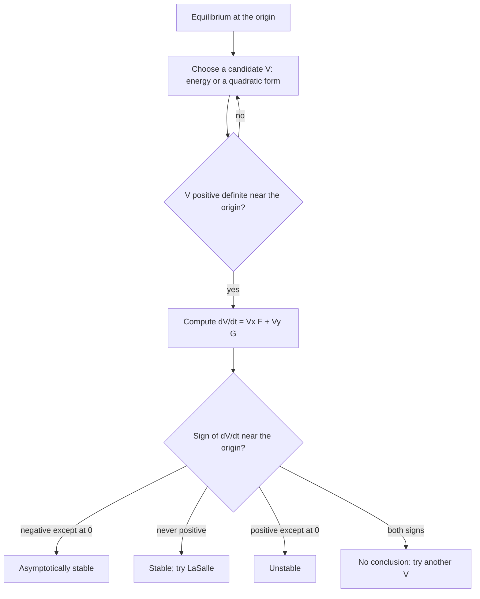

## Stability without solving

Lesson 37 left one case open: when the Jacobian has purely imaginary (or zero) eigenvalues,
the nonlinear terms decide, and linearization can't say which way. For Lotka–Volterra and the
undamped pendulum a **conserved quantity** rescued us. This honors lesson turns that rescue into
a general method.

A marble rolling in a bowl with friction keeps losing energy, so it ends up at the bottom; we
know that without solving its equations of motion. In 1892 Aleksandr Lyapunov made this
precise for any system, with an "energy-like" function in place of energy. His **direct method**
decides stability from one function and its rate of change, with no solutions needed.

## Two kinds of stability

Shift the equilibrium to the origin first ($u = x - x_0$, $v = y - y_0$, as in Lesson 37).

- The origin is **Lyapunov stable** if solutions that start close stay close: for every
  $\varepsilon > 0$ there is a $\delta > 0$ such that every solution starting within $\delta$ of the
  origin stays within $\varepsilon$ of it for all $t \ge 0$.
- It is asymptotically stable if it is Lyapunov stable and, in addition, every solution that
  starts close enough tends to the origin as $t \to \infty$.

A center (Lesson 35) is stable but not asymptotically stable. (Attracting alone is not
enough: in some unusual systems nearby solutions reach the equilibrium only after a large
excursion.)

## Energy as the model

The damped pendulum $\theta'' + c\theta' + \sin\theta = 0$ ($c > 0$, units scaled so that
$g/L = 1$) becomes $x' = y$, $y' = -\sin x - cy$. Its scaled energy, kinetic plus potential
measured from the bottom, is

$$E(x, y) = \tfrac12y^2 + 1 - \cos x.$$

Along a solution, the chain rule gives

$$\frac{dE}{dt} = E_x\,x' + E_y\,y' = (\sin x)\,y + y(-\sin x - cy) = -cy^2 \le 0.$$

$E > 0$ near the origin except at the origin, and $E$ never increases. A pendulum that starts
near the bottom can never gain enough energy to get far away, so the bottom is stable. This
does not yet prove that it *settles*: $dE/dt = 0$ all along the $x$-axis (the instants when the
pendulum is momentarily at rest), so the energy loss might stall. We return to this below.
(Linearization also works here, but the energy argument never used eigenvalues, and that is
what makes it portable.)

```plot
{"x": [-4, 4], "y": [-2.6, 2.6], "equal": true, "yAxisAt": "left", "xAxisAt": "bottom", "xLabel": "angle x", "yLabel": "angular velocity y", "vectorField": {"u": "y", "v": "-sin(x) - 0.5*y", "step": 0.5}, "curves": [{"x": "2*asin(sqrt(0.25)*sin(t))", "y": "sqrt(1)*cos(t)", "t": [0, "2pi"]}, {"x": "2*asin(sqrt(0.5)*sin(t))", "y": "sqrt(2)*cos(t)", "t": [0, "2pi"]}, {"x": "2*asin(sqrt(0.75)*sin(t))", "y": "sqrt(3)*cos(t)", "t": [0, "2pi"]}, {"x": "2*asin(sin(t))", "y": "2*cos(t)", "t": [0, "2pi"], "dashed": true}], "points": [{"at": [0, 0], "color": "#1c2833"}, {"at": [-3.14159, 0], "open": true, "color": "#c0392b"}, {"at": [3.14159, 0], "open": true, "color": "#c0392b"}], "caption": "Damped pendulum (c = 0.5) with the energy level curves E = 0.5, 1, 1.5 and, dashed, E = 2 through the upright positions (±π, 0). The arrows cross every level curve inward or along it, never outward."}
```

## The derivative along trajectories

For a system $x' = F(x, y)$, $y' = G(x, y)$ and any differentiable $V(x, y)$, the chain rule gives
the rate of change of $V$ along a solution:

$$\dot V(x, y) = V_x\,F(x, y) + V_y\,G(x, y) = \nabla V \cdot (F, G).$$

This is the **derivative along trajectories**, computed straight from the right-hand sides:
no solution needed. Geometrically, $\nabla V$ points across the level curves of $V$
toward higher values, so $\dot V < 0$ at a point means the flow crosses the level curve there
heading inward, toward lower $V$.

A function $V$ is **positive definite** near the origin if $V(0, 0) = 0$ and $V > 0$ at every other
point of some disk around the origin. Picture its graph as a bowl, with small level curves
nested around the origin.

## Lyapunov's theorem

**Theorem (Lyapunov's direct method).** Let the origin be an equilibrium, and let $V$ be
continuously differentiable and positive definite on a disk $U$ around it.

1. If $\dot V \le 0$ in $U$, the origin is Lyapunov stable.
2. If $\dot V < 0$ in $U$ except at the origin, the origin is asymptotically stable.

Such a $V$ is called a **Lyapunov function** (some books keep the name for case 2).

*Why case 1 holds.* Pick $\varepsilon$ with the $\varepsilon$-disk inside $U$. On the circle of radius
$\varepsilon$, $V$ has a minimum value $m > 0$. Because $V$ is continuous with $V(0, 0) = 0$, some smaller
disk, of radius $\delta$, has $V < m$ throughout. A solution starting in it begins with $V < m$, and
$V$ never increases, so it can never reach the circle, where $V \ge m$.


*Why case 2 holds.* Along a solution $V$ decreases and stays $\ge 0$, so it has a limit $L \ge 0$. If
$L > 0$, the solution stays in a ring around the origin where $\dot V \le -k$ for some $k > 0$, so $V$
would eventually drop below zero: impossible. So $L = 0$, which forces the solution to the origin.

A mirror-image test proves instability: if $V(0, 0) = 0$, $V > 0$ at points arbitrarily close to
the origin, and $\dot V > 0$ except at the origin, then the origin is unstable.

The theorem runs one way only. If your candidate has $\dot V > 0$ somewhere, you have learned
about $V$, not about the system. Converse theorems (José Massera, 1949) say every
asymptotically stable equilibrium of a smooth system has a Lyapunov function, but give no
recipe: finding one is the art.



## Quadratic candidates

Without a physical energy, first try a quadratic form $V = ax^2 + bxy + cy^2$. Completing the
square,

$$V = a\Big(x + \frac{b}{2a}y\Big)^2 + \frac{4ac - b^2}{4a}\,y^2,$$

so $V$ is positive definite exactly when $a > 0$ and $4ac - b^2 > 0$. In matrix form
$V = \mathbf{x}^{T}P\mathbf{x}$ with the symmetric $P = \begin{bmatrix} a & b/2 \\ b/2 & c \end{bmatrix}$, and the
test reads $a > 0$, $\det P > 0$. For a linear system $\mathbf{x}' = A\mathbf{x}$,

$$\dot V = \mathbf{x}'^{T}P\mathbf{x} + \mathbf{x}^{T}P\mathbf{x}' = \mathbf{x}^{T}\big(A^{T}P + PA\big)\mathbf{x},$$

another quadratic form.

### Example 1: choosing the weights

Take $x' = -x + 9y$, $y' = -x - y$ ($T = -2$, $D = 10$, eigenvalues $-1 \pm 3i$: a spiral sink).

- Try circles, $V = x^2 + y^2$: $\dot V = 2x(-x + 9y) + 2y(-x - y) = -2x^2 + 16xy - 2y^2$. At $(1, 1)$
  this is $+12$, so this $V$ proves nothing.
- Try $V = x^2 + wy^2$: $\dot V = -2x^2 + (18 - 2w)xy - 2wy^2$. Choosing $w = 9$ kills the cross term:
  $\dot V = -2x^2 - 18y^2$, negative except at the origin. Asymptotically stable.

In matrix terms, $P = \begin{bmatrix} 1 & 0 \\ 0 & 9 \end{bmatrix}$ gives $A^{T}P + PA = \begin{bmatrix} -2 & 0 \\ 0 & -18 \end{bmatrix}$.

```plot
{"x": [-3.4, 3.4], "y": [-1.5, 1.5], "equal": true, "width": 560, "yAxisAt": "left", "xAxisAt": "bottom", "curves": [{"x": "3*cos(t)", "y": "sin(t)", "t": [0, "2pi"], "color": "#2f855a"}, {"x": "2*cos(t)", "y": "2/3*sin(t)", "t": [0, "2pi"], "color": "#2f855a"}, {"x": "cos(t)", "y": "1/3*sin(t)", "t": [0, "2pi"], "color": "#2f855a"}, {"x": "cos(t)", "y": "sin(t)", "t": [0, "2pi"], "dashed": true, "color": "#1c2833", "label": "circle r = 1"}, {"x": "3*exp(-t)*cos(3*t)", "y": "-exp(-t)*sin(3*t)", "t": [0, 3], "color": "#c0392b"}], "points": [{"at": [3, 0], "label": "start", "color": "#c0392b"}], "caption": "Example 1: the solution from (3, 0) (red) crosses each green ellipse x² + 9y² = constant inward, but it crosses the dashed circle r = 1 three times: in, out, and in again."}
```

The **Lyapunov equation** $A^{T}P + PA = -Q$ reverses the process: pick a positive definite $Q$
(often $I$) and solve three linear equations for $a$, $b$, $c$. A standard theorem: every eigenvalue
of $A$ has negative real part exactly when the equation has a positive definite solution $P$.

Why bother, when eigenvalues already settle linear systems? Because the same $V$ works for a
nonlinear system whose Jacobian is $A$: near the equilibrium the nonlinear terms add only
terms of order three and higher to $\dot V$, too small to beat $-\mathbf{x}^{T}Q\mathbf{x}$. That is, in
outline, how the stable half of the linearization theorem is proved.

## When linearization fails

### Example 2: same linearization, opposite fates

Compare (a) $x' = -y - x^3$, $y' = x - y^3$ and (b) $x' = -y + x^3$, $y' = x + y^3$. Both have Jacobian
$\begin{bmatrix} 0 & -1 \\ 1 & 0 \end{bmatrix}$ at the origin: a center, inconclusive. With $V = x^2 + y^2$:

- (a) $\dot V = 2x(-y - x^3) + 2y(x - y^3) = -2(x^4 + y^4)$, negative except at the origin:
  asymptotically stable.
- (b) $\dot V = 2(x^4 + y^4)$, positive except at the origin: unstable, by the mirror-image test.

The cubic terms push solutions slowly inward or outward. Because $x^4 + y^4 \ge \tfrac12r^4$, in (a)
$rr' \le -\tfrac12r^4$: the decay is like the $r' = -r^3$ case of Lesson 91, slower than any
exponential, which is why the linearization can't see it.

## LaSalle's invariance principle

For the pendulum, $\dot E = -cy^2$ vanishes on the $x$-axis, but a solution can't *stay* there
unless $y' = -\sin x$ is zero too, so it crosses and keeps losing energy. Joseph LaSalle (1960,
building on Evgenii Barbashin and Nikolai Krasovskii, 1952) turned this into a theorem.

A set is an **invariant set** if every solution starting in it stays in it for all time,
forward and backward (equilibria and closed orbits are examples). It is
**positively invariant** if solutions starting in it stay in it for all $t \ge 0$. When $\dot V \le 0$, a closed,
bounded piece of $\{V \le c\}$ is positively invariant: solutions can't climb out.

**LaSalle's invariance principle** (stated without proof). Let $\Omega$ be closed, bounded and
positively invariant, and let $V$ be continuously differentiable with $\dot V \le 0$ on $\Omega$. Let $Z$
be the set of points of $\Omega$ where $\dot V = 0$, and $M$ the largest invariant set inside $Z$. Then
every solution starting in $\Omega$ approaches $M$ as $t \to \infty$.

In practice: if $V$ is positive definite, $\dot V \le 0$, and no solution except the equilibrium
stays in $\{\dot V = 0\}$ forever, the equilibrium is asymptotically stable. For the pendulum,
a solution staying on the $x$-axis has $y \equiv 0$, so $\sin x \equiv 0$ and $x = k\pi$; near the origin
only the origin qualifies.

### Example 3: a hardening spring with friction

$x'' + x' + x^3 = 0$ becomes $x' = y$, $y' = -x^3 - y$. The Jacobian $\begin{bmatrix} 0 & 1 \\ 0 & -1 \end{bmatrix}$
has eigenvalues $0$ and $-1$: inconclusive.

- Energy: $E = \tfrac12y^2 + \tfrac14x^4$ (the potential is $\int x^3\,dx$), positive definite.
- $\dot E = x^3y + y(-x^3 - y) = -y^2 \le 0$, zero on the $x$-axis.
- On the $x$-axis $y' = -x^3$, zero only at $x = 0$, so $M = \{(0, 0)\}$.
- Every set $\{E \le c\}$ is a closed, bounded oval, so every solution tends to the origin.

An equilibrium is **globally asymptotically stable** when every solution approaches it. A
standard sufficient condition: $V$ is positive definite on the whole plane, $\dot V < 0$ except at
the equilibrium (or the LaSalle version), and $V$ is **radially unbounded**: $V \to \infty$ as
$x^2 + y^2 \to \infty$. Without that, level sets can be unbounded (as for $V = \frac{x^2}{1 + x^2} + y^2$
when $V \ge 1$), and solutions may escape to infinity while $V$ decreases. Examples 1, 2(a) and 3
are all global.

## Estimating the basin of attraction

The **basin of attraction** of an asymptotically stable equilibrium is the set of starting
points whose solutions approach it. Linearization says nothing about its size; a Lyapunov
function does. If the closed, bounded piece of $\{V \le c\}$ around the equilibrium has $\dot V < 0$
everywhere except at the equilibrium, that piece lies in the basin (it is positively invariant,
and LaSalle applies with $M$ the equilibrium). So look for the largest such $c$.

### Example 4: a safe disk

Take $x' = -x + xy^2$, $y' = -y + x^2y$. The Jacobian at the origin is $-I$: a sink, but how big
is its basin?

- $V = x^2 + y^2$ gives $\dot V = -2(x^2 + y^2) + 4x^2y^2$.
- On the circle of radius $r$, $x^2y^2 = \tfrac14r^4\sin^2 2\theta \le \tfrac14r^4$, so
  $\dot V \le -2r^2 + r^4 = -r^2(2 - r^2)$, negative for $0 < r^2 < 2$.
- So each disk $x^2 + y^2 \le c$ with $c < 2$ lies in the basin, and so does the open disk of radius
  $\sqrt2 \approx 1.41$.

Circles can't do better: the saddles $(\pm1, \pm1)$ (check: $x' = -1 + 1 = 0$) lie exactly on the circle
$r = \sqrt2$, and an equilibrium is never in another one's basin. The true basin is larger (the
whole $x$-axis is in it, since $y = 0$ stays $0$ and then $x' = -x$): the estimate is safe, not exact.

```plot
{"x": [-2.2, 2.2], "y": [-2.2, 2.2], "equal": true, "vectorField": {"u": "-x + x*y^2", "v": "-y + x^2*y", "step": 0.4}, "curves": [{"x": "sqrt(2)*cos(t)", "y": "sqrt(2)*sin(t)", "t": [0, "2pi"], "dashed": true, "label": "r = √2"}, {"x": "cos(t)", "y": "sin(t)", "t": [0, "2pi"]}], "points": [{"at": [0, 0], "color": "#1c2833"}, {"at": [1, 1], "open": true, "label": "saddle", "color": "#c0392b"}, {"at": [-1, 1], "open": true, "color": "#c0392b"}, {"at": [1, -1], "open": true, "color": "#c0392b"}, {"at": [-1, -1], "open": true, "color": "#c0392b"}], "caption": "Example 4: inside the dashed circle r = √2 the flow crosses every circle inward (the solid circle r = 1 is one of them). The four saddles sit on the dashed circle."}
```

The same reasoning finishes the pendulum: the upright position has $E = 1 - \cos\pi = 2$, so the
oval $E < 2$ around the bottom (the region inside the dashed curve in the first figure) lies in
the basin. Starting there, the pendulum can't go over the top.

## A little history

Lyapunov (1857–1918), a student of Pafnuty Chebyshev in St Petersburg, wrote his doctoral
dissertation, *The General Problem of the Stability of Motion* (1892), while teaching in
Kharkov. It offered two methods: the first works with series expansions of solutions (the
Lyapunov exponents of Lesson 92 grew out of it); the second is this lesson's direct method.
A French translation appeared in 1907, but the method became an everyday tool only in the
mid-twentieth century, first in Soviet stability and control theory and then, after Rudolf
Kalman and John Bertram's 1960 papers, among Western control engineers.

## Common mistakes

- **Reading a failed candidate as instability.** $\dot V > 0$ somewhere only means this $V$ fails.
- **Skipping the positive-definite check.** $V = x^2$ with $\dot V \le 0$ proves nothing in the
  plane: $V$ is zero on the whole $y$-axis.
- **Claiming asymptotic stability from $\dot V \le 0$.** You need $\dot V < 0$ away from the
  equilibrium, or a LaSalle argument.
- **Forgetting the $\tfrac12$** when putting a cross term $bxy$ into $P$: the off-diagonal entries are
  $b/2$.
- **Basin estimates from a bad level set.** It must be bounded and have $\dot V < 0$ at *every*
  point except the equilibrium, not just at a few test points.

## Key points

- $\dot V = V_xF + V_yG$, computed without solving.
- $V$ positive definite and $\dot V \le 0$: stable; $\dot V < 0$ away from the equilibrium:
  asymptotically stable. A failed $V$ disproves nothing.
- $ax^2 + bxy + cy^2$ is positive definite exactly when $a > 0$ and $4ac - b^2 > 0$.
- Lyapunov functions settle cases linearization can't (centers, zero eigenvalues).
- LaSalle: solutions in a bounded positively invariant set approach the largest invariant set
  where $\dot V = 0$.
- A bounded piece of $\{V \le c\}$ with $\dot V < 0$ except at the equilibrium lies in the basin.
