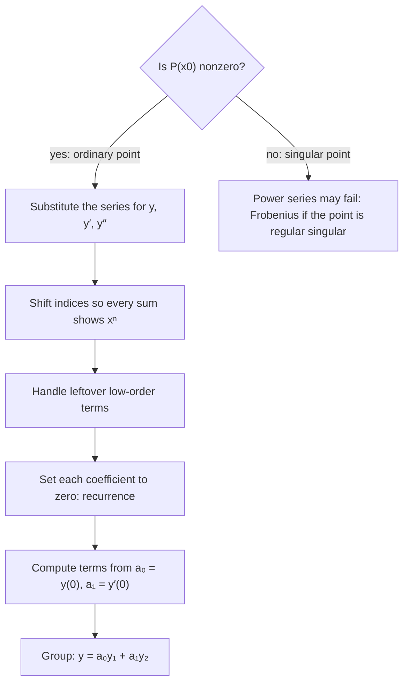

## When there's no closed form

Constant-coefficient and Cauchy–Euler equations have solutions built from familiar
functions. Most variable-coefficient equations don't. Airy's equation $y'' - xy = 0$
(which describes light near a caustic and quantum particles in a linear potential) has no
solution in terms of exponentials, sines or polynomials. Yet we can still compute its
solutions to any accuracy by assuming a **power series** and finding its coefficients one at
a time. This is how many of the "special functions" of physics were first defined.

## Ordinary points

Write the equation as $P(x)y'' + Q(x)y' + R(x)y = 0$ with polynomial coefficients that have
no common factor (cancel any first). A point $x_0$ is an **ordinary point** if
$P(x_0) \ne 0$; otherwise it's a **singular point**. (For non-polynomial coefficients the
general definition is that $Q/P$ and $R/P$ are analytic at $x_0$, meaning they have
convergent Taylor series there.) Near an ordinary point:

**Theorem.** If $x_0$ is an ordinary point, the general solution is a power series
$y = \sum_{n=0}^\infty a_n(x - x_0)^n = a_0y_1(x) + a_1y_2(x)$, where $a_0$ and $a_1$ are arbitrary
and $y_1$, $y_2$ are independent series solutions. Each series converges at least on the
interval out to the nearest singular point (including complex ones) of $Q/P$ and $R/P$.

We'll work at $x_0 = 0$.

## The method

1. Substitute $y = \sum_{n=0}^\infty a_nx^n$, $y' = \sum_{n=1}^\infty na_nx^{n-1}$,
   $y'' = \sum_{n=2}^\infty n(n-1)a_nx^{n-2}$.
2. Multiply in the coefficients and **shift indices** so every sum shows $x^n$.
3. Collect the coefficient of each power of $x$ and set it to zero. This gives a
   **recurrence relation** expressing later coefficients in terms of earlier ones.
4. Use the recurrence to compute terms; $a_0 = y(0)$ and $a_1 = y'(0)$ are free.

The flowchart shows the whole procedure, including the first check: whether $x_0$ is an
ordinary point at all.



Shifting is the step that needs care. In $\sum_{n=2}^\infty n(n-1)a_nx^{n-2}$, replace $n$ by
$n + 2$: it becomes $\sum_{n=0}^\infty (n+2)(n+1)a_{n+2}x^n$. Same sum, relabeled.

### Example 1: a check on a known equation

Solve $y'' + y = 0$ by series.

- Substitute: $\sum_{n=0}^\infty (n+2)(n+1)a_{n+2}x^n + \sum_{n=0}^\infty a_nx^n = 0$.
- Coefficient of $x^n$: $(n+2)(n+1)a_{n+2} + a_n = 0$, so
  $$a_{n+2} = -\frac{a_n}{(n+2)(n+1)}.$$
- Even terms from $a_0$: $a_2 = -\dfrac{a_0}{2}$, $a_4 = -\dfrac{a_2}{12} = \dfrac{a_0}{24}$, …, so
  $a_{2k} = \dfrac{(-1)^ka_0}{(2k)!}$.
- Odd terms from $a_1$: $a_3 = -\dfrac{a_1}{6}$, $a_5 = \dfrac{a_1}{120}$, …, $a_{2k+1} = \dfrac{(-1)^ka_1}{(2k+1)!}$.
- $y = a_0\left(1 - \dfrac{x^2}{2!} + \dfrac{x^4}{4!} - \cdots\right) + a_1\left(x - \dfrac{x^3}{3!} + \cdots\right) = a_0\cos x + a_1\sin x$. ✓

The recurrence "skips by 2", so even and odd coefficients separate into two independent solutions.

### Example 2: Airy's equation

Solve $y'' - xy = 0$ near $x = 0$.

- $xy = \sum_{n=0}^\infty a_nx^{n+1} = \sum_{n=1}^\infty a_{n-1}x^n$ (shift).
- $y'' = \sum_{n=0}^\infty (n+2)(n+1)a_{n+2}x^n$.
- The $x^0$ term appears only in $y''$: $2a_2 = 0$, so $a_2 = 0$.
- For $n \ge 1$: $(n+2)(n+1)a_{n+2} - a_{n-1} = 0$, so
  $$a_{n+2} = \frac{a_{n-1}}{(n+2)(n+1)}.$$
- This skips by 3. From $a_0$: $a_3 = \dfrac{a_0}{6}$, $a_6 = \dfrac{a_3}{30} = \dfrac{a_0}{180}$.
  From $a_1$: $a_4 = \dfrac{a_1}{12}$, $a_7 = \dfrac{a_4}{42} = \dfrac{a_1}{504}$. And $a_2 = 0$ forces
  $a_5 = a_8 = \cdots = 0$.
- $y = a_0\left(1 + \dfrac{x^3}{6} + \dfrac{x^6}{180} + \cdots\right) + a_1\left(x + \dfrac{x^4}{12} + \dfrac{x^7}{504} + \cdots\right)$.

There are no singular points ($P = 1$), so both series converge for every $x$.

```plot
{"x": [-4, 2], "y": [-1, 3], "functions": [{"f": "1 + x^3/6 + x^6/180 + x^9/12960 + x^12/1710720 + x^15/359251200 + x^18/109930867200 + x^21/46170964224000", "label": "y₁ (a₀ = 1, a₁ = 0)"}], "caption": "Partial sum (through x²¹) of the Airy series y₁: it oscillates for x < 0 and grows rapidly for x > 0."}
```

### Example 3: an IVP with variable coefficients

Find the first terms of the solution of $y'' + xy' + y = 0$, $y(0) = 1$, $y'(0) = 0$.

- $xy' = \sum_{n=1}^\infty na_nx^n = \sum_{n=0}^\infty na_nx^n$ (the $n = 0$ term is zero anyway).
- Coefficient of $x^n$: $(n+2)(n+1)a_{n+2} + na_n + a_n = 0$, so
  $a_{n+2} = -\dfrac{(n+1)a_n}{(n+2)(n+1)} = -\dfrac{a_n}{n+2}$.
- $a_0 = 1$, $a_1 = 0$: $a_2 = -\tfrac12$, $a_4 = -\dfrac{a_2}{4} = \tfrac18$, $a_6 = -\tfrac{1}{48}$; odd ones vanish.
- $y = 1 - \dfrac{x^2}{2} + \dfrac{x^4}{8} - \dfrac{x^6}{48} + \cdots$, which you may recognize as
  $e^{-x^2/2}$. (Check: it satisfies the equation.)

## Radius of convergence

The theorem's guarantee depends on singular points in the complex plane. For
$(1 + x^2)y'' + y = 0$, $P = 1 + x^2$ vanishes at $x = \pm i$, at distance 1 from 0. So series
solutions about 0 are guaranteed to converge for $|x| < 1$, even though nothing looks wrong
on the real line. For Legendre's equation $(1 - x^2)y'' - 2xy' + \alpha(\alpha + 1)y = 0$ the
singular points $\pm1$ give radius at least 1.

The picture shows the first example in the complex plane. The disk around the expansion
point reaches out to the nearest singular point; on the real line, that disk covers the
interval where convergence is guaranteed.


## Singular points, briefly

At a singular point the method can fail. If the singularity is mild (a **regular singular
point**, like $x = 0$ in Bessel's equation $x^2y'' + xy' + (x^2 - \nu^2)y = 0$), a modified
series $x^r\sum a_nx^n$ works; this is the **method of Frobenius**, beyond our scope. The
Cauchy–Euler equation of Lesson 21 is the simplest example, with solutions $x^r$.

## Common mistakes

- **Index shifts.** After shifting, check by writing out the first term of each sum.
- **Missing low-order equations.** If sums start at different $n$, handle the leftover
  terms (like $2a_2 = 0$ in Airy) separately.
- **Assuming every recurrence skips by 2.** Airy's skips by 3.
- **Forgetting $a_0 = y(0)$, $a_1 = y'(0)$.**

## Key points

- At an ordinary point ($P(x_0) \ne 0$), $y = \sum a_n(x - x_0)^n$ with $a_0$, $a_1$ free.
- Substitute, shift indices to common powers, and set each coefficient to zero to get a recurrence.
- Convergence is guaranteed out to the nearest (possibly complex) singular point.
