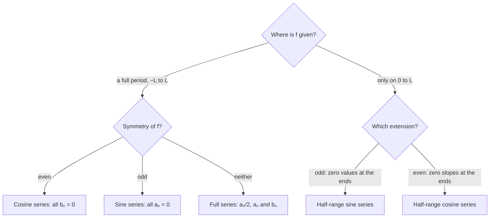

## Building functions from sines and cosines

Power series write a function as a sum of powers $x^n$. A **Fourier series** writes a
periodic function as a sum of sines and cosines of increasing frequency. Fourier invented
them to solve the heat equation (next lesson), and they now run through all of physics and
engineering: sound and music, image compression, signal processing, quantum mechanics. This
lesson computes Fourier series; the next uses them to solve PDEs.

## Periodic functions

A function is **periodic** with period $P$ if $f(x + P) = f(x)$ for all $x$. The functions
$\cos\dfrac{n\pi x}{L}$ and $\sin\dfrac{n\pi x}{L}$ all have period $2L$ (their fundamental
periods are $2L/n$, which divide $2L$). So any combination of them has period $2L$.

## The Fourier series of a function

For $f$ with period $2L$, its Fourier series is

$$f(x) \sim \frac{a_0}{2} + \sum_{n=1}^\infty \left(a_n\cos\frac{n\pi x}{L} + b_n\sin\frac{n\pi x}{L}\right),$$

with **Fourier coefficients**

$$a_n = \frac1L\int_{-L}^{L}f(x)\cos\frac{n\pi x}{L}\,dx, \qquad b_n = \frac1L\int_{-L}^{L}f(x)\sin\frac{n\pi x}{L}\,dx.$$

(The $\tfrac{a_0}{2}$ convention lets one formula cover $n = 0$; $\tfrac{a_0}{2}$ is the average
value of $f$ over a period.)

### Where the formulas come from: orthogonality

Over one period, different sines and cosines are **orthogonal**: the integral of the
product of two different ones is zero. For positive integers $m$, $n$:

$$\int_{-L}^{L}\cos\frac{m\pi x}{L}\cos\frac{n\pi x}{L}\,dx = \begin{cases} L, & m = n \\ 0, & m \ne n \end{cases}$$

and similarly for sines, while $\int_{-L}^{L}\sin\frac{m\pi x}{L}\cos\frac{n\pi x}{L}\,dx = 0$
always. Multiply the series by $\cos\dfrac{m\pi x}{L}$ and integrate: every term dies except
the $m$th, leaving $\int f\cos\frac{m\pi x}{L}\,dx = a_mL$. That's the formula. It's the same
idea as finding the components of a vector by dot products with perpendicular unit vectors.

### Example 1: a square wave

Let $f(x) = -1$ for $-\pi < x < 0$ and $f(x) = 1$ for $0 < x < \pi$, extended with period $2\pi$
($L = \pi$).

- $f$ is odd, so $f\cos nx$ is odd and every $a_n = 0$.
- $b_n = \dfrac1\pi\displaystyle\int_{-\pi}^{\pi}f(x)\sin nx\,dx = \dfrac2\pi\int_0^\pi\sin nx\,dx = \dfrac{2}{n\pi}(1 - \cos n\pi) = \dfrac{2}{n\pi}\big(1 - (-1)^n\big)$.
- So $b_n = \dfrac{4}{n\pi}$ for odd $n$ and 0 for even $n$:

$$f(x) = \frac4\pi\left(\sin x + \frac{\sin 3x}{3} + \frac{\sin 5x}{5} + \cdots\right).$$

```plot
{"x": [-6.3, 6.3], "y": [-1.6, 1.6], "functions": [{"f": "(4/pi)*(sin(x) + sin(3x)/3 + sin(5x)/5)", "label": "3 terms"}, {"f": "(4/pi)*(sin(x) + sin(3x)/3 + sin(5x)/5 + sin(7x)/7 + sin(9x)/9 + sin(11x)/11 + sin(13x)/13 + sin(15x)/15 + sin(17x)/17 + sin(19x)/19)", "label": "10 terms"}], "segments": [{"from": [-6.283, 1], "to": [-3.1416, 1], "dashed": true}, {"from": [-3.1416, -1], "to": [0, -1], "dashed": true}, {"from": [0, 1], "to": [3.1416, 1], "dashed": true}, {"from": [3.1416, -1], "to": [6.283, -1], "dashed": true}], "caption": "Partial sums (3 and 10 terms) of the square-wave series, with the square wave dashed. Near each jump the partial sums overshoot: the Gibbs phenomenon."}
```

## Convergence

**Theorem.** If $f$ and $f'$ are piecewise continuous, the Fourier series converges to $f(x)$
wherever $f$ is continuous, and to the average $\tfrac12\big(f(x^-) + f(x^+)\big)$ at a jump.

For the square wave, at $x = 0$ the series gives $0$ (every $\sin 0 = 0$), the midpoint of the
jump from $-1$ to $1$. Near a jump, partial sums overshoot by about 9% of the jump size no
matter how many terms you take (the **Gibbs phenomenon**), though the overshoot region
gets narrower.

## Even and odd functions save work

- If $f$ is **even** ($f(-x) = f(x)$), all $b_n = 0$: a **cosine series**, and
  $a_n = \dfrac2L\displaystyle\int_0^L f(x)\cos\frac{n\pi x}{L}\,dx$.
- If $f$ is **odd** ($f(-x) = -f(x)$), all $a_n = 0$: a **sine series**, and
  $b_n = \dfrac2L\displaystyle\int_0^L f(x)\sin\frac{n\pi x}{L}\,dx$.

### Example 2

Find the Fourier series of $f(x) = |x|$ on $-\pi < x < \pi$ (period $2\pi$).

- Even, so $b_n = 0$. $a_0 = \dfrac2\pi\displaystyle\int_0^\pi x\,dx = \pi$.
- $a_n = \dfrac2\pi\displaystyle\int_0^\pi x\cos nx\,dx = \dfrac2\pi\cdot\dfrac{\cos n\pi - 1}{n^2} = \dfrac{2\big((-1)^n - 1\big)}{\pi n^2}$
  (integrating by parts). That's $-\dfrac{4}{\pi n^2}$ for odd $n$, 0 for even $n$.
- $|x| = \dfrac\pi2 - \dfrac4\pi\left(\cos x + \dfrac{\cos 3x}{9} + \dfrac{\cos 5x}{25} + \cdots\right)$.

The coefficients fall like $1/n^2$ (faster than the square wave's $1/n$) because $|x|$ has no
jumps, only corners. Smoother functions have faster-decaying coefficients.

## Half-range expansions

For the PDEs ahead, we'll have a function defined only on $0 < x < L$ (a rod or string of
length $L$) and want a pure sine series. Extend $f$ to $(-L, 0)$ as an odd function; its
Fourier series is the **Fourier sine series**

$$f(x) = \sum_{n=1}^\infty b_n\sin\frac{n\pi x}{L}, \qquad b_n = \frac2L\int_0^L f(x)\sin\frac{n\pi x}{L}\,dx.$$

The even extension gives a cosine series instead.

The two extensions of $f(x) = x$ on $(0, \pi)$ show the difference. The odd extension is a
sawtooth with jumps (its sine series is Example 4 below); the even extension is the
continuous triangle wave $|x|$ of Example 2, which is why its coefficients fall off faster.

```plot
{"x": [-9.5, 9.5], "y": [-4, 4], "functions": [{"f": "x + 2*pi", "from": -9.42, "to": -3.15, "dashed": true}, {"f": "x", "from": -3.1416, "to": 0, "dashed": true}, {"f": "x", "from": 0, "to": 3.1416, "label": "f(x) = x"}, {"f": "x - 2*pi", "from": 3.15, "to": 9.42, "dashed": true}], "caption": "Odd extension of f(x) = x from (0, π): a sawtooth of period 2π that jumps at x = ±π, ±3π. Solid: the original piece; dashed: the extension."}
```

```plot
{"x": [-9.5, 9.5], "y": [-1, 4], "functions": [{"f": "abs(x + 2*pi)", "from": -9.42, "to": -3.1416, "dashed": true}, {"f": "abs(x)", "from": -3.1416, "to": 0, "dashed": true}, {"f": "x", "from": 0, "to": 3.1416, "label": "f(x) = x"}, {"f": "abs(x - 2*pi)", "from": 3.1416, "to": 9.42, "dashed": true}], "caption": "Even extension of the same f: a continuous triangle wave of period 2π (the function |x| of Example 2). Solid: the original piece; dashed: the extension."}
```

Which series to compute depends on what you're given and, for the PDEs ahead, on what the
solution must do at the ends:



### Example 3

Find the sine series of $f(x) = 1$ on $0 < x < L$.

$b_n = \dfrac2L\displaystyle\int_0^L\sin\frac{n\pi x}{L}\,dx = \dfrac{2}{n\pi}\big(1 - (-1)^n\big)$, so
$1 = \dfrac4\pi\displaystyle\sum_{n\text{ odd}}\frac1n\sin\frac{n\pi x}{L}$ on $0 < x < L$. It's Example 1 in disguise.

### Example 4: a sine series for $f(x) = x$ on $(0, \pi)$

$b_n = \dfrac2\pi\displaystyle\int_0^\pi x\sin nx\,dx$. Integrating by parts,
$\int_0^\pi x\sin nx\,dx = \left[-\dfrac{x\cos nx}{n}\right]_0^\pi + \dfrac1n\int_0^\pi\cos nx\,dx = -\dfrac{\pi(-1)^n}{n}$.
So $b_n = \dfrac{2(-1)^{n+1}}{n}$ and

$$x = 2\left(\sin x - \frac{\sin 2x}{2} + \frac{\sin 3x}{3} - \cdots\right), \quad 0 < x < \pi.$$

At $x = \pi$ the series gives 0, the average of the jump from $\pi$ to $-\pi$ in the odd periodic
extension. Setting $x = \pi/2$ gives the famous series $\dfrac\pi4 = 1 - \dfrac13 + \dfrac15 - \cdots$.

## Common mistakes

- **Forgetting the factor $\tfrac12$ on $a_0$**, or using $\tfrac1L$ vs $\tfrac2L$ inconsistently.
- **Integrating over the wrong interval.** Full-range formulas use $(-L, L)$; even/odd shortcuts use $(0, L)$ with factor $\tfrac2L$.
- **$\cos n\pi$.** It equals $(-1)^n$, not 1.
- **Expecting convergence to $f$ at jumps.** The series gives the average of the two sides.

## Key points

- Period $2L$: $f \sim \tfrac{a_0}{2} + \sum\big(a_n\cos\frac{n\pi x}{L} + b_n\sin\frac{n\pi x}{L}\big)$,
  $a_n = \tfrac1L\int_{-L}^Lf\cos$, $b_n = \tfrac1L\int_{-L}^Lf\sin$.
- Orthogonality of sines and cosines is why the coefficient formulas work.
- Even $f$: cosine series; odd $f$: sine series. Half-range sine series:
  $b_n = \tfrac2L\int_0^Lf\sin\frac{n\pi x}{L}$.
- Converges to $f$ where continuous, to the jump's midpoint at discontinuities.
