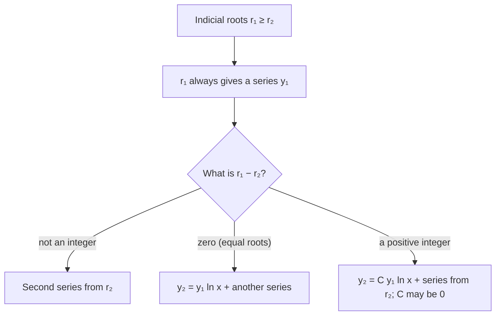

## When the power series breaks down

Lesson 38 built solutions as power series around an ordinary point and stopped at a
warning: at a singular point, where the leading coefficient $P(x)$ vanishes, the method can
fail. Those points are often exactly where the interesting physics is. Bessel's equation

$$x^2y'' + xy' + (x^2 - \nu^2)y = 0$$

has a singular point at $x = 0$, and it is the equation you get when you separate variables
in the heat or wave equation in polar coordinates (a round drum, a cylinder cooling, light
in an optical fiber). The center of the drum is $x = 0$, so you cannot just avoid it.

The fix is to let the series start with a power $x^r$ that need not be a whole number:
$y = x^r\sum a_nx^n$. Lazarus Fuchs worked out the theory of such singular points in 1866,
and Georg Frobenius published the systematic series method in 1873; it now carries his
name. This lesson shows when the method applies, how the exponent $r$ is found, what can go
wrong, and what it says about Bessel's equation.

## Regular and irregular singular points

Divide $P(x)y'' + Q(x)y' + R(x)y = 0$ by $P$ to get $y'' + p(x)y' + q(x)y = 0$, with
$p = Q/P$ and $q = R/P$. Suppose $x = 0$ is a singular point. It is a **regular singular
point** if

$$xp(x) \quad\text{and}\quad x^2q(x)$$

are both analytic at 0 (have convergent Taylor series there). In words, $p$ blows up no
worse than $1/x$ and $q$ no worse than $1/x^2$. Otherwise it is an **irregular singular
point**, and series methods generally fail there. (At a point $x_0 \ne 0$, use $x - x_0$
in place of $x$.)

- Bessel's equation: $p = \dfrac1x$, $q = \dfrac{x^2 - \nu^2}{x^2}$, so $xp = 1$ and
  $x^2q = x^2 - \nu^2$. Both are polynomials: regular.
- $x^3y'' + y = 0$: $q = \dfrac{1}{x^3}$, so $x^2q = \dfrac1x$, which is not analytic at 0:
  irregular.

Why these powers? Near $x = 0$, a regular singular point looks like a Cauchy–Euler equation
(Lesson 21). Writing $p_0 = \lim_{x\to0}xp(x)$ and $q_0 = \lim_{x\to0}x^2q(x)$, the equation is
approximately $x^2y'' + p_0xy' + q_0y = 0$, whose solutions are powers $x^r$. So the true
solutions should behave like $x^r$ times a correction that is a power series.

## The method

Try a **Frobenius series**

$$y = x^r\sum_{n=0}^\infty a_nx^n = \sum_{n=0}^\infty a_nx^{n+r}, \qquad a_0 \ne 0, \quad x > 0.$$

Then $y' = \sum(n + r)a_nx^{n+r-1}$ and $y'' = \sum(n + r)(n + r - 1)a_nx^{n+r-2}$. Note that
the sums all start at $n = 0$: since $r$ need not be an integer, the $n = 0$ terms don't
vanish when you differentiate.

1. Substitute and shift indices so every sum shows the same power, as in Lesson 38.
2. The lowest power appears only with $a_0$. Since $a_0 \ne 0$, its coefficient must vanish:
   $$r(r - 1) + p_0r + q_0 = 0.$$
   This quadratic is the indicial equation of the singular point (the same one as for the
   Cauchy–Euler equation that approximates it). Its roots $r_1 \ge r_2$ are the allowed
   starting exponents.
3. The higher powers give a recurrence for $a_n$ that now depends on $r$. Run it once for
   each root.

Requiring $a_0 \ne 0$ is what makes $r$ meaningful: it says the solution really starts
like $x^r$, so $r$ can't be shifted by absorbing powers of $x$ into the series.

### Example 1: two Frobenius series

Solve $2xy'' + y' + y = 0$ near $x = 0$.

- **Check the point.** $p = \dfrac{1}{2x}$, $q = \dfrac{1}{2x}$, so $xp = \tfrac12$ and $x^2q = \tfrac x2$:
  regular, with $p_0 = \tfrac12$, $q_0 = 0$.
- **Substitute.** $2xy'' = \sum 2(n+r)(n+r-1)a_nx^{n+r-1}$ and $y' = \sum(n+r)a_nx^{n+r-1}$
  already share the power $x^{n+r-1}$. Shift $y = \sum a_nx^{n+r} = \sum_{n\ge1}a_{n-1}x^{n+r-1}$.
- **Lowest power** ($n = 0$): $\big(2r(r-1) + r\big)a_0 = 0$, so $r(2r - 1) = 0$ and $r = 0$ or $r = \tfrac12$.
  (The formula $r(r-1) + \tfrac12r + 0 = 0$ gives the same roots.)
- **Recurrence** ($n \ge 1$): $(n+r)\big(2(n+r) - 1\big)a_n + a_{n-1} = 0$, so
  $$a_n = -\frac{a_{n-1}}{(n+r)(2n+2r-1)}.$$
- **$r = 0$:** $a_n = -\dfrac{a_{n-1}}{n(2n-1)}$. With $a_0 = 1$: $a_1 = -1$, $a_2 = \tfrac{1}{6}$,
  $a_3 = -\tfrac{1}{90}$. So $y_1 = 1 - x + \dfrac{x^2}{6} - \dfrac{x^3}{90} + \cdots$
- **$r = \tfrac12$:** $a_n = -\dfrac{a_{n-1}}{(n + \frac12)(2n)} = -\dfrac{a_{n-1}}{n(2n+1)}$. With $a_0 = 1$:
  $a_1 = -\tfrac13$, $a_2 = \tfrac{1}{30}$, $a_3 = -\tfrac{1}{630}$. So
  $y_2 = x^{1/2}\left(1 - \dfrac x3 + \dfrac{x^2}{30} - \dfrac{x^3}{630} + \cdots\right)$.

The general solution for $x > 0$ is $c_1y_1 + c_2y_2$. These happen to have closed forms,
$y_1 = \cos\sqrt{2x}$ and $y_2 = \dfrac{\sin\sqrt{2x}}{\sqrt2}$ (expand $\cos s$ and $\sin s$ with
$s = \sqrt{2x}$ to check). Notice that $y_2$ has a vertical tangent at $x = 0$, since
$y_2' \approx \dfrac{1}{2\sqrt x}$ there: no ordinary power series could have produced it.
There are no other singular points, so both series converge for all $x > 0$.

## The three cases

The roots of the indicial equation decide what the second solution looks like. The
theorem behind this (Frobenius's theorem) says: at a regular singular point with real
roots $r_1 \ge r_2$, there is always a solution $y_1 = x^{r_1}\sum a_nx^n$, and the series
converges at least out to the nearest other singular point. For the second solution:



The logarithm should not surprise you: a Cauchy–Euler equation with a repeated root has
solutions $x^r$ and $x^r\ln x$, and the same thing happens here. When the roots differ by
an integer, the recurrence for the smaller root hits a step where it would divide by zero;
sometimes the numerator is zero too and the series survives ($C = 0$), and sometimes a
logarithm is forced. (Complex roots also give two solutions, built from $x^{\alpha \pm i\beta}$
as in Lesson 21; we won't need them.)

### Example 2: reading off the case

- $x^2y'' - xy' + (1 + x)y = 0$: $p_0 = -1$, $q_0 = 1$, so $r(r-1) - r + 1 = (r - 1)^2 = 0$.
  Equal roots $r = 1$: one series $x\sum a_nx^n$, and the second solution contains $y_1\ln x$.
- Bessel's equation of order $\tfrac12$, $x^2y'' + xy' + (x^2 - \tfrac14)y = 0$: $p_0 = 1$,
  $q_0 = -\tfrac14$, so $r^2 - \tfrac14 = 0$ and $r = \pm\tfrac12$. The roots differ by the integer 1,
  yet here $C = 0$: the two solutions are $\dfrac{\sin x}{\sqrt x}$ and $\dfrac{\cos x}{\sqrt x}$, both pure
  Frobenius series. So an integer difference means "check", not "log for sure".

## Bessel's equation of order zero

Set $\nu = 0$: $x^2y'' + xy' + x^2y = 0$. Here $p_0 = 1$ and $q_0 = 0$, so the indicial equation
is $r^2 = 0$, a double root $r = 0$.

### Example 3: the Bessel function $J_0$

- **Substitute.** $x^2y'' + xy' = \sum\big((n+r)(n+r-1) + (n+r)\big)a_nx^{n+r} = \sum(n+r)^2a_nx^{n+r}$,
  and $x^2y = \sum_{n\ge2}a_{n-2}x^{n+r}$.
- **Powers.** $n = 0$: $r^2a_0 = 0$. $n = 1$: $(1+r)^2a_1 = 0$, so $a_1 = 0$ for $r = 0$.
  $n \ge 2$: $(n+r)^2a_n + a_{n-2} = 0$.
- **With $r = 0$:** $a_n = -\dfrac{a_{n-2}}{n^2}$. The odd coefficients all vanish (they follow
  $a_1 = 0$), and with $a_0 = 1$: $a_2 = -\tfrac14$, $a_4 = \tfrac{1}{64}$, $a_6 = -\tfrac{1}{2304}$.
- **The pattern** is $a_{2k} = \dfrac{(-1)^k}{2^{2k}(k!)^2}$, so

$$J_0(x) = \sum_{k=0}^\infty\frac{(-1)^k}{(k!)^2}\left(\frac x2\right)^{2k} = 1 - \frac{x^2}{4} + \frac{x^4}{64} - \frac{x^6}{2304} + \cdots$$

This is the **Bessel function** of the first kind of order zero. The ratio test shows the
series converges for every $x$. At $x = 1$ the four terms shown give
$1 - 0.25 + 0.015625 - 0.000434 \approx 0.76519$, already within about $10^{-5}$ of the true
value $J_0(1) \approx 0.76520$.

Because the root is repeated, the second solution has a logarithm: it behaves like a
multiple of $\ln x$ near 0 and so is unbounded there. (Suitably normalized, it is the Bessel function
of the second kind, $Y_0$.) For a drum or a solid cylinder, $x = 0$ is a real point of the
object, the temperature or displacement there must be finite, and that throws the
logarithmic solution out. Only $J_0$ is left.

```plot
{"x": [0, 12], "y": [-0.6, 1.1], "functions": [{"f": "1 - 0.25*x^2 + 0.015625*x^4 - 0.000434027777777778*x^6 + 6.78168402777778e-06*x^8 - 6.78168402777778e-08*x^10 + 4.7095027970679e-10*x^12 - 2.40280754952444e-12*x^14 + 9.38596699032984e-15*x^16 - 2.89690339207711e-17*x^18 + 7.24225848019278e-20*x^20 - 1.49633439673405e-22*x^22 + 2.59780277210772e-25*x^24 - 3.84290350903508e-28*x^26 + 4.90166263907536e-31*x^28 - 5.44629182119485e-34*x^30 + 5.31864435663559e-37*x^32 - 4.60090342269515e-40*x^34 + 3.55007980146231e-43*x^36 - 2.45850401763318e-46*x^38 + 1.53656501102074e-49*x^40", "label": "J₀(x)"}], "points": [{"at": [2.405, 0]}, {"at": [5.520, 0]}, {"at": [8.654, 0]}], "caption": "The Bessel function J₀ (series summed through x⁴⁰): a decaying oscillation, with its first three zeros marked at x ≈ 2.405, 5.520 and 8.654. The gaps between zeros approach π."}
```

## Why drums don't sound like strings

The zeros of $J_0$ matter physically. Separating the wave equation for a round drumhead of
radius $R$ (clamped at its rim) in polar coordinates leads, for vibrations that are the same
in every direction, to Bessel's equation of order zero in the variable $\sqrt\lambda\,r$. The
clamped rim needs $J_0(\sqrt\lambda R) = 0$, so $\sqrt\lambda R$ must be a zero of $J_0$:
$2.405$, $5.520$, $8.654, \dots$ The frequencies of these modes are proportional to those zeros.

For a string (Lesson 40) the mode frequencies are $1, 2, 3, \dots$ times the fundamental:
harmonics. For the drum the ratios are $\dfrac{5.520}{2.405} \approx 2.295$ and
$\dfrac{8.654}{2.405} \approx 3.598$: not whole numbers. That is a large part of why a struck drum
gives a less definite pitch than a plucked string. (This is a simplified model: real drums
also have modes that vary with angle, which bring in Bessel functions $J_m$ of other
orders, and the air around a drumhead shifts the frequencies; tuned drums such as timpani
rely on exactly those effects.)

## Common mistakes

- **Skipping the regularity check.** Frobenius's theorem needs $xp$ and $x^2q$ analytic. At an
  irregular singular point the method can produce a series that converges nowhere.
- **Using $n$ instead of $n + r$** when differentiating. Every factor is $(n + r)$, and the sums
  still start at $n = 0$.
- **Allowing $a_0 = 0$.** That just shifts $r$; the indicial equation comes from insisting $a_0 \ne 0$.
- **Assuming an integer difference forces a logarithm.** It only might; Bessel's equation of
  order $\tfrac12$ is a counterexample.
- **Forgetting that $x^r$ needs $x > 0$** for non-integer $r$. For $x < 0$, use $|x|^r$.

## Key points

- $x = 0$ is a regular singular point when $xp(x)$ and $x^2q(x)$ are analytic there; then
  try $y = \sum a_nx^{n+r}$ with $a_0 \ne 0$.
- The lowest power gives the indicial equation $r(r-1) + p_0r + q_0 = 0$; the rest give a
  recurrence that depends on $r$.
- The larger root always gives a Frobenius series. A second series comes from the smaller
  root when the roots don't differ by an integer; equal roots force a $\ln x$ term, and an
  integer difference may.
- Bessel's equation of order zero has the double root $r = 0$; its bounded solution is
  $J_0(x) = \sum\frac{(-1)^k}{(k!)^2}(x/2)^{2k}$, whose zeros set the frequencies of a round drum.
