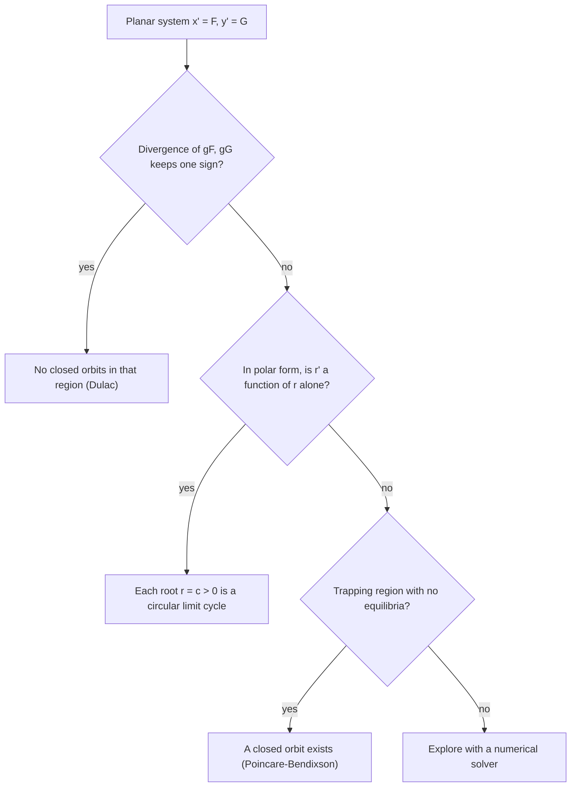

## Oscillations that choose their own size

Lesson 37 linearized nonlinear systems near their equilibria. That tells you what happens
close to a single point, but many real systems never settle at an equilibrium at all. A heart
beats, a cricket chirps, a violin string bowed steadily sings at one loudness, and an
electronic oscillator produces a steady tone. Each repeats the same cycle forever, and if you
nudge it, it returns to *the same* cycle, with the same size and period.

Linear systems can't do this. A linear center (Lesson 35) has a whole family of closed
orbits, one through every point: if $\mathbf{x}(t)$ is a periodic solution, so is
$2\mathbf{x}(t)$, so the size of the oscillation is set by the starting point and any nudge
moves you to a different orbit for good. A self-sustained oscillation with a preferred size
is a purely nonlinear effect. This honors module studies such effects: limit cycles here,
the bifurcations that create them in Lesson 91, and chaos in Lessons 92 and 93.

## Closed orbits and limit cycles

A **closed orbit** (periodic orbit) is a trajectory that returns to its starting point, so
the solution is periodic: $\mathbf{x}(t + T) = \mathbf{x}(t)$ for some period $T > 0$. A
**limit cycle** is a closed orbit that is isolated: nearby trajectories are not closed, they
spiral toward it or away from it.

- *Stable* limit cycle: nearby trajectories on both sides spiral toward it as $t \to \infty$.
- *Unstable*: they spiral away on both sides.
- *Semistable*: toward it on one side, away on the other.

The centers of Lesson 35 and the Lotka–Volterra loops of Lesson 37 are closed orbits but not
limit cycles: their neighbors are closed orbits too.

## Polar coordinates: a phase line for the radius

The easiest limit cycles to analyze are rotationally symmetric. With $x = r\cos\theta$,
$y = r\sin\theta$, two identities convert any planar system:

$$rr' = xx' + yy', \qquad r^2\theta' = xy' - yx'.$$

(Differentiate $r^2 = x^2 + y^2$ for the first; differentiate $\tan\theta = y/x$ for the second.)

### Example 1

Analyze $x' = x - y - x(x^2 + y^2)$, $y' = x + y - y(x^2 + y^2)$.

- $xx' + yy' = x^2 + y^2 - (x^2 + y^2)^2 = r^2 - r^4$, so $r' = r(1 - r^2)$.
- $xy' - yx' = x^2 + y^2 = r^2$ (the cubic terms cancel), so $\theta' = 1$.

The radius obeys a one-dimensional autonomous equation, so draw its phase line (Lesson 14).
On $r \ge 0$, $f(r) = r(1 - r^2)$ is zero at $r = 0$ and $r = 1$, positive between them and
negative for $r > 1$. Every trajectory except the equilibrium at the origin moves toward
$r = 1$ while turning counterclockwise at one radian per unit time. The circle $r = 1$ is a
stable limit cycle with period $2\pi$. (The origin is a spiral source: its Jacobian is
$\begin{bmatrix} 1 & -1 \\ 1 & 1 \end{bmatrix}$, with eigenvalues $1 \pm i$.)

The radius equation is a Bernoulli equation (Lesson 10), so it even has a formula:
$r(t) = \left(1 + (r_0^{-2} - 1)e^{-2t}\right)^{-1/2}$. Starting at $r_0 = 0.5$, after one time
unit $r(1) \approx 0.84$; starting at $r_0 = 2$, $r(1) \approx 1.05$. Both close in on 1.

```plot
{"x": [-2.2, 2.2], "y": [-2.2, 2.2], "equal": true, "vectorField": {"u": "x - y - x*(x^2 + y^2)", "v": "x + y - y*(x^2 + y^2)", "step": 0.55}, "curves": [{"x": "cos(t)", "y": "sin(t)", "t": [0, "2pi"]}, {"x": "cos(t)/sqrt(1 + 99*exp(-2*t))", "y": "sin(t)/sqrt(1 + 99*exp(-2*t))", "t": [0, "4pi"], "dashed": true}, {"x": "2*cos(t)/sqrt(4 - 3*exp(-2*t))", "y": "2*sin(t)/sqrt(4 - 3*exp(-2*t))", "t": [0, "4pi"], "dashed": true}], "labels": [{"at": [1.38, -0.8], "text": "r = 1"}], "caption": "Example 1: a trajectory starting at r = 0.1 spirals out and one starting at r = 2 spirals in; both approach the stable limit cycle r = 1."}
```

### Example 2

Suppose $r' = r(r - 1)(r - 2)$, $\theta' = 1$. On the phase line for $r$: for $0 < r < 1$ all
three factors give $(+)(-)(-) > 0$, so $r$ grows; for $1 < r < 2$, $(+)(+)(-) < 0$, so $r$
shrinks; for $r > 2$, $r' > 0$. So $r = 1$ is a stable limit cycle and $r = 2$ is an unstable
one. Trajectories starting between the circles go to $r = 1$; those starting outside $r = 2$
go off to infinity. The unstable cycle is a boundary between two fates, just as an unstable
equilibrium is on a phase line.

## The Poincaré–Bendixson theorem

Most systems have no polar shortcut, and finding a limit cycle exactly is usually
impossible. Proving that one *exists* is often easy, though, thanks to a theorem of Henri
Poincaré (1880s) and Ivar Bendixson (1901).

**Poincaré–Bendixson theorem** (a common form). Suppose $x' = F(x, y)$, $y' = G(x, y)$ has
continuously differentiable $F$ and $G$, and $R$ is a closed, bounded region of the plane
that contains **no equilibrium points**. If a trajectory starts in $R$ and stays in $R$ for
all $t \ge 0$, then it is a closed orbit or it spirals toward a closed orbit as $t \to \infty$.
Either way, $R$ contains a closed orbit.

The usual way to use it is to build a **trapping region**: a region whose boundary the flow
crosses only inward, so nothing that starts inside can leave. Equilibria are often inside
the region you would naturally draw; the standard fix is to cut out a small disk around
them, which works when the equilibrium repels (a source), so the flow leaves that small
disk too. The result is an annulus (a ring).


Why can't a trajectory just wander forever in the ring without closing up? In the plane,
trajectories can't cross each other (uniqueness, Lesson 7), and a curve that winds around
a ring without crossing itself is squeezed into a pattern that must converge. That is the
heart of the proof, and it is purely two-dimensional. In three dimensions trajectories can
pass over and under each other, and Lesson 93 shows what becomes possible then.

### Example 3

Show that $x' = x - y - x^3$, $y' = x + y - y^3$ has a closed orbit.

- **Radial rate.** $rr' = xx' + yy' = x^2 + y^2 - (x^4 + y^4) = r^2 - (x^4 + y^4)$.
- **Bound the quartic.** $x^4 + y^4 \le (x^2 + y^2)^2 = r^4$, and $x^4 + y^4 \ge \tfrac12(x^2 + y^2)^2 = \tfrac12 r^4$
  (because $(x^2 - y^2)^2 \ge 0$). So $r^2 - r^4 \le rr' \le r^2 - \tfrac12 r^4$.
- **Inner circle.** For $r < 1$, $rr' \ge r^2(1 - r^2) > 0$: the flow points outward on any
  circle $r = c$ with $0 < c < 1$.
- **Outer circle.** For $r > \sqrt2$, $rr' \le r^2(1 - \tfrac12 r^2) < 0$: the flow points
  inward on any circle $r = C$ with $C > \sqrt2$.
- **Equilibria.** Setting both equations to zero and eliminating $y = x - x^3$ leaves a
  degree-9 polynomial whose only real root is $x = 0$. So the origin is the only equilibrium,
  and it lies outside the annulus.

The annulus $0.9 \le r \le 1.5$ (for instance) is a trapping region with no equilibria, so
it contains a closed orbit. A numerical solution shows a single stable limit cycle whose
radius varies between about $1.07$ and $1.25$, inside the annulus as promised. The theorem
proves existence; it doesn't say how many cycles there are or give their shape.

## Ruling closed orbits out

Sometimes you want the opposite: a guarantee that there is no oscillation.

**Dulac's criterion**. Let $D$ be a simply connected region (no holes). If there is a
continuously differentiable function $g(x, y)$ such that
$\dfrac{\partial (gF)}{\partial x} + \dfrac{\partial (gG)}{\partial y}$ is continuous, has one
sign throughout $D$, and is not identically zero on any small disk in $D$, then $D$ contains no closed orbit. The case
$g = 1$ is **Bendixson's criterion**: the divergence $F_x + G_y$ has one sign.

*Why it works.* Suppose a closed orbit $C$ bounded a region $\Omega$ inside $D$. Along $C$
the direction $(dx, dy)$ is parallel to $(F, G)$, so $F\,dy - G\,dx = 0$ at every point and
$\oint_C (F\,dy - G\,dx) = 0$. By Green's theorem this integral equals
$\iint_\Omega (F_x + G_y)\,dA$, which can't be zero if the divergence keeps one sign and doesn't vanish throughout $\Omega$. (With $g$,
apply the same argument to $(gF, gG)$, which has the same trajectories traced at a different speed.)

### Example 4

Show that $x' = y$, $y' = -x - y - y^3$ has no closed orbits.

$F_x + G_y = 0 + (-1 - 3y^2) < 0$ everywhere. The whole plane is simply connected, so by
Bendixson's criterion there are no closed orbits. This is a spring with damping that grows
with speed: energy always drains away, so oscillations die out.



Two more facts help. A closed orbit in the plane must enclose at least one equilibrium (a
result from index theory, stated here without proof), so a region without holes that
contains no equilibria contains no closed orbit either. And in the plane, Poincaré–Bendixson
limits what can happen in the long run: if there are only finitely many equilibria, a
bounded trajectory approaches an equilibrium, a closed orbit, or a loop of equilibria joined
by trajectories. Nothing wilder is possible in two dimensions.

## The Van der Pol oscillator

In the 1920s the Dutch engineer Balthasar van der Pol studied circuits built around vacuum
tubes, which produce steady oscillations. His model, the **Van der Pol equation**, is

$$x'' - \mu(1 - x^2)x' + x = 0, \qquad \mu > 0.$$

Compare it with a damped spring $x'' + cx' + x = 0$: here the damping coefficient is
$-\mu(1 - x^2)$. For small $|x|$ it is *negative*, pumping energy in, so small oscillations
grow; for $|x| > 1$ it is positive, so large oscillations shrink. Somewhere between they
balance. As a system ($x' = y$, $y' = \mu(1 - x^2)y - x$), the origin has Jacobian
$\begin{bmatrix} 0 & 1 \\ -1 & \mu \end{bmatrix}$, trace $\mu > 0$, determinant 1: a source. A theorem of
Alfred-Marie Liénard (1928) guarantees that for every $\mu > 0$ there is exactly one closed
orbit, and it is a stable limit cycle.

```plot
{"x": [-3, 3], "y": [-3, 3], "equal": true, "xLabel": "x", "yLabel": "y = x′", "vectorField": {"u": "y", "v": "(1 - x^2)*y - x", "step": 0.6}, "polygons": [{"points": [[0.0,2.17],[0.21,2.37],[0.44,2.54],[0.68,2.66],[0.93,2.67],[1.17,2.55],[1.39,2.28],[1.59,1.91],[1.74,1.47],[1.86,1.04],[1.94,0.66],[1.99,0.35],[2.01,0.1],[2.01,-0.08],[1.99,-0.23],[1.97,-0.33],[1.93,-0.42],[1.89,-0.48],[1.84,-0.54],[1.79,-0.59],[1.73,-0.63],[1.67,-0.67],[1.61,-0.72],[1.54,-0.76],[1.47,-0.81],[1.39,-0.86],[1.31,-0.92],[1.22,-0.98],[1.13,-1.05],[1.03,-1.14],[0.92,-1.23],[0.8,-1.35],[0.67,-1.47],[0.52,-1.62],[0.37,-1.79],[0.19,-1.97],[0.0,-2.17],[-0.21,-2.37],[-0.44,-2.54],[-0.68,-2.66],[-0.93,-2.67],[-1.17,-2.55],[-1.39,-2.28],[-1.59,-1.91],[-1.74,-1.47],[-1.86,-1.04],[-1.94,-0.66],[-1.99,-0.35],[-2.01,-0.1],[-2.01,0.08],[-1.99,0.23],[-1.97,0.33],[-1.93,0.42],[-1.89,0.48],[-1.84,0.54],[-1.79,0.59],[-1.73,0.63],[-1.67,0.67],[-1.61,0.72],[-1.54,0.76],[-1.47,0.81],[-1.39,0.86],[-1.31,0.92],[-1.22,0.98],[-1.13,1.05],[-1.03,1.14],[-0.92,1.23],[-0.8,1.35],[-0.67,1.47],[-0.52,1.62],[-0.37,1.79],[-0.19,1.97]]}], "points": [{"at": [0, 0], "open": true}], "caption": "Van der Pol with μ = 1: the limit cycle (computed numerically) reaches x ≈ ±2.0; the period is about 6.66."}
```

Numerically, the cycle's amplitude stays close to $2$ for every $\mu$. For small $\mu$ it is
nearly a circle of radius 2 with period close to $2\pi$. For large $\mu$ the motion becomes a
**relaxation oscillation**: a slow buildup followed by a sudden jump, repeated, with a period
that grows roughly in proportion to $\mu$ (about $1.6\mu$ to leading order). Heartbeats and
dripping faucets have been modeled the same way, though those models are simplified
caricatures, not precise physiology.

## Common mistakes

- **Calling every closed orbit a limit cycle.** A center's orbits come in a continuous family;
  a limit cycle is isolated.
- **Applying Poincaré–Bendixson to a region containing an equilibrium.** The region must
  have none. Cut a small disk around a source out of the region.
- **Checking the boundary in only one place.** For a trapping region, the flow must point
  inward at *every* point of the boundary; that is why Example 3 bounds $x^4 + y^4$ for all angles.
- **Reading Dulac backwards.** A divergence that changes sign does *not* prove a closed orbit exists;
  the criterion only rules orbits out. And it needs a region without holes.
- **Using Poincaré–Bendixson in three dimensions.** It is a theorem about the plane only.

## Key points

- A limit cycle is an isolated closed orbit; linear systems never have one.
- In polar form, $rr' = xx' + yy'$ and $r^2\theta' = xy' - yx'$. If $r' = f(r)$ and $\theta'$ is never zero, isolated positive zeros of $f$
  are circular limit cycles, and the phase line of $f$ gives their stability.
- Poincaré–Bendixson: a closed, bounded region with no equilibria that traps a trajectory
  contains a closed orbit. Build an annulus: flow inward on the outside, outward on the inside.
- Bendixson/Dulac: if $(gF)_x + (gG)_y$ keeps one sign on a region without holes, there are no closed orbits there.
- Van der Pol $x'' - \mu(1 - x^2)x' + x = 0$: one stable limit cycle for each $\mu > 0$, amplitude about 2.
