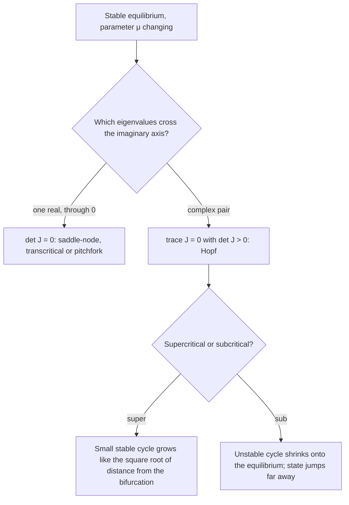

## Where do oscillations come from?

Lesson 15 followed the equilibria of a one-dimensional equation $y' = f(y, c)$ as a parameter
$c$ changed, and found that equilibria can appear, disappear or trade stability at a
bifurcation value. Lesson 90 found limit cycles, oscillations with a preferred size. This
lesson joins the two ideas: as a parameter changes, a quiet equilibrium can lose its
stability and give birth to an oscillation. That event, the **Hopf bifurcation**, explains the
onset of oscillation in chemical reactions, lasers, heart cells, wing flutter models and
predator–prey models, and it is the main way rhythms are born in dynamical systems.

## How an equilibrium can lose stability

Take a planar system depending on a parameter $\mu$, with an equilibrium whose Jacobian
$J(\mu)$ has trace $T(\mu)$ and determinant $D(\mu)$. From the trace–determinant chart
(Lesson 35), the equilibrium is a sink while $T < 0$ and $D > 0$. It can lose stability in
only two ways, because an eigenvalue has to cross the imaginary axis:

1. **A real eigenvalue passes through 0** ($D$ passes through 0). The plane has a direction
   along which the system behaves like a one-dimensional equation, and you see the
   saddle-node, transcritical and pitchfork bifurcations of Lesson 15 happening along that
   direction.
2. **A complex pair $\alpha \pm i\omega$ crosses the imaginary axis** ($T$ passes through 0 while
   $D > 0$). At the crossing the linearization is a center with frequency $\omega = \sqrt{D}$.
   This is a Hopf bifurcation.



## The supercritical Hopf bifurcation

The cleanest example is written in polar form:

$$r' = \mu r - r^3, \qquad \theta' = \omega,$$

with $\omega > 0$ fixed. In Cartesian form it reads
$x' = \mu x - \omega y - x(x^2 + y^2)$, $y' = \omega x + \mu y - y(x^2 + y^2)$, and its Jacobian at
the origin is $\begin{bmatrix} \mu & -\omega \\ \omega & \mu \end{bmatrix}$ with eigenvalues $\mu \pm i\omega$.

- **$\mu < 0$:** $r' = r(\mu - r^2) < 0$ for every $r > 0$. The origin is a stable spiral.
- **$\mu = 0$:** $r' = -r^3$. Still attracting, but slowly (not exponentially). The linearization
  is a center and can't see this; the cubic term decides.
- **$\mu > 0$:** $r' = r(\mu - r^2)$ is positive for $0 < r < \sqrt\mu$ and negative beyond. The
  origin is now an unstable spiral, and the circle $r = \sqrt\mu$ is a stable limit cycle.

As $\mu$ increases through 0, a stable oscillation is born with zero size and grows like
$\sqrt\mu$, while its period stays near $2\pi/\omega$. Physically, the change is gentle: an
experiment slowly turning up $\mu$ sees a tiny oscillation that swells smoothly. This is the
**supercritical** case.

```plot
{"x": [-0.5, 0.5], "y": [-0.8, 0.8], "xLabel": "μ", "yLabel": "x on the cycle", "functions": [{"f": "0", "from": -0.5, "to": 0, "label": "stable"}, {"f": "0", "from": 0, "to": 0.5, "dashed": true}, {"f": "sqrt(x)", "from": 0, "to": 0.5, "label": "stable cycle"}, {"f": "-sqrt(x)", "from": 0, "to": 0.5}], "caption": "Supercritical Hopf bifurcation diagram for r′ = μr − r³: the equilibrium (solid where stable, dashed where unstable) and the cycle's extent x = ±√μ."}
```

### Example 1

For $r' = \mu r - r^3$, $\theta' = 2$ with $\mu = 0.09$: the cycle radius is $\sqrt{0.09} = 0.3$
and the period is $2\pi/2 = \pi \approx 3.14$. Quadrupling $\mu$ to $0.36$ doubles the radius
to $0.6$; the period doesn't change.

## The Hopf theorem, informally

Real systems aren't written in polar form. What makes the example typical is a theorem
proved in general by Eberhard Hopf in 1942 (Aleksandr Andronov's school had treated the
planar case in the 1930s, and the idea goes back to Poincaré, so it is also called the
Andronov–Hopf bifurcation).

**Hopf bifurcation theorem (informal).** Suppose that at $\mu = \mu_0$ an equilibrium has
Jacobian eigenvalues $\pm i\omega_0$ with $\omega_0 \ne 0$, and that the real part $\alpha(\mu)$
of the eigenvalues crosses zero with nonzero speed: $\alpha'(\mu_0) \ne 0$. Then, apart from a
degenerate borderline case, a one-parameter family of periodic orbits is born at $\mu_0$.
Near $\mu_0$ their size is proportional to $\sqrt{|\mu - \mu_0|}$ and their period is close
to $2\pi/\omega_0$.

The linearization finds the bifurcation, but it doesn't tell you which side the cycles are on
or whether they are stable. That is decided by the cubic terms through a number called the
first Lyapunov coefficient, whose formula is long; in practice it is computed by software or
the outcome is found numerically. Simplified textbook statements often skip this point.

### Example 2

The **Brusselator** is a model of an oscillating chemical reaction proposed by Ilya Prigogine
and René Lefever in 1968:

$$x' = 1 - (b + 1)x + ax^2y, \qquad y' = bx - ax^2y, \qquad a, b > 0.$$

- **Equilibrium.** Adding the equations gives $x' + y' = 1 - x$, so at equilibrium $x = 1$; then
  $y' = 0$ gives $b - ay = 0$, so $y = b/a$. The only equilibrium is $(1, b/a)$.
- **Jacobian.** $J = \begin{bmatrix} -(b+1) + 2axy & ax^2 \\ b - 2axy & -ax^2 \end{bmatrix}$, and at $(1, b/a)$, where $2axy = 2b$:
  $J = \begin{bmatrix} b - 1 & a \\ -b & -a \end{bmatrix}$.
- **Trace and determinant.** $T = b - 1 - a$ and $D = -a(b - 1) + ab = a > 0$.
- **Hopf.** $T = 0$ when $b = 1 + a$, with $D = a > 0$ and $dT/db = 1 \ne 0$. The equilibrium
  is a stable spiral or node for $b < 1 + a$ and unstable for $b > 1 + a$.

At the bifurcation the eigenvalues are $\pm i\sqrt a$, so the newborn oscillation has period
about $2\pi/\sqrt a$. With $a = 1$: Hopf at $b = 2$, period near $2\pi \approx 6.28$. A
numerical solution with $b = 2.1$ settles onto a small stable cycle (here $x$ swings between
about $0.71$ and $1.47$) with period about $6.3$, so this Hopf bifurcation is supercritical.

## The subcritical Hopf bifurcation

In the **subcritical** case the cycle born at the bifurcation is unstable and exists on the
side where the equilibrium is still stable. To see it, flip the sign of the cubic term and
add a stabilizing fifth-power term:

$$r' = \mu r + r^3 - r^5 = r(\mu + r^2 - r^4), \qquad \theta' = \omega.$$

The linearization is the same as before (eigenvalues $\mu \pm i\omega$), but the behavior is
not. Limit cycles are the positive roots of $\mu + r^2 - r^4 = 0$, a quadratic in $r^2$:

$$r^2 = \frac{1 \pm \sqrt{1 + 4\mu}}{2}.$$

- For $-\tfrac14 < \mu < 0$ there are two cycles: an inner unstable one (minus sign) and an
  outer stable one (plus sign). The origin is stable, but only trajectories starting inside
  the unstable cycle reach it.
- At $\mu = 0$ the inner cycle has shrunk onto the origin, which becomes unstable.
- For $\mu > 0$ only the large stable cycle remains.


### Example 3

At $\mu = -0.1$: $\sqrt{1 + 4\mu} = \sqrt{0.6} \approx 0.775$, so $r^2 \approx 0.887$ or $0.113$,
giving a stable cycle at $r \approx 0.942$ and an unstable one at $r \approx 0.336$. A
trajectory starting at $r = 0.3$ decays to the origin; one starting at $r = 0.4$ grows to
the big cycle. Now raise $\mu$ slowly past 0. The state that sat at the origin suddenly
leaves and ends up on a cycle of radius about 1, a jump from no oscillation to a large one.
Lowering $\mu$ again, the large oscillation persists below 0, all the way down to
$\mu = -\tfrac14$, where the two cycles collide and vanish (a **saddle-node bifurcation of
cycles**). Only then does the state drop back to the origin.

The behavior depends on the history, not just the current $\mu$: this is **hysteresis**. In
engineering, a subcritical Hopf bifurcation is the dangerous kind, since the warning signs
are small and the onset is sudden. Some aircraft-wing flutter models and models of other
oscillation onsets show exactly this structure.

## A worked check on a real equation

### Example 4

Find the Hopf bifurcation of $x'' - (\mu - x^2)x' + x = 0$ and describe the cycle.

- As a system: $x' = y$, $y' = -x + (\mu - x^2)y$. The only equilibrium is $(0, 0)$.
- $J = \begin{bmatrix} 0 & 1 \\ -1 & \mu \end{bmatrix}$: $T = \mu$, $D = 1$. Eigenvalues
  $\tfrac{\mu}{2} \pm \tfrac{i}{2}\sqrt{4 - \mu^2}$ for $|\mu| < 2$, with real part $\mu/2$ crossing zero at speed $\tfrac12$.
- Hopf at $\mu = 0$ with $\omega_0 = 1$, so the period starts near $2\pi$.
- For $\mu > 0$ the damping is negative for small $|x|$ and positive for large $|x|$, as in Van der
  Pol (Lesson 90). Numerically the cycle's amplitude is about $2\sqrt\mu$: $0.40$ at $\mu = 0.04$,
  $1.00$ at $\mu = 0.25$. The square-root growth confirms a supercritical Hopf.

**Contrast.** In the Van der Pol equation $x'' - \mu(1 - x^2)x' + x = 0$, the parameter
multiplies the nonlinear term too, and the cycle has amplitude about 2 for every small $\mu > 0$.
That is a degenerate case of the theorem, a reminder to check the hypotheses rather than
assume square-root growth.

## Hopf bifurcations in ecology (a simplified story)

Make the Lotka–Volterra model of Lesson 37 more realistic: prey grow logistically, and
each predator's eating rate levels off when prey are abundant. The coexistence equilibrium
of that model can be stable, but raising the prey's carrying capacity (enriching the
environment) pushes it through a Hopf bifurcation into large population cycles. Michael
Rosenzweig called this the **paradox of enrichment** in 1971. It is a model prediction;
how often it shows up in real ecosystems is still debated.

## Common mistakes

- **Looking for $\det J = 0$.** A Hopf bifurcation has $T = 0$ with $D > 0$; $D = 0$ signals a
  real eigenvalue at zero instead.
- **Forgetting the $D > 0$ check.** If $T = 0$ and $D < 0$, the equilibrium is a saddle, and
  nothing oscillates.
- **Assuming the cycle is stable.** The linearization cannot tell supercritical from subcritical.
- **Expecting the amplitude to jump in a supercritical case.** It grows from zero like $\sqrt{\mu - \mu_0}$.
- **Using $2\pi/\omega$ far from the bifurcation.** The period formula is a near-onset approximation.

## Key points

- An equilibrium loses stability when a real eigenvalue crosses 0 ($\det J = 0$) or a complex pair
  crosses the imaginary axis ($\operatorname{tr} J = 0$, $\det J > 0$): the second is a Hopf bifurcation.
- Supercritical prototype $r' = \mu r - r^3$, $\theta' = \omega$: a stable cycle of radius $\sqrt\mu$ for $\mu > 0$, period $2\pi/\omega$.
- Subcritical prototype $r' = \mu r + r^3 - r^5$: an unstable cycle shrinks onto the equilibrium; jumps and hysteresis follow.
- Hopf theorem: eigenvalues $\pm i\omega_0$ crossing with nonzero speed give cycles of size $\propto\sqrt{|\mu - \mu_0|}$, period near $2\pi/\omega_0$.
- Brusselator: Hopf at $b = 1 + a$, period near $2\pi/\sqrt a$.
