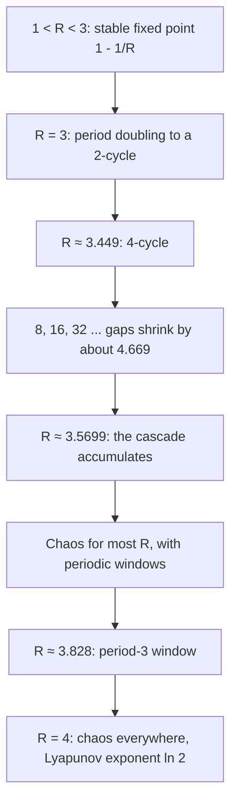

## A tame equation, a wild computation

Solve the logistic equation $y' = y(1 - y)$ with Euler's method (Lesson 5) from $y_0 = 0.1$.
With step $h = 0.5$ the values climb smoothly toward 1, as the true solution does. With
$h = 1.5$ they overshoot: $0.1, 0.235, 0.505, 0.880, 1.038, 0.979, 1.010, \dots$, still settling
on 1 but wobbling. With $h = 2.5$ they never settle at all; after a while they repeat the
four values $0.536, 0.701, 1.158, 1.225$ forever. Larger steps make things wilder still.

The differential equation didn't change; only the computation did. Euler's method replaces
the equation with a rule $y_{n+1} = g(y_n)$, and rules like this, **iterated maps**, have a
life of their own. They also model populations that breed in separate seasons (many insects,
annual plants), where next year's count depends on this year's. This lesson studies the most
famous one, made popular by the ecologist Robert May in a 1976 paper, and finds the simplest
known road to chaos.

## From Euler's method to the logistic map

Euler on $y' = ry(1 - y)$ with step $h$ gives $y_{n+1} = y_n + hry_n(1 - y_n) = (1 + hr)y_n - hry_n^2$.
Rescale with $x_n = \dfrac{hr}{1 + hr}\,y_n$. Multiplying the Euler rule by $\dfrac{hr}{1 + hr}$:

$$x_{n+1} = hr\,y_n - \frac{(hr)^2}{1 + hr}y_n^2 = (1 + hr)x_n - (1 + hr)x_n^2.$$

So with $R = 1 + hr$,

$$x_{n+1} = f(x_n), \qquad f(x) = Rx(1 - x).$$

This is the **logistic map**. Every Euler computation of the logistic equation is a logistic map
in disguise, with $R$ growing with the step size. For $0 \le R \le 4$, $f$ maps $[0, 1]$ into
itself, so the iterates stay bounded.

## Fixed points and their stability

A **fixed point** of a map is a value with $f(x^*) = x^*$: start there and you stay there. It
plays the role an equilibrium plays for a differential equation.

**Stability test.** Write $x_n = x^* + e_n$ with $e_n$ small. Then
$x^* + e_{n+1} = f(x^* + e_n) \approx f(x^*) + f'(x^*)e_n$, so

$$e_{n+1} \approx f'(x^*)\,e_n.$$

The error is multiplied by the **multiplier** $f'(x^*)$ at every step. If $|f'(x^*)| < 1$ the error
shrinks and $x^*$ is stable; if $|f'(x^*)| > 1$ it grows and $x^*$ is unstable. The sign
matters too: a positive multiplier gives a steady approach from one side, a negative one
an approach that alternates sides.

Notice the difference from Lesson 14. For $y' = f(y)$ the test is the *sign* of $f'(y^*)$; for a
map it is the *size* of $f'(x^*)$ compared with 1. Overshooting is impossible for a
one-dimensional differential equation but natural for a map.

For the logistic map, $f'(x) = R(1 - 2x)$ and the fixed points solve $Rx(1 - x) = x$:

- $x^* = 0$, multiplier $f'(0) = R$: stable for $0 < R < 1$ (the population dies out).
- $x^* = 1 - \dfrac1R$ (positive when $R > 1$), multiplier $R\left(1 - 2 + \dfrac2R\right) = 2 - R$:
  stable when $|2 - R| < 1$, that is, $1 < R < 3$. The approach is one-sided for $R < 2$ and alternating for $2 < R < 3$.

Translated back to Euler: $R < 3$ means $hr < 2$. That matches the stability condition for
Euler's method from Lesson 17: near $y = 1$ the equation behaves like $u' = -ru$,
and Euler is stable for that only when $hr < 2$.

### Example 1

Take $R = 2.8$ and $x_0 = 0.1$. The fixed point is $x^* = 1 - 1/2.8 \approx 0.6429$, with
multiplier $2 - 2.8 = -0.8$. So the iterates converge, overshooting each time, and the
distance to $x^*$ shrinks by a factor of about 0.8 per step. Iterating:
$0.1 \to 0.252 \to 0.528 \to 0.698 \to 0.590 \to 0.677 \to 0.612 \to \dots$, closing in on
$0.643$ from alternate sides.

A **cobweb diagram** shows this. Graph $y = f(x)$ and the diagonal $y = x$. From $x_0$ on the
horizontal axis, go vertically to the curve (that height is $x_1$), then horizontally to the
diagonal (which moves $x_1$ to the horizontal axis), then vertically to the curve again, and so on.
Fixed points are where the curve crosses the diagonal.

```plot
{"x": [0, 1], "y": [0, 1], "equal": true, "xLabel": "xₙ", "yLabel": "xₙ₊₁", "functions": [{"f": "2.8x*(1-x)", "label": "y = 2.8x(1 − x)"}, {"f": "x", "dashed": true, "label": "y = x"}], "segments": [{"from": [0.1, 0], "to": [0.1, 0.252]}, {"from": [0.1, 0.252], "to": [0.252, 0.252]}, {"from": [0.252, 0.252], "to": [0.252, 0.5278]}, {"from": [0.252, 0.5278], "to": [0.5278, 0.5278]}, {"from": [0.5278, 0.5278], "to": [0.5278, 0.6978]}, {"from": [0.5278, 0.6978], "to": [0.6978, 0.6978]}, {"from": [0.6978, 0.6978], "to": [0.6978, 0.5904]}, {"from": [0.6978, 0.5904], "to": [0.5904, 0.5904]}, {"from": [0.5904, 0.5904], "to": [0.5904, 0.6771]}, {"from": [0.5904, 0.6771], "to": [0.6771, 0.6771]}, {"from": [0.6771, 0.6771], "to": [0.6771, 0.6122]}, {"from": [0.6771, 0.6122], "to": [0.6122, 0.6122]}, {"from": [0.6122, 0.6122], "to": [0.6122, 0.6648]}, {"from": [0.6122, 0.6648], "to": [0.6648, 0.6648]}, {"from": [0.6648, 0.6648], "to": [0.6648, 0.624]}, {"from": [0.6648, 0.624], "to": [0.624, 0.624]}, {"from": [0.624, 0.624], "to": [0.624, 0.657]}, {"from": [0.624, 0.657], "to": [0.657, 0.657]}, {"from": [0.657, 0.657], "to": [0.657, 0.631]}, {"from": [0.657, 0.631], "to": [0.631, 0.631]}], "points": [{"at": [0.6429, 0.6429], "label": "x* ≈ 0.643"}], "caption": "Cobweb for R = 2.8 from x₀ = 0.1: the path spirals into the fixed point x* ≈ 0.643, overshooting each time because the multiplier is −0.8."}
```

## Period doubling

At $R = 3$ the multiplier of $x^* = 1 - 1/R$ reaches $-1$, and beyond that the fixed point
repels. The iterates don't escape (they can't leave $[0, 1]$); instead they settle into a
**2-cycle**, alternating between two values $p$ and $q$ with $f(p) = q$ and $f(q) = p$. This
change is a **period-doubling bifurcation**, the map's version of a Hopf bifurcation: a
steady state gives way to a repeating pattern.

The 2-cycle points are fixed points of $f(f(x))$ that aren't fixed points of $f$. Dividing the
fourth-degree equation $f(f(x)) = x$ by the factors for the known fixed points leaves
$R^2x^2 - R(R + 1)x + (R + 1) = 0$, so

$$p, q = \frac{(R + 1) \pm \sqrt{(R - 3)(R + 1)}}{2R},$$

real only for $R \ge 3$. By the chain rule, the multiplier of the cycle is
$(f \circ f)'(p) = f'(q)f'(p)$, which works out to $4 + 2R - R^2$. It lies between $-1$ and $1$
for $3 < R < 1 + \sqrt6 \approx 3.449$.

### Example 2

For $R = 3.2$: $\sqrt{(0.2)(4.2)} = \sqrt{0.84} \approx 0.9165$, so
$p \approx \dfrac{4.2 + 0.9165}{6.4} \approx 0.7995$ and $q \approx \dfrac{4.2 - 0.9165}{6.4} \approx 0.5130$.
Check: $3.2(0.7995)(0.2005) \approx 0.5130$. The cycle's multiplier is
$4 + 6.4 - 10.24 = 0.16$, so the cycle is stable. Iterating from $x_0 = 0.2$ gives
$0.512, 0.7995, 0.5129, 0.7995, 0.513, \dots$, exactly this cycle.

At $R = 1 + \sqrt6$ the 2-cycle's multiplier reaches $-1$ and it doubles to a 4-cycle; that
doubles to an 8-cycle, and so on, each step coming sooner:

| Period born | 2 | 4 | 8 | 16 |
|---|---|---|---|---|
| At $R \approx$ | 3 | 3.4495 | 3.5441 | 3.5644 |

The gaps between these values shrink by a factor approaching
$\delta \approx 4.669$, the **Feigenbaum constant**, and the doublings pile up at
$R_\infty \approx 3.5699$. Mitchell Feigenbaum found in the mid-1970s that the same $\delta$
appears for every smooth map with a single hump, not just this one, and experiments on
fluid convection and electronic circuits later measured period-doubling cascades with
ratios close to it.


## Chaos

Past $R_\infty$, for most values of $R$ the iterates never repeat, never settle and never
escape. They are **chaotic**: bounded, not periodic and not approaching anything periodic,
and *sensitive to the starting value*. The orbit diagram above shows it: for each $R$ it
plots the values the iterates keep visiting after a long run. Inside the chaotic range are
windows of order; the widest is the period-3 window, which opens at $R = 1 + \sqrt8 \approx 3.828$.
In 1975 Tien-Yien Li and James Yorke proved that a continuous map of an interval with a
point of period 3 also has points of every other period, and called their paper "Period
three implies chaos" (Oleksandr Sharkovsky had proved a more general ordering of periods in 1964).



### Measuring chaos: the Lyapunov exponent

How fast do nearby starting values separate? An error $e_0$ is multiplied by roughly
$f'(x_0)$, then $f'(x_1)$, and so on, so after $n$ steps
$|e_n| \approx |e_0|\,|f'(x_0)f'(x_1)\cdots f'(x_{n-1})|$. Writing that product as $e^{n\lambda}$ defines the
**Lyapunov exponent**

$$\lambda = \lim_{n \to \infty} \frac1n \sum_{k=0}^{n-1} \ln|f'(x_k)|,$$

the average exponential rate of separation per step. A negative $\lambda$ means nearby
orbits converge (a stable fixed point or cycle); a positive $\lambda$ means **sensitive dependence on initial conditions**, the signature of chaos.

### Example 3

On the stable 2-cycle at $R = 3.2$, the orbit alternates between $p$ and $q$, so
$\lambda = \tfrac12\left(\ln|f'(p)| + \ln|f'(q)|\right) = \tfrac12\ln|f'(p)f'(q)| = \tfrac12\ln 0.16 = \ln 0.4 \approx -0.916.$
Negative, as it must be for a stable cycle: errors shrink by a factor of $0.4$ per step on average.

At $R = 4$ the exponent is $\ln 2 \approx 0.693$ for almost every starting point (a numerical
average over a million steps gives $0.6931$; there is also an exact proof). Errors double
each step on average. Start two orbits at $0.3$ and $0.3000001$, a difference of $10^{-7}$: since
$2^{23} \approx 10^7$, the difference should become as large as the values themselves after
roughly 20 steps. The computation agrees: they still match to two decimals at step 13, differ
by about $0.065$ at step 20, and are unrelated after that.

```plot
{"x": [0, 30], "y": [0, 1], "xLabel": "n", "yLabel": "xₙ", "segments": [{"from": [0, 0.3], "to": [1, 0.84]}, {"from": [1, 0.84], "to": [2, 0.538]}, {"from": [2, 0.538], "to": [3, 0.994]}, {"from": [3, 0.994], "to": [4, 0.022]}, {"from": [4, 0.022], "to": [5, 0.088]}, {"from": [5, 0.088], "to": [6, 0.321]}, {"from": [6, 0.321], "to": [7, 0.872]}, {"from": [7, 0.872], "to": [8, 0.448]}, {"from": [8, 0.448], "to": [9, 0.989]}, {"from": [9, 0.989], "to": [10, 0.043]}, {"from": [10, 0.043], "to": [11, 0.166]}, {"from": [11, 0.166], "to": [12, 0.554]}, {"from": [12, 0.554], "to": [13, 0.988]}, {"from": [13, 0.988], "to": [14, 0.046]}, {"from": [14, 0.046], "to": [15, 0.177]}, {"from": [15, 0.177], "to": [16, 0.583]}, {"from": [16, 0.583], "to": [17, 0.973]}, {"from": [17, 0.973], "to": [18, 0.106]}, {"from": [18, 0.106], "to": [19, 0.379]}, {"from": [19, 0.379], "to": [20, 0.942]}, {"from": [20, 0.942], "to": [21, 0.219]}, {"from": [21, 0.219], "to": [22, 0.685]}, {"from": [22, 0.685], "to": [23, 0.863]}, {"from": [23, 0.863], "to": [24, 0.472]}, {"from": [24, 0.472], "to": [25, 0.997]}, {"from": [25, 0.997], "to": [26, 0.013]}, {"from": [26, 0.013], "to": [27, 0.05]}, {"from": [27, 0.05], "to": [28, 0.188]}, {"from": [28, 0.188], "to": [29, 0.612]}, {"from": [29, 0.612], "to": [30, 0.95]}, {"from": [14, 0.046], "to": [15, 0.174], "dashed": true, "color": "#a33a2c"}, {"from": [15, 0.174], "to": [16, 0.576], "dashed": true, "color": "#a33a2c"}, {"from": [16, 0.576], "to": [17, 0.977], "dashed": true, "color": "#a33a2c"}, {"from": [17, 0.977], "to": [18, 0.089], "dashed": true, "color": "#a33a2c"}, {"from": [18, 0.089], "to": [19, 0.325], "dashed": true, "color": "#a33a2c"}, {"from": [19, 0.325], "to": [20, 0.877], "dashed": true, "color": "#a33a2c"}, {"from": [20, 0.877], "to": [21, 0.431], "dashed": true, "color": "#a33a2c"}, {"from": [21, 0.431], "to": [22, 0.981], "dashed": true, "color": "#a33a2c"}, {"from": [22, 0.981], "to": [23, 0.075], "dashed": true, "color": "#a33a2c"}, {"from": [23, 0.075], "to": [24, 0.277], "dashed": true, "color": "#a33a2c"}, {"from": [24, 0.277], "to": [25, 0.8], "dashed": true, "color": "#a33a2c"}, {"from": [25, 0.8], "to": [26, 0.639], "dashed": true, "color": "#a33a2c"}, {"from": [26, 0.639], "to": [27, 0.922], "dashed": true, "color": "#a33a2c"}, {"from": [27, 0.922], "to": [28, 0.287], "dashed": true, "color": "#a33a2c"}, {"from": [28, 0.287], "to": [29, 0.819], "dashed": true, "color": "#a33a2c"}, {"from": [29, 0.819], "to": [30, 0.594], "dashed": true, "color": "#a33a2c"}], "caption": "Logistic map with R = 4. Solid: x₀ = 0.3. Dashed (drawn from step 14, where the two first differ visibly): x₀ = 0.3000001. A difference of one part in ten million grows to order one in about 20 steps."}
```

This is chaos in the technical sense: the rule is completely deterministic, yet long-range
prediction needs impossibly precise starting data. Practical prediction is limited by the
Lyapunov exponent: each extra step of reliable forecast costs a fixed factor in starting accuracy.

## What this means for numerical solutions

Back to the opening. The logistic *differential equation* can't oscillate, let alone be chaotic:
its solutions are monotone. All the period doubling and chaos above lives in Euler's method
with too large a step. The lesson for practice: when a numerical solution looks strange,
halve the step size and see whether the strangeness survives. (Lesson 93 shows that chaos in
a genuine differential equation is a different matter: it survives every refinement.)

## Common mistakes

- **Using the ODE stability test on a map.** For a map, compare $|f'(x^*)|$ with 1; the sign of $f'$
  only says whether the approach alternates.
- **Treating a 2-cycle point as a fixed point of $f$.** It is a fixed point of $f \circ f$; $f$ swaps $p$ and $q$.
- **Multiplying the wrong derivatives for a cycle's multiplier.** Use $f'$ at each point of the cycle: $f'(p)f'(q)$.
- **Thinking chaos means randomness.** The logistic map is deterministic; chaos is sensitive dependence plus non-periodic, bounded behavior.
- **Blaming the model for a step-size artifact.** Euler's method on a smooth logistic equation can look chaotic.

## Key points

- Euler on $y' = ry(1 - y)$ with step $h$ is the logistic map $x_{n+1} = Rx_n(1 - x_n)$, $R = 1 + hr$.
- A fixed point is stable if $|f'(x^*)| < 1$; for the logistic map, $x^* = 1 - 1/R$ has multiplier $2 - R$, stable for $1 < R < 3$.
- Period doublings at $R = 3, 3.449, 3.544, \dots$ accumulate at $R_\infty \approx 3.5699$; gap ratios approach $\delta \approx 4.669$.
- Chaos: bounded, aperiodic, sensitive. Lyapunov exponent $\lambda = \lim \frac1n\sum\ln|f'(x_k)|$; positive means chaos ($\ln 2$ at $R = 4$).
- A period-3 window opens at $R = 1 + \sqrt8 \approx 3.828$.
