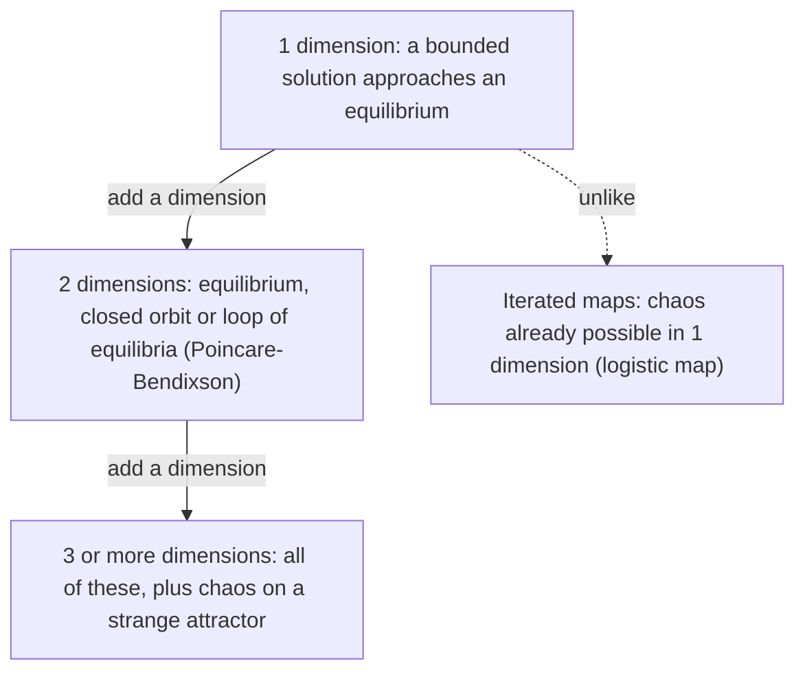

## Chaos in a real differential equation

Lesson 92 found chaos in the logistic map, but only as a side effect of taking Euler steps
that were far too large. Can an honest differential equation, solved as accurately as you
like, be chaotic? Lesson 90 rules this out for autonomous systems in the plane: by
Poincaré–Bendixson, a bounded trajectory there approaches an equilibrium, a closed orbit or a
loop of them. Trajectories can't cross, and in two dimensions that leaves no room to tangle.

In three dimensions trajectories can pass over and under each other, and chaos becomes
possible. (A forced second-order equation such as a driven pendulum counts as three-dimensional,
because the forcing's phase acts as a third variable.) This lesson studies the most famous
example, a system of three equations that Edward Lorenz, a meteorologist at MIT, published in
1963, and uses every tool of this module on it.

## The Lorenz equations

The **Lorenz equations** are

$$x' = \sigma(y - x), \qquad y' = rx - y - xz, \qquad z' = xy - bz,$$

with positive parameters $\sigma$, $r$, $b$. Lorenz derived them by cutting a model of a fluid
layer heated from below (a simplified model of atmospheric convection due to Barry Saltzman)
down to three variables: $x$ measures the speed of the convection rolls, $y$ the temperature
difference between rising and sinking fluid, and $z$ how far the vertical temperature profile is
from a straight line. The parameter $r$ measures how strongly the layer is heated. The
truncation is drastic, so the equations are a caricature of real convection, not a weather
model; their importance is what they showed was possible. Lorenz's classic values, used
below unless stated otherwise, are $\sigma = 10$, $b = 8/3$ and $r = 28$.

Lorenz later told how he met sensitive dependence: around 1961, restarting a run of a larger
12-variable weather model from printed numbers rounded to three decimals, he found the new run
drifting away from the old one until the two were unrelated. The 1963 paper set out to explain
that kind of behavior in the smallest possible system.

## Three structural facts

**Symmetry.** Replacing $(x, y, z)$ with $(-x, -y, z)$ leaves the equations unchanged, so the
mirror image of any solution is a solution.

**Volumes shrink.** For a system $\mathbf{x}' = \mathbf{F}(\mathbf{x})$, the divergence
$\nabla\cdot\mathbf{F}$ is the rate at which a small blob of starting points changes its volume, per
unit volume. A system with negative divergence is called **dissipative**. Here

$$\frac{\partial}{\partial x}\big(\sigma(y - x)\big) + \frac{\partial}{\partial y}(rx - y - xz) + \frac{\partial}{\partial z}(xy - bz) = -\sigma - 1 - b,$$

a negative constant, so every volume shrinks like $e^{-(\sigma + 1 + b)t}$.

**Bounded.** One can build a large ellipsoid that every trajectory eventually enters and never
leaves (a three-dimensional trapping region; the construction is omitted here).

### Example 1

With $\sigma = 10$, $b = 8/3$: $\sigma + 1 + b = 41/3 \approx 13.67$. After one time unit a blob of
starting points has volume $e^{-13.67} \approx 1.2 \times 10^{-6}$ times its original volume. So
whatever the trajectories settle onto has zero volume. Yet, as we'll see, it isn't a point or
a closed loop either.

## Equilibria and their stability

### Example 2

Find the equilibria and classify the origin for $r = 28$.

- $x' = 0$ gives $y = x$. Then $z' = 0$ gives $z = x^2/b$, and $y' = 0$ gives
  $x(r - 1 - z) = 0$.
- So either $x = 0$ (the origin) or $z = r - 1$ and $x^2 = b(r - 1)$. For $r > 1$ the second option
  gives two more equilibria:

$$C_\pm = \left(\pm\sqrt{b(r - 1)},\ \pm\sqrt{b(r - 1)},\ r - 1\right).$$

  With $b = 8/3$, $r = 28$: $\sqrt{72} = 6\sqrt2 \approx 8.49$, so $C_\pm \approx (\pm 8.49, \pm 8.49, 27)$.
- At the origin the Jacobian is $\begin{bmatrix} -\sigma & \sigma & 0 \\ r & -1 & 0 \\ 0 & 0 & -b \end{bmatrix}$.
  The $z$-direction separates off with eigenvalue $-b$. The $2 \times 2$ block gives
  $\lambda^2 + (\sigma + 1)\lambda - \sigma(r - 1) = 0$, so

$$\lambda = \frac{-(\sigma + 1) \pm \sqrt{(\sigma + 1)^2 + 4\sigma(r - 1)}}{2}.$$

  For $r = 28$: $\lambda = \dfrac{-11 \pm \sqrt{1201}}{2} \approx 11.83$ or $-22.83$, plus $-8/3$. One positive
  eigenvalue: the origin is a saddle. (For $r < 1$ all three are negative, and the origin attracts
  everything; at $r = 1$ the pair $C_\pm$ is born in a pitchfork bifurcation, Lesson 15's picture.)

**Losing $C_\pm$.** For $r$ a little above 1, $C_\pm$ are stable: the rolls turn steadily one way or
the other. Their Jacobian has one negative real eigenvalue and a complex pair, and when
$\sigma > b + 1$ the complex pair crosses the imaginary axis at

$$r_H = \frac{\sigma(\sigma + b + 3)}{\sigma - b - 1} = \frac{10\,(47/3)}{19/3} = \frac{470}{19} \approx 24.74.$$

This is a Hopf bifurcation (Lesson 91), and a *subcritical* one: no small stable cycle appears.
Unstable cycles shrink onto $C_\pm$ as $r$ rises to $r_H$, and above it trajectories near $C_\pm$
spiral outward to something far away. At $r = 28$ the eigenvalues at $C_\pm$ are about
$-13.85$ and $0.094 \pm 10.19i$: a strongly attracting direction, and a plane in which
trajectories spiral slowly outward.

## The strange attractor

So at $r = 28$ all three equilibria are unstable, and numerical work finds no stable closed
orbit either. Yet trajectories stay bounded and volumes shrink. What do solutions do?

A trajectory spirals outward around $C_+$ for a few turns, gets flung across to spiral around
$C_-$, returns, and so on. The number of turns on each side before switching never settles
into a pattern. All trajectories approach the same butterfly-shaped set, an **attractor**: a
bounded set that nearby trajectories approach and stay near. It is a **strange attractor**:
on it, motion has sensitive dependence on initial conditions, and the set itself has a
layered, fractal structure, like infinitely many sheets packed together (numerical estimates
put its fractal dimension near 2.06). It has zero volume, consistent with Example 1, but it is
far more than a curve.

Whether the attractor seen on computers truly exists for the exact equations stayed an open
problem for decades. Warwick Tucker settled it with a computer-assisted proof published in 2002.

**The Lorenz map.** Lorenz found order inside the chaos. Record each local maximum $z_n$ of
$z(t)$ and plot $z_{n+1}$ against $z_n$: the points fall very close to a single curve shaped like
a tent, whose slope is steeper than 1 in size everywhere. By Lesson 92's reasoning, every
fixed point of such a map is unstable and errors grow at each step. The continuous flow
contains an iterated map, and the map's chaos is the flow's chaos.

## How fast does prediction fail?

Two solutions starting a distance $\delta_0$ apart separate on average like $\delta_0 e^{\lambda t}$,
where $\lambda$ is now the largest **Lyapunov exponent** of the flow (the continuous-time
version of Lesson 92's exponent). For the classic Lorenz system $\lambda \approx 0.91$ per time unit
(a numerical estimate; published values are about 0.906). If you can tolerate an error of
size $\Delta$, the **predictability horizon** is

$$t \approx \frac1\lambda \ln\frac{\Delta}{\delta_0}.$$

### Example 3

Starting error $\delta_0 = 10^{-6}$, tolerance $\Delta = 1$:
$t \approx \dfrac{\ln 10^6}{0.91} \approx \dfrac{13.8}{0.91} \approx 15$ time units. Now improve the starting
accuracy a millionfold, to $\delta_0 = 10^{-12}$: $t \approx \dfrac{27.6}{0.91} \approx 30$. A million times
better data only doubles the horizon. Each factor of 10 in accuracy buys just
$\ln 10/0.91 \approx 2.5$ time units.

The horizon is an average-rate estimate, not a precise prediction. Two solutions computed from
$(1, 1, 1)$ and $(1, 1, 1.000001)$ stay within $10^{-5}$ of each other until about $t = 10$,
differ by about $0.007$ at $t = 20$, and by more than 1 at $t = 25$. The separation grows in
uneven bursts, faster in some parts of the attractor than others.

This is the **butterfly effect**, named after the title of a 1972 talk by Lorenz that asked
whether the flap of a butterfly's wings in Brazil could set off a tornado in Texas. Real
weather forecasting faces the same limit, which is one reason forecasters run ensembles of
slightly different starting states and report probabilities.

## What numerical solutions can and can't tell you

Every numerical method (Lesson 17's RK4 included) makes a small error at each step, and in a
chaotic system that error is amplified like any other. So no computed Lorenz trajectory
matches the true solution with the same starting point beyond a limited time, however small
the step. What *is* reliable: the shape of the attractor, the fraction of time spent near each
wing, and the Lyapunov exponent itself. These come out the same for any small enough step
size and any typical starting point. This is a practical observation, backed by theory for
some systems; for the Lorenz system it is supported by extensive computation rather than a
complete proof. Compare Lesson 92, where the chaos disappeared when the step shrank; here it
survives every refinement, because it belongs to the equations.

## Other chaotic systems

Many other systems are chaotic in the same sense: the Rössler equations (a simpler
three-variable system from 1976), a damped pendulum driven by a periodic torque, and the forced
Duffing oscillator $x'' + cx' + x^3 = F\cos\omega t$ for suitable parameters. Their common
ingredients are the ones the Lorenz system shows: at least three dimensions (counting the
forcing phase), dissipation that keeps solutions on a thin attractor, and stretching that
separates nearby trajectories, followed by folding that keeps them bounded.

## Common mistakes

- **Looking for chaos in a planar autonomous system.** Poincaré–Bendixson forbids it; you need
  three dimensions (or forcing, or a map).
- **Equating "unpredictable" with "random."** The Lorenz equations are deterministic; the problem is
  the exponential growth of tiny errors.
- **Concluding that more accuracy solves the problem.** Better starting data extends the horizon only
  logarithmically.
- **Forgetting the $z$-direction at the origin.** The Jacobian there is $3 \times 3$; $z$ contributes the eigenvalue $-b$.
- **Treating the Hopf at $r_H$ as supercritical.** No small stable cycles appear; trajectories leave
  for the distant attractor.

## Key points

- Lorenz: $x' = \sigma(y - x)$, $y' = rx - y - xz$, $z' = xy - bz$; classic values $\sigma = 10$, $b = 8/3$, $r = 28$.
- Divergence $-(\sigma + 1 + b)$: volumes shrink, so the attractor has zero volume.
- Equilibria: origin (saddle for $r > 1$) and $C_\pm = (\pm\sqrt{b(r-1)}, \pm\sqrt{b(r-1)}, r - 1)$, stable until a subcritical Hopf at $r_H = \sigma(\sigma + b + 3)/(\sigma - b - 1) \approx 24.74$.
- At $r = 28$: a strange attractor with sensitive dependence; Lyapunov exponent about 0.91.
- Predictability horizon $t \approx \frac1\lambda\ln(\Delta/\delta_0)$: grows only logarithmically with accuracy.
- Chaos in autonomous ODEs needs at least three dimensions.
