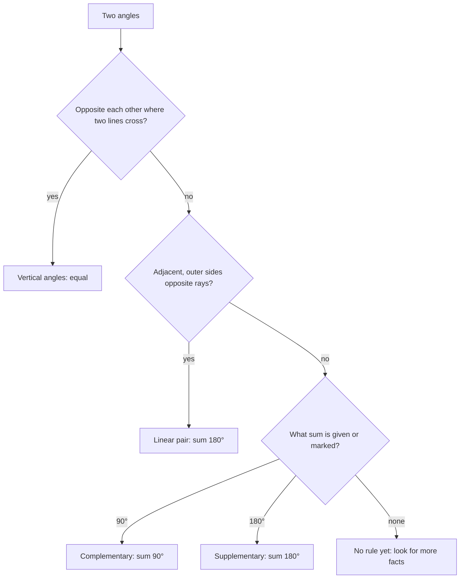

In the last lesson we measured single angles. Most geometry problems, though, involve angles that sit next to each other or across from each other, and their measures are tied together. This lesson names the important pairs and the relationships between them. These relationships are the first facts you will *prove*, and they show up in nearly every diagram for the rest of the course.

## Adjacent angles and linear pairs

**Adjacent angles** are two coplanar angles that share a vertex and a side but have no interior points in common. They sit side by side, like slices of pie next to each other.

A **linear pair** is a pair of adjacent angles whose non-shared sides are opposite rays. Together they make a straight line, so their measures add to $180^\circ$. This is the **Linear Pair Postulate**.

```shape
{"segments": [{"from": [-6, 0], "to": [6, 0]}, {"from": [0, 0], "to": [3.5, 4.8]}], "curves": [{"x": "1.3cos(t)", "y": "1.3sin(t)", "t": [0, 0.94]}, {"x": "1.6cos(t)", "y": "1.6sin(t)", "t": [0.94, 3.1416]}], "labels": [{"at": [2.1, 0.8], "text": "1"}, {"at": [-1.3, 2.0], "text": "2"}], "caption": "Angles 1 and 2 form a linear pair: m∠1 + m∠2 = 180°."}
```

## Complementary and supplementary angles

These two words describe *any* pair of angles by their sum, whether or not they touch.

- **Complementary angles** have measures that add to $90^\circ$. Each is the **complement** of the other.
- **Supplementary angles** have measures that add to $180^\circ$. Each is the **supplement** of the other.

So the complement of an angle of $x^\circ$ is $(90 - x)^\circ$, and its supplement is $(180 - x)^\circ$. Only acute angles have complements. Every angle less than $180^\circ$ has a supplement. A memory aid: "C" comes before "S" in the alphabet, and 90 comes before 180.

A linear pair is always supplementary, but supplementary angles need not form a linear pair. Two angles of $120^\circ$ and $60^\circ$ in different corners of a page are supplementary but not adjacent.

The picture compares the three situations side by side.


### Example 1

An angle measures $24^\circ$ more than its complement. Find the angle.

**Step 1.** Let the angle be $x$. Its complement is $90 - x$.

**Step 2.** Translate: $x = (90 - x) + 24$.

**Step 3.** Solve: $2x = 114$, so $x = 57^\circ$. Its complement is $33^\circ$, and $57 - 33 = 24$ checks.

### Example 2

The supplement of an angle is five times the angle's complement. Find the angle.

**Step 1.** Supplement $= 180 - x$; complement $= 90 - x$.

**Step 2.** Translate: $180 - x = 5(90 - x) = 450 - 5x$.

**Step 3.** Solve: $4x = 270$, so $x = 67.5^\circ$.

**Check.** Supplement $112.5^\circ$, complement $22.5^\circ$, and $5 \times 22.5 = 112.5$.

## Vertical angles

When two lines cross, they form four angles. The angles directly across from each other are **vertical angles**. There are two pairs of them, and each pair is congruent.

```shape
{"segments": [{"from": [-5, -2.5], "to": [5, 2.5]}, {"from": [-4, 3], "to": [4, -3]}], "labels": [{"at": [1.6, 0], "text": "1"}, {"at": [0, 1.25], "text": "2"}, {"at": [-1.6, 0], "text": "3"}, {"at": [0, -1.25], "text": "4"}], "caption": "Two intersecting lines: ∠1 and ∠3 are vertical, as are ∠2 and ∠4."}
```

**Vertical Angles Theorem.** Vertical angles are congruent.

*Why it's true.* In the figure, $\angle 1$ and $\angle 2$ form a linear pair, so $m\angle 1 + m\angle 2 = 180^\circ$. Also $\angle 2$ and $\angle 3$ form a linear pair, so $m\angle 2 + m\angle 3 = 180^\circ$. Both $m\angle 1$ and $m\angle 3$ equal $180^\circ - m\angle 2$, so $m\angle 1 = m\angle 3$. The same argument works for $\angle 2$ and $\angle 4$.

This short argument is a proof: it uses only a postulate (linear pairs) and algebra to reach a new fact. You will write it formally in Module 2.

It also tells us something useful: once you know *one* of the four angles at an intersection, you know all four. If $m\angle 1 = 40^\circ$, then $m\angle 3 = 40^\circ$ and $m\angle 2 = m\angle 4 = 140^\circ$.

### Example 3

Two lines intersect. One angle measures $(4x + 15)^\circ$ and the angle vertical to it measures $(6x - 25)^\circ$. Find all four angles.

**Step 1.** Vertical angles are congruent: $4x + 15 = 6x - 25$.

**Step 2.** Solve: $40 = 2x$, so $x = 20$.

**Step 3.** That angle is $4(20) + 15 = 95^\circ$ (and $6(20) - 25 = 95^\circ$ checks).

**Step 4.** The other two angles form linear pairs with it: $180 - 95 = 85^\circ$ each.

The four angles are $95^\circ, 85^\circ, 95^\circ, 85^\circ$, and they add to $360^\circ$, as angles around a point always do.

## Angles around a point

The four angles at an intersection add to $360^\circ$, and this is true of *any* set of angles that fill the space around a point without overlapping. You can see why by splitting the full turn into two straight angles: each straight angle is $180^\circ$, and $180 + 180 = 360$. This fact lets you find a missing angle when several rays come out of one point.

### Example 4

Rays from a point make four non-overlapping angles that fill the turn, measuring $x^\circ$, $2x^\circ$, $(x + 20)^\circ$ and $100^\circ$. Find $x$.

**Step 1.** Angles around a point add to $360^\circ$: $x + 2x + (x + 20) + 100 = 360$.

**Step 2.** Combine: $4x + 120 = 360$, so $4x = 240$ and $x = 60$.

**Step 3.** The angles are $60^\circ$, $120^\circ$, $80^\circ$ and $100^\circ$, which add to $360^\circ$.

## Perpendicular lines

Lines that intersect to form a right angle are **perpendicular**, written $\ell \perp m$. When one of the four angles is $90^\circ$, its vertical partner is $90^\circ$ and the two linear-pair partners are $180 - 90 = 90^\circ$, so all four are right angles. A right-angle box at one corner is enough.

## Which rule applies?

When a problem shows two angles, decide which relationship they have before writing an equation. Vertical angles give an equation of the form "one = the other"; the other relationships give "sum = 90" or "sum = 180".



## Common mistakes

- **Swapping complement and supplement.** Complement uses 90, supplement uses 180.
- **Setting vertical angles supplementary.** Vertical angles are *equal*; it's the *adjacent* ones at an intersection that add to $180^\circ$.
- **Calling any two angles that look across from each other "vertical".** They must be formed by the same two intersecting lines.
- **Assuming a right angle from a picture.** Unless a box marks it or it is given, don't assume $90^\circ$.
- **Translating "more than" backwards.** "$x$ is 24 more than its complement" is $x = (90 - x) + 24$, not $x + 24 = 90 - x$.

## Key points

- Adjacent angles share a vertex and side, with no overlap.
- A linear pair is supplementary (adds to $180^\circ$).
- Complementary: sum $90^\circ$. Supplementary: sum $180^\circ$.
- Vertical angles are congruent; know one angle at an intersection and you know all four.
- Perpendicular lines form four right angles.
