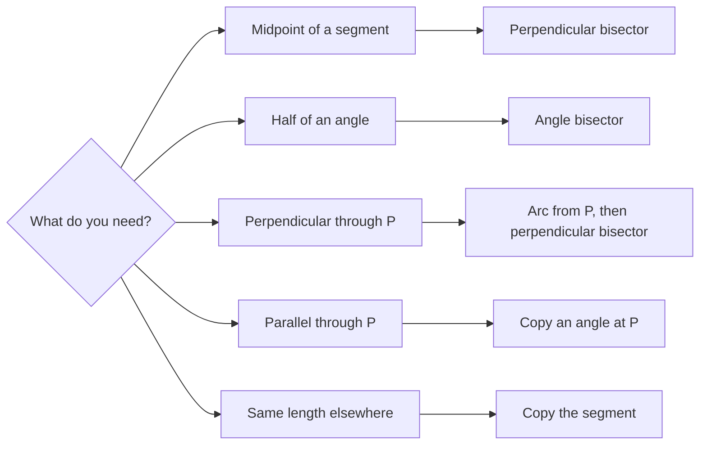

So far we have measured with a ruler and protractor. The ancient Greeks set themselves a stricter challenge: draw figures exactly using only a **straightedge** (an unmarked ruler, for drawing lines) and a **compass** (for drawing circles and copying distances). Drawings made this way are called **constructions**. They matter for two reasons. First, they are exact: no measuring error. Second, each one secretly relies on a theorem, so constructions are a hands-on preview of the congruence ideas in Module 4.

## The two tools and what they can do

- The straightedge draws the line through two points you already have. It has no scale.
- The compass draws a circle (or a piece of one, an **arc**) with a chosen center through a chosen point. Equivalently, it can "hold" a distance and transfer it.

Every point in a construction comes from an intersection: of two lines, a line and an arc, or two arcs. That's the whole toolkit.

## Construction 1: copy a segment

*Goal: given $\overline{AB}$ and a point $C$ on a ray, make $\overline{CD} \cong \overline{AB}$.*

1. Put the compass point on $A$ and open it to reach $B$.
2. Without changing the opening, put the point on $C$ and draw an arc crossing the ray. Call the crossing $D$.

*Why it works:* every point on the arc is the same distance from $C$ as $B$ is from $A$, so $CD = AB$.

## Construction 2: perpendicular bisector of a segment

*Goal: find the midpoint of $\overline{AB}$ and the line through it perpendicular to $\overline{AB}$.*

1. Open the compass to more than half of $AB$.
2. With the point on $A$, draw an arc above and below the segment.
3. With the *same* opening and the point on $B$, draw arcs crossing the first two. Label the crossings $P$ (above) and $Q$ (below).
4. Draw $\overleftrightarrow{PQ}$. It crosses $\overline{AB}$ at the midpoint $M$, and $\overleftrightarrow{PQ} \perp \overline{AB}$.

```shape
{"segments": [{"from": [0, 0], "to": [8, 0]}, {"from": [4, -4.5], "to": [4, 4.5], "dashed": true}, {"from": [0, 0], "to": [4, 3.48]}, {"from": [8, 0], "to": [4, 3.48]}], "curves": [{"x": "5.3cos(t)", "y": "5.3sin(t)", "t": [0.55, 0.85]}, {"x": "5.3cos(t)", "y": "-5.3sin(t)", "t": [0.55, 0.85]}, {"x": "8 - 5.3cos(t)", "y": "5.3sin(t)", "t": [0.55, 0.85]}, {"x": "8 - 5.3cos(t)", "y": "-5.3sin(t)", "t": [0.55, 0.85]}], "points": [{"at": [0, 0], "label": "A"}, {"at": [8, 0], "label": "B"}, {"at": [4, 3.48], "label": "P"}, {"at": [4, -3.48], "label": "Q"}, {"at": [4, 0], "label": "M"}], "rightAngles": [[[4, 0], [8, 0], [4, 3]]], "caption": "Equal arcs from A and B meet at P and Q; line PQ is the perpendicular bisector of AB."}
```

*Why it works:* $P$ is the same distance from $A$ and from $B$ (both distances are the compass opening), and so is $Q$. In Module 5 you will prove that every point equidistant from $A$ and $B$ lies on the perpendicular bisector of $\overline{AB}$, so the line through $P$ and $Q$ must be that bisector. You can also see it with congruent triangles: $\triangle APQ \cong \triangle BPQ$ by SSS.

This same construction finds the **midpoint** of a segment and is the basis of constructing a perpendicular line.

## Construction 3: bisect an angle

*Goal: given $\angle ABC$, draw the ray that splits it into two congruent angles.*

1. With the point on the vertex $B$, draw an arc crossing both sides. Call the crossings $X$ (on $\overrightarrow{BA}$) and $Y$ (on $\overrightarrow{BC}$).
2. With the point on $X$, draw an arc in the interior of the angle. With the same opening and the point on $Y$, draw an arc crossing it at $Z$.
3. Draw $\overrightarrow{BZ}$. It bisects $\angle ABC$.

```shape
{"segments": [{"from": [0, 0], "to": [2.736, 7.518], "arrow": true}, {"from": [0, 0], "to": [8, 0], "arrow": true}, {"from": [0, 0], "to": [7.759, 5.433], "arrow": true, "dashed": true}], "curves": [{"x": "4cos(t)", "y": "4sin(t)", "t": [-0.1, 1.32]}, {"x": "1.368 + 3.5cos(t)", "y": "3.759 + 3.5sin(t)", "t": [-0.5, 0.3]}, {"x": "4 + 3.5cos(t)", "y": "3.5sin(t)", "t": [0.9, 1.6]}], "points": [{"at": [0, 0], "label": "B"}, {"at": [1.368, 3.759], "label": "X"}, {"at": [4, 0], "label": "Y"}, {"at": [4.849, 3.395], "label": "Z"}, {"at": [2.736, 7.518], "label": "A"}, {"at": [8, 0], "label": "C"}], "caption": "Bisecting angle ABC: one arc from B gives X and Y; equal arcs from X and Y meet at Z; ray BZ is the bisector."}
```

*Why it works:* $BX = BY$ (same first arc), $XZ = YZ$ (same second opening) and $BZ$ is shared, so $\triangle BXZ \cong \triangle BYZ$ by SSS, and the angles at $B$ match.

## Construction 4: copy an angle

*Goal: copy $\angle A$ onto a ray $\overrightarrow{DE}$.*

1. With the point on $A$, draw an arc crossing both sides of $\angle A$ at $X$ and $Y$. With the same opening and the point on $D$, draw an arc crossing $\overrightarrow{DE}$ at $X'$.
2. Set the compass to the distance $XY$. With the point on $X'$, draw an arc crossing the previous arc at $Y'$.
3. Draw $\overrightarrow{DY'}$. Then $\angle Y'DX' \cong \angle A$, again by SSS.

## Construction 5: perpendicular through a point, and parallels

*Perpendicular through a point $P$ on or off line $\ell$:* draw an arc centered at $P$ crossing $\ell$ at two points $R$ and $S$. Then construct the perpendicular bisector of $\overline{RS}$; it passes through $P$ because $PR = PS$.

*Parallel through a point $P$ not on $\ell$:* draw any line through $P$ that crosses $\ell$, making an angle there. Copy that angle at $P$ in the corresponding position. In Module 3 you will see that equal corresponding angles force the new line to be parallel to $\ell$.

## Construction 6: equilateral triangle and regular hexagon

*Equilateral triangle on $\overline{AB}$* (Euclid's very first proposition): draw the circle centered at $A$ through $B$ and the circle centered at $B$ through $A$. They meet at $C$. Then $AC = AB$ (radii of the first circle) and $BC = BA$ (radii of the second), so all three sides are equal.

*Regular hexagon:* draw a circle, keep the compass at the radius, and step around the circle marking six points. They close up exactly because a hexagon is six equilateral triangles meeting at the center.


*Square inscribed in a circle:* draw a diameter, then construct its perpendicular bisector, which is a second diameter at right angles to the first. The four endpoints are the vertices of a square, because its diagonals are congruent, perpendicular and bisect each other.

## Choosing a construction

Most construction tasks reduce to one of the basic constructions above. The chart matches the goal to the tool.



### Example 1

Using a perpendicular bisector construction, a student finds the midpoint $M$ of a segment whose endpoints sit at $-7$ and $11$ on a number line. Where is $M$, and what is the shortest compass opening that would have worked?

**Step 1.** Midpoint: $\tfrac{-7 + 11}{2} = 2$.

**Step 2.** The segment has length $|11 - (-7)| = 18$. The arcs from each end must overlap, so the opening must be *more than half*, more than 9 units. Exactly 9 makes the arcs just touch at $M$, giving only one point, which is not enough to draw a line.

### Example 2

You bisect a $76^\circ$ angle and then bisect one of the halves. What angles are formed?

**Step 1.** The first bisection gives two $38^\circ$ angles.

**Step 2.** Bisecting one of these gives two $19^\circ$ angles.

So the original angle is split into $38^\circ$, $19^\circ$ and $19^\circ$. Repeated bisection can make $\tfrac14$, $\tfrac18$, … of any angle. (Trisecting an arbitrary angle, splitting it into three equal parts, turns out to be *impossible* with compass and straightedge, a fact proved in the 1800s.)

## Common mistakes

- **Changing the compass opening between paired arcs.** In the perpendicular bisector and angle bisector, the two arcs must use the same opening.
- **Opening less than half the segment.** The arcs won't cross.
- **Using the straightedge to measure.** It has no marks; only the compass transfers lengths.
- **Erasing construction marks.** They are the evidence that the construction was done correctly.

## Key points

- Constructions use only a straightedge and compass; new points come from intersections.
- Perpendicular bisector: equal arcs from both endpoints; the line through their crossings bisects the segment at a right angle.
- Angle bisector and angle copy both work because of SSS congruence.
- Equal compass openings mean equal distances, which is the key to every justification.
