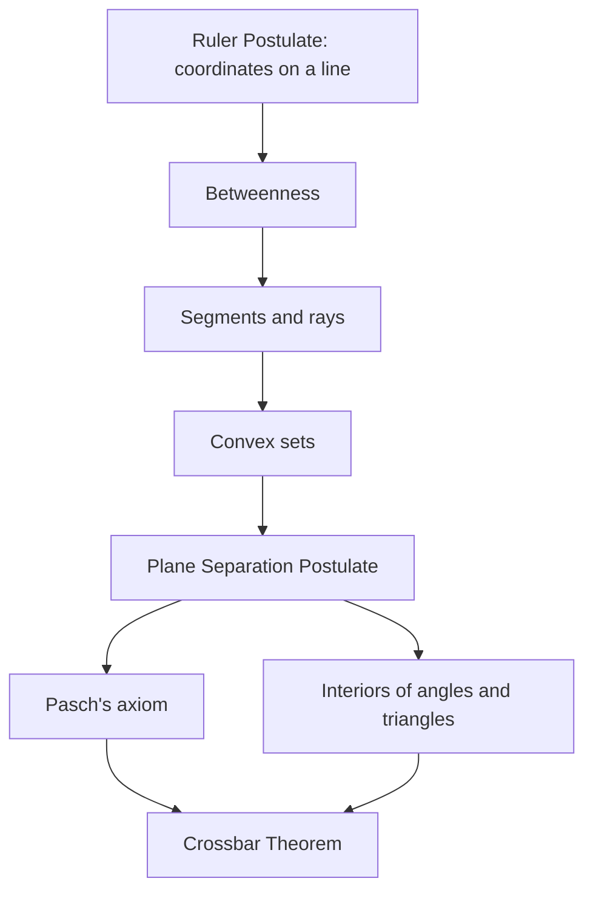

Lessons 1 and 2 used some words as if their meaning were obvious: a point is *between* two others, a point is *inside* an angle, a line *crosses* a side of a triangle. A proof is not allowed to lean on a drawing, yet for about two thousand years readers of Euclid accepted proofs that quietly used facts about "between" and "inside" that Euclid never stated. This honors lesson makes those ideas exact, as a college foundations-of-geometry course does, and ends with a famous false proof that shows what goes wrong without them.

## Betweenness made exact

The Ruler Postulate (Lesson 2) gives every point of a line a coordinate. That lets us define **betweenness** with numbers instead of pictures:

> $B$ is between $A$ and $C$ when $A$, $B$, $C$ are distinct points on one line and $AB + BC = AC$.

With coordinates $a$, $b$, $c$, this happens exactly when $b$ lies between $a$ and $c$ on the number line: either $a < b < c$ or $c < b < a$. Here is why. If $a < b < c$, then $AB + BC = (b - a) + (c - b) = c - a = AC$. If instead $b$ is outside, say $b > c > a$, then $AB + BC = (b - a) + (b - c)$, which is bigger than $c - a$ by $2(b - c) > 0$, so the equation fails.

Since three different numbers always have exactly one in the middle, we get a theorem that Euclid simply assumed: **of three distinct points on a line, exactly one is between the other two.** Betweenness then defines the familiar figures exactly. The segment $\overline{AC}$ is $A$, $C$ and every point between them. The ray $\overrightarrow{AC}$ is the segment $\overline{AC}$ together with every point $X$ such that $C$ is between $A$ and $X$.

### Example 1

**(a)** Points $X$, $Y$, $Z$ on a line have coordinates $9$, $-5$ and $2$. Which point is between the other two? **(b)** Three collinear points have $PQ = 6$, $QR = 10$ and $PR = 4$. Which is between the others?

**(a)** Order the coordinates: $-5 < 2 < 9$, so $Z$ (at $2$) is between $Y$ and $X$. Check with distances: $YZ = 7$, $ZX = 7$, $YX = 14$, and $7 + 7 = 14$.

**(b)** Try each point as the middle one. The middle point's two distances must add to the third distance. $QP + PR = 6 + 4 = 10 = QR$, so **$P$ is between $Q$ and $R$**. (The other tries fail: $PQ + QR = 16 \ne 4$ and $PR + RQ = 14 \ne 6$.)

## Convex sets

A set of points is a **convex set** if, whenever $P$ and $Q$ are in the set, the whole segment $\overline{PQ}$ is in the set too. Think "no dents and no holes". A segment, a ray, a line and a whole plane are convex. A circle (just the curve) is not: the segment joining two points of the circle passes through the inside, which is not part of the curve. A line with one point removed is not convex either, since the segment joining points on opposite sides of the gap would need the missing point.

One useful fact: **the intersection of convex sets is convex.** If $P$ and $Q$ belong to every one of the sets, then $\overline{PQ}$ lies in each set (each is convex), so it lies in their intersection. We'll use this to show that angle interiors and triangle interiors are convex.

## The Plane Separation Postulate

Draw a line on a sheet of paper and it splits the sheet into two sides. The postulate that makes this exact is the **Plane Separation Postulate**:

> A line $\ell$ in a plane divides the points of the plane that are not on $\ell$ into two sets, called **half-planes**, such that (1) each half-plane is convex, and (2) if $P$ is in one half-plane and $Q$ in the other, then $\overline{PQ}$ meets $\ell$.

The line $\ell$ is the *edge* of each half-plane and belongs to neither. Points in the same half-plane are *on the same side* of $\ell$, and a segment joining them never touches $\ell$; a segment joining points *on opposite sides* always does.

In space the same idea holds one dimension up: a plane separates the points of space not on it into two **half-spaces**.

**A coordinate test.** In the coordinate plane, write the line as $y = mx + b$ and compute $d = y - (mx + b)$ for a point. Points above the line give $d > 0$, points below give $d < 0$, and points on it give $d = 0$. So two points are on the same side exactly when their $d$-values have the same sign. When the signs differ, the segment crosses the line at the fraction $t = \dfrac{d_P}{d_P - d_Q}$ of the way from $P$ to $Q$, because $d$ changes at a steady rate along a segment and $t$ is where it reaches $0$.

### Example 2

Line $\ell$ is $y = 2x - 1$. Are $P(0, 3)$ and $Q(3, 1)$ on the same side of $\ell$? If not, where does $\overline{PQ}$ cross $\ell$?

**Step 1.** For $P$: $d_P = 3 - (2 \cdot 0 - 1) = 4$. For $Q$: $d_Q = 1 - (2 \cdot 3 - 1) = -4$.

**Step 2.** The signs differ, so $P$ and $Q$ are on opposite sides, and by the postulate $\overline{PQ}$ must meet $\ell$.

**Step 3.** $t = \dfrac{4}{4 - (-4)} = \dfrac12$, so the crossing is halfway: the midpoint $\left(\tfrac32, 2\right)$.

**Check.** $2 \cdot \tfrac32 - 1 = 2$, so $\left(\tfrac32, 2\right)$ is on $\ell$.

## Inside an angle, inside a triangle

Now "inside" can be defined without a picture. The **interior of an angle** $\angle ABC$ is the set of points that are on the same side of $\overleftrightarrow{BA}$ as $C$ *and* on the same side of $\overleftrightarrow{BC}$ as $A$. It is the intersection of two half-planes, so it is convex. The **exterior of an angle** is every point of the plane that is neither on the angle nor in its interior. This is the precise meaning of "$D$ is in the interior of $\angle ABC$" in the Angle Addition Postulate of Lesson 2.

The **interior of a triangle** $\triangle ABC$ is the intersection of three half-planes: the side of $\overleftrightarrow{BC}$ containing $A$, the side of $\overleftrightarrow{CA}$ containing $B$, and the side of $\overleftrightarrow{AB}$ containing $C$. Equivalently, it is the set of points in the interiors of all three of its angles. Again an intersection of convex sets, so it is convex.

### Example 3

$B = (0, 0)$, $A = (0, 4)$ and $C = (5, 0)$. Is $D(2, 3)$ in the interior of $\angle ABC$? Is $E(-1, 2)$?

**Step 1.** $\overleftrightarrow{BA}$ is the $y$-axis, and $C$ has $x = 5 > 0$. So the first half-plane is $x > 0$.

**Step 2.** $\overleftrightarrow{BC}$ is the $x$-axis, and $A$ has $y = 4 > 0$. So the second half-plane is $y > 0$.

**Step 3.** The interior is the open first quadrant, $x > 0$ and $y > 0$. $D(2, 3)$ passes both tests, so it is **in the interior**. $E(-1, 2)$ has $x < 0$, the wrong side of $\overleftrightarrow{BA}$, so it is **in the exterior**.

## Pasch's axiom

In 1882 the German mathematician Moritz Pasch pointed out a fact about triangles that Euclid used without stating:

> **Pasch's axiom.** If a line in the plane of a triangle crosses one side at a point between its endpoints and passes through no vertex, then it also crosses one of the other two sides.

A line that enters a triangle must leave it. Pasch, and David Hilbert in his 1899 axioms, took this as an axiom; in systems that assume the Plane Separation Postulate, as many textbooks since the 1960s do, it is a theorem.

### Example 4: proving Pasch's axiom from plane separation

*Given:* line $\ell$ crosses $\overline{AB}$ at a point $D$ between $A$ and $B$, and $\ell$ contains none of $A$, $B$, $C$. *Prove:* $\ell$ crosses $\overline{AC}$ or $\overline{BC}$, but not both.

**Step 1.** $\overline{AB}$ meets $\ell$ at $D$, and $A$, $B$ are not on $\ell$. If $A$ and $B$ were on the same side, $\overline{AB}$ would lie entirely in that convex half-plane and miss $\ell$. So $A$ and $B$ are on **opposite sides** of $\ell$.

**Step 2.** $C$ is not on $\ell$, so it lies in one of the two half-planes: the one containing $A$ or the one containing $B$.

**Step 3.** If $C$ is on $A$'s side, then $C$ and $B$ are on opposite sides, so $\overline{BC}$ meets $\ell$ (part 2 of the postulate). Meanwhile $\overline{AC}$ lies in one convex half-plane, so it does *not* meet $\ell$.

**Step 4.** If $C$ is on $B$'s side, the same reasoning shows $\overline{AC}$ meets $\ell$ and $\overline{BC}$ does not. $\blacksquare$

Notice the bonus: a line through no vertex can never cross all three sides of a triangle.

## The Crossbar Theorem

A close relative of Pasch's axiom is the **Crossbar Theorem**: if $D$ is in the interior of $\angle BAC$, then the ray $\overrightarrow{AD}$ meets the segment $\overline{BC}$. Think of $\overline{BC}$ as a crossbar between the angle's sides.

Lesson 13 used this silently. Its proof of the Base Angles Theorem says "draw the bisector of $\angle B$, meeting $\overline{AC}$ at $D$." Why must the bisector meet $\overline{AC}$ at all? The bisector passes through the interior of the angle, so the Crossbar Theorem guarantees it. The usual proof (outline only here) picks a point $E$ with $A$ between $E$ and $B$, applies Pasch's axiom to $\triangle EBC$ and the line $\overleftrightarrow{AD}$, and then uses half-planes to rule out every crossing except one on $\overline{BC}$ along the ray $\overrightarrow{AD}$.

## Why it matters: every triangle is isosceles?

Here is a famous false proof, popularized by W. W. Rouse Ball in the 1890s. Take any triangle $ABC$. Let $P$ be where the bisector of $\angle A$ meets the perpendicular bisector of $\overline{BC}$ (which meets $\overline{BC}$ at its midpoint $D$). Drop perpendiculars from $P$ to $E$ on $\overleftrightarrow{AB}$ and $F$ on $\overleftrightarrow{AC}$.

1. $\triangle AEP \cong \triangle AFP$ by AAS (right angles at $E$ and $F$, equal halves of $\angle A$, shared side $\overline{AP}$), so $AE = AF$ and $PE = PF$.
2. $P$ is on the perpendicular bisector of $\overline{BC}$, so $PB = PC$.
3. $\triangle PEB \cong \triangle PFC$ by HL, so $EB = FC$.
4. Therefore $AB = AE + EB = AF + FC = AC$.

Steps 1 to 3 are correct. Step 4 assumes that $E$ is between $A$ and $B$ and $F$ is between $A$ and $C$, as the false drawing suggests. In an accurate drawing of a triangle with $AB \ne AC$, the point $P$ lies *outside* the triangle, and one of the feet lands on a side while the other lands on an extension of a side. In the accurate drawing above, $F$ is between $A$ and $C$ but $B$ is between $A$ and $E$, so $AB = AE - EB$ while $AC = AF + FC$. The equations then give $AC - AB = 2\,EB$, not $AB = AC$. (Proving in general that $P$ is outside takes the circle theorems of Module 7: $P$ lies on the circle through $A$, $B$, $C$.) The error is purely one of betweenness, the very thing this lesson's postulates control.

## Common mistakes

- **Defining betweenness by the picture.** "It looks between" is not a reason. Use coordinates, or $AB + BC = AC$ for collinear points.
- **Forgetting that the edge belongs to neither half-plane.** A point on $\ell$ is on neither side of $\ell$.
- **Using "or" instead of "and" for an angle's interior.** The interior must pass *both* half-plane tests; passing one is not enough.
- **Calling a curve convex because the region it surrounds is convex.** A circle is not convex; the disk it bounds is.
- **Thinking a line can cross all three sides of a triangle.** Unless it goes through a vertex, it crosses exactly two or none.

## Key points

- $B$ is between $A$ and $C$ when the three are distinct, collinear and $AB + BC = AC$; of three collinear points exactly one is between the others.
- A convex set contains the segment joining any two of its points; intersections of convex sets are convex.
- Plane Separation: a line splits the rest of the plane into two convex half-planes, and a segment joins opposite sides only by crossing the line. Coordinate test: compare the signs of $y - (mx + b)$.
- Interiors of angles and triangles are intersections of half-planes, so they are convex.
- Pasch's axiom: a line entering a triangle through a side leaves through exactly one other side. The Crossbar Theorem: a ray into an angle meets any segment joining its sides.
- Careless betweenness is behind the false proof that every triangle is isosceles.
